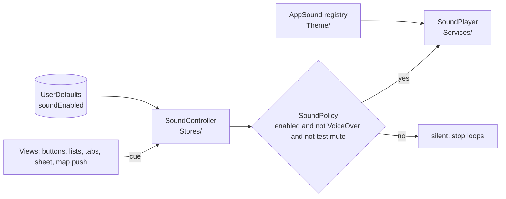

# Design: Interaction sounds

## Overview

Five owner-recorded sounds are named in a new `AppSound` registry in `Theme/`, in the same way `AppIcon` names icons. Views never play audio directly: they send a cue (`play(.hiss)`, `startLoop(.humanSteps)`) to a `SoundController` store, which applies a pure `SoundPolicy` (sounds on, VoiceOver off, no test mute) and forwards allowed cues to a `SoundPlaying` player built on `AVAudioPlayer`. The on/off choice is saved in UserDefaults and toggled from the Markets toolbar. On iOS and visionOS the audio session is ambient, so sounds follow the silent switch and mix with other apps.

**Technology stack (locked on approval):** Swift, SwiftUI (`onScrollPhaseChange`, `@Environment(\.accessibilityVoiceOverEnabled)`, `ButtonStyle`), AVFoundation (`AVAudioPlayer`, `AVAudioSession` on iOS and visionOS), Observation, OSLog. Swift Testing for unit tests, XCTest for UI tests. No new dependencies.



## What exists today (read from the source)

- **Sound files:** `Sounds/Human steps.m4a` (6.74 s, mono AAC 48 kHz), `Sounds/Cat steps.m4a` (1.37 s, mono), `Sounds/Door.m4a` (2.90 s, mono), `Sounds/Door and hit.m4a` (2.90 s, mono), `Sounds/Short hiss.m4a` (1.02 s, stereo). They are untracked at the repo root, outside the synchronized `NYCFarmerMarkets/` folder, so they are not bundled today.
- **Detail sheet:** `RootTabView` presents `.sheet(item: $store.selectedMarket)`. `MarketStore.selectedMarket` is set by the Markets rows (`MarketListView`), the Favorites rows (`FavoritesView`) and "More info" on the map card (`MarketMapView.MarketCard`). It is set back to nil when the sheet closes (Close or swipe down).
- **Single-market map:** `MarketDetailView` has `@State showsMap` and `.navigationDestination(isPresented: $showsMap)` pushing `MarketLocationMapView`. "Go to Map" sets `showsMap = true`; Back sets it to false; Close on the pushed map calls the sheet's `dismiss()`.
- **Tabs:** `RootTabView`'s `TabView` has no selection binding. The tab labels are `Text("Markets")`, `Text("Map")`, `Text("Favorites")` with `.appFont(.tabBarLabel)`. UI tests switch tabs with `app.tabBars.buttons[name]`.
- **Buttons:**
  - `ThemedButtonStyle` (`Theme/ThemeStyling.swift`) styles Retry (`SplashView`), More info, Go to Map and Directions; it reads `configuration.isPressed`.
  - Markets rows, Favorites rows and section headers use `.buttonStyle(.plain)`.
  - Close and the favorite toggle are `ToolbarItem`s in `MarketDetailToolbar`; the favorite toggle has `.sensoryFeedback(.selection, trigger: isFavorite)`.
  - Swipe-to-remove is a `.swipeActions` button in `FavoritesView`; Favorites rows also have an `accessibilityAction(named: "Remove from favorites")`.
- **Lists:** both are `List` with `.listStyle(.plain)`. `MarketListView` has `.refreshable` and `.id(dynamicTypeSize)` on its `NavigationStack`.
- **App entry:** `NYCFarmerMarketsApp.init()` registers fonts, applies `ThemeAppearance`, parses `LaunchOptions`, creates `MarketStore` and `FavoritesStore`, and injects them with `.environment(...)` on `AppRootView`.
- **Launch options:** `LaunchOptions` parses `-uiTestingReset`, `-uiTestingFailDownload`, `-uiTestingSplashMinimumSeconds`. UI tests pass `["-uiTestingReset"]` (`NYCFarmerMarketsUITests`) and `["-uiTestingReset", "-uiTestingFailDownload"]` (`SplashFailureUITests`). `testSplashAppearsAtLaunch` replaces the arguments with its own list.

## Key decisions

### 1. Where each cue is triggered

| Interaction | Sound | Trigger location | Why there |
|---|---|---|---|
| Markets list scrolls | Human steps, loop | `MarketListView` `List` `.onScrollPhaseChange` | Only the scroll view knows the phase |
| Favorites list scrolls | Cat steps, loop | `FavoritesView` `List` `.onScrollPhaseChange` | Same |
| Themed button pressed (Retry, More info, Go to Map, Directions) | Hiss | `ThemedButtonStyle` on `isPressed` false → true | One place covers every themed button |
| Row or section header pressed | Hiss | New `HissingPlainButtonStyle` (replaces `.plain`) | Same look as `.plain`, adds the cue |
| Close, favorite toggle | Hiss | In the button action, `MarketDetailToolbar` | Toolbar items may not honor custom styles |
| Swipe-to-remove (and its accessibility action) | Hiss | In the action, `FavoritesView` | Swipe actions ignore button styles |
| Sound toggle turned on | Hiss | In the toggle action, after enabling | Plays only when sound is on |
| Detail sheet opens | Door and hit | `RootTabView` `.onChange(of: store.selectedMarket?.id)` nil → id | Covers all three openers; fires once per opening |
| Single map pushed | Door and hit | `MarketDetailView` `.onChange(of: showsMap)` false → true | Fires on push only, not on Back |
| Tabs first appear | Door | `RootTabView` `.onAppear`, once (`@State` latch) | Tabs are created once after the splash |
| Tab changed | Door | `RootTabView` `.onChange(of: selection)` | Needs the new selection binding |

Rejected: playing Door_And_Hit from `MarketDetailView.onAppear`. That fires again when popping back from the pushed map (requirement 4.4), and twice if the sheet is rebuilt.

### 2. Tab selection

Add `private enum Tab: Hashable { case markets, map, favorites }` and `@State private var selection: Tab = .markets` in `RootTabView`, with `.tag(Tab.markets)` and so on on each tab. Labels, icons and accessibility do not change, so `selectTab()` in the UI tests keeps working. Selecting the current tab does not change `selection`, so no Door plays (requirement 5.3).

### 3. Step loops

`onScrollPhaseChange { old, new in ... }` reports `ScrollPhase` values: `.idle`, `.tracking`, `.interacting`, `.decelerating`, `.animating`. The policy maps them to a `ScrollActivity`:
- `.interacting` and `.decelerating` → `.scrolling` (user drag and coasting, requirement 2.3).
- `.idle` → `.stopped`.
- `.tracking` (finger down, not moved yet) and `.animating` (programmatic scroll, for example a section expanding) → no change, so they neither start nor stop a loop.

`SoundPolicy.loopAction(isLooping:activity:)` returns `.start`, `.stop` or `.none`; a second `.scrolling` while looping returns `.none` (requirement 2.3). Leaving the screen sends `.left`, which always stops. Each list view calls it from `onScrollPhaseChange`, `onDisappear`, and when `scenePhase` leaves `.active` (requirement 2.5). A tab change triggers `onDisappear` of the hidden tab's content; the Detail_Sheet does not, so `RootTabView` also calls `stopAllLoops()` when the sheet opens. The controller keeps one current loop; starting a different loop stops the other first (requirement 2.6).

Pull-to-refresh on the Markets list is a drag, so it plays Human steps while pulling. Accepted.

### 4. Hiss on press

`ThemedButtonStyle` and `HissingPlainButtonStyle` use `.onChange(of: configuration.isPressed) { _, pressed in if pressed { sounds.play(.hiss) } }`. A `ButtonStyle` is a value type and cannot hold `@Environment(SoundController.self)` in `makeBody` directly, so `makeBody` returns a small private view (`HissOnPress`) that reads the controller from the environment and attaches the `onChange`. If no controller is in the environment (previews), the view uses an optional environment and stays silent.

Press, not tap: the hiss plays when the finger goes down, even if the press is then cancelled by a scroll. On a list row, starting a scroll on a row may hiss; if the listening pass shows this is noisy, the fallback is to hiss in the row action instead (decided at task 5, reported in the PR).

### 5. Overlapping one-shots

`SoundPlayer` keeps one `AVAudioPlayer` per `AppSound`. `play(_:)` sets `currentTime = 0` and calls `play()`, so a repeated cue restarts its own sound instead of stacking copies (requirements 3.3 and 5.4). Different sounds may overlap (Hiss and Door_And_Hit, requirement 4.3).

### 6. Policy and VoiceOver

`SoundController.voiceOverOn` is set by `RootTabView` and `AppRootView` from `@Environment(\.accessibilityVoiceOverEnabled)` (`.onChange(of:initial: true)`). The environment value updates while the app runs, which covers requirements 7.2 and 7.3. Every cue passes `SoundPolicy.shouldPlay(enabled:voiceOverOn:testMuted:)`. When the result changes to false, the controller calls `player.stopAll()`.

### 7. Audio session

`SoundPlayer.init` calls, under `#if os(iOS) || os(visionOS)`, `try AVAudioSession.sharedInstance().setCategory(.ambient)` and `setActive(true)`. `.ambient` mixes with other audio and obeys the silent switch (requirements 8.1 and 8.2). No `.duckOthers`. On macOS there is no session (requirement 8.3). Errors are logged and ignored.

### 8. Test mute

`LaunchOptions.muteSounds` is true when `-uiTestingMuteSounds` is passed. `NYCFarmerMarketsApp` passes it into `SoundController(testMuted:)`. UI tests add it to every `launchArguments` list, including the relaunch in `testSplashAppearsAtLaunch`. The flag only silences; it is inert in normal launches, like the other test hooks.

## Type shapes

```swift
// Theme/AppSound.swift
nonisolated enum AppSound: String, CaseIterable, Sendable {
    case humanSteps, catSteps, door, doorAndHit, hiss
    var fileName: String        // "human-steps", "cat-steps", "door", "door-and-hit", "short-hiss"
    var fileExtension: String   // "m4a"
    var loops: Bool             // true for humanSteps, catSteps
}

// Models/SoundPolicy.swift
nonisolated enum ScrollActivity: Sendable { case scrolling, stopped, left }
nonisolated enum LoopAction: Equatable, Sendable { case start, stop, none }
nonisolated enum SoundPolicy {
    static func shouldPlay(enabled: Bool, voiceOverOn: Bool, testMuted: Bool) -> Bool
    static func activity(for phase: ScrollPhase) -> ScrollActivity?   // nil = no change
    static func loopAction(isLooping: Bool, activity: ScrollActivity) -> LoopAction
}

// Services/SoundPlayer.swift
protocol SoundPlaying: AnyObject {
    func play(_ sound: AppSound)
    func startLoop(_ sound: AppSound)
    func stopLoop(_ sound: AppSound)      // fades out over ~0.3 s
    func stopAll()
}
final class SoundPlayer: SoundPlaying { /* one preloaded AVAudioPlayer per AppSound */ }

// Stores/SoundController.swift
@Observable final class SoundController {
    var isEnabled: Bool { get set }        // persisted in UserDefaults "soundEnabled", default true
    var voiceOverOn: Bool                  // set from the environment
    private(set) var currentLoop: AppSound?
    init(defaults: UserDefaults = .standard, key: String = "soundEnabled",
         testMuted: Bool = false, player: any SoundPlaying = SoundPlayer())
    func play(_ sound: AppSound)
    func handle(_ activity: ScrollActivity, loop sound: AppSound)
    func stopAllLoops()
}
```

`SoundPolicy.activity(for:)` takes SwiftUI's `ScrollPhase`; `ScrollPhase` is a plain enum, so the function stays pure. If importing SwiftUI into `Models/` is unwanted, the mapping moves to a tiny extension in the view layer and the policy takes `ScrollActivity` only (decided at task 2).

`AppIcon` gets `soundOn` (`.symbol("speaker.wave.2.fill")`, "Sounds on") and `soundOff` (`.symbol("speaker.slash.fill")`, "Sounds off").

## Error handling

| Operation | Failure | Recoverable? | What the caller gets | Logging |
|---|---|---|---|---|
| Load a Sound_File at player init | File missing or unreadable | Yes | That sound is silent; others work | `Logger` (subsystem bundle id, category `sound`), `.error`, once per file, file name `.public` |
| `setCategory(.ambient)` | Session error | Yes | Default session; sounds may ignore the silent switch | `.error` once |
| `play()` returns false | Device audio busy | Yes | Nothing plays | Not logged (can happen often) |
| UserDefaults has no `soundEnabled` | First launch | Yes | `isEnabled = true` | None |

No failure crashes or reaches the user. No force unwraps; `Bundle.main.url(forResource:withExtension:)` results are optional-bound.

## Testing

Unit tests (Swift Testing, `NYCFarmerMarketsTests/`):
1. `AppSoundTests`: every case's file is found in the app bundle; file names are unique; exactly `humanSteps` and `catSteps` loop.
2. `SoundPolicyTests`: `shouldPlay` for all 8 combinations; `activity(for:)` for each `ScrollPhase`; `loopAction` for sequences: start → start (none) → stop; stop when not looping (none); left while looping (stop).
3. `SoundControllerTests` with a `FakeSoundPlayer` recording calls and a `UserDefaults(suiteName:)` removed after each test: default on; toggling saves; `play` forwarded only when allowed; turning off or `voiceOverOn = true` calls `stopAll`; starting a second loop stops the first; test mute blocks everything.
4. `LaunchOptionsTests`: `-uiTestingMuteSounds` sets `muteSounds`.

UI tests (XCTest):
- All launch argument lists gain `-uiTestingMuteSounds`.
- `testSoundToggleIsSaved`: tap `sound-toggle`, check its value flips; relaunch with `-uiTestingMuteSounds` only (no reset of the sound key); value kept; restore it at the end.

Manual listening pass on the iOS simulator and, if possible, a device (cannot be unit tested): scroll Markets and Favorites; each button once; open detail from all three places; Go to Map and Back; switch tabs quickly; toggle off; VoiceOver on; music playing in another app; silent switch on a device. Results go in the PR.

## Files

New:
- `NYCFarmerMarkets/Sounds/human-steps.m4a`, `cat-steps.m4a`, `door.m4a`, `door-and-hit.m4a`, `short-hiss.m4a` (moved with `git mv`, then the originals' folder `Sounds/` is empty and removed by git).
- `NYCFarmerMarkets/Theme/AppSound.swift`
- `NYCFarmerMarkets/Models/SoundPolicy.swift`
- `NYCFarmerMarkets/Services/SoundPlayer.swift`
- `NYCFarmerMarkets/Stores/SoundController.swift`
- `NYCFarmerMarketsTests/AppSoundTests.swift`, `SoundPolicyTests.swift`, `SoundControllerTests.swift`

Modified:
- `NYCFarmerMarkets/NYCFarmerMarketsApp.swift`: create and inject `SoundController`.
- `NYCFarmerMarkets/Models/LaunchOptions.swift`: `muteSounds`.
- `NYCFarmerMarkets/Theme/AppIcon.swift`: `soundOn`, `soundOff`.
- `NYCFarmerMarkets/Theme/ThemeStyling.swift`: hiss in `ThemedButtonStyle`; new `HissingPlainButtonStyle`.
- `NYCFarmerMarkets/Views/RootTabView.swift`: tab selection, Door, Door_And_Hit on sheet open, VoiceOver state.
- `NYCFarmerMarkets/Views/AppRootView.swift`: VoiceOver state while the splash shows (Retry hiss).
- `NYCFarmerMarkets/Views/MarketListView.swift`: sound toggle, Human steps loop, row and header button style.
- `NYCFarmerMarkets/Views/FavoritesView.swift`: Cat steps loop, row style, swipe-remove hiss.
- `NYCFarmerMarkets/Views/MarketDetailView.swift`: Door_And_Hit when `showsMap` becomes true.
- `NYCFarmerMarkets/Views/Shared/MarketDetailToolbar.swift`: hiss in Close and favorite toggle.
- `NYCFarmerMarketsTests/LaunchOptionsTests.swift`; `NYCFarmerMarketsUITests/*.swift` launch arguments and the toggle test.
- `.kiro/steering/theme-conventions.md`, `tech.md`, `known-limits.md`.
- Not modified: `project.pbxproj`, `Info.plist`.

## Assumptions to confirm

1. Hiss on press (finger down), with the row-action fallback if scrolling over rows is noisy.
2. Pull-to-refresh plays Human steps.
3. Swipe-down dismissal of the sheet is silent (no button pressed).
4. The tab bar items do not hiss; they play the Door.
