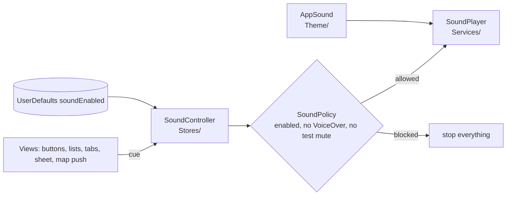

# Design: Interaction sounds (issue #14)

Branch: `feature/14-interaction-sounds`. Basis: the approved spec `.kiro/specs/interaction-sounds/design.md`, built against `01-requirements.md`. The record_spec step updates that same folder. This document keeps the approved decisions, resolves the two choices the approved design left open, and adds detail the implementer needs.

## Overview

The five recordings are named in a new `AppSound` registry in `Theme/`, as `AppIcon` names icons. Views never touch audio. They send a cue to a `SoundController` store (`play(.hiss)`, `handle(.scrolling, loop: .humanSteps)`). The controller asks the pure `SoundPolicy` whether sound is allowed (toggle on, VoiceOver off, no test mute) and forwards allowed cues to a `SoundPlaying` player implemented with `AVAudioPlayer`. The on/off choice is stored in UserDefaults and toggled from the Markets toolbar. On iOS and visionOS the audio session is `.ambient`.

**Technology stack (locked on approval):** Swift (language mode 5), SwiftUI (`onScrollPhaseChange`, `accessibilityVoiceOverEnabled`, `ButtonStyle`, `scenePhase`), AVFoundation (`AVAudioPlayer`; `AVAudioSession` on iOS and visionOS only), Observation, OSLog. Swift Testing for unit tests, XCTest for UI tests. No new dependencies.



## Facts from the code

- Sound files today: `Sounds/Human steps.m4a` (6.74 s), `Cat steps.m4a` (1.37 s), `Door.m4a` (2.90 s), `Door and hit.m4a` (2.90 s), `Short hiss.m4a` (1.02 s). Tracked in git at `Sounds/`, outside the synchronized folder, so not bundled.
- `RootTabView`: `TabView` without selection; `.sheet(item: $store.selectedMarket)`. `selectedMarket` is set by `MarketListView` rows, `FavoritesView` rows and "More info" in `MarketMapView.MarketCard`.
- `MarketDetailView`: `@State showsMap`, `.navigationDestination(isPresented:)` to `MarketLocationMapView`.
- `ThemedButtonStyle` (`Theme/ThemeStyling.swift`) is used by Retry, More info, Go to Map, Directions. `MarketListView` (lines 70, 113) and `FavoritesView` (line 48) use `.buttonStyle(.plain)` for rows and section headers. `FavoritesView` has `.swipeActions` and an accessibility action "Remove from favorites". `MarketListView` has no toolbar yet.
- `LaunchOptions` parses launch arguments with `arguments.contains(...)`. `NYCFarmerMarketsApp.init()` builds the stores and injects them with `.environment(...)` on `AppRootView`. `AppRootView` is the parent of both the splash and `RootTabView`.
- `AppIcon` is an exhaustive enum with `source` and `accessibilityName` switches; new cases need entries in both.

## Key decisions

### 1. Cue triggers

| Interaction | Sound | Trigger | Reason |
|---|---|---|---|
| Markets list scrolls | Human steps loop | `MarketListView` `List` `.onScrollPhaseChange` | Only the scroll view knows the phase |
| Favorites list scrolls | Cat steps loop | `FavoritesView` `List` `.onScrollPhaseChange` | Same |
| Retry, More info, Go to Map, Directions | Hiss | `ThemedButtonStyle`, on `isPressed` false to true | One place for all themed buttons; capsule buttons are not inside scrolling lists |
| Markets rows, Favorites rows, section headers | Hiss | Inside each button action (`sounds.play(.hiss)` before the existing work), `.buttonStyle(.plain)` unchanged | Fires on tap, never on a drag that starts a scroll, so hiss and step loop do not play together |
| Close, favorite toggle | Hiss | Inside the button action in `MarketDetailToolbar` | Toolbar items may ignore custom styles |
| Swipe-to-remove and its accessibility action | Hiss | Inside the action in `FavoritesView` | Swipe actions ignore button styles |
| Sound toggle turned on | Hiss | In the toggle action, after enabling | Plays only if the new state is on |
| Detail sheet opens | Door and hit | `RootTabView` `.onChange(of: store.selectedMarket?.id)` from nil to non-nil | Covers all three openers, once per opening |
| Single map pushed | Door and hit | `MarketDetailView` `.onChange(of: showsMap)` false to true | Push only, not Back |
| Tabs first appear | Door | `RootTabView` `.onAppear` with a `@State` latch | Once per launch |
| Tab changed | Door | `RootTabView` `.onChange(of: selection)` | Needs the new selection binding |

Rejected: door-and-hit from `MarketDetailView.onAppear`. It fires again when Back pops the map and again if the sheet is rebuilt (R4.3).

### 2. Tab selection

In `RootTabView` add `private enum Tab: Hashable { case markets, map, favorites }`, `@State private var selection: Tab = .markets`, `TabView(selection: $selection)` and `.tag(Tab.markets)` etc. on each tab. Labels and identifiers do not change, so UI tests that use `app.tabBars.buttons[name]` keep working. Selecting the shown tab does not change `selection`, so no door plays (R5.3).

### 3. Step loops

`SoundPolicy.activity(for: ScrollPhase) -> ScrollActivity?` maps: `.interacting` and `.decelerating` to `.scrolling`; `.idle` to `.stopped`; `.tracking` and `.animating` to `nil` (no change, so a section expand or a finger resting does not start or stop a loop). **Decision:** this function lives in `Models/SoundPolicy.swift` with `import SwiftUI` (`ScrollPhase` is a plain enum whose cases tests can construct). The approved design left the file open; this closes it.

`SoundPolicy.loopAction(isLooping:activity:)` returns `.start` for `.scrolling` when not looping, `.none` for `.scrolling` when looping, `.stop` for `.stopped` or `.left` when looping, `.none` otherwise. `isLooping` is `currentLoop == sound` for the sound being handled. The `List` calls `sounds.handle(activity, loop:)` from `onScrollPhaseChange`. It sends `.left` from `onDisappear` and when `scenePhase` becomes not `.active`.

`RootTabView` calls `sounds.stopAllLoops()` in two places: when the sheet opens (a sheet does not trigger `onDisappear` of the tab behind it) and in the `.onChange(of: selection)` handler (so tab changes do not depend on `onDisappear` firing).

Stop semantics (one rule): `.stopped`, `.left`, the scene change and `stopAllLoops()` all call `player.stopLoop(currentLoop)` (0.3 s fade) and set `currentLoop = nil` immediately. `stopAllLoops()` touches loops only; it never calls `player.stopAll()`, so the door-and-hit that plays as the sheet opens is not cut. Only `isEnabled = false` and `voiceOverOn = true` call `player.stopAll()` (hard stop of everything). Starting a loop while another is current hard-stops the other first (no fade), so at most one loop plays (R2.5). A `.stopped` or `.left` for a loop that is not `currentLoop` is ignored.

Early check (first code task, before building the rest): confirm in the simulator, with a temporary `Logger` line removed afterwards, that `onScrollPhaseChange` fires on both `List`s with `.interacting`, `.decelerating`, `.idle`, and that `onDisappear` fires on a tab switch. If `onScrollPhaseChange` does not fire on `List`, the fallback is an `onScrollGeometryChange` velocity check; the implementer stops and reports instead of choosing silently. Tab-change stopping already does not depend on `onDisappear`.

Pull-to-refresh on the Markets list is a drag, so it plays human steps while pulling. Accepted.

### 4. Hiss on press

Only `ThemedButtonStyle` plays on press. It returns a private view `HissOnPress` from `makeBody`. It reads `@Environment(SoundController.self)` as an optional (previews and tests have none, so it stays silent) and runs `.onChange(of: configuration.isPressed) { _, pressed in if pressed { sounds?.play(.hiss) } }`. A `ButtonStyle` value cannot hold an environment property used in `makeBody` directly, hence the small view.

**Decision (review finding 1):** rows, section headers, Close, the favorite toggle, swipe-to-remove and its accessibility action play the hiss inside the action closure (on tap). There is no `HissingPlainButtonStyle` and no fallback. R3.1 "press" is satisfied for list rows by the tap, which is the press that has an effect; a drag that scrolls the list plays only the step loop. The PR notes this.

### 5. Player behavior

`SoundPlayer` (MainActor, the project default) builds one `AVAudioPlayer` per `AppSound` at init and calls `prepareToPlay()`. The five files total a few hundred kilobytes, so synchronous init is accepted with a pass/fail bound: `SoundPlayer.init` must take under 50 ms on the simulator, measured once with `ContinuousClock` in a temporary log line (removed afterwards) and reported in the PR. If it exceeds 50 ms, move creation to a `Task` after first frame and report it. Loop sounds get `numberOfLoops = -1`.

- `play(_:)`: `currentTime = 0`, `setVolume(1, fadeDuration: 0)`, `play()`. A repeated cue restarts its own sound (R3.3, R5.4). Different sounds may overlap. Every cue calls `play()` again, so a player stopped by a system interruption (call, Siri) works again on the next cue; no interruption observer is added.
- `startLoop(_:)`: cancels the pending fade task for that sound, calls `player.setVolume(1, fadeDuration: 0)` (documented immediate change; assigning `volume` is not documented to cancel a running ramp), then `play()` if `!player.isPlaying`, so a scroll resumed during a fade keeps playing from its current position.
- `stopLoop(_:)`: `setVolume(0, fadeDuration: 0.3)`, then a stored per-sound `Task` sleeps 0.35 s, checks `Task.isCancelled`, and only then calls `stop()`, `currentTime = 0`, `setVolume(1, fadeDuration: 0)`.
- `stopAll()`: cancels fade tasks, stops every player at once, resets volume and position.

The resume-during-fade path cannot be unit tested (it needs real `AVAudioPlayer` timing); it is covered by the manual listening pass.

### 6. Policy and VoiceOver

`SoundController.voiceOverOn` is set in `AppRootView` only (it parents both splash and tabs) with `.onChange(of: voiceOverEnabled, initial: true)` from `@Environment(\.accessibilityVoiceOverEnabled)`. The value updates while the app runs (R7.2). `SoundController.canPlay` is `SoundPolicy.shouldPlay(enabled:voiceOverOn:testMuted:)`. When `isEnabled` becomes false or `voiceOverOn` becomes true, the controller calls `player.stopAll()` and clears `currentLoop`. When they flip back, nothing resumes by itself; the next scroll starts a loop.

### 7. Sound toggle

`MarketListView` gets `.toolbar { ToolbarItem(placement: .primaryAction) { SoundToggleButton() } }`. The button shows `AppIcon.soundOn.image` or `soundOff.image`, `accessibilityIdentifier("sound-toggle")`, `accessibilityLabel("Sounds")`, `accessibilityValue(isEnabled ? "On" : "Off")`. Its action calls `sounds.setEnabled(!sounds.isEnabled)` then `play(.hiss)` (the policy blocks the hiss when off). `AppIcon` gains `soundOn` (`speaker.wave.2.fill`, "Sounds on") and `soundOff` (`speaker.slash.fill`, "Sounds off"). The toggle is not blocked by VoiceOver mute: it stays usable and the choice is saved (R7.3).

### 8. Audio session

`SoundPlayer.init` under `#if os(iOS) || os(visionOS)` calls `setCategory(.ambient)` and `setActive(true)`. No `.duckOthers`, no `.interruptSpokenAudioAndMixWithOthers`. macOS has no session code.

### 9. Test mute

`LaunchOptions.muteSounds` is true when `-uiTestingMuteSounds` is in the arguments. `NYCFarmerMarketsApp` passes it to `SoundController(testMuted:)` and, when muted, uses a `SilentSoundPlayer` (no-op `SoundPlaying`) instead of `SoundPlayer`, so the UI tests neither activate the audio session nor load files. Every UI `launchArguments` list gains the flag: `NYCFarmerMarketsUITests.setUp`, the relaunch in `testSplashAppearsAtLaunch`, `SplashFailureUITests`, and `NYCFarmerMarketsUITestsLaunchTests.testLaunch` (which has no list today; it gets `app.launchArguments = ["-uiTestingMuteSounds"]`).

`-uiTestingReset` (`LaunchOptions.resetFavorites`, name unchanged) also runs `UserDefaults.standard.removeObject(forKey: "soundEnabled")` in `NYCFarmerMarketsApp.init`, so each UI test starts with sounds on. Its doc comment becomes "Clears persisted favorites and the sound setting".

## Type shapes

```swift
// Theme/AppSound.swift
nonisolated enum AppSound: String, CaseIterable, Sendable {
    case humanSteps, catSteps, door, doorAndHit, hiss
    var fileName: String      // "human-steps", "cat-steps", "door", "door-and-hit", "short-hiss"
    var fileExtension: String // "m4a"
    var loops: Bool           // humanSteps, catSteps
}
// Models/SoundPolicy.swift  (import SwiftUI for ScrollPhase)
nonisolated enum ScrollActivity: Sendable { case scrolling, stopped, left }
nonisolated enum LoopAction: Equatable, Sendable { case start, stop, none }
nonisolated enum SoundPolicy {
    static func shouldPlay(enabled: Bool, voiceOverOn: Bool, testMuted: Bool) -> Bool
    static func activity(for phase: ScrollPhase) -> ScrollActivity?
    static func loopAction(isLooping: Bool, activity: ScrollActivity) -> LoopAction
}
// Services/SoundPlayer.swift
protocol SoundPlaying: AnyObject {
    func play(_ sound: AppSound)
    func startLoop(_ sound: AppSound)
    func stopLoop(_ sound: AppSound)   // fade ~0.3 s
    func stop(_ sound: AppSound)       // hard stop, no fade
    func stopAll()
}
final class SoundPlayer: SoundPlaying {}
final class SilentSoundPlayer: SoundPlaying {}
// Stores/SoundController.swift
@Observable final class SoundController {
    // @ObservationIgnored private let: defaults, key, testMuted, player
    private(set) var isEnabled: Bool   // saved to UserDefaults "soundEnabled" by setEnabled(_:); default true
    private(set) var voiceOverOn = false
    func setEnabled(_ enabled: Bool)   // the only way to change isEnabled; saves it, stops all sounds when false
    func setVoiceOverOn(_ on: Bool)    // stops all sounds when VoiceOver turns on; resumes nothing by itself
    private(set) var currentLoop: AppSound?
    init(defaults: UserDefaults = .standard, key: String = "soundEnabled",
         testMuted: Bool = false, player: any SoundPlaying)
    func play(_ sound: AppSound)
    func handle(_ activity: ScrollActivity, loop sound: AppSound)
    func stopAllLoops()
}
```

`SoundController.init` has no default `player` (so `Stores/` does not construct a real player in tests by accident); the app passes it.

## Error handling

| Operation | Failure | Recoverable | Caller receives | Logging |
|---|---|---|---|---|
| Load a file at `SoundPlayer.init` (`Bundle.main.url` nil, or `AVAudioPlayer(contentsOf:)` throws) | Missing or unreadable | Yes | That sound is silent; others work | `Logger` (bundle id subsystem, category `sound`) `.error`, once per file, file name `privacy: .public`, error description `.private` |
| `setCategory` or `setActive` | Session error | Yes | Default session; the silent switch may be ignored | `.error` once, description `.private` |
| `play()` returns false | Device audio busy | Yes | Nothing plays | Not logged (frequent) |
| `soundEnabled` absent in UserDefaults | First launch | Yes | `isEnabled = true` | None |
| Fade task cancelled | `startLoop` or `stopAll` during fade | Yes | Fade abandoned, state reset by the canceller | None |

Nothing crashes or reaches the user. No force unwraps; URLs and players are optional-bound; a missing player in the dictionary makes the call a no-op.

## Validation of external inputs

- Launch argument `-uiTestingMuteSounds`: flag, optional, no value; presence only. Inert unless passed. It can only silence.
- UserDefaults `soundEnabled`: optional Bool via `object(forKey:) as? Bool`; any other type or absence gives `true`.
- Bundle files: validated by `AppSoundTests` at test time and by the load check at runtime.

## Invariant ownership

- "At most one loop plays": `SoundController` owns it (single `currentLoop`); `SoundPlayer` is not trusted to enforce it.
- "No sound when disabled, VoiceOver on or test muted": `SoundController` enforces it through `SoundPolicy` on every cue, including loop starts. Views cannot bypass it because they have no player reference.
- "Restart instead of stack": `SoundPlayer` owns it (one `AVAudioPlayer` per sound).
- "Door-and-hit once per opening": the view triggers (onChange transitions) own it.
- "No file names outside Theme": `AppSound` is the only place; checked by grep in the plan.

## Testing

Unit (Swift Testing, `NYCFarmerMarketsTests/`):
1. `AppSoundTests`: every case's file is in `Bundle.main`; names unique; exactly `humanSteps` and `catSteps` loop.
2. `SoundPolicyTests`: `shouldPlay` for all 8 combinations; `activity(for:)` for each `ScrollPhase`; `loopAction` for the sequences start, repeat (none), stop; stop when idle (none); left while looping (stop).
3. `SoundControllerTests` with `FakeSoundPlayer` and a temporary `UserDefaults(suiteName:)` removed afterward: default on; toggle saved; non-boolean stored value gives on; `play` forwarded only when allowed; turning off or `voiceOverOn = true` calls `stopAll`; a second loop stops the first; `.left` stops; a stop for a non-current loop is ignored; test mute blocks everything.
4. `LaunchOptionsTests`: `-uiTestingMuteSounds` sets `muteSounds`; absent leaves it false.

UI (XCTest): all launch lists add `-uiTestingMuteSounds`. `setUp` passes `-uiTestingReset`, which clears `soundEnabled`, so the test starts at the default "On" even if an earlier run failed midway. `testSoundToggleIsSaved` taps `sound-toggle`, checks the value is "Off", terminates and relaunches with only `-uiTestingMuteSounds` (no reset), checks the value is still "Off". No restore step is needed because the next `setUp` resets.

Not unit testable (manual listening pass, reported in the PR): real audio output, fade feel, loop gaps, silent switch, other-app mixing, VoiceOver on a device, macOS and visionOS audio.

## Files

New: `NYCFarmerMarkets/Sounds/{human-steps,cat-steps,door,door-and-hit,short-hiss}.m4a` (moved with `git mv`), `Theme/AppSound.swift`, `Models/SoundPolicy.swift`, `Services/SoundPlayer.swift` (with `SilentSoundPlayer`), `Stores/SoundController.swift`, `NYCFarmerMarketsTests/{AppSoundTests,SoundPolicyTests,SoundControllerTests}.swift`.

Modified: `NYCFarmerMarketsApp.swift`, `Models/LaunchOptions.swift`, `Theme/AppIcon.swift`, `Theme/ThemeStyling.swift`, `Views/RootTabView.swift`, `Views/AppRootView.swift`, `Views/MarketListView.swift`, `Views/FavoritesView.swift`, `Views/MarketDetailView.swift`, `Views/Shared/MarketDetailToolbar.swift`, `NYCFarmerMarketsTests/LaunchOptionsTests.swift`, `NYCFarmerMarketsUITests/*.swift`, `.kiro/steering/{theme-conventions,tech,known-limits}.md` (record sound registry, new launch flag, and known limits). Not modified: `project.pbxproj`, `Info.plist`.

## Edge cases

- Section expand or collapse (`.animating`) does not start a loop.
- Sheet opened while a loop plays: loop stops; closing the sheet does not restart it.
- App backgrounded mid-scroll: `scenePhase` handler stops the loop.
- Tab switch mid-scroll: `onDisappear` sends `.left`; the door plays at the same time as the fade.
- Rapid tab switching: each change restarts the door, never stacks.
- Search typing in Markets does not scroll the list; no sound.
- The toggle turned off during a loop: `stopAll`, no fade.
- Sheet opens from "More info" on the Map tab: the hiss (press) then door-and-hit.

## Assumptions to confirm (carried from the approved spec)

1. Themed capsule buttons hiss on finger down; rows and headers hiss on tap (changed from the approved spec's finger-down rule, see finding 1).
2. Pull-to-refresh plays human steps.
3. Swipe-down dismissal is silent.
4. Tab bar items do not hiss; they play the door.

## Responses to review findings

1. MEDIUM, row hiss trigger: addressed. Hiss in the action closure for rows and headers; `HissingPlainButtonStyle` and the fallback paragraph removed (Key decisions 1 and 4, Files, Assumptions). The spec's design.md must be amended the same way.
2. MEDIUM, loop stop semantics: addressed (Step loops). All stops except disable and VoiceOver fade 0.3 s; `stopAllLoops()` never calls `stopAll()`; tab change calls `stopAllLoops()` itself; an early simulator check of `onScrollPhaseChange` and `onDisappear` is the first code task.
3. MEDIUM, fade restart: addressed (Player behavior). `setVolume(1, fadeDuration: 0)` after cancelling the task, `Task.isCancelled` check before `stop()`, manual-pass note.
4. MEDIUM, UI test state: addressed (Test mute, Testing). `-uiTestingReset` clears `soundEnabled`; relaunch passes only the mute flag; restore step removed.
5. NIT, tracked files: fixed in Facts.
6. NIT, LaunchTests: addressed; the flag is added to `testLaunch`.
7. NIT, SoundPolicy imports SwiftUI: accepted and stated; `Models/SoundPolicy.swift` is the one `Models/` file that imports SwiftUI, because `ScrollPhase` is a plain enum tests can build.
8. NIT, `isLooping`: defined as `currentLoop == sound`.
9. NIT, `@ObservationIgnored`: added to the type shape; `defaults`, `key`, `testMuted`, `player` are `@ObservationIgnored private let`.
10. NIT, interruptions and launch cost: addressed (Player behavior): every cue re-calls `play()`; init bound is 50 ms with a stated fallback.

## Implementation notes (from design review round 2; the design loop was ended by the owner with these still open)

These notes override anything earlier in this document that conflicts with them. Treat them as requirements for the plan and the implementation.

1. **Hard stop of one sound: owner chose option B (was MEDIUM).** Add `func stop(_ sound: AppSound)` to `SoundPlaying`. It stops that one sound immediately: cancel its fade task, call `stop()`, set `currentTime = 0` and `setVolume(1, fadeDuration: 0)`. When a loop starts while a different loop is current, `SoundController` calls `player.stop(previous)` and then `player.startLoop(new)`, and sets `currentLoop = new`. Door, door-and-hit and hiss are not touched. `FakeSoundPlayer` records `stop(_:)`, and the test "a second loop stops the first" asserts `stop(.humanSteps)` is recorded before `startLoop(.catSteps)`.
2. **`ScrollPhase` future cases (NIT).** The `switch` in `SoundPolicy.activity(for:)` ends with `@unknown default: return nil`.
3. **Toolbar placement (NIT).** Attach the sound toggle's `.toolbar { ... }` to `content` next to `.navigationTitle("Markets")`, inside the `NavigationStack` (and so inside `.id(dynamicTypeSize)`), not outside it.
4. **Reset order and key constant (NIT).** Remove `soundEnabled` in the existing `-uiTestingReset` block of `NYCFarmerMarketsApp.init`, before `SoundController` is created. Define the key once as `SoundController.defaultsKey = "soundEnabled"` and use it in the store, the reset block and the tests.
5. **No `didSet` (NIT).** Use explicit methods: `isEnabled` is `private(set)`, changed through `setEnabled(_:)` (saves to UserDefaults, stops all sounds when turned off) and `setVoiceOverOn(_:)` (stops all sounds when VoiceOver turns on). The sound toggle and the views call these methods. The first `SoundControllerTests` cover each side effect.

## Amendment: palette test fix (owner-approved)

Date: 2026-11-14. Commit `9b16611` on this branch changed `AppPalette.onAppIconBackground` from `Base.surface` (`0xCBC7D9`, 2.31:1 on orange) to `Base.deep` (`0x31078C`, 3.57:1), so the splash logo, dots and text pass the 3.0 contrast test. `basePaletteMatchesDesign()` was updated to the current palette. This fixes two ThemeTests that fail on `main` since the "Spooky Colors" commit `e11636c`. It is outside the sound scope by the owner's choice. See `Design/design-changes.md`.
