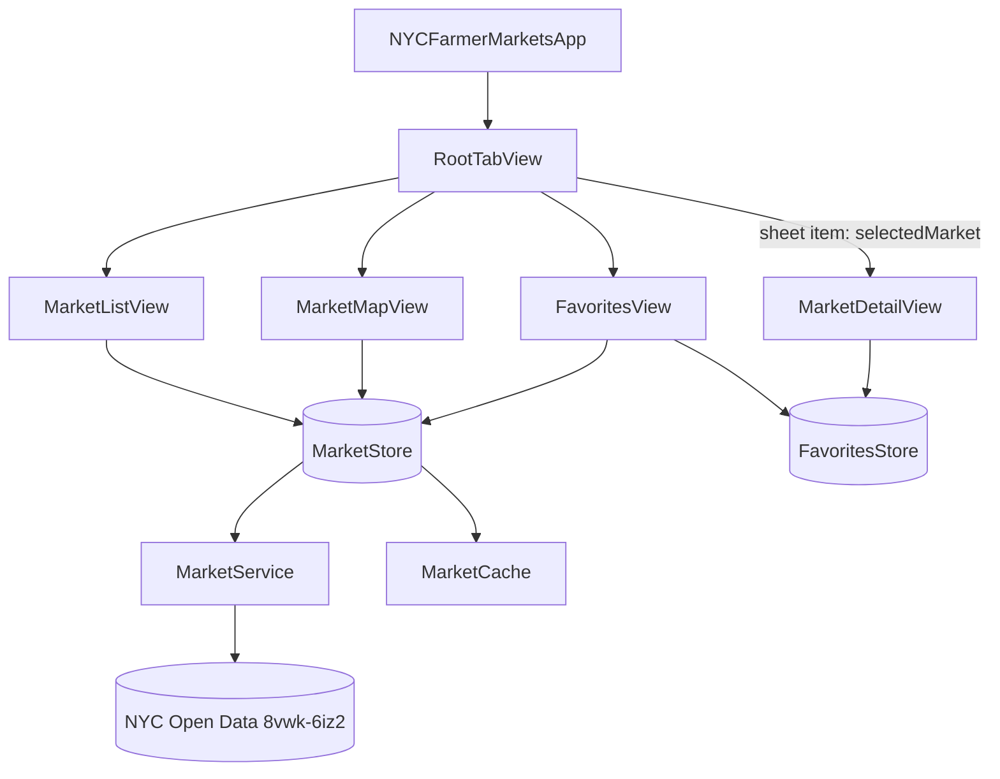

# Design Document

> Retroactive spec. This describes the app as built. Later changes (splash screen, collapsible boroughs, friendly failure messages) are covered by `.kiro/specs/splash-screen-collapsible-boroughs/`, and where they change something below it is noted.

## Overview

A SwiftUI app with two `@Observable` stores injected through the environment, a small data layer, and a theme layer that every view reads from.

| Topic | Decision |
|---|---|
| UI | SwiftUI `TabView` with three tabs: Markets, Map, Favorites |
| State | `MarketStore` (data, load state, selected market) and `FavoritesStore` (favorite IDs) |
| Detail sheet | One `.sheet(item:)` in `RootTabView`, bound to `MarketStore.selectedMarket`, so every tab shares it |
| Data | `MarketService` (URLSession) -> `MarketStore` -> `MarketCache` (JSON file) |
| Persistence | Markets in a JSON file in Application Support; favorite IDs in UserDefaults |
| Theming | `AppPalette` (colors, code only) and `AppIcon` (icons); views use no literals |
| Concurrency | Project default is MainActor isolation; pure types are marked `nonisolated` |

## Architecture

Change since this was written: `NYCFarmerMarketsApp` now shows `AppRootView` (splash gate), which creates `RootTabView` once data is available.

## Components and Interfaces

### Market model (`Models/Market.swift`)

`Market` is `Identifiable, Codable, Hashable, Sendable`. Fields: `id`, `name`, `borough`, `address`, `year`, `communityDistrict`, `latitude`, `longitude`, `daysOfOperation`, `hoursOfOperation`, `acceptsEBT`, `openYearRound`, `healthDeptCooking`.

- `Market.Raw` mirrors one API row (all strings). `Market.init?(raw:)` returns nil when the name is blank.
- `id` = `"<name lowercased>|<address lowercased>"`, so it is stable across downloads.
- Coordinates are parsed from text; blank, unparseable or `0` becomes nil. `coordinate` builds a `CLLocationCoordinate2D` when both exist.
- Text is trimmed. The EBT, year-round and cooking values get a capital first letter. Borough names are canonicalized, and blank becomes `"Unknown"`.

### Service (`Services/MarketService.swift`)

`MarketService(url:session:)` with `fetchMarkets() async throws -> [Market]`. The default URL is the Dataset endpoint with `$limit=5000`. A non-2xx response throws `MarketServiceError.badStatus(code)`. `MarketService.parse(_:)` is a static pure function: decode rows, keep the latest year only, then de-duplicate by `id`.

Dataset facts checked against the live API: 2218 rows across 2009-2026; the 2026 year has 103 unique markets, all with coordinates. Older years contain many rows without coordinates, which is why only the latest year is kept.

### Cache (`Services/MarketCache.swift`)

`MarketCache(fileURL:)` reads and writes the market array as JSON; `save` writes atomically and creates the folder. The default file is `markets-cache.json` in Application Support.

### MarketStore (`Stores/MarketStore.swift`)

State: `markets`, `state` (`idle`, `loading`, `loaded`, `error(String)`), `isShowingCachedData`, `selectedMarket`. Initializer takes the cache and a fetch closure so tests can inject both.

- `load()`: if there are no markets and the cache has some, show them (state `loaded`), then call `refresh()`.
- `refresh()`: set `loading` when empty; on success replace markets, clear the offline flag and save the cache; on cancellation restore the previous state; on any other failure keep existing markets and set `isShowingCachedData`, or enter `error` when there are none.

### FavoritesStore (`Stores/FavoritesStore.swift`)

Holds `ids: Set<String>`, persisted to UserDefaults (key `favoriteMarketIDs`) as a sorted array. Methods: `isFavorite`, `toggle`, `remove`, and `favorites(in:)`, which returns the favorites present in the data sorted by name. IDs with no matching market are skipped but stay stored.

### Grouping (`Models/MarketGrouping.swift`)

Pure. `matches(_:query:)` is a case- and diacritic-insensitive substring match on name, address and borough. `sections(from:query:)` filters, groups by borough in the fixed order (unknown boroughs last, alphabetical), sorts by name and drops empty sections.

### Views

- `RootTabView`: the `TabView`, tint from the palette, and the single `.sheet(item:)` for `MarketDetailView`. Originally it also called `store.load()`; that moved to `AppRootView`.
- `MarketListView`: `NavigationStack` with `List`/`Section` per borough, `.searchable`, `.refreshable`, an offline banner, and "No markets found". Section headers are tinted with the palette. (Collapsible sections were added later.)
- `MarketMapView`: SwiftUI `Map` with `Annotation` per mappable market and selection by ID. The pin is a circle with a bat icon (ghost for favorites); a selected pin is scaled up. A bottom card shows the name, borough and "More info", which sets `selectedMarket`. The offline banner is an overlay at the top.
- `FavoritesView`: `List` of favorites with `swipeActions` (Remove), a plain tap that sets `selectedMarket`, and a `ContentUnavailableView` empty state. No Edit button.
- `MarketDetailView`: `NavigationStack` with a Close button and the ghost favorite toggle in the toolbar, one themed card per field, and "Go to Map" via `MKMapItem`. On macOS it sets a minimum frame.
- `MarketRow`: shared row with the pumpkin icon, name, address (and borough in Favorites), days, and the favorite ghost.
- `OfflineBanner` and the `offlineBanner(_:)` modifier: a banner stacked above the content when the offline flag is set.

### Theme

`Theme/AppPalette.swift`:
- `AppPalette.Base` holds the only hex literals: primary C7D93D, secondary 98A62E, deep 525919, highlight E6F28D, surface F2F2F2 and the icon olive 78872B.
- `ColorToken` stores a light and dark `0xRRGGBB` value and produces a dynamic `Color` (UIKit or AppKit based).
- Semantic tokens: `background`, `card`, `cardSelected`, `textPrimary`, `textSecondary`, `accent`, `accentFill`, `onAccentFill`, `accentSecondary`, `sectionHeader`, `separator`, `appIconBackground`. Dark variants are mixes of the deep color with black or the other base colors, computed by `mix`.
- `luminance` and `contrast` implement the WCAG ratio so tests can check pairs.
- `cardSelected` dark uses a 12% mix of primary into deep; a 25% mix failed the 4.5:1 text check at 4.23.

`Theme/AppIcon.swift`: the `AppIcon` enum maps each role to an SF Symbol or a custom asset, plus `accessibilityName`. `IconView` renders an icon at a given size and hides itself from accessibility; callers supply labels.

Custom icons are single-color SVGs in the asset catalog with `template-rendering-intent: template`: `icon-ghost-filled`, `icon-ghost-outline`, `icon-bat`, `icon-pumpkin`.

`Theme/ThemeStyling.swift`: `themedBackground()`, `themedCard(selected:)`, `ThemedButtonStyle`, and `ThemeAppearance.apply()` which styles the tab bar and navigation tint. The navigation bar keeps the system look because a custom appearance made the large title disappear in testing.

### App icon

`Design/AppIcon.svg` (1024 x 1024, full-bleed olive rect, white 16-point strokes with round joins) is rendered to PNG with `qlmanage`, then redrawn through CoreGraphics without an alpha channel and scaled to 16, 32, 64, 128, 256, 512 and 1024. `AppIcon.appiconset/Contents.json` maps the 1024 file to the iOS slot (the dark and tinted variants stay empty) and the others to the macOS slots. The artwork is a redraw of the reference image, so it is close but not identical.

### Project configuration

- File-system-synchronized groups mean new files are picked up without editing the project file.
- `ENABLE_OUTGOING_NETWORK_CONNECTIONS = YES` was added to the app target so the macOS sandbox allows the download.
- Deployment targets: iOS 26.5, macOS 26.4.

## Data Models

See "Market model" above. The cache file is a JSON array of `Market`. Favorites are an array of ID strings in UserDefaults.

## Error Handling

| Situation | Behavior |
|---|---|
| Network failure, cache present | Keep cached markets, show the offline banner |
| Network failure, no cache | `error` state (originally shown in the Markets tab with a Retry button; now handled by the splash) |
| Non-2xx status | `MarketServiceError.badStatus`, handled as a failed download |
| Row without a name | Discarded |
| Row without a usable coordinate | Kept in the list, left off the map |
| Cancelled refresh | State restored, no error shown |
| Favorite ID missing from data | Skipped in the list, ID kept |

## Correctness Properties

### Property 1: Parsing keeps only current, unique, named markets

For any API response, `MarketService.parse` returns only rows of the highest year present, with no two results sharing an `id`, and none with a blank name.

**Validates: Requirements 1.2, 1.3, 1.4**

### Property 2: Coordinates are valid or absent

For any raw latitude and longitude text, a market's coordinate is present only when both parse to non-zero numbers.

**Validates: Requirements 1.5**

### Property 3: Market IDs are stable

For any name and address, the ID is the same regardless of letter case or surrounding calls, and two different name/address pairs differ.

**Validates: Requirements 1.3**

### Property 4: A failed refresh never loses data

For any non-empty market list in the store, a failed refresh leaves the list unchanged and sets the offline flag.

**Validates: Requirements 2.3**

### Property 5: Cache round trip

For any list of markets, saving then loading returns an equal list.

**Validates: Requirements 2.1**

### Property 6: Grouping is ordered, sorted and non-empty

For any markets and query, the sections follow the fixed borough order, each section's markets are sorted by name and belong to that borough, and no section is empty.

**Validates: Requirements 3.1, 3.2, 3.5**

### Property 7: Favorites toggle is an involution and persists

For any market, toggling twice restores the original state, and a new store instance reads back the same set.

**Validates: Requirements 6.1, 6.5**

### Property 8: Text tokens meet contrast

For each text/background token pair used in the UI, the contrast ratio is at least 4.5:1 in both appearances.

**Validates: Requirements 7.6**

## Testing Strategy

Unit tests (Swift Testing, `NYCFarmerMarketsTests`): `ModelAndServiceTests` (fixture JSON, a mocked `URLProtocol`), `CacheAndStoreTests`, `GroupingTests`, `FavoritesTests`, `ThemeTests`. Tests mostly use examples; Property 6 is covered by a seeded randomized test added later, and the others are covered by examples rather than generated inputs.

UI tests (`NYCFarmerMarketsUITests`, live API): open and close the detail sheet from the list; favorite a market, find it in Favorites, swipe to remove and see the empty state; open the detail sheet from a map pin; search with no result. They use the launch argument `-uiTestingReset` to clear favorites.

Manual checks: Dynamic Type, VoiceOver, iPad and Mac layout, and the look of the app icon on a device have not been verified.
