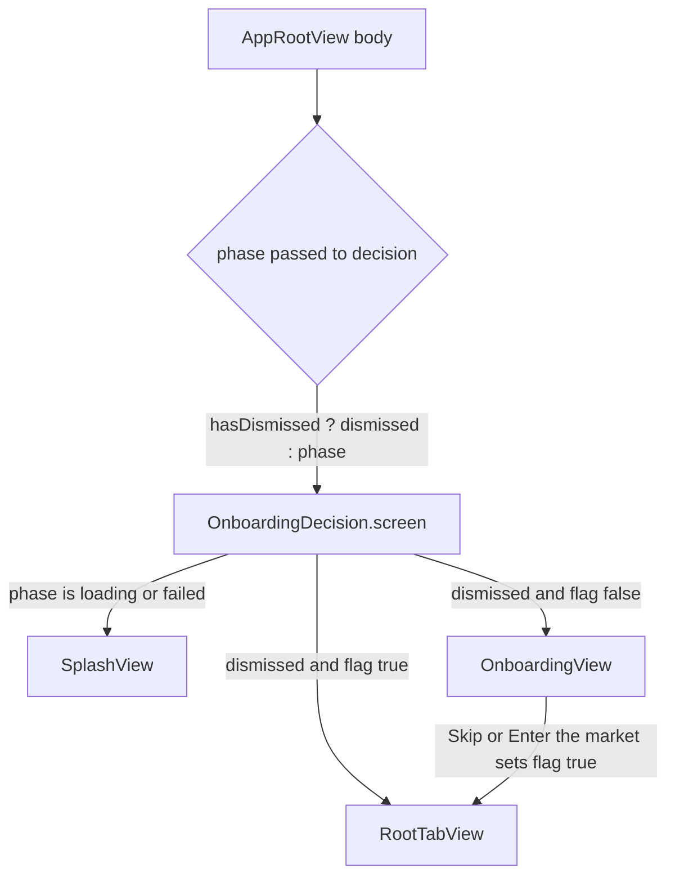
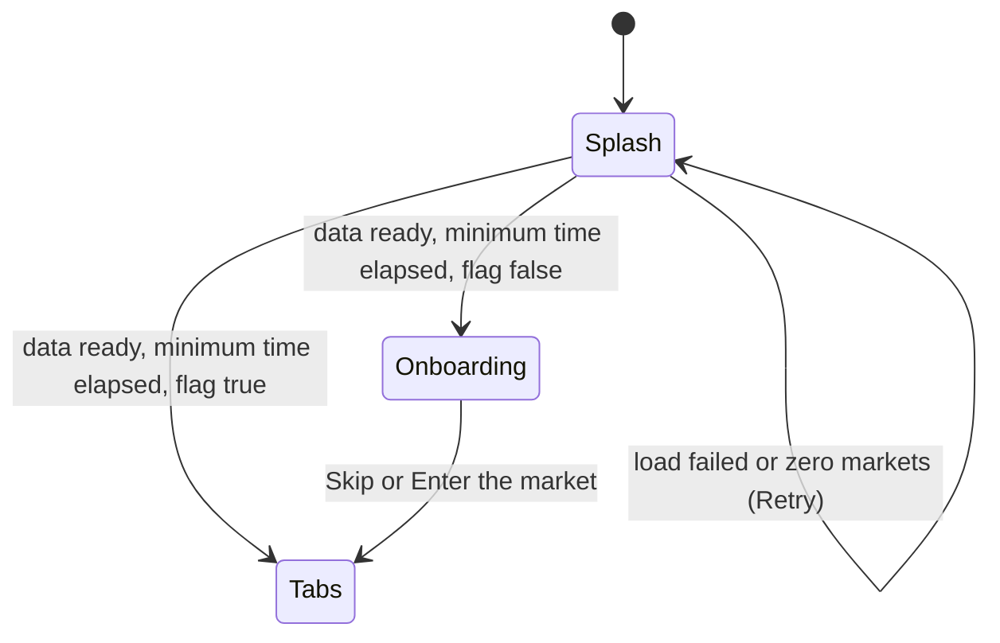
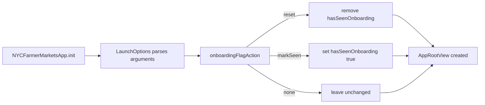

# Design Document

## Overview

This feature places the owner's `Onboarding/` views between the splash and the tabs. Onboarding shows once per install, after the first successful data load. The design changes four areas:

1. A pure `OnboardingDecision` in `Models/` chooses the screen (splash, onboarding or tabs) from the splash phase and the `hasSeenOnboarding` flag.
2. `AppRootView` owns the flag, calls the decision, and renders one of three screens. Its existing `hasDismissed` latch and single `store.load()` task stay as they are.
3. The three owner files are adjusted to the theme conventions: icons from `AppIcon`, text from `AppCopy`, fonts from `.appFont`, identifiers, an explicit hiss cue and Reduce Motion handling. Copy and the `.glass` buttons stay as written.
4. `LaunchOptions` gets two flags, and `NYCFarmerMarketsApp.init` applies a pure "flag action" to `UserDefaults` before the root view exists, so existing UI tests keep reaching the tabs.

Research: all findings come from the repo (no external research was needed). Facts that shape the design:

- `AppRootView` already latches `hasDismissed` through `.onChange(of: phase, initial: true)` and runs `store.load()` in a single `.task` on the root `ZStack`, outside any switched child. Keeping both there satisfies requirement 4.1 without new code.
- `RootTabView` plays `.door` in `.onAppear`, guarded by its own `@State hasAppeared`. If `RootTabView` is created only when the screen is `.tabs`, the door plays once after onboarding and never during it (requirements 8.2 to 8.4). No change to `RootTabView`.
- `SoundController.play(_:)` already applies `SoundPolicy` (sounds off, VoiceOver on, test muted). Views only send cues, so requirements 8.6 and 8.7 hold without new sound code.
- `AppTypography` has no emoji or hero-symbol role. Details are under Decisions.
- `LaunchOptions` parses flags with `arguments.contains(...)`. The new flags use the same pattern (requirement 9.6).
- Unit tests are hosted (they use `@testable import`), and `AppCopyTests` and `everyIconResolves` already iterate copy and `AppIcon.allCases`, so new strings and cases join existing checks.

### Design decisions

| Decision | Choice | Reason |
|---|---|---|
| Source of truth for the flag | `UserDefaults` key `hasSeenOnboarding`, read by one `@AppStorage` in `AppRootView`. `OnboardingView` receives a `Binding<Bool>` and writes through it. | One reader, one writer path. The owner's `@AppStorage` inside `OnboardingView` would be a second wrapper on the same key; passing a binding avoids it and keeps previews simple (`.constant(false)`). |
| How completion reaches the root | The binding. No callback. | Setting the flag changes `screen` in `AppRootView`, which swaps the view. A callback would duplicate this. |
| Screen choice | Pure `OnboardingDecision.screen(phase:hasSeenOnboarding:)` returning `RootScreen`. | Testable without SwiftUI (requirement 5). |
| Latch | `AppRootView` passes `hasDismissed ? .dismissed : phase` to the decision. | Same semantics as today: once the splash is dismissed it never returns, even if a later refresh changes `phase`. Using the latch in the same pass also avoids a one-frame gap between `phase` and the `onChange`. |
| Launch-flag precedence | Pure `OnboardingFlagAction` computed in `LaunchOptions`, applied by a small function that takes a `UserDefaults`. | Precedence and the write are unit tested with a throwaway suite (requirements 9.1 to 9.5, 10.2). |
| Hero symbol and emoji fonts | Emoji uses `.appFont(.splash)`, and the `splash` role grows from 40 to 44 pt. Hero symbol is drawn by `IconView(_, size: 72)`, so its size is set in `Theme/`. No new `AppTypography` role. | Requirements 7.3 and 7.8. See "Typography" below. |
| Buttons | Keep `.glass` and the tinted glass `Next` button. Send `.hiss` explicitly in the actions. | Owner decision. Plain-style buttons call `sounds.play(.hiss)` per `theme-conventions.md`. |

## Architecture

### Screen selection



### Screen states



There is no edge from Onboarding or Tabs back to Splash. The market load keeps running in the root `.task` while Onboarding shows (requirements 4.1 to 4.4).

### Launch flow



## Components and Interfaces

### `Models/OnboardingDecision.swift` (new, Foundation only)

```swift
import Foundation

/// The top-level screen the app shows.
nonisolated enum RootScreen: Equatable, Sendable {
    case splash, onboarding, tabs
}

nonisolated enum OnboardingDecision {
    /// `UserDefaults` key for "the user has finished or skipped onboarding".
    static let defaultsKey = "hasSeenOnboarding"

    /// Splash while loading or failed; once dismissed, onboarding until the flag is true, then tabs.
    static func screen(phase: SplashPhase, hasSeenOnboarding: Bool) -> RootScreen {
        guard phase == .dismissed else { return .splash }
        return hasSeenOnboarding ? .tabs : .onboarding
    }
}
```

No stored state, no clock, no counters (requirements 2.6, 5.1, 5.6). A missing key reads as false through `@AppStorage(...) = false` and through `UserDefaults.bool(forKey:)` (requirement 2.4).

### `Models/LaunchOptions.swift` (changed)

Added to the existing struct:

```swift
/// Marks onboarding as seen at launch. Argument: `-uiTestingSkipOnboarding`.
var skipOnboarding = false
/// Removes the onboarding flag at launch, so onboarding shows. Argument: `-uiTestingResetOnboarding`.
var resetOnboarding = false

/// What launch does to the onboarding flag. `-uiTestingResetOnboarding` wins over the other two.
nonisolated enum OnboardingFlagAction: Equatable, Sendable { case none, markSeen, reset }

var onboardingFlagAction: OnboardingFlagAction {
    if resetOnboarding { return .reset }
    if skipOnboarding || resetFavorites { return .markSeen }
    return .none
}
```

`init(arguments:)` adds `skipOnboarding = arguments.contains("-uiTestingSkipOnboarding")` and `resetOnboarding = arguments.contains("-uiTestingResetOnboarding")`. `contains` on `[String]` is exact and case-sensitive, and does not consume the next argument (requirement 9.6).

The write is a second pure-ish function in the same file, so a test can run it on a throwaway `UserDefaults(suiteName:)`:

```swift
extension LaunchOptions.OnboardingFlagAction {
    func apply(to defaults: UserDefaults, key: String = OnboardingDecision.defaultsKey) {
        switch self {
        case .none: break
        case .markSeen: defaults.set(true, forKey: key)
        case .reset: defaults.removeObject(forKey: key)
        }
    }
}
```

### `NYCFarmerMarketsApp.init` (changed)

After the existing `options.resetFavorites` block, one line:

```swift
options.onboardingFlagAction.apply(to: .standard)
```

It runs inside `init`, before `body` creates `AppRootView`, so `@AppStorage` reads the final value on its first access (requirements 9.1 to 9.5). The existing favorites and sound-setting clearing under `-uiTestingReset` is untouched.

### `Views/AppRootView.swift` (changed)

```swift
@AppStorage(OnboardingDecision.defaultsKey) private var hasSeenOnboarding = false

private var screen: RootScreen {
    OnboardingDecision.screen(phase: hasDismissed ? .dismissed : phase,
                              hasSeenOnboarding: hasSeenOnboarding)
}

var body: some View {
    ZStack {
        switch screen {
        case .splash:
            SplashView(phase: phase, hint: errorHint) { Task { await store.refresh() } }
                .transition(reduceMotion ? .identity : .opacity)
        case .onboarding:
            OnboardingView(hasSeenOnboarding: $hasSeenOnboarding)
                .transition(reduceMotion ? .identity : .opacity)
        case .tabs:
            RootTabView()
        }
    }
    .animation(reduceMotion ? nil : .easeInOut(duration: 0.3), value: screen)
    .task { await store.load() }            // unchanged: one load, from the root
    .task { try? await Task.sleep(for: minimumDisplayTime); minimumTimeElapsed = true }  // unchanged
    .onChange(of: phase, initial: true) { _, newValue in
        if newValue == .dismissed { hasDismissed = true }                                // unchanged latch
    }
    .onChange(of: voiceOverEnabled, initial: true) { _, enabled in sounds.setVoiceOverOn(enabled) }  // unchanged
}
```

Why this satisfies the requirements:

- 1.2, 2.1, 8.4: `RootTabView` exists only in the `.tabs` case. With the flag true, `screen` goes from `.splash` straight to `.tabs`; `.onboarding` is never produced.
- 4.1: both `.task` modifiers sit on the `ZStack`, which is not replaced when `screen` changes. Retry still calls `store.refresh()`.
- 4.4: the `phase` computed property sees a non-empty market list, so `errorMessage` is nil and an offline refresh failure shows nothing while Onboarding is up. The tabs show the offline banner as today.
- 4.5 to 4.7: `failed` and `loading` phases map to `.splash` for both flag values. After Retry succeeds, `phase` becomes `.dismissed` once the minimum time has elapsed, and the decision applies the flag.
- `SplashView` is still passed `phase` (not the latched value), as today.

### `Onboarding/OnboardingPage.swift` (changed)

- `HeroStyle` and `OnboardingPage` become `nonisolated` (and `Sendable`) so unit tests can read `OnboardingPage.all` without `@MainActor`. Both types hold only value data.
- `symbol: String` becomes `symbol: AppIcon`. Page values: `.onboardingShipping`, `.onboardingMap`, `.onboardingPeople`.
- All copy, ids, eyebrows, emoji, `heroImage` names and `heroStyle` values stay exactly as written. The page-to-asset mapping is already correct: page 0 `pirate-ship`, page 1 `map-image` (framed), page 2 `dairy-products-pallete`.
- The file stays in `Onboarding/`; the type is data, but it imports the theme icon type, so moving it to `Models/` is optional and not part of this feature.

### `Onboarding/OnboardingPageView.swift` (changed)

| Line today | Change | Requirement |
|---|---|---|
| `Image(systemName: "moon.stars.fill")` in bullets | `AppIcon.onboardingBullet.image` (still `.accessibilityHidden(true)`, still `.foregroundStyle(AppPalette.accentSecondary.color)`). The image inherits the environment body font, so it scales like the bullet text, as today. | 7.1, 6.2 |
| `Image(systemName: page.symbol).font(.system(size: 72))` | `IconView(page.symbol, size: 72)` | 7.1, 7.3 |
| `Text(page.emoji).font(.system(size: 44))` | `Text(page.emoji).appFont(.splash)` | 7.3, 7.8 |
| Title `Text` | add `.accessibilityAddTraits(.isHeader)` | 6.5 |
| `ScrollView` | add `.accessibilityIdentifier("onboarding-page-\(page.id)")` | 7.5 |

Everything else stays: the `hero` view is `.accessibilityHidden(true)` as a whole (this covers the image, the emoji and the symbol, requirement 6.2); eyebrow, title, message and the bullets are separate `Text` views in top-to-bottom order (requirements 6.5, 6.6); the `ScrollView` with `contentMargins` and `.scrollBounceBehavior(.basedOnSize)` scrolls at every Dynamic Type size (requirement 6.3). The `#Preview` is unchanged.

### `Onboarding/OnboardingView.swift` (changed)

```swift
struct OnboardingView: View {
    @Binding var hasSeenOnboarding: Bool
    @Environment(SoundController.self) private var sounds
    @Environment(\.accessibilityReduceMotion) private var reduceMotion
    @State private var selection = 0
    ...
}
```

Changes, in order:

1. Replace `@AppStorage("hasSeenOnboarding")` with `@Binding var hasSeenOnboarding: Bool`. `#Preview` becomes `OnboardingView(hasSeenOnboarding: .constant(false)).environment(SoundController(testMuted: true, player: SilentSoundPlayer()))`.
2. Root: put `.accessibilityElement(children: .contain)` and `.accessibilityIdentifier("onboarding-screen")` on the `GeometryReader` content, as `SplashView` does for `splash-screen`. Without `.contain` the identifier would be copied onto every child.
3. Skip button: `Button(AppCopy.onboardingSkip, action: skip)`, `.accessibilityLabel(AppCopy.onboardingSkip)`, `.accessibilityIdentifier("onboarding-skip")`, `.opacity(isLast ? 0 : 1)`, `.disabled(isLast)` and new `.accessibilityHidden(isLast)` (requirements 3.5, 3.7, 6.1).
4. Page indicator: the label becomes `AppCopy.onboardingPageIndicator(page: selection + 1, count: pages.count)`, plus `.accessibilityIdentifier("onboarding-page-indicator")`. It keeps `.accessibilityElement(children: .ignore)`, so it stays one element with no value (requirements 3.9, 6.8, 7.4).
5. Next button: `Text(AppCopy.onboardingPrimaryLabel(isLast: isLast))`; `.accessibilityLabel` with the same string; `.accessibilityIdentifier("onboarding-next")`. The button keeps `.buttonStyle(.plain)` and the tinted `.glassEffect(... .interactive())` (requirements 3.2, 3.3, 6.1, 7.5).
6. Actions:

```swift
private func skip() {
    guard !hasSeenOnboarding else { return }   // repeated taps while the view is leaving
    sounds.play(.hiss)
    hasSeenOnboarding = true
}

private func advance() {
    guard !hasSeenOnboarding else { return }
    sounds.play(.hiss)
    if isLast {
        hasSeenOnboarding = true
    } else if reduceMotion {
        selection += 1
    } else {
        withAnimation(.easeInOut) { selection += 1 }
    }
}
```

   - `advance` only runs `selection += 1` when `!isLast`, so the page never exceeds the last index. `selection` never goes below 0 because no code decrements it (swipes are clamped by the page `TabView`).
   - The guard makes the flag write happen at most once and the hiss play at most once per effective tap; once the flag is true the root swaps the view (requirement 3.10).
   - The flag is written through the binding, which is `UserDefaults` itself, before the root re-evaluates `screen` (requirement 2.2).
   - A swipe changes only `selection`, so labels and the Skip state follow `isLast` with no extra code, and no cue is sent (requirements 3.8, 8.5).
   - Reduce Motion: no `withAnimation` for the programmatic change (requirement 6.4). Whether the paged `TabView` still slides without a transaction is verified manually (see Testing Strategy).

### `Theme/AppIcon.swift` (changed)

New cases, each with a `source` and an `accessibilityName` (the exhaustive switches force both):

| Case | Source | Accessibility name |
|---|---|---|
| `onboardingBullet` | `.symbol("moon.stars.fill")` | "Bullet" |
| `onboardingShipping` | `.symbol("shippingbox.fill")` | "Shipping" |
| `onboardingMap` | `.symbol("map.fill")` | "Map" |
| `onboardingPeople` | `.symbol("person.2.fill")` | "Neighbors and growers" |

`.openInMaps` already uses `map.fill`, but it is named "Go to Map" and may change independently, so onboarding gets its own case. The names are used only if an icon is ever exposed; the onboarding views hide these icons.

### `Theme/AppCopy.swift` (changed)

```swift
// MARK: Onboarding
static let onboardingSkip = "Skip"
static let onboardingNext = "Next"
static let onboardingEnter = "Enter the market"

static func onboardingPrimaryLabel(isLast: Bool) -> String { isLast ? onboardingEnter : onboardingNext }
static func onboardingPageIndicator(page: Int, count: Int) -> String { "Page \(page) of \(count)" }
```

These strings are visible text and also the accessibility labels, because the requirements ask for labels equal to the visible text (6.1, 7.4). The page copy itself stays in `OnboardingPage.all`, unchanged. `AppCopyTests.allVisibleStrings` gets the three labels and one indicator string so the existing tone checks cover them.

### Typography

The roles are `splash` (44), `splashHint`, `tabTitle`, `tabBarLabel`, `navigationTitle`, `detailTitle`, `sectionHeader`, `favoriteItemTitle`, `body`, `bodyEmphasis`, `subheadline`, `caption`, `footnote`. The onboarding files already use `.footnote`, `.detailTitle`, `.body` and `.bodyEmphasis`, which exist.

- Emoji (44 pt today): the emoji uses `.appFont(.splash)`. The `splash` role changes from 40 to 44 pt (requirement 7.8) so the emoji keeps its current 44 pt size. The role stays in the display family and scales with Dynamic Type. Grim Creeper has no emoji glyphs, so the system draws them from its fallback font at the requested size. No new role is added.
- The change is one line in `Theme/AppTypography.swift`: `case .splash: 40` becomes `case .splash: 44`. Display roles are not scaled (`effectiveSize == size`), so `effectiveSize` also becomes 44.
- Other `.splash` users: only `SplashView` uses `.appFont(.splash)` besides onboarding, for the failure message (`splash-error`). That message grows from 40 to 44 pt. The loading caption in `SplashLoadingIndicator` uses `.splashHint` (22 pt) and does not change. The failure message already wraps (`fixedSize(horizontal: false, vertical: true)`, centered), so the extra 4 pt needs no layout change; check it at large Dynamic Type sizes during the manual pass.
- `AppTypographyTests` pins no splash size or derived value today. `displayRolesKeepTheirDesignSize` asserts `effectiveSize == size` for every display role and passes unchanged. One example test is added to pin `splash` at 44 (requirements 7.8, 10.13).
- Hero symbol (72 pt): a text role cannot express this size (the largest, `splash`, is 44). `IconView` draws the symbol at 72 pt, and the size is set inside `Theme/AppIcon.swift`, which already calls `.font(.system(size:))` in the Theme folder and hides itself from VoiceOver. This satisfies requirement 7.3 as worded: `Onboarding/` contains no `.font(` call, `Font.system` or `Font.custom`, and every text font, including the emoji, goes through `.appFont`. No requirement amendment is needed.

### Docs (changed)

- `tech.md`, "Launch arguments": add `-uiTestingSkipOnboarding` (writes `hasSeenOnboarding = true` at launch) and `-uiTestingResetOnboarding` (removes the flag so onboarding shows; wins over `-uiTestingSkipOnboarding` and `-uiTestingReset`). State that `-uiTestingReset` also writes `true` unless the reset argument is present. Add `OnboardingDecision` and `Onboarding/` to the Layout list.
- `theme-conventions.md`: in the Fonts role list, change `splash` (40) to `splash` (44). Add `AppIcon` cases `onboardingBullet`, `onboardingShipping`, `onboardingMap`, `onboardingPeople`; add the onboarding strings to the Copy section; note that onboarding buttons use `.glass` and call `sounds.play(.hiss)` explicitly; note that the onboarding emoji uses `.splash` and the hero symbol size is set by `IconView`; list the identifiers.
- `product.md`: add the onboarding screen to the Screens list between Splash and Tabs, and the flag `hasSeenOnboarding` under Data.
- Per `git-and-workflow.md`, no change to the workflow files is needed.

## Data Models

| Name | Kind | Where | Notes |
|---|---|---|---|
| `RootScreen` | `nonisolated enum` (`splash`, `onboarding`, `tabs`) | `Models/OnboardingDecision.swift` | Output of the decision. |
| `OnboardingDecision` | `nonisolated enum` (namespace) | same | `defaultsKey`, `screen(phase:hasSeenOnboarding:)`. |
| `LaunchOptions.OnboardingFlagAction` | `nonisolated enum` (`none`, `markSeen`, `reset`) | `Models/LaunchOptions.swift` | `apply(to:key:)` performs the write. |
| `LaunchOptions.skipOnboarding`, `.resetOnboarding` | `Bool` | same | Default false. |
| `OnboardingPage`, `HeroStyle` | `nonisolated struct` / `enum`, `Sendable` | `Onboarding/OnboardingPage.swift` | `symbol` becomes `AppIcon`. |
| `hasSeenOnboarding` | `Bool` in `UserDefaults`, absent means false | `OnboardingDecision.defaultsKey` | Read by `AppRootView` only; written by `OnboardingView` through a binding and by launch arguments. |

### Accessibility identifiers

| Identifier | Element |
|---|---|
| `onboarding-screen` | Root view (container) |
| `onboarding-skip` | Skip button |
| `onboarding-next` | Next / "Enter the market" button |
| `onboarding-page-indicator` | Page dots |
| `onboarding-page-0`, `-1`, `-2` | Scroll view of each page |

Existing identifiers are not renamed.

### Sound behavior summary

| Moment | Cue | Where |
|---|---|---|
| Tap Skip | `.hiss` once | `OnboardingView.skip()` |
| Tap Next (any page, including "Enter the market") | `.hiss` once | `OnboardingView.advance()` |
| Swipe between pages | none | no code |
| Tabs appear after onboarding | `.door` once | `RootTabView.onAppear`, created only after the flag is true |
| VoiceOver on, sounds off, `-uiTestingMuteSounds` | nothing plays | `SoundController` / `SoundPolicy` (unchanged) |

## Correctness Properties

*A property is a characteristic or behavior that should hold true across all valid executions of a system-essentially, a formal statement about what the system should do. Properties serve as the bridge between human-readable specifications and machine-verifiable correctness guarantees.*

Reflection: the prework found these testable pure behaviors. Merged: the four decision-table cases, the "failed or loading" cases and the statelessness checks are separate enough to keep as three properties (table, message independence, history independence). The launch precedence rules for requirements 9.1 to 9.5 are one mapping, so they are one property, and the write effect is a second. The label helpers for 3.2, 3.3, 3.9 and 7.4 merge into one property over page indices. The page-content rules (5.7, 10.3) and the asset check (7.7, 10.12) merge into two properties (content shape, asset resolution). UI-only criteria (swipe, tab absence, VoiceOver, Reduce Motion, sounds in the views) are covered by example tests or manual checks in the Testing Strategy.

### Property 1: Decision table

For any splash phase and any flag value, `OnboardingDecision.screen` returns `.splash` when the phase is `.loading` or `.failed`, `.onboarding` when the phase is `.dismissed` and the flag is false, and `.tabs` when the phase is `.dismissed` and the flag is true.

**Validates: Requirements 1.1, 2.1, 5.2, 5.3, 5.4**

### Property 2: Failure message does not matter

For any message string (empty, whitespace only, long, non-ASCII) and any flag value, `OnboardingDecision.screen(phase: .failed(message:), ...)` returns `.splash`. It never returns `.onboarding` or `.tabs`.

**Validates: Requirements 4.5, 4.7, 5.2**

### Property 3: Decision has no memory

For any sequence of (phase, flag) inputs, the result for each input equals the result of evaluating that input alone. In particular, evaluating `(.dismissed, false)` and then `(.dismissed, true)` returns `.onboarding` then `.tabs`, and evaluating the same input twice returns the same screen.

**Validates: Requirements 2.6, 5.5, 5.6**

### Property 4: Launch arguments parse by exact match

For any list of arguments made from the known flags, near-miss strings (for example `-uiTestingResetOnboardingX`, `uiTestingSkipOnboarding`, different case) and unrelated strings, in any order, `skipOnboarding` is true exactly when `"-uiTestingSkipOnboarding"` is an element, `resetOnboarding` is true exactly when `"-uiTestingResetOnboarding"` is an element, and both are false for an empty list. The next element of the list is never read as a value.

**Validates: Requirements 9.1, 9.2, 9.5, 9.6, 10.2**

### Property 5: Onboarding flag action precedence

For any combination of `resetFavorites`, `skipOnboarding` and `resetOnboarding` (all 8), `onboardingFlagAction` is `.reset` when `resetOnboarding` is true, otherwise `.markSeen` when `skipOnboarding` or `resetFavorites` is true, otherwise `.none`.

**Validates: Requirements 9.1, 9.2, 9.3, 9.4, 9.5, 10.2**

### Property 6: Applying a flag action writes the right value

For any starting stored state (absent, true, false) and any `OnboardingFlagAction`, applying the action to a fresh `UserDefaults` suite leaves the flag true for `.markSeen`, absent for `.reset`, and unchanged for `.none`. Applying the same action a second time leaves the same state. The decision for the stored value (absent read as false) matches the table in Property 1.

**Validates: Requirements 2.4, 9.1, 9.2, 9.3, 9.5**

### Property 7: Button and indicator labels follow the page

For any page index `i` in `0..<M` and any page count `M >= 1`, `AppCopy.onboardingPrimaryLabel(isLast: i == M - 1)` is "Enter the market" when `i == M - 1` and "Next" otherwise, and `AppCopy.onboardingPageIndicator(page: i + 1, count: M)` equals "Page \(i + 1) of \(M)".

**Validates: Requirements 3.2, 3.3, 3.9, 6.1, 6.8, 7.4**

### Property 8: Page content shape

For any page in `OnboardingPage.all`, the title, eyebrow and message contain a non-whitespace character and the page has exactly three bullets, each with a non-whitespace character. The array has exactly three pages and their ids are pairwise distinct.

**Validates: Requirements 1.4, 5.7, 10.3**

### Property 9: Hero images exist

For any page in `OnboardingPage.all` with a non-nil `heroImage`, an image with that name resolves in the app bundle's asset catalog. Each of `dairy-products-pallete`, `map-image` and `pirate-ship` is used by exactly one page, and no other image name appears.

**Validates: Requirements 7.7, 10.12**

## Error Handling

- No new technical errors exist: onboarding does no I/O of its own. Market load failures still follow the existing path (`LoadFailureMessage`, logged by `MarketStore`/`MarketService`); nothing is added to `print` or user-visible text.
- Failure with no data keeps the splash (failure message and Retry) for both flag values, and onboarding is never shown on top of a failure (Property 2, requirements 4.5, 4.7).
- Failure with cached data while onboarding is shown: no message, no interruption; the offline banner appears on the tabs (requirement 4.4).
- Cancellation: unchanged. `store.load()` cancellation (for example when the root view goes away) restores the previous state, as today.
- Missing or corrupt flag: `UserDefaults` returns false for an absent key or a non-boolean value, so the user sees onboarding once more. This is the safe direction.
- Missing hero image at runtime: `Image(name)` would draw nothing. Property 9 catches this in tests, so no runtime fallback is added.
- A double tap on Skip or Next while the view is leaving is ignored by the `hasSeenOnboarding` guard, so the flag is written once and the hiss plays once.
- `-uiTestingResetOnboarding` combined with `-uiTestingSkipOnboarding` or `-uiTestingReset` removes the flag (precedence in Property 5). Test authors who want tabs must not pass it.

## Testing Strategy

### Approach

Property-based testing applies to the pure logic: `OnboardingDecision`, `LaunchOptions` parsing and precedence, the flag write, the label helpers and the page data. The domains here are small and finite (3 phases × 2 flags, 3 booleans, a few page indices), so each property is tested by exhaustive enumeration with Swift Testing parameterized `@Test(arguments:)` instead of random generation. That covers more than 100 random iterations would. The project allows no third-party dependencies and the workflow forbids writing a property-test library from scratch, so no generator library is added. Properties over open-ended inputs (Property 2 message strings, Property 4 argument lists) use a fixed list of edge values plus combinations built from the known flags; this is stated in each test's comment.

Each property test carries a comment: `// Feature: onboarding-flow, Property N: <title>`. Each property is one `@Test` (parameterized where the domain is enumerated).

UI rendering, the swipe gesture, VoiceOver order and Reduce Motion are not suited to property tests; they use XCTest UI tests and a manual checklist.

### Unit tests (Swift Testing, `NYCFarmerMarketsTests/`)

| File | Tests | Properties | Requirements |
|---|---|---|---|
| `OnboardingDecisionTests.swift` (new) | Table over `[.loading, .failed("x"), .dismissed] × [false, true]`; failed with varied messages; interleaved calls and same-input-twice | 1, 2, 3 | 1.1, 2.1, 2.6, 4.5, 4.7, 5.2 to 5.6, 10.1 |
| `LaunchOptionsTests.swift` (changed) | Neither argument gives both false; only skip; only reset; both gives `.reset`; near-miss strings do not match; 8-combination precedence table | 4, 5 | 9.1 to 9.6, 10.2 |
| `OnboardingFlagActionTests.swift` (new) | `.markSeen`, `.reset`, `.none` on a fresh `UserDefaults(suiteName:)` from absent, true and false; apply twice; decision for the stored value. The suite is removed in `defer`. | 6 | 2.4, 9.1 to 9.5 |
| `OnboardingPageTests.swift` (new) | Three pages; unique ids; non-blank eyebrow, title, message; three non-blank bullets each; every `heroImage` resolves via `UIImage(named:in:with:)` (or `NSImage` on macOS) with `Bundle(for: MarketStore.self)`; the three asset names are each used once | 8, 9 | 1.4, 5.7, 7.7, 10.3, 10.12 |
| `AppCopyTests.swift` (changed) | Labels "Skip", "Next", "Enter the market"; indicator text for N in 1...M; the new strings join `allVisibleStrings` | 7 | 3.2, 3.3, 3.9, 7.4 |
| `AppTypographyTests.swift` (changed) | New example test `splashRoleIsFortyFourPoints`: `AppTypography.Role.splash.size == 44` and `effectiveSize == 44`. Existing tests pass unchanged. | none (example) | 7.8, 10.13 |
| `NYCFarmerMarketsTests.swift` (existing `everyIconResolves`) | Covers the four new `AppIcon` cases without edits | none | 7.1 |

`Bundle(for: MarketStore.self)` is used instead of `Bundle.main` so the asset lookup targets the app bundle even if the tests are not hosted.

### UI tests (XCTest, `NYCFarmerMarketsUITests/OnboardingUITests.swift`, new)

The new class launches in each test (no `setUp` launch) with `["-uiTestingReset", "-uiTestingResetOnboarding", "-uiTestingMuteSounds"]`. It waits up to 30 seconds for data, like the existing suite (these tests use the live API or the cache).

| Test | Steps | Requirements |
|---|---|---|
| `testOnboardingShowsAfterSplashWithoutTabs` | `onboarding-screen` exists within 30 s; the Markets, Map and Favorites tab items do not exist | 1.1 to 1.3, 1.2, 10.4 |
| `testNextTwiceThenEnterTheMarket` | Tap `onboarding-next` twice; label is "Enter the market"; `onboarding-skip` is not hittable; tap `onboarding-next`; tab items exist within 30 s; `onboarding-screen` is gone | 3.1 to 3.4, 3.7, 10.5 |
| `testSkipLeavesOnboarding` | Tap `onboarding-skip` on page 1; tab items exist within 30 s; `onboarding-screen` is gone | 3.5, 3.6, 10.6 |
| `testOnboardingShowsOnlyOnce` | Finish with Skip; terminate; relaunch with `["-uiTestingMuteSounds"]`; tab items exist within 30 s and `onboarding-screen` never exists in that window | 2.2, 2.3, 2.5, 10.7 |
| `testSwipeMovesToSecondPage` | Swipe left on `onboarding-screen`; `onboarding-page-indicator` label is "Page 2 of 3" | 1.5, 3.9, 10.8 |

Existing UI tests keep their arguments (`-uiTestingReset`, `-uiTestingMuteSounds`) and identifiers. `-uiTestingReset` now also writes the flag, so they land on the tabs after the splash (requirements 9.3, 10.10). No change is needed in `NYCFarmerMarketsUITests.swift`; every launch there, including the relaunch in `testSoundToggleIsSaved`, already passes `-uiTestingMuteSounds` (requirement 10.9). The relaunch in that test passes no onboarding argument and the flag stays true from the first launch.

If the elements inside `onboarding-screen` do not remain individually addressable (for example `onboarding-next` hidden by `.contain`), the identifiers go on the elements themselves and the root keeps only `onboarding-screen`; the UI tests above reveal this.

### Manual checks (not automated)

- VoiceOver on a device or simulator: reading order eyebrow, title (heading), message, three bullets; Skip and Next announce their labels; Next works without swiping; the indicator reads the new page; no stop on hero, emoji or bullet icons (requirements 6.1, 6.2, 6.5 to 6.8).
- Dynamic Type from `xSmall` to `accessibility5` (use `xcrun simctl ui booted content_size`): text is not truncated and scrolls clear of Skip and the controls (requirement 6.3).
- Reduce Motion on: tapping Next shows the next page without a slide. If the paged `TabView` still animates, the fix is a `Transaction` with `disablesAnimations`; decide after the check (requirement 6.4).
- Sounds with sound on and VoiceOver off: hiss on Skip and Next, door once when the tabs appear (requirements 8.1 to 8.3). Tests run muted, so audio is not covered by automation (see `known-limits.md`).
- Convention check from `theme-conventions.md`: zero lines for `NYCFarmerMarkets/Onboarding/` (requirement 7.6).
- Splash failure message (`-uiTestingFailDownload`) at the default and the largest Dynamic Type sizes: the 44 pt text wraps and stays readable (requirement 7.8).
- Build iOS and macOS with the commands in `tech.md`; zero new warnings (requirement 10.11).

### What this design does not verify

visionOS at runtime, macOS visual layout, and the two-source-of-truth risk of `@AppStorage` observation across views (avoided by design, with one `@AppStorage` in `AppRootView`).


---

## Amendment: onboarding accessibility fixes (2026-11-17)

Issue #23, branch `feature/23-onboarding-accessibility-fixes`, follow-up to PR #22. Section numbers below are local to this amendment; where it conflicts with the original design, this amendment wins.


### Overview

Four small changes inside `NYCFarmerMarkets/Onboarding/`, plus one pure helper in `Models/`, one string in `Theme/AppCopy.swift`, and test updates. No new dependencies, no `project.pbxproj` edits, no new launch arguments. Stack stays as is: Swift 5 mode, SwiftUI, `@Observable` stores, Swift Testing for unit tests, XCTest for UI tests. The stack is locked once this design is approved.

Files:

| File | Change |
|---|---|
| `NYCFarmerMarkets/Onboarding/OnboardingView.swift` | Adjustable, larger Page_Indicator; capsule-wide Next hit area; shared `move(to:)`; measured Skip height; `Layout` constants |
| `NYCFarmerMarkets/Onboarding/OnboardingPageView.swift` | Hero 220 to 190 pt (fallback 180 to 160), emoji to `topLeading`, shared `heroSize` constant |
| `NYCFarmerMarkets/Models/OnboardingHeroLayout.swift` (new) | `nonisolated` hero top-inset clearance rule |
| `NYCFarmerMarketsTests/OnboardingHeroLayoutTests.swift` (new) | Swift Testing for the clearance rule |
| `NYCFarmerMarkets/Onboarding/OnboardingPage.swift` | "travel an ocean" to "travels an ocean" on page 0 |
| `NYCFarmerMarkets/Models/OnboardingPaging.swift` (new) | `nonisolated` pure page-step logic |
| `NYCFarmerMarkets/Theme/AppCopy.swift` | New `onboardingPageIndicatorLabel` string |
| `NYCFarmerMarketsTests/OnboardingPagingTests.swift` (new) | Swift Testing for the step logic |
| `NYCFarmerMarketsTests/OnboardingPageTests.swift` | Copy assertions |
| `NYCFarmerMarketsTests/AppCopyTests.swift` | New label string |
| `NYCFarmerMarketsUITests/OnboardingUITests.swift` | Label to value, new tests |
| `.kiro/specs/onboarding-flow/*` | Amendment, written by the record_spec step (not here) |

### 1. Adjustable Page_Indicator (Requirements 1, 2)

**Accessibility.** The dot row stays one element (`.accessibilityElement(children: .ignore)`), keeps identifier `onboarding-page-indicator`, and gains:

- `.accessibilityLabel(AppCopy.onboardingPageIndicatorLabel)`, new constant `"Page indicator"` (plain, not spooky).
- `.accessibilityValue(AppCopy.onboardingPageIndicator(page: selection + 1, count: pages.count))`, the existing "Page N of M" text. It derives from `selection`, so it updates on swipe, Next and adjust.
- `.accessibilityAdjustableAction { direction in ... }`. SwiftUI adds the adjustable trait with this modifier. `.increment` calls `step(+1)`, `.decrement` calls `step(-1)`, `@unknown default` does nothing.

VoiceOver reads "Page indicator, Page 2 of 3, adjustable". XCUITest sees the old text in `value` instead of `label`.

**Step logic.** `Models/OnboardingPaging.swift`:

```swift
nonisolated enum OnboardingPaging {
    /// The page index after moving `delta` pages, or nil when that would leave 0..<count.
    static func target(from current: Int, delta: Int, count: Int) -> Int?
}
```

Returns `nil` for out-of-range results, `count <= 0`, or `current` outside `0..<count`. The view's `step(_:)` ignores `nil`, so increment on the last page and decrement on the first are no-ops. The adjust path never touches `hasSeenOnboarding` (AC 1.5).

Index/id coupling: `selection` holds `OnboardingPage.id`, and `advance()` and `pages[selection]` already treat it as an index. This works because the ids are 0, 1, 2 in order. `move(to:)` and `OnboardingPaging` take an index that equals the page id; a code comment says so.

**Motion.** A private `move(to index: Int)` in `OnboardingView` holds the Reduce Motion branch (`selection = index`, or `withAnimation(.easeInOut) { selection = index }`). `advance()` uses it for non-last pages and `step(_:)` uses it with the clamped target (AC 1.6).

**Sound.** Adjusting plays no sound, like swiping. Only Next and Skip play the hiss (assumption; requirements are silent).

**Size.** `Layout` gains `dotDiameter = 12`, `dotSpacing = 12`, `indicatorMinimumSize = 44`. The row:

```swift
HStack(spacing: Layout.dotSpacing) { dots at Layout.dotDiameter }
    .padding(.horizontal, 16)
    .padding(.vertical, 16)
    .frame(minWidth: Layout.indicatorMinimumSize, minHeight: Layout.indicatorMinimumSize)
    .glassEffect(.regular, in: .capsule)
    .accessibilityElement(children: .ignore) ...
```

Height is 12 + 2 x 16 = 44 pt (the `minHeight` is a guard if values are tuned). Width is 3 x 12 + 2 x 12 + 32 = 92 pt. The frame precedes `.glassEffect`, so the visible capsule equals the accessibility frame (VoiceOver uses that frame; the row has no gesture, so no `contentShape` is added). Dot colors stay `AppPalette.accent` and `AppPalette.textPrimary` at 0.4 opacity.

**Controls area.** The row grows from 28 to 44 pt, so `Layout.controlsAreaHeight` goes from 150 to 166. The controls are a bottom-aligned overlay, so nothing moves off screen. The Next label scales with Dynamic Type, so the check is a screenshot at `accessibility-extra-extra-extra-large` (the largest size) confirming the dots and Next stay on screen (AC 2.4). If Next is clipped there, the coder raises `controlsAreaHeight` or reports it; it is not assumed fine.

### 2. Whole Next capsule tappable (Requirement 3)

Cause: with `.buttonStyle(.plain)` the hit area is the label's content shape, and `.glassEffect` is only a visual layer on the `Text`. Fix: add `.contentShape(.capsule)` to the label after `.glassEffect(...)`. The label already has `.frame(maxWidth: .infinity)` and `.padding(.vertical, 16)`, so the capsule spans the row. Look, `.interactive()` glass, hiss (inside `advance()`, once per tap), label and `onboarding-next` are unchanged.

**Fallback (finding 6):** if `testNextTapsOutsideTextAdvance` still fails, also apply `.contentShape(.capsule)` to the `Button` itself (after `.buttonStyle(.plain)`). If that also fails, report to the orchestrator; do not switch to `.glass`/`.glassProminent` (changes the look; `glassProminent` is nearly opaque).

### 3. Hero spacing (Requirement 4)

Current numbers on a 59 pt safe-area iPhone: top of view to Hero top is 59 + 48 = 107 pt. Of that, 59 is the safe area, 8 is Skip's top padding, about 34 is Skip's height and about 6 is the gap below Skip. Skip's bottom edge is at about 101 pt.

**Owner decision: option (c).** A literal half (53.5 pt) would sit above Skip's top edge, so the owner chose: the Hero top at safe-area top + 8 pt (67 pt on a 59 pt safe area, 40 pt higher, a 37% reduction), a smaller hero (190 pt), and the emoji moved to the left. The Hero then rises beside Skip instead of under it. AC 4.1 is restated in the amendment as these numbers. AC 4.2 ("never under Skip") is met by the clearance rule below, at every screen width and text size.

**Hero size.** In `OnboardingPageView`, the illustration circle, the framed picture and the symbol fallback shrink: 220 to 190 pt (`Layout.heroSize`), and the fallback circle 180 to 160 pt (`Layout.heroFallbackSize`). The emoji overlay alignment changes from `.topTrailing` to `.topLeading`, so the emoji sits at the left corner, away from Skip. The ZStack stays `.accessibilityHidden(true)`, and colors and fonts stay `AppPalette` tokens and `.appFont(.splash)`.

**Skip measured.** `OnboardingView` replaces the fixed `skipAreaHeight` (48) with `@State private var skipSize: CGSize = Layout.defaultSkipSize` (about 70 x 34, used until the first measurement). The Skip button is measured before its padding:

```swift
Button(...)...buttonStyle(.glass)
    .onGeometryChange(for: CGSize.self) { $0.size } action: { skipSize = $0 }
    .padding(.top, 8)   // Layout.skipTopPadding
    .padding(.horizontal, 24)  // Layout.skipTrailingPadding
```

Skip is hidden on the last page with `opacity(0)` and `disabled`, not removed, so it keeps laying out and its size stays measured; pages do not jump. `onGeometryChange` needs iOS 18 / macOS 15, below the deployment targets.

**Clearance rule (pure logic).** A new `nonisolated` type in `Models/OnboardingHeroLayout.swift`:

```swift
nonisolated enum OnboardingHeroLayout {
    static let topMargin: CGFloat = 8           // Hero top below the safe area when beside Skip
    static let gapBelowSkip: CGFloat = 3        // fallback when Skip is wider than the free space
    static let sideGap: CGFloat = 4             // horizontal space kept between Hero and Skip
    static func topInset(safeAreaTop: CGFloat, containerWidth: CGFloat,
                         heroWidth: CGFloat, skipSize: CGSize,
                         skipTopPadding: CGFloat, skipTrailingPadding: CGFloat) -> CGFloat
}
```

The Hero is centered, so its right edge is `containerWidth / 2 + heroWidth / 2`. Skip's left edge is `containerWidth - skipTrailingPadding - skipSize.width`. If `heroRight + sideGap <= skipLeft`, the Hero cannot touch Skip, and the result is `safeAreaTop + topMargin`. Otherwise (narrow screen or large text making Skip wide) the result falls back to `safeAreaTop + skipTopPadding + skipSize.height + gapBelowSkip`, below Skip. Inputs are sanitized: non-finite or negative values count as 0. The result is never less than `safeAreaTop + topMargin`. A zero `skipSize` (before measurement) cannot occur because the state starts at the default size. The rule uses the largest hero width (190), so it also holds for the 160 pt fallback.

Numbers, default text, 393 pt screen: hero right edge 196.5 + 95 = 291.5; with a 4 pt gap 295.5. Skip left is about 393 - 24 - 70 = 299, so 295.5 <= 299 and the Hero rises to 67 pt. The rule uses `sideGap = 4`. The 70 pt Skip width is an estimate: the coder reads the real width from a screenshot, and the owner's target (about 40 pt higher on a 393 pt screen at default text) must hold. If it does not, the coder reports it rather than shrinking the Hero further. On a 320 pt screen: 160 + 95 + 4 = 259 > 320 - 24 - 70 = 226, so the Hero falls back to below Skip (safe top + 8 + 34 + 3). At large Dynamic Type Skip grows wider, so the rule falls back at the size where it would collide, which is what AC 4.2 asks for ("never under Skip at any Dynamic Type size"). The circle's bounding box, not its curved corner, is used, which is conservative.

**Wiring.** `OnboardingView` computes `topInset` with `OnboardingHeroLayout.topInset(...)` from `proxy.safeAreaInsets.top`, `proxy.size.width`, `Layout.heroWidth` (shared constant 190, defined once in `OnboardingPageView` as `static let heroSize` and read by `OnboardingView`), `skipSize` and the padding constants, and passes it to the pages. `topInset` flows through `contentMargins(.top, ...)`, so all pages, both hero styles and the symbol fallback change together, and the same value is used on the last page (AC 4.3). The pager's `.ignoresSafeArea()` stays. Scrolling under Skip and the bottom controls is unchanged (AC 4.4). The macOS pager shows one page at a time and uses the same inset.

**Content side effect.** The Hero is 30 pt smaller and 40 pt higher, so about 70 pt more content is visible at scroll offset zero. No page scrolling logic changes.

Side effect to note: at the default text size the measured Skip height may differ slightly from 34, so the real gap is the measured value plus 3, not a fixed 3 from the old 48. The coder reads the real height from a screenshot and states it in the PR.

### 4. Copy (Requirement 5)

`OnboardingPage.all[0].message`: "...or travel an ocean before..." becomes "...or travels an ocean before...". Nothing else changes. The amendment notes the reversal of "keep copy as written" for this phrase only.

### Error handling and validation

No new failure paths, I/O or external input. `OnboardingPaging.target` is total: it returns `nil` for invalid input instead of trapping, and the caller treats `nil` as a silent no-op (expected VoiceOver behavior at the ends). Nothing is logged because no technical error exists. Invariants: "selection stays in `0..<pages.count`" is owned by `OnboardingPaging` for adjust and by the `isLast` guard for Next; "the Onboarding_Flag is set only by Next on the last page or Skip" is owned by `advance()`/`skip()`, which the adjust path cannot reach. `skipHeight` is only a layout value; an unmeasured or zero reading falls back to the default 34 via the initial state and is clamped with `max(_, 0)`.

### Testing

**Unit (Swift Testing):**
- `OnboardingPagingTests.swift`: `target` for +1 and -1 in the middle, nil at both ends, `count` 0 and 1, `current` out of range, deltas other than +-1 (nil if out of range, not clamped).
- `OnboardingHeroLayoutTests.swift`: 393 pt wide, default Skip (70 x 34), safe top 59 gives 67; 320 pt wide falls back to 59 + 8 + 34 + 3; wide Skip (large text) on 393 falls back; a Skip that barely fits (equality) rises; negative and non-finite inputs; the result is never below `safeAreaTop + 8`.
- `OnboardingPageTests.swift`: `OnboardingPage.all[0].message` contains "travels an ocean" and not "travel an ocean"; `OnboardingPage.all[2].message.contains("Or existent farmers")` (page id 2; id equals index).
- `AppCopyTests.swift`: `onboardingPageIndicatorLabel == "Page indicator"`, and add it to `plainStrings` (and `allVisibleStrings` if that list exists) so `noTechnicalErrorText` covers it. The "Page N of M" test stays.

**UI (XCTest, `OnboardingUITests.swift`, all via `launchWithOnboarding()` with `-uiTestingMuteSounds`):**
- `testSwipeMovesToSecondPage` reads `pageIndicator.value as? String` instead of `.label` (helper `indicatorValue`).
- `testNextTapsOutsideTextAdvance`: tap `nextButton.coordinate(withNormalizedOffset: CGVector(dx: 0.04, dy: 0.5))` (inside the capsule, left of the centered text); wait for "Page 2 of 3".
- `testPageIndicatorFrameIsAtLeast44Points`: `frame.height >= 44` and `frame.width >= 44`.
- `testPageIndicatorAdjustActions` (finding 3), success defined as:
  1. On page 1, one `adjust(toNormalizedSliderPosition: 1.0)` changes the value to "Page 2 of 3"; one `adjust(toNormalizedSliderPosition: 0.0)` returns it to "Page 1 of 3".
  2. No-op at the first page: `adjust(0.0)` on page 1, wait 1 s, value still "Page 1 of 3".
  3. No-op at the last page: navigate to page 3 with Next taps, `adjust(1.0)`, wait 1 s, value still "Page 3 of 3" and `onboarding-screen` still exists (flag not set).

The design does not claim this works: XCUITest's behavior with `adjust(toNormalizedSliderPosition:)` on a non-slider adjustable SwiftUI element is unverified. The code step runs it as a spike first. If it fails or the value does not change, the fallback needs approval: **AC 6.2 is amended** to "the indicator exposes the value 'Page N of M' and the adjustable behavior is covered by `OnboardingPagingTests` plus the owner's VoiceOver check", the UI value and frame tests stay, and the result goes in the PR body under "not verified". The coder reports the spike result to the orchestrator rather than silently dropping the test.

**Manual/screenshot:** an XCUITest attaches screenshots (`XCTAttachment`) of page 0 and the last page at default and `accessibility-extra-extra-extra-large` text, to confirm the Hero clears Skip and the dots and Next are visible. VoiceOver on a device is the owner's check.

### Build checks

iOS build, macOS build (the shared view compiles there; `accessibilityAdjustableAction` and `onGeometryChange` exist on macOS), unit tests, and onboarding UI tests, using the repo commands. No `Color(...)`, hex or raw SF Symbol names added.

### Review responses (revision 2)

1. MEDIUM, hero 3 pt not "half": Addressed by owner decision (c): Hero top at safe-area top + 8 (about 40 pt higher), hero 190 pt, emoji at the left, with a horizontal clearance rule (section 3). AC 4.1 is restated in the amendment with these numbers.
2. MEDIUM, fixed Skip height: Addressed. Skip's size (width and height) is measured with `onGeometryChange`, and `OnboardingHeroLayout.topInset` falls back to below Skip whenever the Hero would not clear Skip horizontally, at any text size or screen width.
3. MEDIUM, adjust test: Addressed. Success and no-op criteria are defined; the spike is explicitly unverified; the fallback is an owner-approved amendment of AC 6.2, not a silent drop.
4. NIT, largest size: Addressed. Uses `accessibility-extra-extra-extra-large`, with no assumption that Next fits.
5. NIT, indicator `contentShape`: Addressed. Removed.
6. NIT, Next fallback: Addressed (section 2).
7. NIT, `plainStrings`: Addressed.
8. NIT, concrete copy test and id/index note: Addressed.

### Implementation notes (from design review round 2; the design loop was ended by the owner with these still open)

These notes override anything earlier in this document that conflicts with them. Treat them as requirements for the plan and the implementation.

0. **Owner decisions (2026-11-14), recorded by the orchestrator:** the owner chose hero option (c) in the chat in reply to the design step's question, and then chose the shape-aware clearance rule. `01-requirements.md` AC 4.1, 4.2, 4.3 and Out of Scope were updated to match; they no longer say "half".
1. **Shape-aware clearance (was MEDIUM, owner chose option (b)).** `OnboardingHeroLayout.topInset` takes a `heroCornerRadius` input (`heroWidth / 2` for the circular illustration and symbol fallback, 32 for the framed style). It computes the Hero's horizontal half-extent at the height of Skip's bottom edge (relative to the Hero top) for a rounded rectangle with that corner radius, and checks `centerX + halfExtent + sideGap <= skipLeft`. If it clears, the top is safe-area top + 8; otherwise just below Skip (`safe + 8 + skipHeight + 3`). `sideGap` is a named, tested constant (4 pt), not screenshot-tuned.
2. **Tests.** `OnboardingHeroLayoutTests` covers 375 pt, 390 pt and 393 pt widths at the default Skip size (70 x 34) for circle and framed styles, expecting the raised position for the circle on all three; a large-Skip case (Dynamic Type) that falls back; and the framed style result stated explicitly. Remove the 320 pt case (no supported device). The coder confirms the real Skip size from a screenshot and updates `defaultSkipSize` if it differs; the rule uses the measured size at runtime regardless.
3. **Names (NIT).** One constant each: `OnboardingPageView.heroSize = 190`, `OnboardingPageView.heroFallbackSize = 160`, read by `OnboardingView`. State is `skipSize` with `Layout.defaultSkipSize`; replace every `skipHeight`/"default 34" mention accordingly.
4. **Adjust test decision path (NIT).** If the spike for the indicator's increment/decrement UI test fails, the coder sends `send_message` to 'parent' with severity 'warning' and waits; it does not edit AC 6.2 itself.
5. **Expected spike result (NIT).** `adjust(toNormalizedSliderPosition:)` will probably fail on "Page 1 of 3" because XCTest parses slider values. That failure is the expected spike outcome and goes straight to the warning in note 4, not to view changes.
