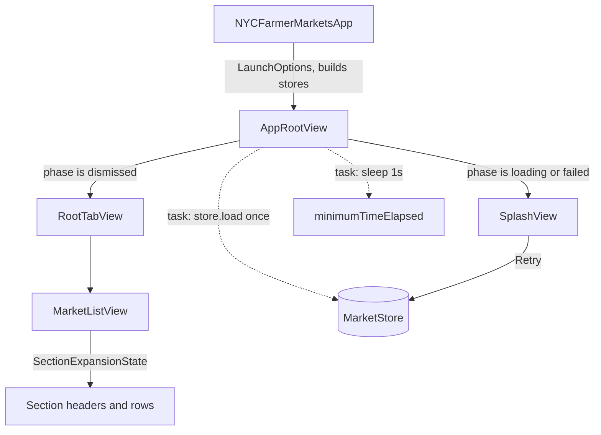

# Design Document

## Overview

This feature adds a launch splash screen that gates the tabs until market data is available, and makes the borough sections in the Markets tab collapsible (all collapsed by default, auto-expanded while searching).

The design keeps the current architecture: SwiftUI, `@Observable` stores injected through the environment, colors only from `AppPalette`, icons only from `AppIcon`, default MainActor isolation, and `nonisolated` for pure value types and functions.

Key decisions:

| Topic | Decision |
|---|---|
| Splash gating | Pure `SplashDecision.phase(dataAvailable:minimumTimeElapsed:errorMessage:) -> SplashPhase`, used by a new `AppRootView`. |
| Who starts the load | `AppRootView` runs `store.load()` once in `.task`. The `.task` in `RootTabView` is removed. |
| Minimum display time | `AppRootView` sleeps 1 second in a `.task` and sets `minimumTimeElapsed`. Duration is an init parameter (default 1 s). |
| Expanded-section model | `SectionExpansionState`, a pure `nonisolated` value type. Owned as `@State` in `MarketListView`. |
| Collapsed state lifetime | In memory only. A relaunch starts collapsed. |
| Logo asset | New vector imageset `logo-carrot` (strokes only, template rendering) and `AppIcon.logo`. |
| Logo color | New palette token `onAppIconBackground`. |
| Failed-download test hook | `-uiTestingFailDownload` launch argument, parsed by a pure `LaunchOptions`, handled in `NYCFarmerMarketsApp`. |
| Loading and error views in Markets tab | Removed from `MarketListView`. `LoadErrorView` is deleted. |

## Architecture



Launch sequence:

1. `NYCFarmerMarketsApp.init` parses `LaunchOptions`, applies the reset, and builds the stores.
2. `AppRootView` appears and starts two tasks: `store.load()` and the minimum display timer.
3. `SplashDecision.phase` is recomputed whenever `store.markets`, `store.state` or `minimumTimeElapsed` changes.
4. When the phase becomes `.dismissed`, `AppRootView` latches that result and shows `RootTabView`. `RootTabView` is never created before that, so the tabs are unreachable.

## Components and Interfaces

### Splash decision (pure)

New file `Models/SplashDecision.swift`.

```swift
nonisolated enum SplashPhase: Equatable, Sendable {
    case loading
    case failed(message: String)
    case dismissed
}

nonisolated enum SplashDecision {
    static let minimumDisplayTime: Duration = .seconds(1)

    /// - dataAvailable: the store holds a non-empty market list (cache or download).
    /// - minimumTimeElapsed: at least `minimumDisplayTime` passed since launch.
    /// - errorMessage: non-nil when the last attempt failed AND there is no data.
    static func phase(
        dataAvailable: Bool,
        minimumTimeElapsed: Bool,
        errorMessage: String?
    ) -> SplashPhase {
        if dataAvailable { return minimumTimeElapsed ? .dismissed : .loading }
        if let errorMessage { return .failed(message: errorMessage) }
        return .loading
    }
}
```

Truth table:

| dataAvailable | minimumTimeElapsed | errorMessage | Result |
|---|---|---|---|
| true | true | any | `.dismissed` (2.1, 3.5, 3.6) |
| true | false | any | `.loading` (2.2) |
| false | any | non-nil | `.failed(message)` (3.1, 3.2) |
| false | any | nil | `.loading` (3.4, retry in progress) |

Data wins over error, so cached data plus a failed refresh dismisses after the minimum time (3.6). The offline banner is already driven by `store.isShowingCachedData`.

The error is shown as soon as it exists, even before the minimum time has elapsed. The minimum time only delays dismissal.

### AppRootView

New file `Views/AppRootView.swift`.

```swift
struct AppRootView: View {
    @Environment(MarketStore.self) private var store
    @Environment(\.accessibilityReduceMotion) private var reduceMotion

    var minimumDisplayTime: Duration = SplashDecision.minimumDisplayTime

    @State private var minimumTimeElapsed = false
    @State private var hasDismissed = false

    /// Failure that leaves nothing to show: a failed load, or a successful load that returned no markets.
    private var errorMessage: String? {
        guard store.markets.isEmpty else { return nil }
        switch store.state {
        case .error(let message): return message
        case .loaded: return "No markets are available right now."
        case .idle, .loading: return nil
        }
    }

    private var phase: SplashPhase {
        SplashDecision.phase(
            dataAvailable: !store.markets.isEmpty,
            minimumTimeElapsed: minimumTimeElapsed,
            errorMessage: errorMessage
        )
    }

    var body: some View {
        ZStack {
            if hasDismissed {
                RootTabView()
            } else {
                SplashView(phase: phase) { Task { await store.refresh() } }
                    .transition(reduceMotion ? .identity : .opacity)
            }
        }
        .animation(reduceMotion ? nil : .easeInOut(duration: 0.3), value: hasDismissed)
        .task { await store.load() }                               // started once, from the splash phase
        .task {
            try? await Task.sleep(for: minimumDisplayTime)
            minimumTimeElapsed = true
        }
        .onChange(of: phase) { _, newValue in
            if newValue == .dismissed { hasDismissed = true }      // latch: the splash never returns
        }
    }
}
```

Notes:

- The `.loaded` plus empty case covers a download that succeeds with an empty list. Without it the splash would spin forever.
- `.onChange(of: phase)` fires on later changes only. Because `minimumTimeElapsed` flips after launch, the dismissed transition is always observed. If the latch needs to be evaluated on first render, use `.onChange(of: phase, initial: true)`.
- Retry calls `store.refresh()`. With no markets it sets `state = .loading`, so `errorMessage` becomes nil and the splash shows the Loading_Indicator (3.4). On success markets become non-empty and the phase becomes `.dismissed` (3.5).
- The task for `store.load()` is attached to the root, which never leaves the hierarchy, so it runs once per launch (2.4).

### SplashView

New file `Views/SplashView.swift`.

```swift
struct SplashView: View {
    let phase: SplashPhase
    let onRetry: () -> Void

    var body: some View {
        VStack(spacing: 32) {
            Spacer()
            LogoView()                                  // IconView(.logo, size: 160) + accessibility label
            footer
            Spacer()
        }
        .frame(maxWidth: .infinity, maxHeight: .infinity)
        .background(AppPalette.appIconBackground.color.ignoresSafeArea())
        .foregroundStyle(AppPalette.onAppIconBackground.color)
        .accessibilityElement(children: .contain)
        .accessibilityIdentifier("splash-screen")
    }

    @ViewBuilder private var footer: some View {
        if case .failed(let message) = phase {
            VStack(spacing: 16) {
                Text(message).multilineTextAlignment(.center).accessibilityIdentifier("splash-error")
                Button("Retry", action: onRetry)
                    .buttonStyle(ThemedButtonStyle())
                    .accessibilityLabel("Retry loading markets")
                    .accessibilityIdentifier("splash-retry")
            }
            .padding(.horizontal, 32)
        } else {
            SplashLoadingIndicator()
        }
    }
}
```

`LogoView` is a small private view: `IconView(.logo, size: 160)` inside `.accessibilityElement(children: .ignore)` with `.accessibilityLabel(AppIcon.logo.accessibilityName)`. `IconView` hides itself from accessibility, so the wrapper provides the element (5.2).

### SplashLoadingIndicator

Three dots drawn with `Circle().fill(AppPalette.onAppIconBackground.color)`. No icons or literal colors are needed.

- Reduce Motion off: each dot pulses its opacity and scale with `.easeInOut(duration: 0.6).repeatForever()`, staggered by 0.2 s per dot. The animation starts in `.onAppear` by flipping a `@State` flag (4.1).
- Reduce Motion on (`@Environment(\.accessibilityReduceMotion)`): the flag is never flipped and all three dots render at full opacity. No `.animation` modifier is applied (4.2).
- The whole indicator is one accessibility element: `.accessibilityElement(children: .ignore)`, label "Loading farmers markets", identifier `splash-loading` (5.1).

The indicator is removed from the hierarchy while the error is shown, and returns on retry.

Dismissal motion: `AppRootView` uses `.opacity` when Reduce Motion is off and `.identity` plus a nil animation when it is on (4.3).

### Palette and icon registry

`AppPalette`:

```swift
/// Content drawn on top of `appIconBackground` (splash logo, indicator, text).
static let onAppIconBackground = ColorToken(Base.surface)
```

`Base.surface` (0xF2F2F2) on `Base.appIconOlive` (0x78872B) gives a contrast ratio of about 3.5:1. That meets the 3:1 requirement for graphics and large text. The splash message uses the default body font, so it is **not** covered by 3:1. The test in the Testing Strategy section checks the actual ratio, and if it is below 4.5:1 the message text should use a larger or semibold style (large text threshold) or the implementation should darken `appIconOlive`. This is flagged as a risk below.

`AppIcon`:

```swift
case logo          // source: .asset("logo-carrot"), accessibilityName: "NYC Farmer Markets"
case sectionChevron // source: .symbol("chevron.right"), accessibilityName: "Section"
```

Raw symbol names stay inside the registry (6.7). `sectionChevron` points right when collapsed and is rotated 90 degrees when expanded.

### Logo asset

- Create `Assets.xcassets/logo-carrot.imageset/` with `Contents.json` and `logo-carrot.svg`, following the structure of the existing `icon-*.imageset` folders (single universal SVG, `preserves-vector-representation: true`, `template-rendering-intent: template`).
- `logo-carrot.svg` is derived from `Design/AppIcon.svg`: same 1024 viewBox and the same stroke paths, but the background `<rect>` is removed and the stroke is a single opaque color (template images use only the alpha channel).
- The splash background comes from `AppPalette.appIconBackground`, and the tint from `AppPalette.onAppIconBackground`. The logo therefore follows the palette and has no literal colors in Swift (1.2, 1.3, 1.5).
- A PNG was rejected because it would not scale cleanly for different devices and tinting.
- The file lives in the file-system-synchronized `NYCFarmerMarkets` group, so no `project.pbxproj` change is required.

### Section expansion (pure)

New file `Models/SectionExpansion.swift`.

```swift
nonisolated struct SectionExpansionState: Equatable, Sendable {
    /// Boroughs the user expanded while not searching. Empty = everything collapsed.
    private(set) var userExpanded: Set<String> = []
    /// Per-borough choices made while searching. Discarded when the search ends.
    private(set) var searchOverrides: [String: Bool] = [:]

    static func isSearching(_ query: String) -> Bool {
        !query.trimmingCharacters(in: .whitespacesAndNewlines).isEmpty
    }

    func isExpanded(_ borough: String, query: String) -> Bool {
        if Self.isSearching(query) { return searchOverrides[borough] ?? true }
        return userExpanded.contains(borough)
    }

    mutating func toggle(_ borough: String, query: String) {
        let wasExpanded = isExpanded(borough, query: query)
        if Self.isSearching(query) {
            searchOverrides[borough] = !wasExpanded
        } else if wasExpanded {
            userExpanded.remove(borough)
        } else {
            userExpanded.insert(borough)
        }
    }

    /// Call when the query goes from non-empty to empty.
    mutating func endSearch() { searchOverrides.removeAll() }
}
```

Why two collections: if one toggle set were reused during search, a section the user collapsed while searching would flip to expanded when the search is cleared. Keeping `userExpanded` untouched during search and dropping `searchOverrides` on clear satisfies 7.3 exactly.

Search filtering already exists: `MarketGrouping.sections(from:query:)` drops sections with no matching markets and filters markets within a section (7.1, 7.2). It needs no change.

Accessibility text and identifier are also pure so they can be tested:

```swift
nonisolated enum SectionHeaderAccessibility {
    static func label(borough: String, count: Int) -> String { "\(borough), \(count) markets" }
    static func value(isExpanded: Bool) -> String { isExpanded ? "Expanded" : "Collapsed" }
    static func hint(isExpanded: Bool) -> String { isExpanded ? "Double tap to collapse" : "Double tap to expand" }
    static func identifier(borough: String) -> String {
        "section-header-" + borough.replacingOccurrences(of: " ", with: "-")
    }
}
```

The label follows the required form literally, so a count of 1 reads "1 markets". This matches 8.2 as written.

### MarketListView changes

State lives in the view: `@State private var expansion = SectionExpansionState()`. It is created fresh at launch (6.1, 6.6). The `TabView` keeps the Markets tab alive while switching tabs, so state survives tab changes. A small observable was rejected: nothing else reads this state, and `@State` with a value type keeps the logic pure and testable.

```swift
@Environment(\.accessibilityReduceMotion) private var reduceMotion
@State private var expansion = SectionExpansionState()

// content is now just `list` (loading and error branches removed)

ForEach(sections) { section in
    let isExpanded = expansion.isExpanded(section.borough, query: query)
    Section {
        if isExpanded {
            ForEach(section.markets) { market in /* existing Button + MarketRow, id "market-row" */ }
        }
    } header: {
        sectionHeader(section, isExpanded: isExpanded)
    }
}
.onChange(of: SectionExpansionState.isSearching(query)) { _, searching in
    if !searching { expansion.endSearch() }
}
```

The header becomes a `Button` that wraps the existing layout so a tap anywhere toggles (6.2, 6.3, 7.4):

```swift
private func sectionHeader(_ section: BoroughSection, isExpanded: Bool) -> some View {
    Button {
        withAnimation(reduceMotion ? nil : .easeInOut(duration: 0.25)) {
            expansion.toggle(section.borough, query: query)
        }
    } label: {
        HStack {
            Text(section.borough).font(.subheadline.weight(.bold))
            Spacer()
            Text("\(section.markets.count)").font(.caption.weight(.semibold))
            IconView(.sectionChevron, size: 12)
                .rotationEffect(.degrees(isExpanded ? 90 : 0))
        }
        .textCase(nil)
        .foregroundStyle(AppPalette.textPrimary.color)
        .padding(.horizontal, 16).padding(.vertical, 6)
        .frame(maxWidth: .infinity)
        .background(AppPalette.sectionHeader.color)
        .contentShape(Rectangle())
    }
    .buttonStyle(.plain)
    .listRowInsets(EdgeInsets())
    .accessibilityElement(children: .ignore)
    .accessibilityLabel(SectionHeaderAccessibility.label(borough: section.borough, count: section.markets.count))
    .accessibilityValue(SectionHeaderAccessibility.value(isExpanded: isExpanded))
    .accessibilityHint(SectionHeaderAccessibility.hint(isExpanded: isExpanded))
    .accessibilityAddTraits(.isHeader)
    .accessibilityIdentifier(SectionHeaderAccessibility.identifier(borough: section.borough))
}
```

`withAnimation(nil)` applies the change without animation under Reduce Motion (6.5). The chevron rotation is driven by the same transaction, so it is also instant in that case.

The "No markets found" empty state is unchanged: it appears when `sections` is empty.

Removed from `MarketListView`: the `LoadErrorView` branch and the "Summoning markets…" `ProgressView` branch. The tabs are only reachable after `Data_Available`, and `markets` is never emptied after that, so these branches are unreachable (2.5). `LoadErrorView` and its `retry-button` identifier are deleted from `OfflineBanner.swift`; a grep of the current sources shows `MarketListView` is its only user, which the implementation must re-check before deleting. `offlineBanner(_:)` stays.

### RootTabView changes

Remove `.task { await store.load() }`. Loading is owned by `AppRootView`. Everything else (tabs, detail sheet) is unchanged.

### Launch options and UI-test hooks

New file `Models/LaunchOptions.swift`, a pure parser so the argument handling is unit-testable:

```swift
nonisolated struct LaunchOptions: Equatable, Sendable {
    var resetFavorites = false
    var failDownload = false

    init(arguments: [String]) {
        resetFavorites = arguments.contains("-uiTestingReset")
        failDownload = arguments.contains("-uiTestingFailDownload")
    }
}
```

`NYCFarmerMarketsApp.init`:

```swift
let options = LaunchOptions(arguments: ProcessInfo.processInfo.arguments)

// (2) Existing flow, unchanged: UI tests start from a clean slate.
if options.resetFavorites {
    UserDefaults.standard.removeObject(forKey: "favoriteMarketIDs")
}

if options.failDownload {
    // (1) Forced failure with no cached data: a cache file that does not exist,
    // and a fetch that always fails. The real cache is neither read nor written.
    let emptyCache = MarketCache(
        fileURL: FileManager.default.temporaryDirectory
            .appendingPathComponent("ui-testing-empty-cache-\(UUID().uuidString).json")
    )
    _marketStore = State(initialValue: MarketStore(
        cache: emptyCache,
        fetch: { throw URLError(.notConnectedToInternet) }
    ))
} else {
    _marketStore = State(initialValue: MarketStore())
}
_favoritesStore = State(initialValue: FavoritesStore())
```

`body` renders `AppRootView()` instead of `RootTabView()`, with both stores in the environment.

How the two open points are settled:

1. Forced failure: `-uiTestingFailDownload` injects a throwing fetch and a cache pointing at a non-existent temporary file. `MarketStore.load()` finds no cache, `refresh()` throws, and `state` becomes `.error(...)` with empty `markets`. No change to `MarketStore` is needed because it already takes `cache` and `fetch` initializers. The hook does not touch the real cache file, so a failed-download test cannot corrupt the developer's saved data and vice versa. Retry in this mode fails again by design: the test verifies the error and Retry button appear, and that Retry keeps the splash visible. Verifying a successful retry is covered by the pure decision tests and a MarketStore unit test with a fetch that fails then succeeds.
2. `-uiTestingReset`: unchanged behavior (clears `favoriteMarketIDs`). It runs in `init`, before any view exists, so it works the same through the splash. Existing tests pass the argument alone, so the real fetch or the real cache is used. The splash appears, then the tabs, once data is available (9.1). The UI tests can pass both arguments together.

## Data Models

No changes to `Market`, `BoroughSection`, `MarketCache` or `MarketStore`. New types:

| Type | Kind | Purpose |
|---|---|---|
| `SplashPhase` | enum | `loading`, `failed(message:)`, `dismissed` |
| `SplashDecision` | namespace enum | Pure gating function and minimum display time |
| `SectionExpansionState` | struct | Manual expansion set plus search overrides |
| `SectionHeaderAccessibility` | namespace enum | Label, value, hint and identifier strings |
| `LaunchOptions` | struct | Parsed launch arguments |

All are `nonisolated` and `Sendable`, so they can be used from nonisolated tests and contexts under the project's default MainActor isolation.

## Error Handling

| Situation | Behavior |
|---|---|
| Download fails, no cache | `MarketStore.state = .error(message)`. Splash shows the message (`splash-error`) and Retry (`splash-retry`). |
| Retry tapped | `store.refresh()` sets `.loading`. Error is hidden, Loading_Indicator shown. Failure shows the error again. |
| Download fails, cache present | `markets` is non-empty. Splash dismisses after 1 s. `isShowingCachedData` shows the offline banner. |
| Download succeeds with an empty list | Treated as a failure with the message "No markets are available right now." so the splash cannot spin forever. |
| Cancelled refresh | Existing `restoreStateAfterCancel` logic is kept. A cancelled load with no data leaves `.idle`, which the splash shows as loading. |
| Timer task cancelled | `try?` swallows cancellation. The flag stays false only if the view is gone, so no effect. |
| Reduce Motion | Static indicator, no dismiss transition, no section animation. |

Risk: if `AppRootView` is ever re-created (for example by a scene change), `.task` would run `store.load()` again. `load()` is safe to repeat: it skips the cache step when markets exist and refreshes the data.

## Correctness Properties

*A property is a characteristic or behavior that should hold true across all valid executions of a system-essentially, a formal statement about what the system should do. Properties serve as the bridge between human-readable specifications and machine-verifiable correctness guarantees.*

### Property 1: Splash is dismissed exactly when data is available and the minimum time has elapsed

For any combination of `dataAvailable`, `minimumTimeElapsed` and `errorMessage` (nil or any string), `SplashDecision.phase` returns `.dismissed` if and only if `dataAvailable` and `minimumTimeElapsed` are both true. When `dataAvailable` is true and `minimumTimeElapsed` is false, it returns `.loading`, regardless of `errorMessage`.

**Validates: Requirements 1.4, 2.1, 2.2, 3.5, 3.6**

### Property 2: Failure without data shows the error, retry hides it

For any `minimumTimeElapsed` value and any error message string, `SplashDecision.phase(dataAvailable: false, minimumTimeElapsed:, errorMessage: message)` returns `.failed(message: message)`, and with `errorMessage: nil` it returns `.loading`.

**Validates: Requirements 3.1, 3.4**

### Property 3: Sections start collapsed

For any borough name, a freshly created `SectionExpansionState` with an empty query reports the section as collapsed.

**Validates: Requirements 6.1, 6.6**

### Property 4: Toggling twice restores the state

For any `SectionExpansionState`, any borough name and any query (empty or not), calling `toggle` twice for the same borough with the same query leaves `isExpanded` for that borough equal to its original value, and a single `toggle` inverts it.

**Validates: Requirements 6.2, 6.3, 7.4**

### Property 5: Search auto-expands untouched sections

For any borough name and any query that is non-empty after trimming whitespace, a state with no search overrides reports the section as expanded, whatever the `userExpanded` set contains.

**Validates: Requirements 7.1**

### Property 6: Search results contain exactly the matching markets

For any list of markets and any non-empty query, every market in every section returned by `MarketGrouping.sections(from:query:)` matches the query, every market that matches the query appears in exactly one section, and no section is empty.

**Validates: Requirements 7.2**

### Property 7: Clearing a search restores the earlier expansion state

For any sequence of toggles made without a search, followed by any sequence of toggles made while a non-empty query is active, calling `endSearch` yields a state whose `isExpanded` result for every borough (with an empty query) equals the result before the search began.

**Validates: Requirements 7.3**

### Property 8: Section header accessibility text is consistent with its state

For any borough name, market count and expanded flag, `SectionHeaderAccessibility.label` equals "<borough>, <count> markets", `value` is "Expanded" when the flag is true and "Collapsed" when false, and `hint` is "Double tap to collapse" when true and "Double tap to expand" when false.

**Validates: Requirements 8.2, 8.3, 8.4**

### Property 9: Section header identifier has no spaces and encodes the borough

For any borough name, `SectionHeaderAccessibility.identifier` equals "section-header-" followed by the borough name with every space replaced by a hyphen, and the part after the prefix contains no space characters.

**Validates: Requirements 8.5**

## Testing Strategy

Property-based tests are used for the pure types (`SplashDecision`, `SectionExpansionState`, `SectionHeaderAccessibility`, `MarketGrouping`). UI, animation and Reduce Motion behavior are covered by example UI tests and manual checks. Run each property with at least 100 iterations. The existing test target uses Swift Testing; the same framework is used, with the existing style for inputs. If the project has no property-testing library, generate inputs with a seeded random generator inside a `@Test(arguments:)` loop, or enumerate the small finite spaces exhaustively (Property 1 and 2 have only 4 boolean combinations times a few messages). Tag each test: **Feature: splash-screen-collapsible-boroughs, Property N: <text>**.

### Unit tests (Swift Testing, `NYCFarmerMarketsTests`)

- `SplashDecisionTests`: Properties 1 and 2, plus the full truth table as explicit examples.
- `SectionExpansionTests`: Properties 3, 4, 5 and 7, plus examples: search-collapse then clear returns to collapsed, and manual expand then search-collapse then clear returns to expanded.
- `SectionHeaderAccessibilityTests`: Properties 8 and 9.
- `MarketGroupingTests` (extend existing): Property 6.
- `LaunchOptionsTests`: example tests for each argument alone, both together and neither.
- `MarketStoreTests` (extend existing, if present): with a temporary cache file and a counting fetch, cached data makes `markets` non-empty (2.3); a fetch that fails then succeeds ends in `.loaded` after `refresh()` (3.3, 3.5).
- Extend `everyIconResolves` so the new `logo` and `sectionChevron` cases resolve, and add an example that `AppIcon.logo.accessibilityName == "NYC Farmer Markets"` (5.2).
- Palette: add `onAppIconBackground` over `appIconBackground` to the existing contrast checks, with a minimum of 3:1 for the logo. Add a 4.5:1 check for text, or choose a larger text style as noted above.

### UI tests (`NYCFarmerMarketsUITests`)

The sections are collapsed by default, so no `market-row` exists until a header is tapped. Existing tests must expand a section first.

Helpers (replace the current `waitForMarkets`):

```swift
private var firstSectionHeader: XCUIElement {
    app.descendants(matching: .any)
        .matching(NSPredicate(format: "identifier BEGINSWITH 'section-header-'"))
        .firstMatch
}

/// Waits for the splash to finish, then expands the first borough if it is collapsed.
private func waitForMarkets(file: StaticString = #filePath, line: UInt = #line) {
    XCTAssertTrue(firstSectionHeader.waitForExistence(timeout: 30), "Markets did not load", file: file, line: line)
    if !firstMarketRow.exists { firstSectionHeader.tap() }
    XCTAssertTrue(firstMarketRow.waitForExistence(timeout: 5), "Borough did not expand", file: file, line: line)
}
```

Changes to existing tests:

- `testOpenDetailFromListAndClose`, `testFavoriteAppearsInFavoritesTabAndSwipeRemoves`, `testMapPinMoreInfoAndClose`: call the new `waitForMarkets()`, which now includes the expand tap. The identifiers `market-row`, `market-list`, `close-detail`, `favorite-toggle`, `more-info` and `favorites-empty` are unchanged.
- In the favorites test, after returning to the Markets tab, call `waitForMarkets()` again instead of assuming the section is still open. This makes the test independent of whether tab state is kept.
- `testSearchFiltersList`: wait for a section header instead of a row (no row is needed), then search for "zzzzzz". The "No markets found" expectation is unchanged.

New tests in the same class:

- `testSplashAppearsAtLaunch`: right after `launch()`, `splash-screen` exists. The 1-second minimum guarantees it is visible. Then `firstSectionHeader` appears and `splash-screen` no longer exists.
- `testSectionsStartCollapsed`: after the headers appear, `market-row` does not exist and the first header's `value` is "Collapsed".
- `testTappingHeaderExpandsAndCollapses`: tap the first header, expect `value == "Expanded"` and a `market-row`; tap again, expect `value == "Collapsed"` and no `market-row` (use an `NSPredicate` expectation for non-existence).
- `testSearchAutoExpandsMatchingBoroughs`: type "Manhattan" into the search field. The query matches the borough field, so `section-header-Manhattan` has `value == "Expanded"` and a row exists. Tapping that header collapses it (7.4). Clearing the search returns it to "Collapsed".

A new test class `SplashFailureUITests` launches with `["-uiTestingReset", "-uiTestingFailDownload"]` (its own `setUp`, so the default class is not affected):

- `testRetryAndErrorShownWhenDownloadFailsWithoutCache`: `splash-screen`, `splash-error` and `splash-retry` exist; the retry button's label is "Retry loading markets"; the tab bar does not exist. After tapping retry, the splash is still present and the error returns after the (failing) attempt (9.6).

Reduce Motion and the animation behavior (4.1 to 4.3, 6.5) are checked manually with the Accessibility setting on and off, since XCUITest cannot observe animation.

### Manual checks

- Splash on a cold launch with cache, without cache (airplane mode, app data deleted) and in dark mode.
- VoiceOver on the splash and section headers.
- Contrast and layout of the splash on iPhone SE and a large Dynamic Type size.
