# iyepes/NYCFarmerMarkets Wiki

Version: 1

## Overview

### Project Overview

<details>
<summary>Relevant source files</summary>

The following files were used as context for generating this wiki page:

- [readme.md](https://github.com/iyepes/NYCFarmerMarkets/blob/550674eaf4fdbb45bfca8191cb8ed53e7e453c09/readme.md)
- [NYCFarmerMarkets/Models/Market.swift](https://github.com/iyepes/NYCFarmerMarkets/blob/550674eaf4fdbb45bfca8191cb8ed53e7e453c09/NYCFarmerMarkets/Models/Market.swift)
- [NYCFarmerMarkets/NYCFarmerMarketsApp.swift](https://github.com/iyepes/NYCFarmerMarkets/blob/550674eaf4fdbb45bfca8191cb8ed53e7e453c09/NYCFarmerMarkets/NYCFarmerMarketsApp.swift)
- [NYCFarmerMarkets/Theme/AppTypography.swift](https://github.com/iyepes/NYCFarmerMarkets/blob/550674eaf4fdbb45bfca8191cb8ed53e7e453c09/NYCFarmerMarkets/Theme/AppTypography.swift)
- [NYCFarmerMarkets/Theme/AppCopy.swift](https://github.com/iyepes/NYCFarmerMarkets/blob/550674eaf4fdbb45bfca8191cb8ed53e7e453c09/NYCFarmerMarkets/Theme/AppCopy.swift)
- [NYCFarmerMarkets/Views/MarketDetailView.swift](https://github.com/iyepes/NYCFarmerMarkets/blob/550674eaf4fdbb45bfca8191cb8ed53e7e453c09/NYCFarmerMarkets/Views/MarketDetailView.swift)
- [NYCFarmerMarketsTests/NYCFarmerMarketsTests.swift](https://github.com/iyepes/NYCFarmerMarkets/blob/550674eaf4fdbb45bfca8191cb8ed53e7e453c09/NYCFarmerMarketsTests/NYCFarmerMarketsTests.swift)
- [NYCFarmerMarketsTests/SplashDecisionTests.swift](https://github.com/iyepes/NYCFarmerMarkets/blob/550674eaf4fdbb45bfca8191cb8ed53e7e453c09/NYCFarmerMarketsTests/SplashDecisionTests.swift)
- [NYCFarmerMarketsTests/SectionExpansionTests.swift](https://github.com/iyepes/NYCFarmerMarkets/blob/550674eaf4fdbb45bfca8191cb8ed53e7e453c09/NYCFarmerMarketsTests/SectionExpansionTests.swift)
</details>

# Project Overview

NYCFarmerMarkets is a mobile application that identifies and locates registered farmers' markets across New York City. The application consumes data from the NYC Open Data "NYC Farmers Markets" dataset (8vwk-6iz2) to provide users with market details, geographic locations, and search capabilities.

The project utilizes a SwiftUI-based architecture with a centralized state management system (`MarketStore`) and specialized storage for user favorites (`FavoritesStore`). It features a thematic "spooky" visual style implemented through custom typography and color palettes while maintaining accessibility standards.

Sources: [readme.md:1-18](https://github.com/iyepes/NYCFarmerMarkets/blob/550674eaf4fdbb45bfca8191cb8ed53e7e453c09/readme.md#L1-L18), [NYCFarmerMarkets/NYCFarmerMarketsApp.swift:15-46](https://github.com/iyepes/NYCFarmerMarkets/blob/550674eaf4fdbb45bfca8191cb8ed53e7e453c09/NYCFarmerMarkets/NYCFarmerMarketsApp.swift#L15-L46), [NYCFarmerMarkets/Models/Market.swift:11-13](https://github.com/iyepes/NYCFarmerMarkets/blob/550674eaf4fdbb45bfca8191cb8ed53e7e453c09/NYCFarmerMarkets/Models/Market.swift#L11-L13)

## Core Architecture and Data Flow

The application follows a reactive data flow where the `MarketStore` serves as the primary source of truth for market data. At launch, the app attempts to fetch fresh data from the NYC Open Data API. If the network request fails, the system falls back to a local disk cache managed by `MarketCache`.

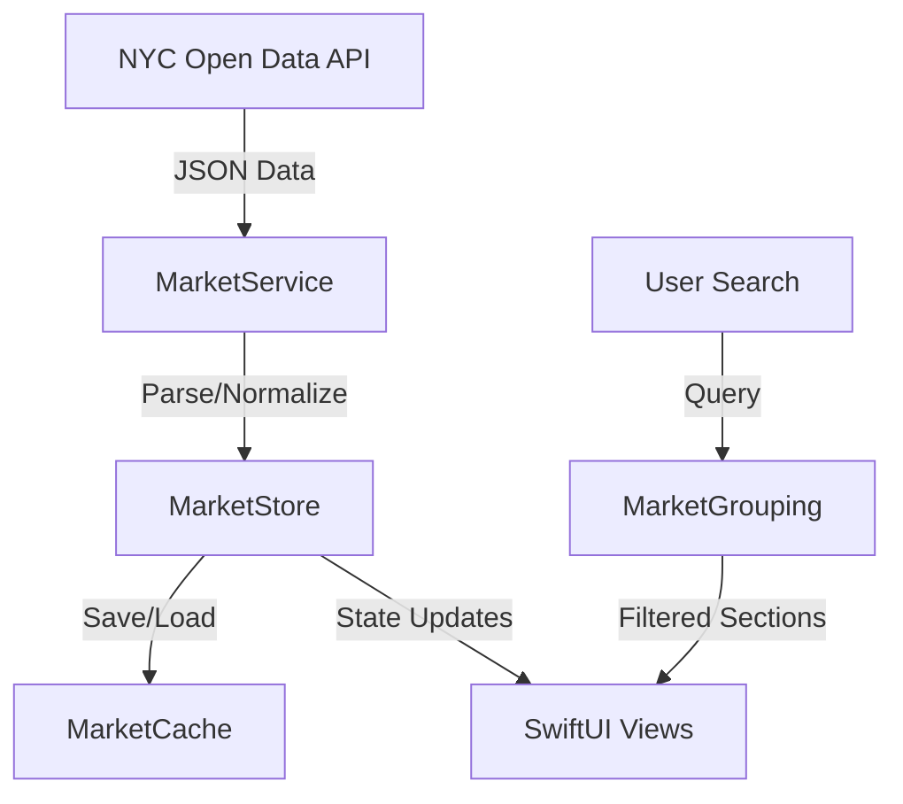
The diagram shows the lifecycle of market data from the external API to the user interface, including the local caching mechanism.
Sources: [NYCFarmerMarketsTests/NYCFarmerMarketsTests.swift:114-142](https://github.com/iyepes/NYCFarmerMarkets/blob/550674eaf4fdbb45bfca8191cb8ed53e7e453c09/NYCFarmerMarketsTests/NYCFarmerMarketsTests.swift#L114-L142), [NYCFarmerMarkets/NYCFarmerMarketsApp.swift:24-40](https://github.com/iyepes/NYCFarmerMarkets/blob/550674eaf4fdbb45bfca8191cb8ed53e7e453c09/NYCFarmerMarkets/NYCFarmerMarketsApp.swift#L24-L40)

### Startup Logic
The application manages initial loading through a splash screen. The splash screen remains visible until two conditions are met: a minimum of one second has elapsed and data is available (either from the API or cache).

| Phase | Conditions | User Experience |
| :--- | :--- | :--- |
| **Loading** | `dataAvailable: false`, `elapsed: false/true` | Shows "Summoning markets…" |
| **Failed** | `dataAvailable: false`, `errorMessage: String` | Shows error message and retry option |
| **Dismissed** | `dataAvailable: true`, `elapsed: true` | Reveals main application tabs |

Sources: [NYCFarmerMarketsTests/SplashDecisionTests.swift:30-58](https://github.com/iyepes/NYCFarmerMarkets/blob/550674eaf4fdbb45bfca8191cb8ed53e7e453c09/NYCFarmerMarketsTests/SplashDecisionTests.swift#L30-L58), [NYCFarmerMarkets/Theme/AppCopy.swift:12-13](https://github.com/iyepes/NYCFarmerMarkets/blob/550674eaf4fdbb45bfca8191cb8ed53e7e453c09/NYCFarmerMarkets/Theme/AppCopy.swift#L12-L13), [NYCFarmerMarketsTests/SplashDecisionTests.swift:83-85](https://github.com/iyepes/NYCFarmerMarkets/blob/550674eaf4fdbb45bfca8191cb8ed53e7e453c09/NYCFarmerMarketsTests/SplashDecisionTests.swift#L83-L85)

## Data Models

The `Market` model represents a single location. It includes a nested `Raw` struct for decoding the API response where all fields are strings. The `init(raw:)` initializer cleans, normalizes, and transforms these strings into typed data.

### Market Model Fields
| Field | Type | Description |
| :--- | :--- | :--- |
| `id` | `String` | Stable ID generated from lowercase name and address |
| `name` | `String` | Cleaned market name |
| `borough` | `String` | Normalized borough name (e.g., "Brooklyn", "Manhattan") |
| `latitude/longitude` | `Double?` | Geographic coordinates; `nil` if missing or 0 |
| `acceptsEBT` | `String?` | Indicates if EBT is accepted (Capitalized "Yes/No") |

Sources: [NYCFarmerMarkets/Models/Market.swift:14-63](https://github.com/iyepes/NYCFarmerMarkets/blob/550674eaf4fdbb45bfca8191cb8ed53e7e453c09/NYCFarmerMarkets/Models/Market.swift#L14-L63), [NYCFarmerMarketsTests/NYCFarmerMarketsTests.swift:81-105](https://github.com/iyepes/NYCFarmerMarkets/blob/550674eaf4fdbb45bfca8191cb8ed53e7e453c09/NYCFarmerMarketsTests/NYCFarmerMarketsTests.swift#L81-L105)

## Navigation and UI Components

The application is structured into three primary tabs: **Markets** (List View), **Map** (Geographic View), and **Favorites** (Personalized List).

### List Management and Search
The List view groups markets by borough in a specific order: Manhattan, Brooklyn, Queens, Bronx, Staten Island, and Unknown. Sections start collapsed by default. Searching automatically expands sections containing matches.

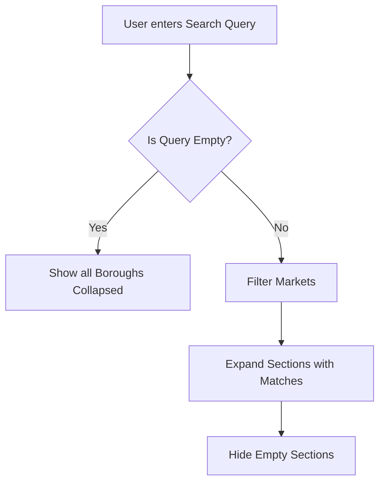
The flow shows how search interaction affects the expansion state of borough-grouped sections in the list view.
Sources: [NYCFarmerMarketsTests/SectionExpansionTests.swift:55-85](https://github.com/iyepes/NYCFarmerMarkets/blob/550674eaf4fdbb45bfca8191cb8ed53e7e453c09/NYCFarmerMarketsTests/SectionExpansionTests.swift#L55-L85), [NYCFarmerMarketsTests/NYCFarmerMarketsTests.swift:234-245](https://github.com/iyepes/NYCFarmerMarkets/blob/550674eaf4fdbb45bfca8191cb8ed53e7e453c09/NYCFarmerMarketsTests/NYCFarmerMarketsTests.swift#L234-L245)

### Detailed View
The `MarketDetailView` displays comprehensive data for a selected market. It includes buttons for in-app map navigation and external directions.

*   **In-app Map**: Pushes a `MarketLocationMapView` showing a single pin for the specific market.
*   **External Maps**: Utilizes `MKMapItem` to open the location in the system's default mapping application.
*   **Favorites**: Users can toggle a favorite status, which persists via `UserDefaults` in the `FavoritesStore`.

Sources: [NYCFarmerMarkets/Views/MarketDetailView.swift:16-55](https://github.com/iyepes/NYCFarmerMarkets/blob/550674eaf4fdbb45bfca8191cb8ed53e7e453c09/NYCFarmerMarkets/Views/MarketDetailView.swift#L16-L55), [NYCFarmerMarketsTests/NYCFarmerMarketsTests.swift:330-345](https://github.com/iyepes/NYCFarmerMarkets/blob/550674eaf4fdbb45bfca8191cb8ed53e7e453c09/NYCFarmerMarketsTests/NYCFarmerMarketsTests.swift#L330-L345)

## Design System

The app employs a custom "spooky" theme characterized by specific typography and high-contrast colors.

### Typography
The system uses two custom font families: `Grim-Creeper-Regular` (Display) and `Breath-of-the-House` (Body).

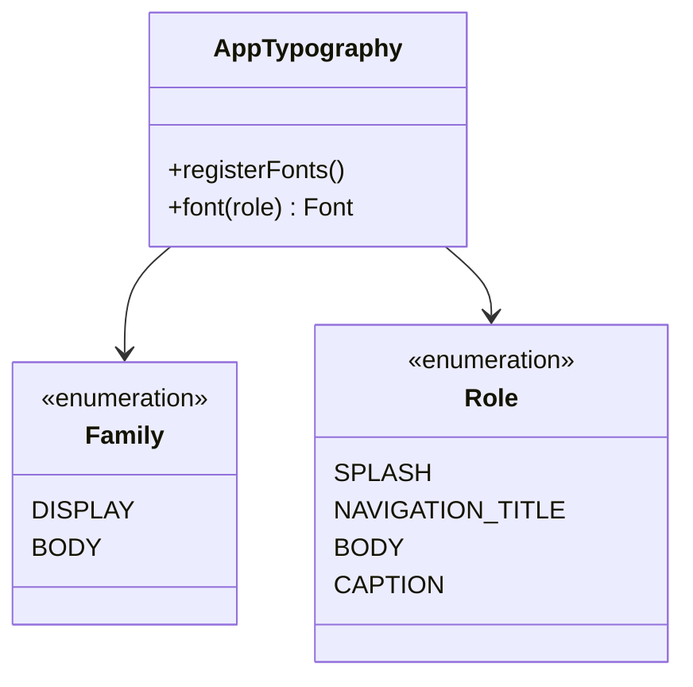
The diagram illustrates the relationship between typography families and semantic roles used throughout the UI.
Sources: [NYCFarmerMarkets/Theme/AppTypography.swift:18-80](https://github.com/iyepes/NYCFarmerMarkets/blob/550674eaf4fdbb45bfca8191cb8ed53e7e453c09/NYCFarmerMarkets/Theme/AppTypography.swift#L18-L80)

### Contrast and Accessibility
Theme colors are validated against WCAG AA standards (4.5:1 ratio). Accessibility labels use plain language (e.g., "Loading farmers markets") even when the visual UI uses thematic language (e.g., "Summoning markets…").
Sources: [NYCFarmerMarketsTests/NYCFarmerMarketsTests.swift:362-385](https://github.com/iyepes/NYCFarmerMarkets/blob/550674eaf4fdbb45bfca8191cb8ed53e7e453c09/NYCFarmerMarketsTests/NYCFarmerMarketsTests.swift#L362-L385), [NYCFarmerMarkets/Theme/AppCopy.swift:10-39](https://github.com/iyepes/NYCFarmerMarkets/blob/550674eaf4fdbb45bfca8191cb8ed53e7e453c09/NYCFarmerMarkets/Theme/AppCopy.swift#L10-L39)

### Getting Started

<details>
<summary>Relevant source files</summary>

The following files were used as context for generating this wiki page:

- [NYCFarmerMarkets/NYCFarmerMarketsApp.swift](https://github.com/iyepes/NYCFarmerMarkets/blob/550674eaf4fdbb45bfca8191cb8ed53e7e453c09/NYCFarmerMarkets/NYCFarmerMarketsApp.swift)
- [NYCFarmerMarkets/Views/AppRootView.swift](https://github.com/iyepes/NYCFarmerMarkets/blob/550674eaf4fdbb45bfca8191cb8ed53e7e453c09/NYCFarmerMarkets/Views/AppRootView.swift)
- [NYCFarmerMarkets/Views/SplashView.swift](https://github.com/iyepes/NYCFarmerMarkets/blob/550674eaf4fdbb45bfca8191cb8ed53e7e453c09/NYCFarmerMarkets/Views/SplashView.swift)
- [NYCFarmerMarkets/Theme/AppTypography.swift](https://github.com/iyepes/NYCFarmerMarkets/blob/550674eaf4fdbb45bfca8191cb8ed53e7e453c09/NYCFarmerMarkets/Theme/AppTypography.swift)
- [NYCFarmerMarkets/Theme/ThemeStyling.swift](https://github.com/iyepes/NYCFarmerMarkets/blob/550674eaf4fdbb45bfca8191cb8ed53e7e453c09/NYCFarmerMarkets/Theme/ThemeStyling.swift)
- [NYCFarmerMarkets/Theme/AppPalette.swift](https://github.com/iyepes/NYCFarmerMarkets/blob/550674eaf4fdbb45bfca8191cb8ed53e7e453c09/NYCFarmerMarkets/Theme/AppPalette.swift)
- [NYCFarmerMarketsTests/SplashDecisionTests.swift](https://github.com/iyepes/NYCFarmerMarkets/blob/550674eaf4fdbb45bfca8191cb8ed53e7e453c09/NYCFarmerMarketsTests/SplashDecisionTests.swift)
</details>

# Getting Started

The NYCFarmerMarkets application provides a localized interface for exploring New York City farmer markets using data from the NYC Open Data API. The initialization process ensures that theme assets, such as custom fonts and color palettes, are registered before the user interface loads.

The application lifecycle begins with a splash screen that manages data fetching through the `MarketStore`. It remains visible until data is successfully retrieved and a minimum display time has passed. This ensures a consistent brand experience while preventing UI flickering during rapid network responses.

## Application Initialization

The entry point of the application, `NYCFarmerMarketsApp`, configures the global environment and applies theme settings. It registers custom fonts via `AppTypography` and applies global UI appearances through `ThemeAppearance`.

### Initialization Sequence
1.  **Register Fonts**: The app calls `AppTypography.registerFonts()` to load "Grim Creeper" and "Breath of the House" into the process.
2.  **Apply Theme**: `ThemeAppearance.apply()` sets the global tint and bar appearances for `UINavigationBar` and `UITabBar`.
3.  **Setup Stores**: The app initializes `MarketStore` for market data and `FavoritesStore` for user preferences.
4.  **Launch Options**: The app parses `LaunchOptions` to determine if it should reset favorites or simulate network failures for UI testing.

Sources: [NYCFarmerMarkets/NYCFarmerMarketsApp.swift:15-40](https://github.com/iyepes/NYCFarmerMarkets/blob/550674eaf4fdbb45bfca8191cb8ed53e7e453c09/NYCFarmerMarkets/NYCFarmerMarketsApp.swift#L15-L40), [NYCFarmerMarkets/Theme/AppTypography.swift:138-140](https://github.com/iyepes/NYCFarmerMarkets/blob/550674eaf4fdbb45bfca8191cb8ed53e7e453c09/NYCFarmerMarkets/Theme/AppTypography.swift#L138-L140)

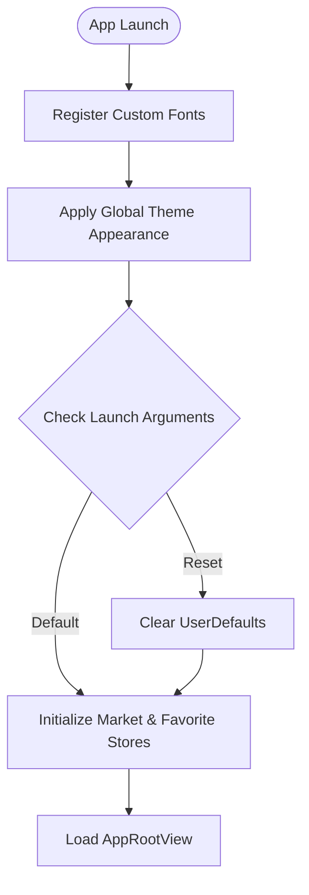
The diagram shows the synchronous setup steps performed in the `init()` method of the main `App` struct. Sources: [NYCFarmerMarkets/NYCFarmerMarketsApp.swift:15-35](https://github.com/iyepes/NYCFarmerMarkets/blob/550674eaf4fdbb45bfca8191cb8ed53e7e453c09/NYCFarmerMarkets/NYCFarmerMarketsApp.swift#L15-L35)

## Launch Sequence and Splash Phase

The `AppRootView` manages the transition from the splash screen to the main content. It uses a logic engine to determine the current `SplashPhase` based on data availability, elapsed time, and error states.

### Splash Decision Logic
The application evaluates three conditions to determine if the splash screen should dismiss:
*   **Data Availability**: Whether `MarketStore.markets` contains entries.
*   **Minimum Time**: Whether the `minimumDisplayTime` (default 1 second) has passed.
*   **Error Message**: Whether a failure occurred during the initial fetch.

Sources: [NYCFarmerMarkets/Views/AppRootView.swift:39-45](https://github.com/iyepes/NYCFarmerMarkets/blob/550674eaf4fdbb45bfca8191cb8ed53e7e453c09/NYCFarmerMarkets/Views/AppRootView.swift#L39-L45), [NYCFarmerMarketsTests/SplashDecisionTests.swift:65-67](https://github.com/iyepes/NYCFarmerMarkets/blob/550674eaf4fdbb45bfca8191cb8ed53e7e453c09/NYCFarmerMarketsTests/SplashDecisionTests.swift#L65-L67)

| Phase | Conditions | UI Representation |
| :--- | :--- | :--- |
| `.loading` | Data not available AND no error | Logo and loading indicator |
| `.failed` | Data not available AND error present | Error message, hint, and Retry button |
| `.dismissed` | Data available AND minimum time elapsed | Transition to `RootTabView` |

Sources: [NYCFarmerMarkets/Views/SplashView.swift:30-55](https://github.com/iyepes/NYCFarmerMarkets/blob/550674eaf4fdbb45bfca8191cb8ed53e7e453c09/NYCFarmerMarkets/Views/SplashView.swift#L30-L55), [NYCFarmerMarkets/Views/AppRootView.swift:48-56](https://github.com/iyepes/NYCFarmerMarkets/blob/550674eaf4fdbb45bfca8191cb8ed53e7e453c09/NYCFarmerMarkets/Views/AppRootView.swift#L48-L56)

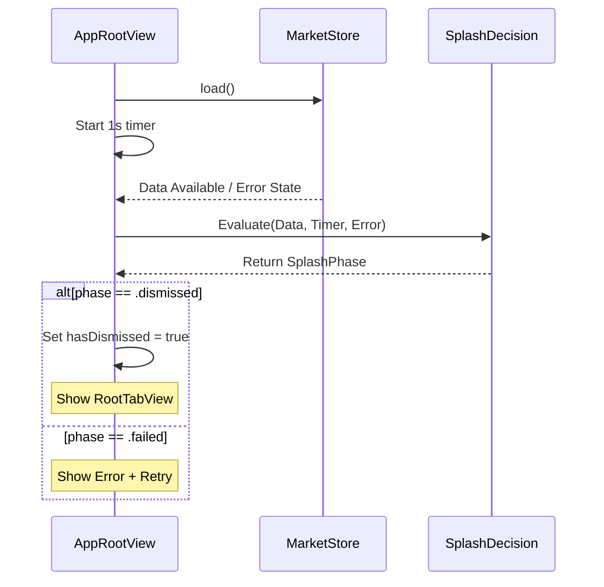
This sequence illustrates how `AppRootView` coordinates between the data store and the splash decision logic to handle the initial boot. Sources: [NYCFarmerMarkets/Views/AppRootView.swift:48-68](https://github.com/iyepes/NYCFarmerMarkets/blob/550674eaf4fdbb45bfca8191cb8ed53e7e453c09/NYCFarmerMarkets/Views/AppRootView.swift#L48-L68)

## Theme Configuration

The project utilizes a centralized theme system to ensure visual consistency and accessibility. This is managed through two primary components: `AppPalette` for colors and `AppTypography` for text styling.

### Color System
`AppPalette` defines semantic tokens that map to specific hex values. These tokens automatically adapt to light and dark modes.

| Token | Purpose | Base Reference |
| :--- | :--- | :--- |
| `background` | Primary screen surface | `Base.surface` / `Base.deep` |
| `accent` | Controls, links, and highlights | `Base.deep` / `Base.primary` |
| `card` | Background for rows and containers | `Base.highlight` / `Base.surface` |
| `textPrimary` | Main body and title text | `Base.deep` / `Base.surface` |

Sources: [NYCFarmerMarkets/Theme/AppPalette.swift:54-75](https://github.com/iyepes/NYCFarmerMarkets/blob/550674eaf4fdbb45bfca8191cb8ed53e7e453c09/NYCFarmerMarkets/Theme/AppPalette.swift#L54-L75)

### Typography Roles
Text styling is applied using semantic roles rather than direct font sizes. Each role defines a font family, design size, and scaling behavior for Dynamic Type.

*   **Display Family**: Used for `splash`, `navigationTitle`, and `sectionHeader`.
*   **Body Family**: Used for `body`, `subheadline`, and `caption`. This family includes a `sizeScale` of 1.15 to improve legibility.

Sources: [NYCFarmerMarkets/Theme/AppTypography.swift:57-90](https://github.com/iyepes/NYCFarmerMarkets/blob/550674eaf4fdbb45bfca8191cb8ed53e7e453c09/NYCFarmerMarkets/Theme/AppTypography.swift#L57-L90)

## Development and Testing Setup

The application includes specific configurations to facilitate automated testing and development.

### UI Testing Overrides
When launching with specific arguments, the app modifies its behavior:
*   **`-uiTestingReset`**: Clears the `favoriteMarketIDs` key in `UserDefaults`.
*   **`-uiTestingSplashMinimumSeconds`**: Overrides the default splash duration.
*   **Mocking Failure**: If the `failDownload` flag is detected, the `MarketStore` is initialized with a closure that throws `URLError(.notConnectedToInternet)`.

Sources: [NYCFarmerMarkets/NYCFarmerMarketsApp.swift:23-35](https://github.com/iyepes/NYCFarmerMarkets/blob/550674eaf4fdbb45bfca8191cb8ed53e7e453c09/NYCFarmerMarkets/NYCFarmerMarketsApp.swift#L23-L35)

### Data Structure
The application processes NYC Open Data using the `Market` model. Each market includes coordinates for map rendering and metadata regarding operations.

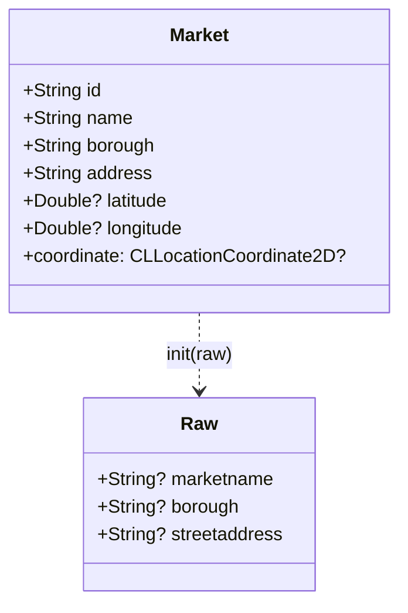
Sources: [NYCFarmerMarkets/Models/Market.swift:10-40](https://github.com/iyepes/NYCFarmerMarkets/blob/550674eaf4fdbb45bfca8191cb8ed53e7e453c09/NYCFarmerMarkets/Models/Market.swift#L10-L40)

## Summary
To get started with the codebase, developers should focus on the `NYCFarmerMarketsApp` for lifecycle management and the `Theme` directory for visual configurations. The application ensures a robust initial state by combining mandatory splash durations with asynchronous data loading and local caching.

### Licensing, Open Data Terms & Fonts

<details>
<summary>Relevant source files</summary>

The following files were used as context for generating this wiki page:

- [license.md](https://github.com/iyepes/NYCFarmerMarkets/blob/550674eaf4fdbb45bfca8191cb8ed53e7e453c09/license.md)
- [NYCFarmerMarkets/Theme/AppTypography.swift](https://github.com/iyepes/NYCFarmerMarkets/blob/550674eaf4fdbb45bfca8191cb8ed53e7e453c09/NYCFarmerMarkets/Theme/AppTypography.swift)
- [NYCFarmerMarkets/Theme/AppTypography+UIKit.swift](https://github.com/iyepes/NYCFarmerMarkets/blob/550674eaf4fdbb45bfca8191cb8ed53e7e453c09/NYCFarmerMarkets/Theme/AppTypography+UIKit.swift)
- [NYCFarmerMarkets/Models/Market.swift](https://github.com/iyepes/NYCFarmerMarkets/blob/550674eaf4fdbb45bfca8191cb8ed53e7e453c09/NYCFarmerMarkets/Models/Market.swift)
- [NYCFarmerMarkets/Theme/AppCopy.swift](https://github.com/iyepes/NYCFarmerMarkets/blob/550674eaf4fdbb45bfca8191cb8ed53e7e453c09/NYCFarmerMarkets/Theme/AppCopy.swift)
- [NYCFarmerMarketsTests/AppTypographyTests.swift](https://github.com/iyepes/NYCFarmerMarkets/blob/550674eaf4fdbb45bfca8191cb8ed53e7e453c09/NYCFarmerMarketsTests/AppTypographyTests.swift)
</details>

# Licensing, Open Data Terms & Fonts

The NYCFarmerMarkets project operates under a standard permissive license while integrating public domain data from New York City. The application implements a custom typography system that manages two specific font families, provides semantic text roles, and ensures accessibility through automatic system-font fallbacks.

## Software Licensing

The project is licensed under a permissive agreement granted by Hacemos Contactos SAS. This license allows any person to deal in the software without restriction, including rights to use, copy, modify, merge, publish, distribute, sublicense, or sell copies. 

The following conditions apply:
*   The copyright notice and permission notice must appear in all copies or substantial portions of the software.
*   The software is provided "AS IS", without warranties of any kind.
*   The authors are not liable for any claims, damages, or other liabilities arising from the software.

Sources: [license.md:1-12](https://github.com/iyepes/NYCFarmerMarkets/blob/550674eaf4fdbb45bfca8191cb8ed53e7e453c09/license.md#L1-L12)

## Open Data Integration

The application consumes data from the NYC Open Data portal, specifically the "NYC Farmers Markets" dataset (identifier 8vwk-6iz2). This dataset provides geospatial and operational details for markets across the five boroughs.

### Data Model Constraints
The `Market` model processes raw API records where every value is initially a string. The system normalizes these strings to ensure data consistency.

| Field | Source Type | Application Type | Normalization Logic |
| :--- | :--- | :--- | :--- |
| `id` | Calculated | String | Lowercased `name` and `address` joined by `\|` |
| `borough` | String | String | Canonicalizes to "Manhattan", "Brooklyn", "Queens", "Bronx", or "Staten Island" |
| `latitude` | String | Double? | Parses to Double; returns nil if value is "0" |
| `longitude` | String | Double? | Parses to Double; returns nil if value is "0" |
| `acceptsEBT` | String | String? | Capitalizes the first letter (e.g., "yes" to "Yes") |

Sources: [NYCFarmerMarkets/Models/Market.swift:10-72](https://github.com/iyepes/NYCFarmerMarkets/blob/550674eaf4fdbb45bfca8191cb8ed53e7e453c09/NYCFarmerMarkets/Models/Market.swift#L10-L72)

## Typography System

The `AppTypography` system manages custom font registration and resolution. It encapsulates two distinct font families and maps them to semantic roles used throughout the UI.

### Font Families
The app bundles two TrueType Font (.ttf) files:
1.  **Grim Creeper**: Used for display and title roles.
2.  **Breath of the House**: Used for body text. This family has a 1.15x `sizeScale` and a `minimumSize` of 14pt to compensate for its small x-height and thin strokes.

Sources: [NYCFarmerMarkets/Theme/AppTypography.swift:18-52](https://github.com/iyepes/NYCFarmerMarkets/blob/550674eaf4fdbb45bfca8191cb8ed53e7e453c09/NYCFarmerMarkets/Theme/AppTypography.swift#L18-L52)

### Semantic Roles and Scaling
The application uses semantic roles instead of direct font declarations. Each role defines a target family, a design size, and a fallback system weight.

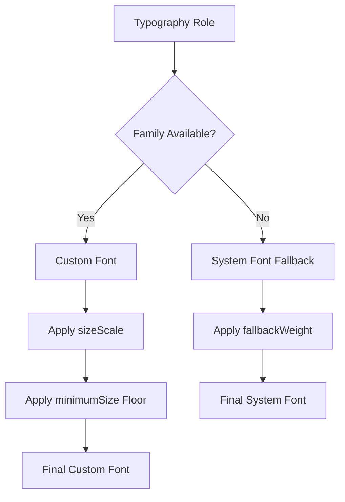
The diagram above shows the logic used to resolve a font for a specific UI element based on availability and role definitions.

Sources: [NYCFarmerMarkets/Theme/AppTypography.swift:135-141](https://github.com/iyepes/NYCFarmerMarkets/blob/550674eaf4fdbb45bfca8191cb8ed53e7e453c09/NYCFarmerMarkets/Theme/AppTypography.swift#L135-L141), [NYCFarmerMarketsTests/AppTypographyTests.swift:54-72](https://github.com/iyepes/NYCFarmerMarkets/blob/550674eaf4fdbb45bfca8191cb8ed53e7e453c09/NYCFarmerMarketsTests/AppTypographyTests.swift#L54-L72)

### UIKit Integration and Accessibility
For system-managed components like tab bars and navigation bars, the system provides `UIFont` instances via `UIFontMetrics`. This ensures custom fonts scale correctly with Dynamic Type.

*   **Tab Bar Constraints**: The `tabBarLabel` role has a `maximumPointSize` of 15 to prevent text from overlapping icons at large accessibility sizes.
*   **Automatic Fallback**: If `registerFonts()` fails to find or load the bundled files, the system defaults to the standard system font using specified weights (e.g., `.bold` for splash titles).

Sources: [NYCFarmerMarkets/Theme/AppTypography+UIKit.swift:13-35](https://github.com/iyepes/NYCFarmerMarkets/blob/550674eaf4fdbb45bfca8191cb8ed53e7e453c09/NYCFarmerMarkets/Theme/AppTypography%2BUIKit.swift#L13-L35), [NYCFarmerMarkets/Theme/AppTypography.swift:115-126](https://github.com/iyepes/NYCFarmerMarkets/blob/550674eaf4fdbb45bfca8191cb8ed53e7e453c09/NYCFarmerMarkets/Theme/AppTypography.swift#L115-L126)

## UI Copy and Tone

User-facing strings in the project use a "light spooky" theme, while accessibility labels remain plain and descriptive to ensure clarity for screen readers.

| Component | Spooky UI Text | Accessibility Text |
| :--- | :--- | :--- |
| Splash Loading | "Summoning markets…" | "Loading farmers markets" |
| Offline State | "Lost in the fog..." | "Offline, showing saved data" |
| No Results | "Nothing lurking here" | "No markets found" |
| Missing Data | "Shrouded in mist" | "Not listed" |

Sources: [NYCFarmerMarkets/Theme/AppCopy.swift:11-44](https://github.com/iyepes/NYCFarmerMarkets/blob/550674eaf4fdbb45bfca8191cb8ed53e7e453c09/NYCFarmerMarkets/Theme/AppCopy.swift#L11-L44)

## Summary

The NYCFarmerMarkets project combines an MIT-style license with NYC Open Data to provide a specialized utility. Its architecture prioritizes a unique visual identity through custom typography while maintaining strict accessibility standards via font scaling, minimum size floors, and plain-language accessibility fallbacks.


## System Architecture

### App Architecture

<details>
<summary>Relevant source files</summary>

The following files were used as context for generating this wiki page:

- [NYCFarmerMarkets/NYCFarmerMarketsApp.swift](https://github.com/iyepes/NYCFarmerMarkets/blob/550674eaf4fdbb45bfca8191cb8ed53e7e453c09/NYCFarmerMarkets/NYCFarmerMarketsApp.swift)
- [NYCFarmerMarkets/Views/AppRootView.swift](https://github.com/iyepes/NYCFarmerMarkets/blob/550674eaf4fdbb45bfca8191cb8ed53e7e453c09/NYCFarmerMarkets/Views/AppRootView.swift)
- [NYCFarmerMarkets/Theme/AppTypography.swift](https://github.com/iyepes/NYCFarmerMarkets/blob/550674eaf4fdbb45bfca8191cb8ed53e7e453c09/NYCFarmerMarkets/Theme/AppTypography.swift)
- [NYCFarmerMarkets/Theme/AppPalette.swift](https://github.com/iyepes/NYCFarmerMarkets/blob/550674eaf4fdbb45bfca8191cb8ed53e7e453c09/NYCFarmerMarkets/Theme/AppPalette.swift)
- [NYCFarmerMarkets/Theme/ThemeStyling.swift](https://github.com/iyepes/NYCFarmerMarkets/blob/550674eaf4fdbb45bfca8191cb8ed53e7e453c09/NYCFarmerMarkets/Theme/ThemeStyling.swift)
- [NYCFarmerMarketsTests/NYCFarmerMarketsTests.swift](https://github.com/iyepes/NYCFarmerMarkets/blob/550674eaf4fdbb45bfca8191cb8ed53e7e453c09/NYCFarmerMarketsTests/NYCFarmerMarketsTests.swift)
- [NYCFarmerMarkets/Views/SplashView.swift](https://github.com/iyepes/NYCFarmerMarkets/blob/550674eaf4fdbb45bfca8191cb8ed53e7e453c09/NYCFarmerMarkets/Views/SplashView.swift)
</details>

# App Architecture

The NYCFarmerMarkets application follows a modern SwiftUI architecture centered around observable data stores and a centralized theme engine. The system coordinates data fetching from the NYC Open Data API, local persistence via caching and UserDefaults, and a reactive UI that transitions from a launch splash screen to a multi-tab interface.

The architecture emphasizes separation of concerns between data management (`MarketStore`), user preferences (`FavoritesStore`), and visual styling (`AppPalette`, `AppTypography`). It utilizes a state-driven navigation flow where the initial application state is determined by data availability and minimum display timers.

Sources: [NYCFarmerMarketsApp.swift:1-49](https://github.com/iyepes/NYCFarmerMarkets/blob/550674eaf4fdbb45bfca8191cb8ed53e7e453c09/NYCFarmerMarketsApp.swift#L1-L49), [AppRootView.swift:1-60](https://github.com/iyepes/NYCFarmerMarkets/blob/550674eaf4fdbb45bfca8191cb8ed53e7e453c09/AppRootView.swift#L1-L60)

## Core Components and Data Flow

The application lifecycle begins in `NYCFarmerMarketsApp`, which initializes the global stores and applies theme-wide styling. Data flows from the `MarketService` into a `MarketStore`, which manages the loading state and provides data to the view hierarchy via environment injection.

### Application Entry Point
`NYCFarmerMarketsApp` serves as the entry point, configuring the initial environment. It registers custom fonts, applies UIKit appearance proxies, and initializes the primary data stores.

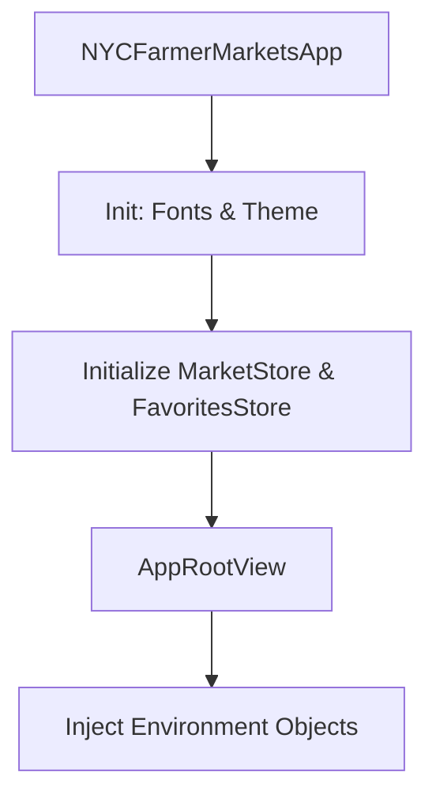
Sources: [NYCFarmerMarketsApp.swift:11-48](https://github.com/iyepes/NYCFarmerMarkets/blob/550674eaf4fdbb45bfca8191cb8ed53e7e453c09/NYCFarmerMarketsApp.swift#L11-L48)

### Lifecycle and Navigation Flow
The `AppRootView` manages the transition between the `SplashView` and the `RootTabView`. It monitors the `MarketStore` state and a minimum display timer to decide when to dismiss the splash screen.

| Component | Responsibility |
| :--- | :--- |
| `NYCFarmerMarketsApp` | Bootstraps the app, initializes stores, and applies global theme settings. |
| `AppRootView` | Orchestrates the transition from splash to main content based on data readiness. |
| `MarketStore` | Manages market data fetching, caching logic, and error states. |
| `FavoritesStore` | Persists user-selected favorite markets using `UserDefaults`. |
| `SplashDecision` | Contains pure logic to determine the current `SplashPhase`. |

Sources: [NYCFarmerMarketsApp.swift:13-39](https://github.com/iyepes/NYCFarmerMarkets/blob/550674eaf4fdbb45bfca8191cb8ed53e7e453c09/NYCFarmerMarketsApp.swift#L13-L39), [AppRootView.swift:12-25](https://github.com/iyepes/NYCFarmerMarkets/blob/550674eaf4fdbb45bfca8191cb8ed53e7e453c09/AppRootView.swift#L12-L25), [NYCFarmerMarketsTests.swift:115-140](https://github.com/iyepes/NYCFarmerMarkets/blob/550674eaf4fdbb45bfca8191cb8ed53e7e453c09/NYCFarmerMarketsTests.swift#L115-L140)

## Data Management Architecture

Data management is partitioned into remote fetching, local caching, and state observation.

### Market Data Pipeline
The `MarketStore` interacts with a `MarketCache` to provide offline support. If a network fetch fails, the store attempts to load data from the local JSON cache.

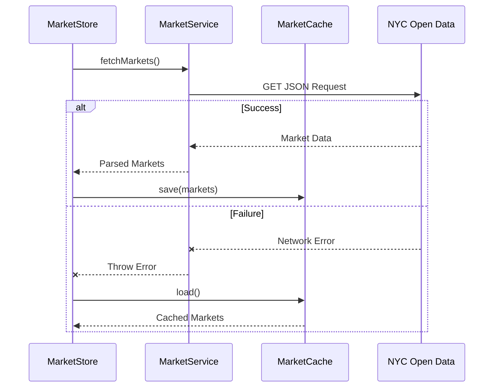
Sources: [NYCFarmerMarketsTests.swift:115-180](https://github.com/iyepes/NYCFarmerMarkets/blob/550674eaf4fdbb45bfca8191cb8ed53e7e453c09/NYCFarmerMarketsTests.swift#L115-L180)

### State Machine Logic
The application state is governed by the `SplashPhase` enumeration, which dictates the UI displayed during the initialization sequence.

- **.loading**: Initial state while data is being fetched and the minimum timer is running.
- **.failed(message)**: Displayed if data cannot be retrieved and no cache exists.
- **.dismissed**: Terminal state that triggers the transition to the main application tabs.

Sources: [AppRootView.swift:39-43](https://github.com/iyepes/NYCFarmerMarkets/blob/550674eaf4fdbb45bfca8191cb8ed53e7e453c09/AppRootView.swift#L39-L43), [SplashView.swift:35-56](https://github.com/iyepes/NYCFarmerMarkets/blob/550674eaf4fdbb45bfca8191cb8ed53e7e453c09/SplashView.swift#L35-L56)

## Theme and Styling System

The architecture uses a centralized theme engine to ensure visual consistency and support for Dark Mode and Dynamic Type.

### Typography Engine
`AppTypography` defines semantic roles for text, mapping them to bundled custom fonts (`Grim Creeper` and `Breath of the House`). It includes a fallback mechanism to system fonts if custom registration fails.

- **Display Family**: Used for titles and headers (e.g., `.splash`, `.navigationTitle`).
- **Body Family**: Used for all descriptive text with a 1.15x size scale to improve readability.

Sources: [AppTypography.swift:14-88](https://github.com/iyepes/NYCFarmerMarkets/blob/550674eaf4fdbb45bfca8191cb8ed53e7e453c09/AppTypography.swift#L14-L88)

### Palette and Color Tokens
Colors are defined as `ColorToken` objects, containing distinct hex values for light and dark modes. The `AppPalette` provides semantic tokens like `background`, `card`, and `accent`, preventing the use of literal color values in views.

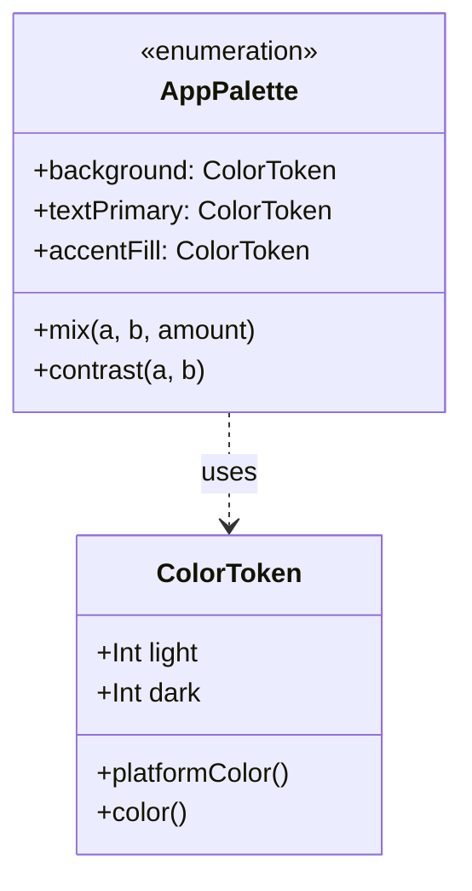
Sources: [AppPalette.swift:18-80](https://github.com/iyepes/NYCFarmerMarkets/blob/550674eaf4fdbb45bfca8191cb8ed53e7e453c09/AppPalette.swift#L18-L80)

### Styling Extensions
The `ThemeStyling.swift` file provides SwiftUI view modifiers to apply common styles:
- `themedBackground()`: Applies the palette's surface color to a view.
- `themedCard(selected:)`: Wraps content in a rounded rectangle with themed fill and stroke.
- `ThemedButtonStyle`: A custom `ButtonStyle` applying accent colors and custom typography.

Sources: [ThemeStyling.swift:15-46](https://github.com/iyepes/NYCFarmerMarkets/blob/550674eaf4fdbb45bfca8191cb8ed53e7e453c09/ThemeStyling.swift#L15-L46)

## Summary

The NYCFarmerMarkets architecture leverages a robust state-driven design. By isolating data fetching logic within `MarketStore` and visual definitions within a semantic theme engine, the application achieves a clean separation between business logic and UI presentation. The implementation of a latching splash phase ensures that the user experience is consistent during data synchronization and potential network failures.

Sources: [NYCFarmerMarketsApp.swift:35-49](https://github.com/iyepes/NYCFarmerMarkets/blob/550674eaf4fdbb45bfca8191cb8ed53e7e453c09/NYCFarmerMarketsApp.swift#L35-L49), [AppRootView.swift:50-59](https://github.com/iyepes/NYCFarmerMarkets/blob/550674eaf4fdbb45bfca8191cb8ed53e7e453c09/AppRootView.swift#L50-L59)

### State Management

<details>
<summary>Relevant source files</summary>

The following files were used as context for generating this wiki page:

- [NYCFarmerMarkets/Stores/MarketStore.swift](https://github.com/iyepes/NYCFarmerMarkets/blob/550674eaf4fdbb45bfca8191cb8ed53e7e453c09/NYCFarmerMarkets/Stores/MarketStore.swift)
- [NYCFarmerMarkets/Stores/FavoritesStore.swift](https://github.com/iyepes/NYCFarmerMarkets/blob/550674eaf4fdbb45bfca8191cb8ed53e7e453c09/NYCFarmerMarkets/Stores/FavoritesStore.swift)
- [NYCFarmerMarkets/NYCFarmerMarketsApp.swift](https://github.com/iyepes/NYCFarmerMarkets/blob/550674eaf4fdbb45bfca8191cb8ed53e7e453c09/NYCFarmerMarkets/NYCFarmerMarketsApp.swift)
- [NYCFarmerMarkets/Models/SplashDecision.swift](https://github.com/iyepes/NYCFarmerMarkets/blob/550674eaf4fdbb45bfca8191cb8ed53e7e453c09/NYCFarmerMarkets/Models/SplashDecision.swift)
- [NYCFarmerMarkets/Views/AppRootView.swift](https://github.com/iyepes/NYCFarmerMarkets/blob/550674eaf4fdbb45bfca8191cb8ed53e7e453c09/NYCFarmerMarkets/Views/AppRootView.swift)
- [NYCFarmerMarkets/Views/MarketListView.swift](https://github.com/iyepes/NYCFarmerMarkets/blob/550674eaf4fdbb45bfca8191cb8ed53e7e453c09/NYCFarmerMarkets/Views/MarketListView.swift)

</details>

# State Management

State management in the NYCFarmerMarkets application centers on the Observation framework to synchronize market data, user favorites, and UI presentation phases. The system handles asynchronous data fetching from the NYC Open Data API, local caching for offline availability, and transient UI states such as search queries and view expansions.

Primary state containers are injected into the SwiftUI environment at the application root, ensuring data consistency across the Markets, Map, and Favorites tabs. Sources: [NYCFarmerMarketsApp.swift:42-43](https://github.com/iyepes/NYCFarmerMarkets/blob/550674eaf4fdbb45bfca8191cb8ed53e7e453c09/NYCFarmerMarketsApp.swift#L42-L43), [MarketStore.swift:11](https://github.com/iyepes/NYCFarmerMarkets/blob/550674eaf4fdbb45bfca8191cb8ed53e7e453c09/MarketStore.swift#L11)

## Core Data Stores

The application utilizes two primary observable stores to manage persistent and semi-persistent data.

### MarketStore
The `MarketStore` manages the primary list of farmers markets. It tracks the loading state, handles network refreshes, and manages local persistence via `MarketCache`. It also holds the shared `searchQuery` used to synchronize results between the list and map views.

Sources: [MarketStore.swift:11-28](https://github.com/iyepes/NYCFarmerMarkets/blob/550674eaf4fdbb45bfca8191cb8ed53e7e453c09/MarketStore.swift#L11-L28)

| Property | Type | Description |
| :--- | :--- | :--- |
| `markets` | `[Market]` | The collection of validated market records. |
| `state` | `LoadState` | Current lifecycle phase: `idle`, `loading`, `loaded`, or `error`. |
| `isShowingCachedData` | `Bool` | Flag indicating if current data is from cache due to network failure. |
| `selectedMarket` | `Market?` | The specific market currently being viewed in detail. |
| `searchQuery` | `String` | Shared search string for filtering results. |

### FavoritesStore
The `FavoritesStore` manages user-selected favorite markets. It persists market IDs using `UserDefaults` to maintain the user's list across app launches.

Sources: [FavoritesStore.swift:11-15](https://github.com/iyepes/NYCFarmerMarkets/blob/550674eaf4fdbb45bfca8191cb8ed53e7e453c09/FavoritesStore.swift#L11-L15), [NYCFarmerMarketsTests.swift:259-261](https://github.com/iyepes/NYCFarmerMarkets/blob/550674eaf4fdbb45bfca8191cb8ed53e7e453c09/NYCFarmerMarketsTests.swift#L259-L261)

## Data Flow Architecture

The following diagram illustrates the flow of data from the initial launch through network fetching and UI updates.

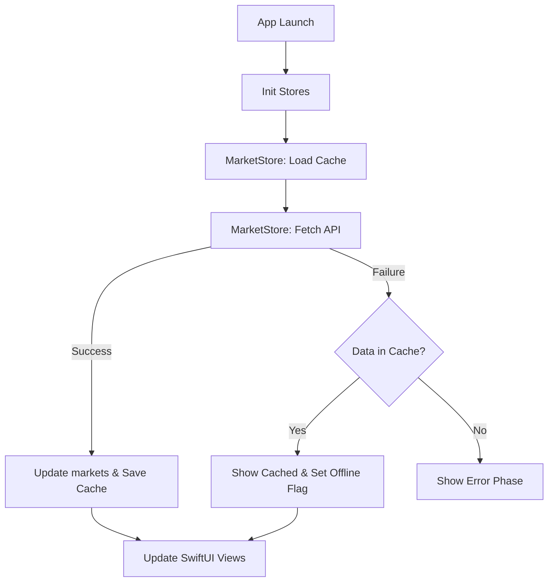
The application prioritizes immediate display of cached data while performing background network refreshes. Sources: [MarketStore.swift:45-50](https://github.com/iyepes/NYCFarmerMarkets/blob/550674eaf4fdbb45bfca8191cb8ed53e7e453c09/MarketStore.swift#L45-L50)

## Launch State and Splash Transitions

The `AppRootView` and `SplashDecision` logic govern the transition from the launch splash screen to the main application interface. The splash remains visible until two conditions are met: data is available (either from cache or network) and a minimum display time has elapsed.

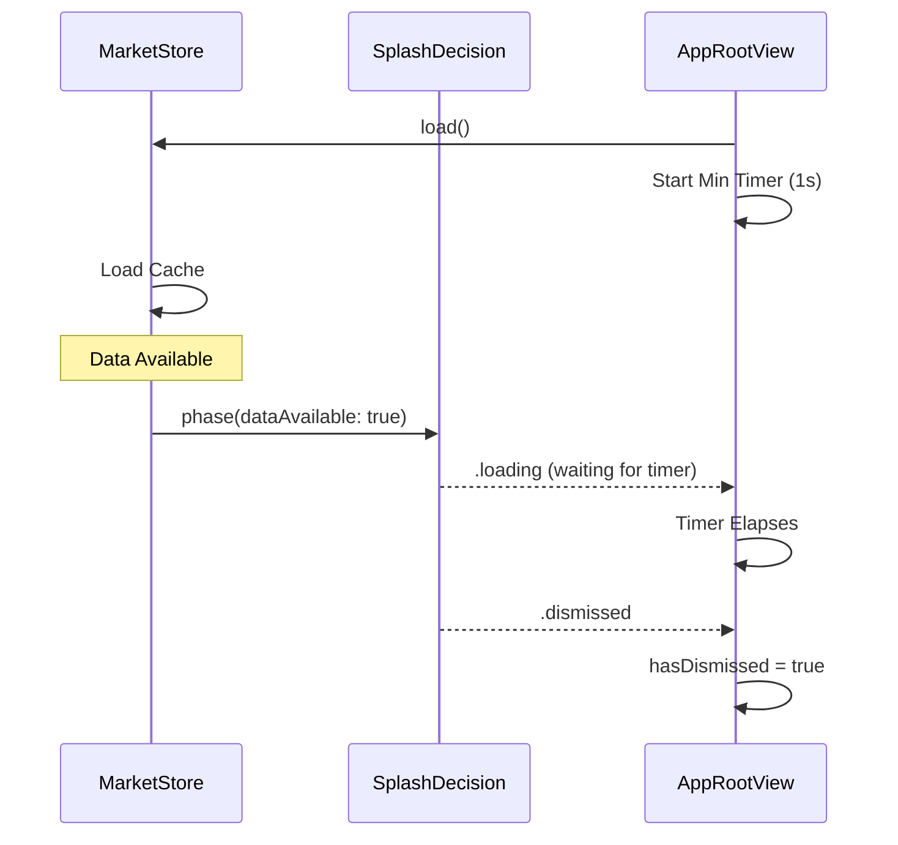
Sources: [SplashDecision.swift:23-45](https://github.com/iyepes/NYCFarmerMarkets/blob/550674eaf4fdbb45bfca8191cb8ed53e7e453c09/SplashDecision.swift#L23-L45), [AppRootView.swift:45-66](https://github.com/iyepes/NYCFarmerMarkets/blob/550674eaf4fdbb45bfca8191cb8ed53e7e453c09/AppRootView.swift#L45-L66)

## UI State Management

Specific views maintain local state for interactive elements that do not require global persistence.

### Section Expansion
`MarketListView` utilizes `SectionExpansionState` to track which borough groupings are open. 
- **Default State**: Sections start collapsed. Sources: [SectionExpansionTests.swift:45-51](https://github.com/iyepes/NYCFarmerMarkets/blob/550674eaf4fdbb45bfca8191cb8ed53e7e453c09/SectionExpansionTests.swift#L45-L51)
- **Search Behavior**: Untouched sections automatically expand when a valid search query is entered. Sources: [SectionExpansionTests.swift:76-80](https://github.com/iyepes/NYCFarmerMarkets/blob/550674eaf4fdbb45bfca8191cb8ed53e7e453c09/SectionExpansionTests.swift#L76-L80)
- **Restoration**: Clearing a search restores the manual expansion state held before the search began. Sources: [SectionExpansionTests.swift:93-98](https://github.com/iyepes/NYCFarmerMarkets/blob/550674eaf4fdbb45bfca8191cb8ed53e7e453c09/SectionExpansionTests.swift#L93-L98)

### Accessibility State
Section headers dynamically update accessibility labels and hints based on the `isExpanded` state and the number of markets within the borough.
Sources: [SectionHeaderAccessibilityTests.swift:47-52](https://github.com/iyepes/NYCFarmerMarkets/blob/550674eaf4fdbb45bfca8191cb8ed53e7e453c09/SectionHeaderAccessibilityTests.swift#L47-L52), [MarketListView.swift:105-115](https://github.com/iyepes/NYCFarmerMarkets/blob/550674eaf4fdbb45bfca8191cb8ed53e7e453c09/MarketListView.swift#L105-L115)

## Error Handling and Recovery
When a network fetch fails, the `MarketStore` logs the technical error but presents a `LoadFailureMessage` to the user.
- If data is already present (from cache), the app transitions to a "loaded" state with `isShowingCachedData` set to true, triggering an offline banner.
- If no data is available, the store enters the `.error` state, which the `AppRootView` uses to display a failure message and retry button on the splash screen.

Sources: [MarketStore.swift:65-79](https://github.com/iyepes/NYCFarmerMarkets/blob/550674eaf4fdbb45bfca8191cb8ed53e7e453c09/MarketStore.swift#L65-L79), [AppRootView.swift:20-27](https://github.com/iyepes/NYCFarmerMarkets/blob/550674eaf4fdbb45bfca8191cb8ed53e7e453c09/AppRootView.swift#L20-L27)

## Summary
The NYCFarmerMarkets state management system ensures a resilient user experience by decoupling network dependency from UI availability. By leveraging a centralized observable `MarketStore` and a persistent `FavoritesStore`, the application maintains a consistent data model across multiple navigation tabs while using pure logic components like `SplashDecision` and `SectionExpansionState` to manage complex view transitions.

### Navigation and Routing

<details>
<summary>Relevant source files</summary>

The following files were used as context for generating this wiki page:

- [NYCFarmerMarkets/Views/RootTabView.swift](https://github.com/iyepes/NYCFarmerMarkets/blob/550674eaf4fdbb45bfca8191cb8ed53e7e453c09/NYCFarmerMarkets/Views/RootTabView.swift)
- [NYCFarmerMarkets/Views/AppRootView.swift](https://github.com/iyepes/NYCFarmerMarkets/blob/550674eaf4fdbb45bfca8191cb8ed53e7e453c09/NYCFarmerMarkets/Views/AppRootView.swift)
- [NYCFarmerMarkets/NYCFarmerMarketsApp.swift](https://github.com/iyepes/NYCFarmerMarkets/blob/550674eaf4fdbb45bfca8191cb8ed53e7e453c09/NYCFarmerMarkets/NYCFarmerMarketsApp.swift)
- [NYCFarmerMarkets/Views/MarketDetailView.swift](https://github.com/iyepes/NYCFarmerMarkets/blob/550674eaf4fdbb45bfca8191cb8ed53e7e453c09/NYCFarmerMarkets/Views/MarketDetailView.swift)
- [NYCFarmerMarkets/Views/MarketListView.swift](https://github.com/iyepes/NYCFarmerMarkets/blob/550674eaf4fdbb45bfca8191cb8ed53e7e453c09/NYCFarmerMarkets/Views/MarketListView.swift)
- [NYCFarmerMarkets/Views/MarketMapView.swift](https://github.com/iyepes/NYCFarmerMarkets/blob/550674eaf4fdbb45bfca8191cb8ed53e7e453c09/NYCFarmerMarkets/Views/MarketMapView.swift)
- [NYCFarmerMarkets/Views/SplashView.swift](https://github.com/iyepes/NYCFarmerMarkets/blob/550674eaf4fdbb45bfca8191cb8ed53e7e453c09/NYCFarmerMarkets/Views/SplashView.swift)
- [NYCFarmerMarketsTests/SplashDecisionTests.swift](https://github.com/iyepes/NYCFarmerMarkets/blob/550674eaf4fdbb45bfca8191cb8ed53e7e453c09/NYCFarmerMarketsTests/SplashDecisionTests.swift)
</details>

# Navigation and Routing

Navigation and Routing in the NYC Farmer Markets application manages the transition from the initial launch state to the main functional areas of the app. The system uses a conditional root view to handle the splash screen lifecycle and a tab-based architecture for primary navigation.

The routing logic ensures that data is available and a minimum display time has passed before presenting the `RootTabView`. It further supports modal presentations for market details and nested navigation for location-specific maps.

## App Startup and Lifecycle Routing

The application entry point, `NYCFarmerMarketsApp`, initializes the core state containers and determines the initial view. It injects `MarketStore` and `FavoritesStore` into the environment, making them accessible throughout the navigation hierarchy.

Sources: [NYCFarmerMarkets/NYCFarmerMarketsApp.swift:13-43](https://github.com/iyepes/NYCFarmerMarkets/blob/550674eaf4fdbb45bfca8191cb8ed53e7e453c09/NYCFarmerMarkets/NYCFarmerMarketsApp.swift#L13-L43)

### Splash Sequence logic
`AppRootView` serves as the primary router during startup. It monitors the `MarketStore` state and a timer to decide when to dismiss the `SplashView`.

*   **Loading State**: The app displays `SplashView` while `MarketStore` is loading data.
*   **Transition**: The app switches to `RootTabView` only when `dataAvailable` is true and `minimumTimeElapsed` is true.
*   **Error Handling**: If loading fails without cached data, the router stays on the splash screen and displays an error with a retry option.

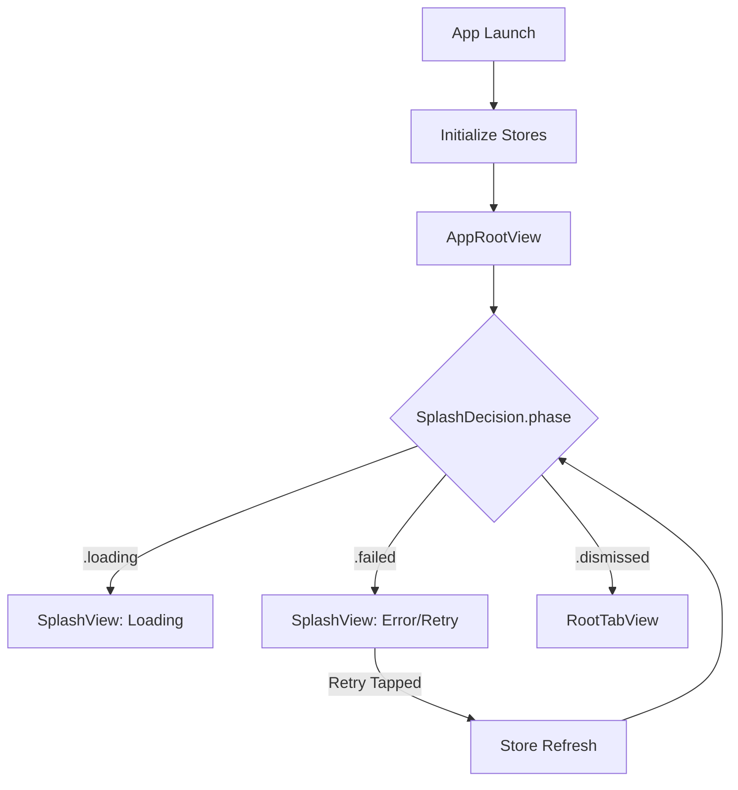
The flow above illustrates how the app decides between the splash screen and the main interface based on data availability and time.
Sources: [NYCFarmerMarkets/Views/AppRootView.swift:15-62](https://github.com/iyepes/NYCFarmerMarkets/blob/550674eaf4fdbb45bfca8191cb8ed53e7e453c09/NYCFarmerMarkets/Views/AppRootView.swift#L15-L62), [NYCFarmerMarkets/Views/SplashView.swift:15-55](https://github.com/iyepes/NYCFarmerMarkets/blob/550674eaf4fdbb45bfca8191cb8ed53e7e453c09/NYCFarmerMarkets/Views/SplashView.swift#L15-L55), [NYCFarmerMarketsTests/SplashDecisionTests.swift:23-38](https://github.com/iyepes/NYCFarmerMarkets/blob/550674eaf4fdbb45bfca8191cb8ed53e7e453c09/NYCFarmerMarketsTests/SplashDecisionTests.swift#L23-L38)

## Primary Navigation Structure

Once the splash screen is dismissed, the app utilizes a `TabView` to organize features into three main sections.

| Tab | View | Functionality |
| :--- | :--- | :--- |
| **Markets** | `MarketListView` | Searchable list of all markets grouped by borough. |
| **Map** | `MarketMapView` | Geographic visualization of markets with pins. |
| **Favorites** | `FavoritesView` | User-selected markets for quick access. |

Sources: [NYCFarmerMarkets/Views/RootTabView.swift:10-30](https://github.com/iyepes/NYCFarmerMarkets/blob/550674eaf4fdbb45bfca8191cb8ed53e7e453c09/NYCFarmerMarkets/Views/RootTabView.swift#L10-L30)

## Detailed Navigation and Modals

The app uses `NavigationStack` within individual tabs to manage drill-down navigation and `sheet` modifiers for detail views.

### Market Detail Presentation
Markets selected from the list or map are presented in a `MarketDetailView`. This is typically triggered by updating the `selectedMarket` property in the `MarketStore`.

### In-App Map Routing
Inside `MarketDetailView`, a "Go to Map" button triggers a push navigation to `MarketLocationMapView`. This uses `navigationDestination` to maintain the navigation context within the modal stack.

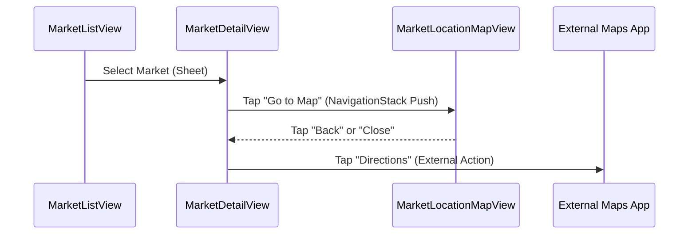
This diagram demonstrates the nested navigation levels available when viewing a specific market's information.
Sources: [NYCFarmerMarkets/Views/MarketDetailView.swift:20-65](https://github.com/iyepes/NYCFarmerMarkets/blob/550674eaf4fdbb45bfca8191cb8ed53e7e453c09/NYCFarmerMarkets/Views/MarketDetailView.swift#L20-L65), [NYCFarmerMarkets/Views/MarketListView.swift:80-92](https://github.com/iyepes/NYCFarmerMarkets/blob/550674eaf4fdbb45bfca8191cb8ed53e7e453c09/NYCFarmerMarkets/Views/MarketListView.swift#L80-L92)

## Search-Driven Routing

Navigation state is also affected by search queries. 
*   **List View**: Entering a search query in `MarketListView` automatically expands matching borough sections through the `SectionExpansionState`.
*   **Map View**: The `MarketMapView` observes the `searchQuery` from the `MarketStore`. If a currently selected market pin no longer matches the search filter, the selection is automatically cleared.

Sources: [NYCFarmerMarkets/Views/MarketListView.swift:34-40](https://github.com/iyepes/NYCFarmerMarkets/blob/550674eaf4fdbb45bfca8191cb8ed53e7e453c09/NYCFarmerMarkets/Views/MarketListView.swift#L34-L40), [NYCFarmerMarkets/Views/MarketMapView.swift:65-69](https://github.com/iyepes/NYCFarmerMarkets/blob/550674eaf4fdbb45bfca8191cb8ed53e7e453c09/NYCFarmerMarkets/Views/MarketMapView.swift#L65-L69)

## Conclusion

The navigation and routing system provides a structured transition from app launch to data interaction. By centralizing the splash decision logic and utilizing SwiftUI's native navigation components, the application ensures a consistent user experience while handling complex states like offline data availability and search-driven view updates.


## Core Features

### Interactive Map View

<details>
<summary>Relevant source files</summary>

The following files were used as context for generating this wiki page:

- [NYCFarmerMarkets/Views/MarketMapView.swift](https://github.com/iyepes/NYCFarmerMarkets/blob/550674eaf4fdbb45bfca8191cb8ed53e7e453c09/NYCFarmerMarkets/Views/MarketMapView.swift)
- [NYCFarmerMarkets/Views/MarketLocationMapView.swift](https://github.com/iyepes/NYCFarmerMarkets/blob/550674eaf4fdbb45bfca8191cb8ed53e7e453c09/NYCFarmerMarkets/Views/MarketLocationMapView.swift)
- [NYCFarmerMarkets/Models/Market.swift](https://github.com/iyepes/NYCFarmerMarkets/blob/550674eaf4fdbb45bfca8191cb8ed53e7e453c09/NYCFarmerMarkets/Models/Market.swift)
- [NYCFarmerMarkets/Models/SingleMarketMap.swift](https://github.com/iyepes/NYCFarmerMarkets/blob/550674eaf4fdbb45bfca8191cb8ed53e7e453c09/NYCFarmerMarkets/Models/SingleMarketMap.swift)
- [NYCFarmerMarkets/Views/MarketDetailView.swift](https://github.com/iyepes/NYCFarmerMarkets/blob/550674eaf4fdbb45bfca8191cb8ed53e7e453c09/NYCFarmerMarkets/Views/MarketDetailView.swift)
- [NYCFarmerMarketsUITests/NYCFarmerMarketsUITests.swift](https://github.com/iyepes/NYCFarmerMarketsUITests/blob/550674eaf4fdbb45bfca8191cb8ed53e7e453c09/NYCFarmerMarketsUITests/NYCFarmerMarketsUITests.swift)
</details>

# Interactive Map View

The **Interactive Map View** provides a geographic interface for users to locate NYC farmers markets. It displays markets as interactive annotations on a standard map, allowing users to select specific locations to view summarized information and navigate to a full detail sheet.

This system integrates with the `MarketStore` to synchronize with list-based search queries and manages a specialized `SingleMarketMap` mode for focusing on individual locations.

Sources: [NYCFarmerMarkets/Views/MarketMapView.swift:10-14](https://github.com/iyepes/NYCFarmerMarkets/blob/550674eaf4fdbb45bfca8191cb8ed53e7e453c09/NYCFarmerMarkets/Views/MarketMapView.swift#L10-L14), [readme.md](https://github.com/iyepes/NYCFarmerMarkets/blob/550674eaf4fdbb45bfca8191cb8ed53e7e453c09/readme.md)

## Architecture and Components

The map view architecture relies on SwiftUI's `Map` framework and a centralized data store. It uses `Annotation` markers to represent market locations on a coordinate plane.

### Core Components
| Component | Responsibility |
| :--- | :--- |
| `MarketMapView` | Main container managing map position, selection state, and overlays. |
| `MarketPin` | Custom view for map markers, indicating selection and favorite status. |
| `MarketCard` | Bottom overlay appearing when a pin is selected, showing a summary of the market. |
| `MarketLocationMapView` | A secondary map view that displays only one specific market location. |

Sources: [NYCFarmerMarkets/Views/MarketMapView.swift:14-38](https://github.com/iyepes/NYCFarmerMarkets/blob/550674eaf4fdbb45bfca8191cb8ed53e7e453c09/NYCFarmerMarkets/Views/MarketMapView.swift#L14-L38), [NYCFarmerMarkets/Views/MarketLocationMapView.swift:11-15](https://github.com/iyepes/NYCFarmerMarkets/blob/550674eaf4fdbb45bfca8191cb8ed53e7e453c09/NYCFarmerMarkets/Views/MarketLocationMapView.swift#L11-L15), [NYCFarmerMarkets/Views/Shared/MarketPin.swift](https://github.com/iyepes/NYCFarmerMarkets/blob/550674eaf4fdbb45bfca8191cb8ed53e7e453c09/NYCFarmerMarkets/Views/Shared/MarketPin.swift)

### Data Flow for Pin Selection
When a user interacts with the map, the system updates the selection state and synchronizes with the detail views.

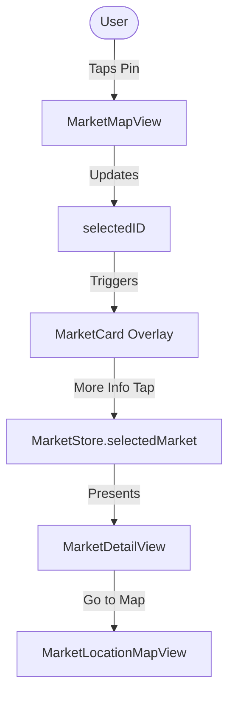
Sources: [NYCFarmerMarkets/Views/MarketMapView.swift:51-64](https://github.com/iyepes/NYCFarmerMarkets/blob/550674eaf4fdbb45bfca8191cb8ed53e7e453c09/NYCFarmerMarkets/Views/MarketMapView.swift#L51-L64), [NYCFarmerMarkets/Views/MarketDetailView.swift:49-55](https://github.com/iyepes/NYCFarmerMarkets/blob/550674eaf4fdbb45bfca8191cb8ed53e7e453c09/NYCFarmerMarkets/Views/MarketDetailView.swift#L49-L55)

## Mapping Logic and Search Integration

The view dynamically filters the markers shown based on the global search query. It only displays `Market` objects that contain valid geographic coordinates.

### Filtering and Coordinates
The map calculates `mappable` markets by checking for non-nil `latitude` and `longitude` values.
- **Default Position:** The map initializes centered on New York City coordinates (40.7128, -74.0060) with a span of 0.35 degrees.
- **Search Sync:** When the user types in the search field of the list view, `MarketMapView` updates the `visibleMarkets` array and clears the `selectedID` if the previously selected market no longer matches the search criteria.

Sources: [NYCFarmerMarkets/Views/MarketMapView.swift:18-35](https://github.com/iyepes/NYCFarmerMarkets/blob/550674eaf4fdbb45bfca8191cb8ed53e7e453c09/NYCFarmerMarkets/Views/MarketMapView.swift#L18-L35), [NYCFarmerMarkets/Models/Market.swift:31-34](https://github.com/iyepes/NYCFarmerMarkets/blob/550674eaf4fdbb45bfca8191cb8ed53e7e453c09/NYCFarmerMarkets/Models/Market.swift#L31-L34)

### Coordinate Validation Code
```swift
// NYCFarmerMarkets/Models/Market.swift:76-79
static func parseCoordinate(_ value: String?) -> Double? {
    guard let text = clean(value), let number = Double(text), number != 0 else { return nil }
    return number
}
```
Sources: [NYCFarmerMarkets/Models/Market.swift:76-79](https://github.com/iyepes/NYCFarmerMarkets/blob/550674eaf4fdbb45bfca8191cb8ed53e7e453c09/NYCFarmerMarkets/Models/Market.swift#L76-L79)

## Single Market View Mode

The `MarketLocationMapView` is a specialized map pushed from the `MarketDetailView`. It focuses exclusively on one market and provides high-zoom visibility.

### Logic and Region Framing
The `SingleMarketMap` enum provides pure logic for calculating the frame and pins for a single location.
- **Span:** It uses a fixed zoom level of 0.01 degrees for both latitude and longitude delta.
- **Pin Creation:** It transforms a `Market` into a `SingleMarketMap.Pin` object.

Sources: [NYCFarmerMarkets/Models/SingleMarketMap.swift:10-25](https://github.com/iyepes/NYCFarmerMarkets/blob/550674eaf4fdbb45bfca8191cb8ed53e7e453c09/NYCFarmerMarkets/Models/SingleMarketMap.swift#L10-L25), [NYCFarmerMarkets/Views/MarketLocationMapView.swift:18-24](https://github.com/iyepes/NYCFarmerMarkets/blob/550674eaf4fdbb45bfca8191cb8ed53e7e453c09/NYCFarmerMarkets/Views/MarketLocationMapView.swift#L18-L24)

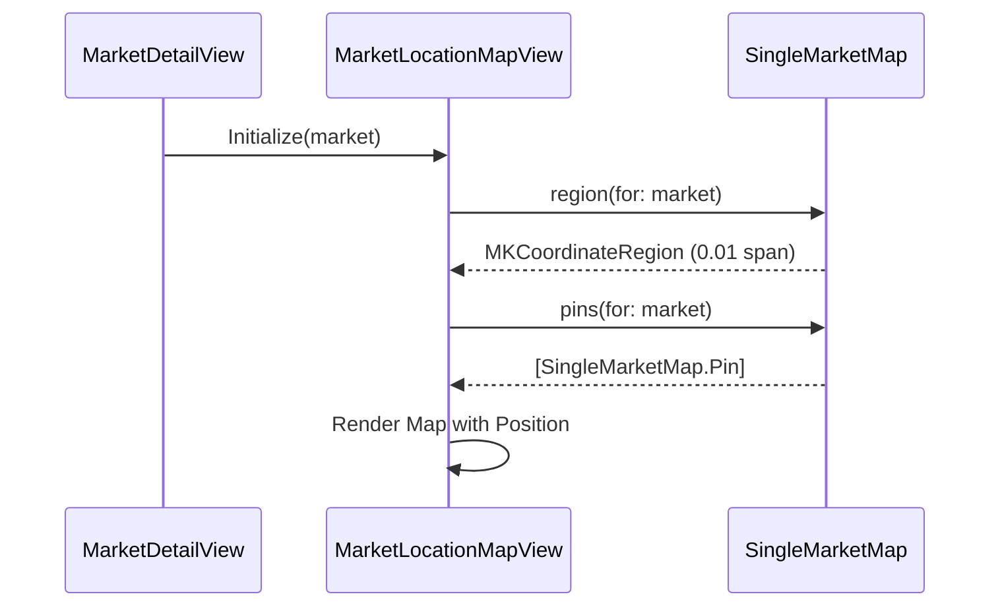
Sources: [NYCFarmerMarkets/Views/MarketLocationMapView.swift:18-24](https://github.com/iyepes/NYCFarmerMarkets/blob/550674eaf4fdbb45bfca8191cb8ed53e7e453c09/NYCFarmerMarkets/Views/MarketLocationMapView.swift#L18-L24), [NYCFarmerMarkets/Models/SingleMarketMap.swift:27-31](https://github.com/iyepes/NYCFarmerMarkets/blob/550674eaf4fdbb45bfca8191cb8ed53e7e453c09/NYCFarmerMarkets/Models/SingleMarketMap.swift#L27-L31)

## User Interaction Details

### Map Overlays
The system uses several overlays to provide context to the user:
1. **Offline Banner:** Appears at the top if the application is showing cached data due to network failure.
2. **Filter Indicator:** Displays the search query and the count of results when a search is active.
3. **Market Card:** Slides from the bottom when a pin is selected, providing the market name, borough, and a "More info" button.

Sources: [NYCFarmerMarkets/Views/MarketMapView.swift:65-80](https://github.com/iyepes/NYCFarmerMarkets/blob/550674eaf4fdbb45bfca8191cb8ed53e7e453c09/NYCFarmerMarkets/Views/MarketMapView.swift#L65-L80)

### External Navigation
The map system allows users to transition to external mapping applications.
- The `Directions` button in the `MarketDetailView` creates an `MKMapItem` using the market's coordinates and calls `openInMaps()`.

Sources: [NYCFarmerMarkets/Views/MarketDetailView.swift:106-114](https://github.com/iyepes/NYCFarmerMarkets/blob/550674eaf4fdbb45bfca8191cb8ed53e7e453c09/NYCFarmerMarkets/Views/MarketDetailView.swift#L106-L114)

## Summary
The Interactive Map View serves as a visual discovery tool for NYC farmers markets. It synchronizes state across the `MarketStore`, manages both city-wide and focused single-market views, and ensures that only markets with valid geographic data are rendered for user interaction.

Sources: [NYCFarmerMarkets/Views/MarketMapView.swift](https://github.com/iyepes/NYCFarmerMarkets/blob/550674eaf4fdbb45bfca8191cb8ed53e7e453c09/NYCFarmerMarkets/Views/MarketMapView.swift), [NYCFarmerMarkets/Views/MarketLocationMapView.swift](https://github.com/iyepes/NYCFarmerMarkets/blob/550674eaf4fdbb45bfca8191cb8ed53e7e453c09/NYCFarmerMarkets/Views/MarketLocationMapView.swift)

### Single Market Map & Directions

<details>
<summary>Relevant source files</summary>

The following files were used as context for generating this wiki page:

- [NYCFarmerMarkets/Views/MarketLocationMapView.swift](https://github.com/iyepes/NYCFarmerMarkets/blob/550674eaf4fdbb45bfca8191cb8ed53e7e453c09/NYCFarmerMarkets/Views/MarketLocationMapView.swift)
- [NYCFarmerMarkets/Models/SingleMarketMap.swift](https://github.com/iyepes/NYCFarmerMarkets/blob/550674eaf4fdbb45bfca8191cb8ed53e7e453c09/NYCFarmerMarkets/Models/SingleMarketMap.swift)
- [NYCFarmerMarkets/Views/MarketDetailView.swift](https://github.com/iyepes/NYCFarmerMarkets/blob/550674eaf4fdbb45bfca8191cb8ed53e7e453c09/NYCFarmerMarkets/Views/MarketDetailView.swift)
- [NYCFarmerMarkets/Models/Market.swift](https://github.com/iyepes/NYCFarmerMarkets/blob/550674eaf4fdbb45bfca8191cb8ed53e7e453c09/NYCFarmerMarkets/Models/Market.swift)
- [NYCFarmerMarketsTests/SingleMarketMapTests.swift](https://github.com/iyepes/NYCFarmerMarkets/blob/550674eaf4fdbb45bfca8191cb8ed53e7e453c09/NYCFarmerMarketsTests/SingleMarketMapTests.swift)
- [NYCFarmerMarkets/Theme/AppCopy.swift](https://github.com/iyepes/NYCFarmerMarkets/blob/550674eaf4fdbb45bfca8191cb8ed53e7e453c09/NYCFarmerMarkets/Theme/AppCopy.swift)
</details>

# Single Market Map & Directions

The Single Market Map & Directions feature enables users to view the geographic location of a specific farmers market and obtain navigation routes. This functionality is accessible through the market detail interface, providing both an in-app focused map view and an integration with external mapping applications.

The system uses `CoreLocation` and `MapKit` to render market coordinates and launch external navigation services. It ensures that geographic features are only presented when valid latitude and longitude data exist for a given `Market` entity.

## Architectural Components

The feature is composed of a data model for map logic, a dedicated SwiftUI view for the in-app map, and interaction logic within the primary detail view.

### SingleMarketMap Logic
The `SingleMarketMap` enum contains non-isolated pure logic for framing a single market. It defines the zoom levels and pin generation required for the map display.

*   **Pin Structure**: A `Pin` represents a single annotation on the map, containing the market's ID, name, and coordinates.
*   **Span**: The map uses a fixed `MKCoordinateSpan` of 0.01 degrees for both latitude and longitude to provide a consistent zoom level.
*   **Region**: The `region(for:)` function calculates an `MKCoordinateRegion` centered on the market's coordinates.

Sources: [NYCFarmerMarkets/Models/SingleMarketMap.swift:10-34](https://github.com/iyepes/NYCFarmerMarkets/blob/550674eaf4fdbb45bfca8191cb8ed53e7e453c09/NYCFarmerMarkets/Models/SingleMarketMap.swift#L10-L34), [NYCFarmerMarketsTests/SingleMarketMapTests.swift:13-41](https://github.com/iyepes/NYCFarmerMarkets/blob/550674eaf4fdbb45bfca8191cb8ed53e7e453c09/NYCFarmerMarketsTests/SingleMarketMapTests.swift#L13-L41)

### MarketLocationMapView
This view is pushed from the detail screen to show a focused map. It utilizes the `SingleMarketMap` logic to position the camera and render a `MarketPin` annotation.

Sources: [NYCFarmerMarkets/Views/MarketLocationMapView.swift:11-47](https://github.com/iyepes/NYCFarmerMarkets/blob/550674eaf4fdbb45bfca8191cb8ed53e7e453c09/NYCFarmerMarkets/Views/MarketLocationMapView.swift#L11-L47)

### Navigation and External Maps
The `MarketDetailView` handles the entry points for mapping. If a market has a coordinate, the view renders buttons for "Go to Map" and "Directions".

*   **In-App Map**: Triggered by the `showsMap` state, navigating the user to `MarketLocationMapView`.
*   **External Directions**: The `openInExternalMaps()` function creates an `MKMapItem` and calls `openInMaps()` to hand over navigation to the system's map application.

Sources: [NYCFarmerMarkets/Views/MarketDetailView.swift:42-76](https://github.com/iyepes/NYCFarmerMarkets/blob/550674eaf4fdbb45bfca8191cb8ed53e7e453c09/NYCFarmerMarkets/Views/MarketDetailView.swift#L42-L76), [NYCFarmerMarkets/Views/MarketDetailView.swift:114-122](https://github.com/iyepes/NYCFarmerMarkets/blob/550674eaf4fdbb45bfca8191cb8ed53e7e453c09/NYCFarmerMarkets/Views/MarketDetailView.swift#L114-L122)

## Data Flow for Mapping

The following diagram illustrates how market data flows from the `Market` model into the mapping components.

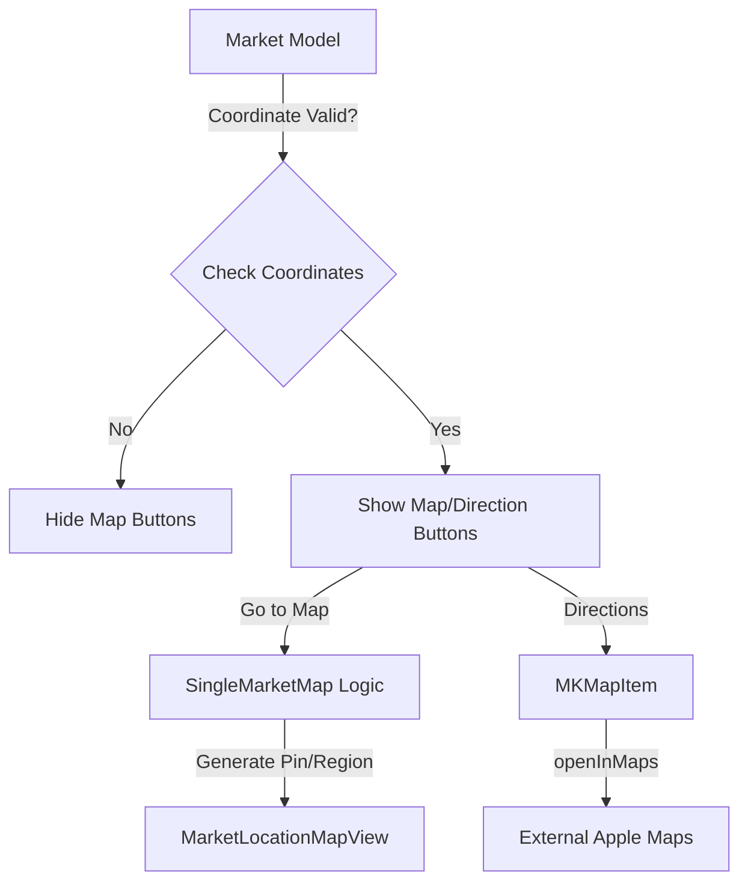
The flow ensures that mapping actions are conditionally available based on data presence.
Sources: [NYCFarmerMarkets/Views/MarketDetailView.swift:42-76](https://github.com/iyepes/NYCFarmerMarkets/blob/550674eaf4fdbb45bfca8191cb8ed53e7e453c09/NYCFarmerMarkets/Views/MarketDetailView.swift#L42-L76), [NYCFarmerMarkets/Models/SingleMarketMap.swift:24-33](https://github.com/iyepes/NYCFarmerMarkets/blob/550674eaf4fdbb45bfca8191cb8ed53e7e453c09/NYCFarmerMarkets/Models/SingleMarketMap.swift#L24-L33)

## Component Specifications

### Map Configuration
| Property | Value / Type | Description |
| :--- | :--- | :--- |
| **Latitude Delta** | 0.01 | Fixed zoom span for vertical axis. |
| **Longitude Delta** | 0.01 | Fixed zoom span for horizontal axis. |
| **Map Style** | `.standard` | Default MapKit standard rendering. |
| **Pin Anchor** | `.center` or `.bottom` | Alignment of the icon relative to the coordinate. |

Sources: [NYCFarmerMarkets/Models/SingleMarketMap.swift:21](https://github.com/iyepes/NYCFarmerMarkets/blob/550674eaf4fdbb45bfca8191cb8ed53e7e453c09/NYCFarmerMarkets/Models/SingleMarketMap.swift#L21), [NYCFarmerMarkets/Views/MarketLocationMapView.swift:37](https://github.com/iyepes/NYCFarmerMarkets/blob/550674eaf4fdbb45bfca8191cb8ed53e7e453c09/NYCFarmerMarkets/Views/MarketLocationMapView.swift#L37), [NYCFarmerMarkets/Views/MarketMapView.swift:41](https://github.com/iyepes/NYCFarmerMarkets/blob/550674eaf4fdbb45bfca8191cb8ed53e7e453c09/NYCFarmerMarkets/Views/MarketMapView.swift#L41)

### Market Model Geographic Fields
The `Market` model cleans and parses raw string data from the NYC Open Data API into typed geographic values.

| Field | Type | Logic |
| :--- | :--- | :--- |
| `latitude` | `Double?` | Parsed from string; returns `nil` if value is "0". |
| `longitude` | `Double?` | Parsed from string; returns `nil` if value is "0". |
| `coordinate` | `CLLocationCoordinate2D?` | Computed property combining lat/long. |

Sources: [NYCFarmerMarkets/Models/Market.swift:24-27](https://github.com/iyepes/NYCFarmerMarkets/blob/550674eaf4fdbb45bfca8191cb8ed53e7e453c09/NYCFarmerMarkets/Models/Market.swift#L24-L27), [NYCFarmerMarkets/Models/Market.swift:85-88](https://github.com/iyepes/NYCFarmerMarkets/blob/550674eaf4fdbb45bfca8191cb8ed53e7e453c09/NYCFarmerMarkets/Models/Market.swift#L85-L88)

## Implementation Details

The integration with external maps uses the `MKMapItem` class to ensure the market name is passed to the system navigator.

```swift
private func openInExternalMaps() {
    guard let coordinate = market.coordinate else { return }
    let item = MKMapItem(
        location: CLLocation(latitude: coordinate.latitude, longitude: coordinate.longitude),
        address: nil
    )
    item.name = market.name
    item.openInMaps()
}
```
Sources: [NYCFarmerMarkets/Views/MarketDetailView.swift:114-122](https://github.com/iyepes/NYCFarmerMarkets/blob/550674eaf4fdbb45bfca8191cb8ed53e7e453c09/NYCFarmerMarkets/Views/MarketDetailView.swift#L114-L122)

The `MarketLocationMapView` uses a `ZStack` and a `ForEach` loop to render pins generated by the `SingleMarketMap` helper. It maintains the current camera position in a `@State` variable initialized during the view's construction.

Sources: [NYCFarmerMarkets/Views/MarketLocationMapView.swift:20-47](https://github.com/iyepes/NYCFarmerMarkets/blob/550674eaf4fdbb45bfca8191cb8ed53e7e453c09/NYCFarmerMarkets/Views/MarketLocationMapView.swift#L20-L47)

## Conclusion
The Single Market Map & Directions module provides a bridge between the market's textual data and its physical location. By encapsulating geographic logic in `SingleMarketMap` and providing both internal and external viewing options, the system maintains high utility for users navigating New York City's farmers markets.

### List View & Grouping

<details>
<summary>Relevant source files</summary>

The following files were used as context for generating this wiki page:

- [NYCFarmerMarkets/Views/MarketListView.swift](https://github.com/iyepes/NYCFarmerMarkets/blob/550674eaf4fdbb45bfca8191cb8ed53e7e453c09/NYCFarmerMarkets/Views/MarketListView.swift)
- [NYCFarmerMarkets/Models/MarketGrouping.swift](https://github.com/iyepes/NYCFarmerMarkets/blob/550674eaf4fdbb45bfca8191cb8ed53e7e453c09/NYCFarmerMarkets/Models/MarketGrouping.swift)
- [NYCFarmerMarkets/Models/Market.swift](https://github.com/iyepes/NYCFarmerMarkets/blob/550674eaf4fdbb45bfca8191cb8ed53e7e453c09/NYCFarmerMarkets/Models/Market.swift)
- [NYCFarmerMarkets/Views/Shared/MarketRow.swift](https://github.com/iyepes/NYCFarmerMarkets/blob/550674eaf4fdbb45bfca8191cb8ed53e7e453c09/NYCFarmerMarkets/Views/Shared/MarketRow.swift)
- [NYCFarmerMarketsTests/SectionExpansionTests.swift](https://github.com/iyepes/NYCFarmerMarkets/blob/550674eaf4fdbb45bfca8191cb8ed53e7e453c09/NYCFarmerMarketsTests/SectionExpansionTests.swift)
- [NYCFarmerMarketsTests/MarketSearchTests.swift](https://github.com/iyepes/NYCFarmerMarkets/blob/550674eaf4fdbb45bfca8191cb8ed53e7e453c09/NYCFarmerMarketsTests/MarketSearchTests.swift)
</details>

# List View & Grouping

The List View and Grouping system manages the display, categorization, and filtering of NYC farmer markets. This module organizes market data into borough-based sections and provides interactive elements for searching and expanding specific groups.

## Architecture and Data Flow

The system follows a reactive data flow where the `MarketListView` observes the `MarketStore` for market data and search queries. It uses `MarketGrouping` logic to transform a flat list of markets into a structured array of `BoroughSection` objects.

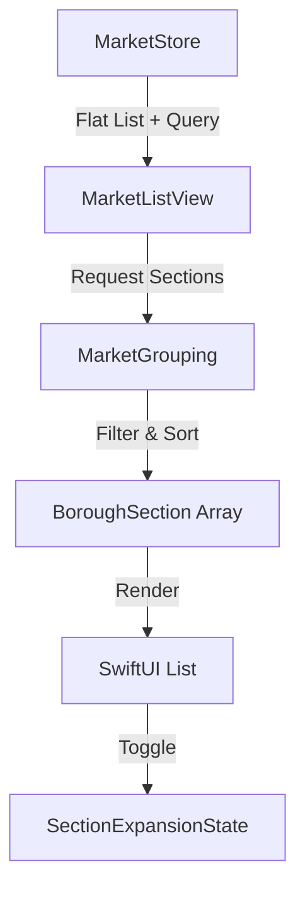
The flow demonstrates how raw data from the store is processed through grouping logic before being rendered in the UI with expansion state management.
Sources: [NYCFarmerMarkets/Views/MarketListView.swift:11-20](https://github.com/iyepes/NYCFarmerMarkets/blob/550674eaf4fdbb45bfca8191cb8ed53e7e453c09/NYCFarmerMarkets/Views/MarketListView.swift#L11-L20), [NYCFarmerMarkets/Models/MarketGrouping.swift:23-28](https://github.com/iyepes/NYCFarmerMarkets/blob/550674eaf4fdbb45bfca8191cb8ed53e7e453c09/NYCFarmerMarkets/Models/MarketGrouping.swift#L23-L28)

## Market Grouping Logic

The `MarketGrouping` enum contains static methods to filter and categorize markets. It prioritizes a specific borough order: Manhattan, Brooklyn, Queens, Bronx, and Staten Island. Markets with unknown boroughs appear at the end.

### Borough Ordering and Sorting
1.  **Filter**: Markets are filtered based on the search query across name, address, and borough fields.
2.  **Group**: Markets are associated with their respective borough strings.
3.  **Sort Sections**: Boroughs are sorted based on `boroughOrder`. Unknown boroughs are sorted alphabetically after the defined list.
4.  **Sort Markets**: Within each section, markets are sorted alphabetically by their name.

Sources: [NYCFarmerMarkets/Models/MarketGrouping.swift:23-45](https://github.com/iyepes/NYCFarmerMarkets/blob/550674eaf4fdbb45bfca8191cb8ed53e7e453c09/NYCFarmerMarkets/Models/MarketGrouping.swift#L23-L45), [NYCFarmerMarkets/Models/Market.swift:70-80](https://github.com/iyepes/NYCFarmerMarkets/blob/550674eaf4fdbb45bfca8191cb8ed53e7e453c09/NYCFarmerMarkets/Models/Market.swift#L70-L80)

### Data Structures
| Structure | Type | Purpose |
| :--- | :--- | :--- |
| `Market` | `struct` | Represents a single market record with name, borough, and address. |
| `BoroughSection` | `struct` | A group of markets identified by a borough string; conforms to `Identifiable`. |
| `MarketGrouping` | `enum` | Stateless utility for filtering and generating sections. |

Sources: [NYCFarmerMarkets/Models/Market.swift:10-24](https://github.com/iyepes/NYCFarmerMarkets/blob/550674eaf4fdbb45bfca8191cb8ed53e7e453c09/NYCFarmerMarkets/Models/Market.swift#L10-L24), [NYCFarmerMarkets/Models/MarketGrouping.swift:9-13](https://github.com/iyepes/NYCFarmerMarkets/blob/550674eaf4fdbb45bfca8191cb8ed53e7e453c09/NYCFarmerMarkets/Models/MarketGrouping.swift#L9-L13)

## Search and Filtering

The search functionality matches queries against multiple market properties. The search is case-insensitive and diacritic-insensitive.

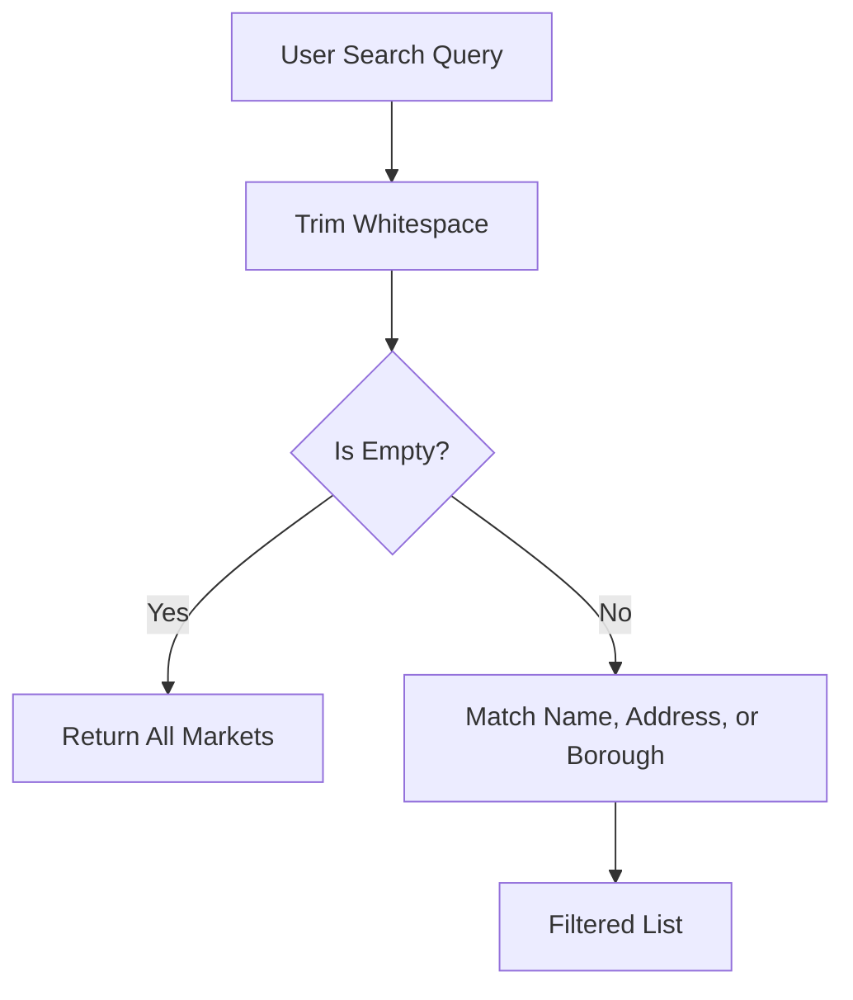
The search process ensures that trailing or leading whitespace does not affect results and checks three primary fields for matches.
Sources: [NYCFarmerMarkets/Models/MarketGrouping.swift:16-21](https://github.com/iyepes/NYCFarmerMarkets/blob/550674eaf4fdbb45bfca8191cb8ed53e7e453c09/NYCFarmerMarkets/Models/MarketGrouping.swift#L16-L21), [NYCFarmerMarketsTests/MarketSearchTests.swift:28-39](https://github.com/iyepes/NYCFarmerMarkets/blob/550674eaf4fdbb45bfca8191cb8ed53e7e453c09/NYCFarmerMarketsTests/MarketSearchTests.swift#L28-L39)

## Section Expansion State

The `SectionExpansionState` manages which borough sections are currently visible. 

*   **Initial State**: Sections start collapsed by default.
*   **Search Behavior**: When a search is active (non-whitespace query), the system auto-expands sections containing matching markets.
*   **Manual Overrides**: Users can manually toggle sections during search.
*   **Restoration**: Clearing a search restores the expansion state that existed before the search began.

Sources: [NYCFarmerMarketsTests/SectionExpansionTests.swift:51-89](https://github.com/iyepes/NYCFarmerMarkets/blob/550674eaf4fdbb45bfca8191cb8ed53e7e453c09/NYCFarmerMarketsTests/SectionExpansionTests.swift#L51-L89), [NYCFarmerMarkets/Views/MarketListView.swift:26-31](https://github.com/iyepes/NYCFarmerMarkets/blob/550674eaf4fdbb45bfca8191cb8ed53e7e453c09/NYCFarmerMarkets/Views/MarketListView.swift#L26-L31)

## User Interface Components

### MarketListView
The primary container for the searchable list. It handles the `NavigationStack`, `.searchable` modifier, and the `ContentUnavailableView` when no results are found.
Sources: [NYCFarmerMarkets/Views/MarketListView.swift:42-63](https://github.com/iyepes/NYCFarmerMarkets/blob/550674eaf4fdbb45bfca8191cb8ed53e7e453c09/NYCFarmerMarkets/Views/MarketListView.swift#L42-L63)

### MarketRow
A shared component that displays market details within a list. It presents:
*   Market Name
*   Subtitle (Borough and Address)
*   Days of Operation
*   Favorite status icon

Sources: [NYCFarmerMarkets/Views/Shared/MarketRow.swift:11-47](https://github.com/iyepes/NYCFarmerMarkets/blob/550674eaf4fdbb45bfca8191cb8ed53e7e453c09/NYCFarmerMarkets/Views/Shared/MarketRow.swift#L11-L47)

### Section Header
Custom interactive headers allow users to toggle section visibility.
```swift
private func sectionHeader(_ section: BoroughSection) -> some View {
    let isExpanded = expansion.isExpanded(section.borough, query: query)
    return Button {
        withAnimation {
            expansion.toggle(section.borough, query: query)
        }
    } label: {
        HStack {
            Text(section.borough)
            Spacer()
            Text("\(section.markets.count)")
            IconView(.sectionChevron)
                .rotationEffect(.degrees(isExpanded ? 90 : 0))
        }
    }
}
```
Sources: [NYCFarmerMarkets/Views/MarketListView.swift:94-115](https://github.com/iyepes/NYCFarmerMarkets/blob/550674eaf4fdbb45bfca8191cb8ed53e7e453c09/NYCFarmerMarkets/Views/MarketListView.swift#L94-L115)

## Conclusion
The List View & Grouping system provides a structured, searchable interface for navigating NYC farmer markets. By combining deterministic borough sorting with a stateful expansion mechanism that reacts to user search input, the module ensures high data discoverability while maintaining a clean, manageable UI.

### Search & Filtering Engine

<details>
<summary>Relevant source files</summary>

The following files were used as context for generating this wiki page:

- [NYCFarmerMarkets/Models/MarketSearch.swift](https://github.com/iyepes/NYCFarmerMarkets/blob/550674eaf4fdbb45bfca8191cb8ed53e7e453c09/NYCFarmerMarkets/Models/MarketSearch.swift)
- [NYCFarmerMarkets/Models/Market.swift](https://github.com/iyepes/NYCFarmerMarkets/blob/550674eaf4fdbb45bfca8191cb8ed53e7e453c09/NYCFarmerMarkets/Models/Market.swift)
- [NYCFarmerMarkets/Views/MarketListView.swift](https://github.com/iyepes/NYCFarmerMarkets/blob/550674eaf4fdbb45bfca8191cb8ed53e7e453c09/NYCFarmerMarkets/Views/MarketListView.swift)
- [NYCFarmerMarkets/Views/MarketMapView.swift](https://github.com/iyepes/NYCFarmerMarkets/blob/550674eaf4fdbb45bfca8191cb8ed53e7e453c09/NYCFarmerMarkets/Views/MarketMapView.swift)
- [NYCFarmerMarketsTests/MarketSearchTests.swift](https://github.com/iyepes/NYCFarmerMarkets/blob/550674eaf4fdbb45bfca8191cb8ed53e7e453c09/NYCFarmerMarketsTests/MarketSearchTests.swift)
- [NYCFarmerMarketsTests/SectionExpansionTests.swift](https://github.com/iyepes/NYCFarmerMarkets/blob/550674eaf4fdbb45bfca8191cb8ed53e7e453c09/NYCFarmerMarketsTests/SectionExpansionTests.swift)
- [NYCFarmerMarkets/Theme/AppCopy.swift](https://github.com/iyepes/NYCFarmerMarkets/blob/550674eaf4fdbb45bfca8191cb8ed53e7e453c09/NYCFarmerMarkets/Theme/AppCopy.swift)
</details>

# Search & Filtering Engine

The Search & Filtering Engine provides a unified mechanism for users to find farmer markets by name, address, or borough across different application views. It processes raw user input into normalized queries to ensure consistent results in both the list and map interfaces.

This engine handles three primary responsibilities: query normalization, market data filtering based on specific market attributes, and UI state management for collapsible search results.

## Search Logic and Normalization

The engine uses a centralized utility, `MarketSearch`, to ensure that filtering behavior remains identical throughout the app. Search is case-insensitive and ignores diacritics.

### Query Processing
1.  **Normalization**: The engine removes surrounding whitespace and newlines from user input.
2.  **Activation**: A search becomes active only when the normalized string is non-empty.
3.  **Matching**: The engine matches the query against the market's name, street address, and borough.

Sources: `[NYCFarmerMarkets/Models/MarketSearch.swift:10-22](https://github.com/iyepes/NYCFarmerMarkets/blob/550674eaf4fdbb45bfca8191cb8ed53e7e453c09/NYCFarmerMarkets/Models/MarketSearch.swift#L10-L22)`, `[NYCFarmerMarketsTests/MarketSearchTests.swift:34-40](https://github.com/iyepes/NYCFarmerMarkets/blob/550674eaf4fdbb45bfca8191cb8ed53e7e453c09/NYCFarmerMarketsTests/MarketSearchTests.swift#L34-L40)`

### Component Relationships
The following diagram illustrates how search state flows from the centralized `MarketStore` to the specialized views and matching logic.

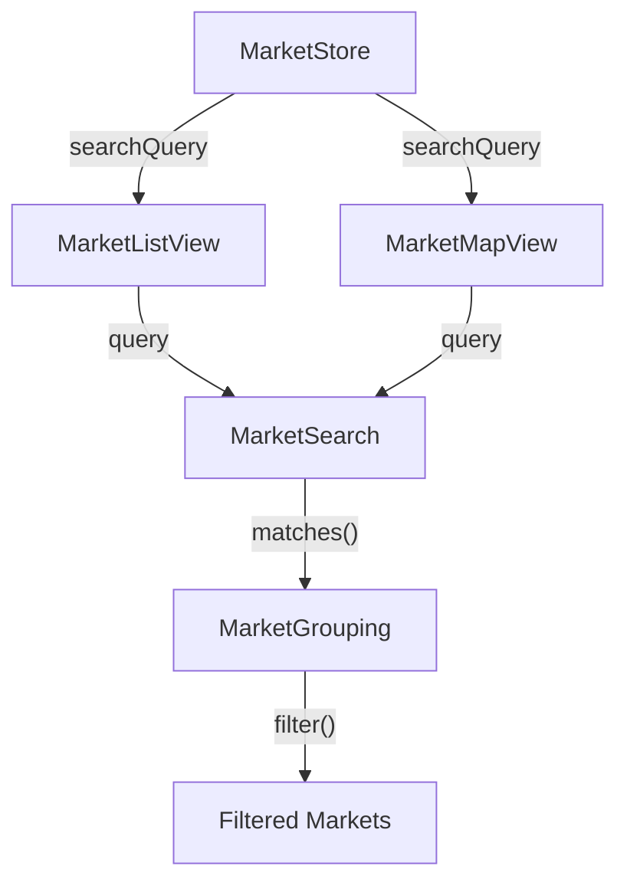
Sources: `[NYCFarmerMarkets/Views/MarketListView.swift:16-20](https://github.com/iyepes/NYCFarmerMarkets/blob/550674eaf4fdbb45bfca8191cb8ed53e7e453c09/NYCFarmerMarkets/Views/MarketListView.swift#L16-L20)`, `[NYCFarmerMarkets/Views/MarketMapView.swift:23-25](https://github.com/iyepes/NYCFarmerMarkets/blob/550674eaf4fdbb45bfca8191cb8ed53e7e453c09/NYCFarmerMarkets/Views/MarketMapView.swift#L23-L25)`, `[NYCFarmerMarkets/Models/MarketSearch.swift:20-22](https://github.com/iyepes/NYCFarmerMarkets/blob/550674eaf4fdbb45bfca8191cb8ed53e7e453c09/NYCFarmerMarkets/Models/MarketSearch.swift#L20-L22)`

## Filtering Data Models

Filtering relies on the `Market` model's properties. During ingestion, the system cleans and normalizes market data to prevent mismatches caused by inconsistent casing or trailing spaces in the raw NYC Open Data source.

### Filterable Attributes
| Attribute | Logic | Source |
| :--- | :--- | :--- |
| `name` | Case-insensitive substring match | `[Market.swift:44](https://github.com/iyepes/NYCFarmerMarkets/blob/550674eaf4fdbb45bfca8191cb8ed53e7e453c09/Market.swift#L44)` |
| `address` | Case-insensitive substring match | `[Market.swift:45](https://github.com/iyepes/NYCFarmerMarkets/blob/550674eaf4fdbb45bfca8191cb8ed53e7e453c09/Market.swift#L45)` |
| `borough` | Normalized to canonical NYC names (e.g., "Brooklyn") | `[Market.swift:78-85](https://github.com/iyepes/NYCFarmerMarkets/blob/550674eaf4fdbb45bfca8191cb8ed53e7e453c09/Market.swift#L78-L85)` |

## UI Integration and User Feedback

The search engine integrates directly with the UI to provide feedback and manage the visibility of results.

### Section Expansion Behavior
In the `MarketListView`, search activity automatically overrides the manual expansion state of borough sections.
*   **Auto-Expansion**: When a search is active, matching borough sections expand automatically to show results.
*   **Restoration**: Clearing the search query restores sections to their previous manual expansion state.
*   **Empty States**: If no markets match the query, the engine triggers a `ContentUnavailableView` using text from `AppCopy`.

Sources: `[NYCFarmerMarketsTests/SectionExpansionTests.swift:79-106](https://github.com/iyepes/NYCFarmerMarkets/blob/550674eaf4fdbb45bfca8191cb8ed53e7e453c09/NYCFarmerMarketsTests/SectionExpansionTests.swift#L79-L106)`, `[NYCFarmerMarkets/Views/MarketListView.swift:45-59](https://github.com/iyepes/NYCFarmerMarkets/blob/550674eaf4fdbb45bfca8191cb8ed53e7e453c09/NYCFarmerMarkets/Views/MarketListView.swift#L45-L59)`

### Search Feedback Strings
The engine generates dynamic feedback strings for accessibility and visual indicators, specifically in the map view.

```mermaid
sequenceDiagram
    participant User
    participant Map as MarketMapView
    participant Copy as AppCopy
    User->>Map: Inputs "kale"
    Map->>Copy: mapFilterSummary(query: "kale", count: 5)
    Copy-->>Map: "5 markets lurking for “kale”"
    Map->>Copy: mapFilterAccessibility(query: "kale", count: 5)
    Copy-->>Map: "Showing 5 results for kale"
```
Sources: `[NYCFarmerMarkets/Theme/AppCopy.swift:27-37](https://github.com/iyepes/NYCFarmerMarkets/blob/550674eaf4fdbb45bfca8191cb8ed53e7e453c09/NYCFarmerMarkets/Theme/AppCopy.swift#L27-L37)`, `[NYCFarmerMarkets/Views/MarketMapView.swift:65-67](https://github.com/iyepes/NYCFarmerMarkets/blob/550674eaf4fdbb45bfca8191cb8ed53e7e453c09/NYCFarmerMarkets/Views/MarketMapView.swift#L65-L67)`

## Implementation Details

### MarketSearch Constants and Methods
```swift
nonisolated enum MarketSearch {
    static func normalized(_ query: String) -> String {
        query.trimmingCharacters(in: .whitespacesAndNewlines)
    }

    static func isActive(_ query: String) -> Bool {
        !normalized(query).isEmpty
    }

    static func filter(_ markets: [Market], query: String) -> [Market] {
        markets.filter { MarketGrouping.matches($0, query: query) }
    }
}
```
Sources: `[NYCFarmerMarkets/Models/MarketSearch.swift:10-22](https://github.com/iyepes/NYCFarmerMarkets/blob/550674eaf4fdbb45bfca8191cb8ed53e7e453c09/NYCFarmerMarkets/Models/MarketSearch.swift#L10-L22)`

The engine ensures that an inactive query (empty or whitespace) returns the full set of markets in their original order, preventing the UI from appearing empty when the user has not yet typed.
Sources: `[NYCFarmerMarketsTests/MarketSearchTests.swift:20-26](https://github.com/iyepes/NYCFarmerMarkets/blob/550674eaf4fdbb45bfca8191cb8ed53e7e453c09/NYCFarmerMarketsTests/MarketSearchTests.swift#L20-L26)`

## Summary
The Search & Filtering Engine centralizes the query logic via `MarketSearch`, ensuring that the `MarketListView` and `MarketMapView` remain synchronized. It supports user experience through automatic section management in lists and specialized "spooky" themed feedback strings for the map interface.

### Favorites System

<details>
<summary>Relevant source files</summary>

The following files were used as context for generating this wiki page:

- [NYCFarmerMarkets/Views/FavoritesView.swift](https://github.com/iyepes/NYCFarmerMarkets/blob/550674eaf4fdbb45bfca8191cb8ed53e7e453c09/NYCFarmerMarkets/Views/FavoritesView.swift)
- [NYCFarmerMarkets/Stores/FavoritesStore.swift](https://github.com/iyepes/NYCFarmerMarkets/blob/550674eaf4fdbb45bfca8191cb8ed53e7e453c09/NYCFarmerMarkets/Stores/FavoritesStore.swift)
- [NYCFarmerMarkets/Models/Market.swift](https://github.com/iyepes/NYCFarmerMarkets/blob/550674eaf4fdbb45bfca8191cb8ed53e7e453c09/NYCFarmerMarkets/Models/Market.swift)
- [NYCFarmerMarkets/NYCFarmerMarketsApp.swift](https://github.com/iyepes/NYCFarmerMarkets/blob/550674eaf4fdbb45bfca8191cb8ed53e7e453c09/NYCFarmerMarkets/NYCFarmerMarketsApp.swift)
- [NYCFarmerMarketsTests/NYCFarmerMarketsTests.swift](https://github.com/iyepes/NYCFarmerMarkets/blob/550674eaf4fdbb45bfca8191cb8ed53e7e453c09/NYCFarmerMarketsTests/NYCFarmerMarketsTests.swift)
- [NYCFarmerMarkets/Views/MarketDetailView.swift](https://github.com/iyepes/NYCFarmerMarkets/blob/550674eaf4fdbb45bfca8191cb8ed53e7e453c09/NYCFarmerMarkets/Views/MarketDetailView.swift)
</details>

# Favorites System

The Favorites System manages a user-selected list of farmers markets, providing persistent storage and a dedicated interface for quick access. It allows users to mark specific markets as favorites across different views, such as the list and map views, and ensures these selections remain available across app sessions.

## Architecture and Data Storage

The system utilizes an observable store to manage state and `UserDefaults` for local persistence. The core logic resides in `FavoritesStore`, which tracks market identifiers and synchronizes them with the device's permanent storage.

### Persistence Mechanism
Market selections persist using a `Set` of unique identifiers stored under the key `favoriteMarketIDs` in `UserDefaults`. When the app launches, `FavoritesStore` initializes by loading these IDs. Any change to the favorites list triggers a call to `persist()`, which saves the current ID set back to `UserDefaults`.

Sources: `[NYCFarmerMarkets/Stores/FavoritesStore.swift:10-21](https://github.com/iyepes/NYCFarmerMarkets/blob/550674eaf4fdbb45bfca8191cb8ed53e7e453c09/NYCFarmerMarkets/Stores/FavoritesStore.swift#L10-L21)`, `[NYCFarmerMarkets/NYCFarmerMarketsApp.swift:34-35](https://github.com/iyepes/NYCFarmerMarkets/blob/550674eaf4fdbb45bfca8191cb8ed53e7e453c09/NYCFarmerMarkets/NYCFarmerMarketsApp.swift#L34-L35)`

### Data Flow Diagram
The following diagram illustrates the flow of data between the UI, the Store, and the underlying persistence layer.

```mermaid
flowchart TD
    User[User Interface] -- Toggles --> FS[FavoritesStore]
    FS -- Updates --> State[Internal ID Set]
    State -- Persists --> UD[UserDefaults]
    UD -- Initializes --> State
    FS -- Filters Markets --> FV[FavoritesView]
```
The diagram shows how user actions trigger state updates that are then synchronized with `UserDefaults`. 
Sources: `[NYCFarmerMarkets/Stores/FavoritesStore.swift](https://github.com/iyepes/NYCFarmerMarkets/blob/550674eaf4fdbb45bfca8191cb8ed53e7e453c09/NYCFarmerMarkets/Stores/FavoritesStore.swift)`, `[NYCFarmerMarkets/Views/FavoritesView.swift](https://github.com/iyepes/NYCFarmerMarkets/blob/550674eaf4fdbb45bfca8191cb8ed53e7e453c09/NYCFarmerMarkets/Views/FavoritesView.swift)`

## Component Breakdown

### FavoritesStore
This class serves as the central manager for favorite data. It performs the following primary actions:
*   **Checking Status**: Determines if a specific `Market` is favorited by checking if its ID exists in the internal set.
*   **Toggling**: Adds a market ID to the set if absent, or removes it if present.
*   **Filtering**: Resolves stored IDs into full `Market` objects by filtering an input list and sorting the results alphabetically by market name.

| Function | Description |
| :--- | :--- |
| `isFavorite(Market)` | Returns true if the market ID is in the set. |
| `toggle(Market)` | Adds or removes the market and calls `persist()`. |
| `remove(Market)` | Explicitly removes the market and calls `persist()`. |
| `favorites(in: [Market])` | Returns a sorted list of `Market` objects matching stored IDs. |

Sources: `[NYCFarmerMarkets/Stores/FavoritesStore.swift:23-42](https://github.com/iyepes/NYCFarmerMarkets/blob/550674eaf4fdbb45bfca8191cb8ed53e7e453c09/NYCFarmerMarkets/Stores/FavoritesStore.swift#L23-L42)`

### FavoritesView
The `FavoritesView` provides the user interface for interacting with the favorites list. It presents a list of markets or an empty state if no favorites exist.

*   **Empty State**: Displays a "No haunts yet" message with a prompt to add markets.
*   **Market List**: Renders each favorited market using a `MarketRow`. 
*   **Interactions**: 
    *   Tapping a market row sets it as the `selectedMarket` in the `MarketStore`.
    *   Swiping a row reveals a "Remove" action, which invokes the `remove(_:)` method on the store.

Sources: `[NYCFarmerMarkets/Views/FavoritesView.swift:20-65](https://github.com/iyepes/NYCFarmerMarkets/blob/550674eaf4fdbb45bfca8191cb8ed53e7e453c09/NYCFarmerMarkets/Views/FavoritesView.swift#L20-L65)`

## Integration with Market Data

The favorites system relies on stable identifiers generated by the `Market` model. Identifiers are case-insensitive and derived from a combination of the market's name and address.

```swift
static func makeID(name: String, address: String) -> String {
    "\(name.lowercased())|\(address.lowercased())"
}
```
Sources: `[NYCFarmerMarkets/Models/Market.swift:65-67](https://github.com/iyepes/NYCFarmerMarkets/blob/550674eaf4fdbb45bfca8191cb8ed53e7e453c09/NYCFarmerMarkets/Models/Market.swift#L65-L67)`, `[NYCFarmerMarketsTests/NYCFarmerMarketsTests.swift:109-114](https://github.com/iyepes/NYCFarmerMarkets/blob/550674eaf4fdbb45bfca8191cb8ed53e7e453c09/NYCFarmerMarketsTests/NYCFarmerMarketsTests.swift#L109-L114)`

### Detail View Integration
The `MarketDetailView` includes a toolbar button that allows users to toggle the favorite status while viewing market specifics. This button uses the `favoritesStore` environment object to perform the update.

Sources: `[NYCFarmerMarkets/Views/MarketDetailView.swift:57](https://github.com/iyepes/NYCFarmerMarkets/blob/550674eaf4fdbb45bfca8191cb8ed53e7e453c09/NYCFarmerMarkets/Views/MarketDetailView.swift#L57)`

## Technical Considerations

### Testing and Validation
The system includes comprehensive tests to ensure reliability:
*   **Toggle Logic**: Verifies that favorites can be added and removed correctly.
*   **Persistence**: Confirms that data remains consistent across different instances of the store.
*   **Resolution**: Ensures that the `favorites(in:)` method correctly filters and sorts markets while ignoring IDs that no longer exist in the provided market list.

Sources: `[NYCFarmerMarketsTests/NYCFarmerMarketsTests.swift:273-305](https://github.com/iyepes/NYCFarmerMarkets/blob/550674eaf4fdbb45bfca8191cb8ed53e7e453c09/NYCFarmerMarketsTests/NYCFarmerMarketsTests.swift#L273-L305)`

### Summary of Key Objects
| Object | Type | Role |
| :--- | :--- | :--- |
| `ids` | `Set<String>` | The internal collection of favorited market identifiers. |
| `defaults` | `UserDefaults` | The persistence layer for the identifier set. |
| `Market` | `Struct` | Provides the `id` required for tracking favorites. |
| `FavoritesView` | `View` | The SwiftUI tab displaying the user's saved markets. |

Sources: `[NYCFarmerMarkets/Stores/FavoritesStore.swift:11-13](https://github.com/iyepes/NYCFarmerMarkets/blob/550674eaf4fdbb45bfca8191cb8ed53e7e453c09/NYCFarmerMarkets/Stores/FavoritesStore.swift#L11-L13)`, `[NYCFarmerMarkets/Views/FavoritesView.swift:9](https://github.com/iyepes/NYCFarmerMarkets/blob/550674eaf4fdbb45bfca8191cb8ed53e7e453c09/NYCFarmerMarkets/Views/FavoritesView.swift#L9)`

The Favorites System ensures a seamless user experience by combining reactive state management with simple, robust local persistence. It maintains a clean separation between the storage logic and the UI representation.

### Offline Support & Fallbacks

<details>
<summary>Relevant source files</summary>

The following files were used as context for generating this wiki page:

- [NYCFarmerMarkets/Views/Shared/OfflineBanner.swift](https://github.com/iyepes/NYCFarmerMarkets/blob/550674eaf4fdbb45bfca8191cb8ed53e7e453c09/NYCFarmerMarkets/Views/Shared/OfflineBanner.swift)
- [NYCFarmerMarkets/Models/LoadFailureMessage.swift](https://github.com/iyepes/NYCFarmerMarkets/blob/550674eaf4fdbb45bfca8191cb8ed53e7e453c09/NYCFarmerMarkets/Models/LoadFailureMessage.swift)
- [NYCFarmerMarkets/Stores/MarketStore.swift](https://github.com/iyepes/NYCFarmerMarkets/blob/550674eaf4fdbb45bfca8191cb8ed53e7e453c09/NYCFarmerMarkets/Stores/MarketStore.swift)
- [NYCFarmerMarkets/Views/AppRootView.swift](https://github.com/iyepes/NYCFarmerMarkets/blob/550674eaf4fdbb45bfca8191cb8ed53e7e453c09/NYCFarmerMarkets/Views/AppRootView.swift)
- [NYCFarmerMarkets/Theme/AppCopy.swift](https://github.com/iyepes/NYCFarmerMarkets/blob/550674eaf4fdbb45bfca8191cb8ed53e7e453c09/NYCFarmerMarkets/Theme/AppCopy.swift)
- [NYCFarmerMarketsTests/NYCFarmerMarketsTests.swift](https://github.com/iyepes/NYCFarmerMarkets/blob/550674eaf4fdbb45bfca8191cb8ed53e7e453c09/NYCFarmerMarketsTests/NYCFarmerMarketsTests.swift)
</details>

# Offline Support & Fallbacks

Offline Support & Fallbacks ensures that the NYC Farmer Markets application remains functional during network instability or total loss of connectivity. The system prioritizes local data availability, providing a seamless transition between live API data and cached content while communicating connection states to the user through non-technical messaging.

The architecture relies on a local JSON cache to store market data, a state-driven store to manage transitions, and a specialized UI banner to indicate when displayed information is not current.

## Data Persistence & Local Cache

The application uses `MarketCache` to persist market data locally. During the initial load sequence, the `MarketStore` attempts to populate the user interface with cached data before initiating a network request.

*   **Immediate Availability**: If cached data exists and is not empty, the store sets the state to `.loaded` immediately to reduce perceived latency.
*   **Background Refresh**: After loading from the cache, the system triggers a background `refresh()` to sync with the latest data from the NYC Open Data API.
*   **Successful Updates**: When a network fetch succeeds, the store updates the local cache with the fresh data and clears any offline flags.

Sources: [NYCFarmerMarkets/Stores/MarketStore.swift:45-53](https://github.com/iyepes/NYCFarmerMarkets/blob/550674eaf4fdbb45bfca8191cb8ed53e7e453c09/NYCFarmerMarkets/Stores/MarketStore.swift#L45-L53), [NYCFarmerMarkets/Stores/MarketStore.swift:61-68](https://github.com/iyepes/NYCFarmerMarkets/blob/550674eaf4fdbb45bfca8191cb8ed53e7e453c09/NYCFarmerMarkets/Stores/MarketStore.swift#L61-L68), [NYCFarmerMarketsTests/NYCFarmerMarketsTests.swift:132-139](https://github.com/iyepes/NYCFarmerMarkets/blob/550674eaf4fdbb45bfca8191cb8ed53e7e453c09/NYCFarmerMarketsTests/NYCFarmerMarketsTests.swift#L132-L139)

## State Management & Error Handling

The `MarketStore` manages the logic for determining when to show cached data versus live data. It tracks the connection status through specific properties that trigger UI updates.

### Connection State Logic

The following flowchart describes the logic used by `MarketStore` to handle network results and determine which data to present:

```mermaid
flowchart TD
    Start([Start Refresh]) --> Fetch[Try API Fetch]
    Fetch -- Success --> SaveCache[Save to Cache]
    SaveCache --> SetLive[isShowingCachedData = false]
    SetLive --> LoadedState[State: .loaded]
    
    Fetch -- Failure --> CheckData{Are markets already loaded?}
    CheckData -- Yes --> SetCached[isShowingCachedData = true]
    SetCached --> LoadedState
    
    CheckData -- No --> MakeMessage[Create LoadFailureMessage]
    MakeMessage --> ErrorState[State: .error]
```
The logic ensures that as long as cached data is available, the user sees a valid list of markets even if the refresh fails. Sources: [NYCFarmerMarkets/Stores/MarketStore.swift:65-85](https://github.com/iyepes/NYCFarmerMarkets/blob/550674eaf4fdbb45bfca8191cb8ed53e7e453c09/NYCFarmerMarkets/Stores/MarketStore.swift#L65-L85)

### Error Mapping

Technical network errors are mapped to user-friendly messages via `LoadFailureMessage`. This avoids exposing raw error codes or technical jargon.

| Error Category | Condition | User Title | User Hint |
| :--- | :--- | :--- | :--- |
| **Offline** | `notConnectedToInternet`, `networkConnectionLost` | You're off the grid | Check your connection, then try again. |
| **Unreachable** | `timedOut`, `cannotFindHost`, `dnsLookupFailed` | The markets are hiding | We couldn't reach NYC Open Data. |
| **Server Problem**| `MarketServiceError.badStatus` | NYC Open Data is sleeping | The server had a problem. |
| **Unknown** | Corrupted data or unrecognized errors | Something spooked the data | We couldn't read the markets. |

Sources: [NYCFarmerMarkets/Models/LoadFailureMessage.swift:15-41](https://github.com/iyepes/NYCFarmerMarkets/blob/550674eaf4fdbb45bfca8191cb8ed53e7e453c09/NYCFarmerMarkets/Models/LoadFailureMessage.swift#L15-L41), [NYCFarmerMarketsTests/LoadFailureMessageTests.swift:15-30](https://github.com/iyepes/NYCFarmerMarkets/blob/550674eaf4fdbb45bfca8191cb8ed53e7e453c09/NYCFarmerMarketsTests/LoadFailureMessageTests.swift#L15-L30)

## User Interface Feedback

The UI provides visual indicators and distinct states based on the availability of data and the status of the network.

### Offline Banner
When the `MarketStore` is in a `.loaded` state but `isShowingCachedData` is true, the app displays the `OfflineBanner`. This banner informs the user that they are viewing saved data because the live refresh failed.

```swift
struct OfflineBanner: View {
    var body: some View {
        HStack(spacing: 8) {
            IconView(.offline, size: 16)
            Text(AppCopy.offlineBanner)
                .appFont(.footnote)
        }
        .background(AppPalette.cardSelected.color)
        .accessibilityLabel(AppCopy.offlineBannerAccessibility)
    }
}
```
Sources: [NYCFarmerMarkets/Views/Shared/OfflineBanner.swift:10-21](https://github.com/iyepes/NYCFarmerMarkets/blob/550674eaf4fdbb45bfca8191cb8ed53e7e453c09/NYCFarmerMarkets/Views/Shared/OfflineBanner.swift#L10-L21), [NYCFarmerMarkets/Theme/AppCopy.swift:17-18](https://github.com/iyepes/NYCFarmerMarkets/blob/550674eaf4fdbb45bfca8191cb8ed53e7e453c09/NYCFarmerMarkets/Theme/AppCopy.swift#L17-L18)

### Root View Decision Logic
The `AppRootView` determines whether to show the main application content or a failure state based on market availability.

1.  If `store.markets` is not empty, the `RootTabView` is displayed (potentially with an `OfflineBanner`).
2.  If `store.markets` is empty and an error occurred, the `SplashView` remains visible in a failed state showing the `LoadFailureMessage` and a retry option.
3.  If a successful load returns an empty list, it specifically shows the `noMarkets` failure message.

Sources: [NYCFarmerMarkets/Views/AppRootView.swift:19-38](https://github.com/iyepes/NYCFarmerMarkets/blob/550674eaf4fdbb45bfca8191cb8ed53e7e453c09/NYCFarmerMarkets/Views/AppRootView.swift#L19-L38)

## Summary of Offline Scenarios

The system behavior varies depending on whether data was successfully cached in a previous session.

| Scenario | Data Source | UI State | Banner Visible |
| :--- | :--- | :--- | :--- |
| **Cold Start + No Network** | None | Splash Failure Screen | No |
| **Warm Start + No Network** | Local Cache | Market List | Yes |
| **Warm Start + Latent Network** | Local Cache (immediate) then API (update) | Market List | No |
| **Warm Start + Failed Refresh** | Local Cache | Market List | Yes |

Sources: [NYCFarmerMarketsTests/NYCFarmerMarketsTests.swift:141-150](https://github.com/iyepes/NYCFarmerMarkets/blob/550674eaf4fdbb45bfca8191cb8ed53e7e453c09/NYCFarmerMarketsTests/NYCFarmerMarketsTests.swift#L141-L150), [NYCFarmerMarketsTests/NYCFarmerMarketsTests.swift:159-173](https://github.com/iyepes/NYCFarmerMarkets/blob/550674eaf4fdbb45bfca8191cb8ed53e7e453c09/NYCFarmerMarketsTests/NYCFarmerMarketsTests.swift#L159-L173)

### Market Detail View

<details>
<summary>Relevant source files</summary>

The following files were used as context for generating this wiki page:

- [NYCFarmerMarkets/Views/MarketDetailView.swift](https://github.com/iyepes/NYCFarmerMarkets/blob/550674eaf4fdbb45bfca8191cb8ed53e7e453c09/NYCFarmerMarkets/Views/MarketDetailView.swift)
- [NYCFarmerMarkets/Models/Market.swift](https://github.com/iyepes/NYCFarmerMarkets/blob/550674eaf4fdbb45bfca8191cb8ed53e7e453c09/NYCFarmerMarkets/Models/Market.swift)
- [NYCFarmerMarkets/Views/MarketListView.swift](https://github.com/iyepes/NYCFarmerMarkets/blob/550674eaf4fdbb45bfca8191cb8ed53e7e453c09/NYCFarmerMarkets/Views/MarketListView.swift)
- [NYCFarmerMarkets/Views/MarketMapView.swift](https://github.com/iyepes/NYCFarmerMarkets/blob/550674eaf4fdbb45bfca8191cb8ed53e7e453c09/NYCFarmerMarkets/Views/MarketMapView.swift)
- [NYCFarmerMarkets/Views/MarketLocationMapView.swift](https://github.com/iyepes/NYCFarmerMarkets/blob/550674eaf4fdbb45bfca8191cb8ed53e7e453c09/NYCFarmerMarkets/Views/MarketLocationMapView.swift)
- [NYCFarmerMarkets/Stores/MarketStore.swift](https://github.com/iyepes/NYCFarmerMarkets/blob/550674eaf4fdbb45bfca8191cb8ed53e7e453c09/NYCFarmerMarkets/Stores/MarketStore.swift)
- [NYCFarmerMarkets/Theme/AppCopy.swift](https://github.com/iyepes/NYCFarmerMarkets/blob/550674eaf4fdbb45bfca8191cb8ed53e7e453c09/NYCFarmerMarkets/Theme/AppCopy.swift)
</details>

# Market Detail View

The `MarketDetailView` serves as the primary informational interface for a selected farmers market. It displays comprehensive attributes including operation hours, location details, and service availability. The view is implemented as a shared detail sheet accessible from the Markets list, the Map view, and the Favorites tab.

Sources: [NYCFarmerMarkets/Views/MarketDetailView.swift:11-13](https://github.com/iyepes/NYCFarmerMarkets/blob/550674eaf4fdbb45bfca8191cb8ed53e7e453c09/NYCFarmerMarkets/Views/MarketDetailView.swift#L11-L13), [NYCFarmerMarkets/Views/MarketListView.swift:56-62](https://github.com/iyepes/NYCFarmerMarkets/blob/550674eaf4fdbb45bfca8191cb8ed53e7e453c09/NYCFarmerMarkets/Views/MarketListView.swift#L56-L62)

## Component Architecture

`MarketDetailView` utilizes a `NavigationStack` containing a `ScrollView` to organize content. It accepts a `Market` model instance as its primary dependency. The view uses `@Environment(\.dismiss)` to handle navigation closure and manages a private state `showsMap` to trigger internal navigation to localized map views.

Sources: [NYCFarmerMarkets/Views/MarketDetailView.swift:14-17](https://github.com/iyepes/NYCFarmerMarkets/blob/550674eaf4fdbb45bfca8191cb8ed53e7e453c09/NYCFarmerMarkets/Views/MarketDetailView.swift#L14-L17)

### Data Flow for Detail Viewing

The following diagram illustrates how a user accesses the detail view from various entry points within the application.

```mermaid
flowchart TD
    ListView[Market List View] -->|Taps Row| StoreSelect[MarketStore.selectedMarket Set]
    MapView[Market Map View] -->|Taps Pin| MapCard[Market Card Overlay]
    MapCard -->|Taps More Info| StoreSelect
    FavoritesView[Favorites View] -->|Taps Row| StoreSelect
    StoreSelect --> DetailSheet[Market Detail View Displayed]
```
The application tracks the currently active market through the `MarketStore.selectedMarket` property, which triggers the presentation of the detail sheet.
Sources: [NYCFarmerMarkets/Stores/MarketStore.swift:31](https://github.com/iyepes/NYCFarmerMarkets/blob/550674eaf4fdbb45bfca8191cb8ed53e7e453c09/NYCFarmerMarkets/Stores/MarketStore.swift#L31), [NYCFarmerMarkets/Views/MarketListView.swift:59](https://github.com/iyepes/NYCFarmerMarkets/blob/550674eaf4fdbb45bfca8191cb8ed53e7e453c09/NYCFarmerMarkets/Views/MarketListView.swift#L59), [NYCFarmerMarkets/Views/MarketMapView.swift:85](https://github.com/iyepes/NYCFarmerMarkets/blob/550674eaf4fdbb45bfca8191cb8ed53e7e453c09/NYCFarmerMarkets/Views/MarketMapView.swift#L85)

## Content Structure

The view organizes market information into a header section followed by a series of themed cards representing specific data points.

### Header Section
The header captures the market's identity, displaying the `name` and the `borough`. It applies specific typography roles (`.detailTitle` and `.body`) and uses semantic colors from the `AppPalette`.
Sources: [NYCFarmerMarkets/Views/MarketDetailView.swift:68-76](https://github.com/iyepes/NYCFarmerMarkets/blob/550674eaf4fdbb45bfca8191cb8ed53e7e453c09/NYCFarmerMarkets/Views/MarketDetailView.swift#L68-L76)

### Information Grid
Data is presented in "detail rows," each consisting of an `AppIcon`, a descriptive title, and the corresponding value from the `Market` model. If a value is missing, the view displays "Shrouded in mist" (defined in `AppCopy`).
Sources: [NYCFarmerMarkets/Views/MarketDetailView.swift:78-92](https://github.com/iyepes/NYCFarmerMarkets/blob/550674eaf4fdbb45bfca8191cb8ed53e7e453c09/NYCFarmerMarkets/Views/MarketDetailView.swift#L78-L92), [NYCFarmerMarkets/Theme/AppCopy.swift:42](https://github.com/iyepes/NYCFarmerMarkets/blob/550674eaf4fdbb45bfca8191cb8ed53e7e453c09/NYCFarmerMarkets/Theme/AppCopy.swift#L42)

| Attribute | Market Model Field | Icon Key |
| :--- | :--- | :--- |
| Address | `market.address` | `.location` |
| Community District | `market.communityDistrict` | `.district` |
| Days | `market.daysOfOperation` | `.hours` |
| Hours | `market.hoursOfOperation` | `.hours` |
| Accepts EBT | `market.acceptsEBT` | `.ebt` |
| Open Year Round | `market.openYearRound` | `.yearRound` |
| Health Dept. Cooking | `market.healthDeptCooking` | `.cooking` |
| Data Year | `market.year` | `.year` |

Sources: [NYCFarmerMarkets/Views/MarketDetailView.swift:23-30](https://github.com/iyepes/NYCFarmerMarkets/blob/550674eaf4fdbb45bfca8191cb8ed53e7e453c09/NYCFarmerMarkets/Views/MarketDetailView.swift#L23-L30)

## Navigation and Map Integration

If the `Market` object contains valid coordinates, the view renders two action buttons for geographic navigation:

1.  **Go to Map**: Sets `showsMap` to true, triggering a navigation destination to `MarketLocationMapView`. This pushes an in-app map focusing on the specific market location.
2.  **Directions**: Executes `openInExternalMaps()`, which creates an `MKMapItem` and launches the system Maps application.

Sources: [NYCFarmerMarkets/Views/MarketDetailView.swift:32-60](https://github.com/iyepes/NYCFarmerMarkets/blob/550674eaf4fdbb45bfca8191cb8ed53e7e453c09/NYCFarmerMarkets/Views/MarketDetailView.swift#L32-L60), [NYCFarmerMarkets/Views/MarketLocationMapView.swift:12-25](https://github.com/iyepes/NYCFarmerMarkets/blob/550674eaf4fdbb45bfca8191cb8ed53e7e453c09/NYCFarmerMarkets/Views/MarketLocationMapView.swift#L12-L25)

```mermaid
sequenceDiagram
    participant User as User
    participant Detail as MarketDetailView
    participant External as Apple Maps App
    participant Internal as MarketLocationMapView

    User->>Detail: Tap "Directions"
    Detail->>External: openInMaps()
    Note over External: Launch System Navigation

    User->>Detail: Tap "Go to Map"
    Detail->>Internal: Navigate (Push)
    Note over Internal: Show in-app focus map
```
Sources: [NYCFarmerMarkets/Views/MarketDetailView.swift:51-60](https://github.com/iyepes/NYCFarmerMarkets/blob/550674eaf4fdbb45bfca8191cb8ed53e7e453c09/NYCFarmerMarkets/Views/MarketDetailView.swift#L51-L60), [NYCFarmerMarkets/Views/MarketDetailView.swift:94-102](https://github.com/iyepes/NYCFarmerMarkets/blob/550674eaf4fdbb45bfca8191cb8ed53e7e453c09/NYCFarmerMarkets/Views/MarketDetailView.swift#L94-L102)

## Implementation Details

### Toolbar Configuration
The view utilizes a `MarketDetailToolbar` which provides a close button to dismiss the sheet and likely handles favorite toggling (though the toggle logic is external to the main view body).
Sources: [NYCFarmerMarkets/Views/MarketDetailView.swift:63](https://github.com/iyepes/NYCFarmerMarkets/blob/550674eaf4fdbb45bfca8191cb8ed53e7e453c09/NYCFarmerMarkets/Views/MarketDetailView.swift#L63)

### External Map Launch Logic
The `openInExternalMaps()` function validates the existence of coordinates before initializing a `CLLocation` and `MKMapItem`. It assigns the market's name to the map item to ensure the destination is labeled correctly in the external application.
Sources: [NYCFarmerMarkets/Views/MarketDetailView.swift:94-102](https://github.com/iyepes/NYCFarmerMarkets/blob/550674eaf4fdbb45bfca8191cb8ed53e7e453c09/NYCFarmerMarkets/Views/MarketDetailView.swift#L94-L102)

```swift
private func openInExternalMaps() {
    guard let coordinate = market.coordinate else { return }
    let item = MKMapItem(
        location: CLLocation(latitude: coordinate.latitude, longitude: coordinate.longitude),
        address: nil
    )
    item.name = market.name
    item.openInMaps()
}
```
Sources: [NYCFarmerMarkets/Views/MarketDetailView.swift:94-102](https://github.com/iyepes/NYCFarmerMarkets/blob/550674eaf4fdbb45bfca8191cb8ed53e7e453c09/NYCFarmerMarkets/Views/MarketDetailView.swift#L94-L102)

## Summary

The `MarketDetailView` consolidates disparate data points from the NYC Open Data dataset into a readable, navigable interface. It serves as a central hub for market-specific actions, facilitating both internal map exploration and external navigation through deep links to system map services.

Sources: [NYCFarmerMarkets/Views/MarketDetailView.swift:1-102](https://github.com/iyepes/NYCFarmerMarkets/blob/550674eaf4fdbb45bfca8191cb8ed53e7e453c09/NYCFarmerMarkets/Views/MarketDetailView.swift#L1-L102)


## Data Management & Integration

### NYC Open Data Service

<details>
<summary>Relevant source files</summary>

The following files were used as context for generating this wiki page:

- [NYCFarmerMarkets/Services/MarketService.swift](https://github.com/iyepes/NYCFarmerMarkets/blob/550674eaf4fdbb45bfca8191cb8ed53e7e453c09/NYCFarmerMarkets/Services/MarketService.swift)
- [NYCFarmerMarkets/Models/Market.swift](https://github.com/iyepes/NYCFarmerMarkets/blob/550674eaf4fdbb45bfca8191cb8ed53e7e453c09/NYCFarmerMarkets/Models/Market.swift)
- [NYCFarmerMarkets/Models/MarketGrouping.swift](https://github.com/iyepes/NYCFarmerMarkets/blob/550674eaf4fdbb45bfca8191cb8ed53e7e453c09/NYCFarmerMarkets/Models/MarketGrouping.swift)
- [NYCFarmerMarketsTests/NYCFarmerMarketsTests.swift](https://github.com/iyepes/NYCFarmerMarkets/blob/550674eaf4fdbb45bfca8191cb8ed53e7e453c09/NYCFarmerMarketsTests/NYCFarmerMarketsTests.swift)
- [NYCFarmerMarkets/NYCFarmerMarketsApp.swift](https://github.com/iyepes/NYCFarmerMarkets/blob/550674eaf4fdbb45bfca8191cb8ed53e7e453c09/NYCFarmerMarkets/NYCFarmerMarketsApp.swift)

</details>

# NYC Open Data Service

The NYC Open Data Service handles the retrieval, filtering, and normalization of farmers market information provided by the New York City Open Data portal. It acts as the primary data ingestion layer, transforming raw JSON responses from the `8vwk-6iz2` dataset into structured, domain-specific `Market` models.

This service manages network communication through `MarketService`, applies data integrity rules during parsing, and organizes results into borough-based groupings for the user interface.

Sources: [NYCFarmerMarkets/Services/MarketService.swift:1-42](https://github.com/iyepes/NYCFarmerMarkets/blob/550674eaf4fdbb45bfca8191cb8ed53e7e453c09/NYCFarmerMarkets/Services/MarketService.swift#L1-L42), [NYCFarmerMarkets/Models/Market.swift:1-12](https://github.com/iyepes/NYCFarmerMarkets/blob/550674eaf4fdbb45bfca8191cb8ed53e7e453c09/NYCFarmerMarkets/Models/Market.swift#L1-L12)

## Data Acquisition and Service Architecture

The service uses a centralized fetch mechanism to communicate with the Socrata Open Data API. It defaults to a specific endpoint restricted to 5,000 records to ensure all historical and current data is captured before local filtering occurs.

### Service Components

*   **MarketService**: A `Sendable` struct that performs asynchronous data fetching using `URLSession`. It encapsulates the endpoint URL and handles HTTP response validation. Sources: [NYCFarmerMarkets/Services/MarketService.swift:20-29](https://github.com/iyepes/NYCFarmerMarkets/blob/550674eaf4fdbb45bfca8191cb8ed53e7e453c09/NYCFarmerMarkets/Services/MarketService.swift#L20-L29)
*   **MarketServiceError**: A specialized error type that identifies invalid HTTP status codes returned by the NYC Open Data servers. Sources: [NYCFarmerMarkets/Services/MarketService.swift:9-16](https://github.com/iyepes/NYCFarmerMarkets/blob/550674eaf4fdbb45bfca8191cb8ed53e7e453c09/NYCFarmerMarkets/Services/MarketService.swift#L9-L16)

The following diagram illustrates the flow from a network request to the generation of localized `Market` objects:

```mermaid
flowchart TD
    API[NYC Open Data API] -->|JSON Data| Service[MarketService]
    Service -->|Validation| ResponseCheck{HTTP 200?}
    ResponseCheck -->|No| Error[MarketServiceError]
    ResponseCheck -->|Yes| RawData[Market.Raw Array]
    RawData -->|compactMap| Models[Market Objects]
    Models -->|Filter| LatestYear[Latest Year Only]
    LatestYear -->|Insert| Unique[Deduplicated Markets]
```
Sources: [NYCFarmerMarkets/Services/MarketService.swift:31-50](https://github.com/iyepes/NYCFarmerMarkets/blob/550674eaf4fdbb45bfca8191cb8ed53e7e453c09/NYCFarmerMarkets/Services/MarketService.swift#L31-L50), [NYCFarmerMarketsTests/NYCFarmerMarketsTests.swift:80-92](https://github.com/iyepes/NYCFarmerMarkets/blob/550674eaf4fdbb45bfca8191cb8ed53e7e453c09/NYCFarmerMarketsTests/NYCFarmerMarketsTests.swift#L80-L92)

## Data Modeling and Normalization

The service converts raw API strings into typed data structures. Because the NYC Open Data API returns every field as a string, the system performs cleaning and normalization to ensure consistency across different data entries.

### Market Data Fields
| Field | Data Type | Description |
| :--- | :--- | :--- |
| `id` | `String` | Stable, case-insensitive ID generated from name and address. |
| `name` | `String` | The cleaned name of the farmers market. |
| `borough` | `String` | Normalized borough name (e.g., "Brooklyn", "Manhattan"). |
| `coordinate` | `CLLocationCoordinate2D?` | Computed property derived from latitude/longitude strings. |
| `acceptsEBT` | `String?` | Capitalized status of EBT acceptance. |

Sources: [NYCFarmerMarkets/Models/Market.swift:10-24](https://github.com/iyepes/NYCFarmerMarkets/blob/550674eaf4fdbb45bfca8191cb8ed53e7e453c09/NYCFarmerMarkets/Models/Market.swift#L10-L24), [NYCFarmerMarkets/Models/Market.swift:49-62](https://github.com/iyepes/NYCFarmerMarkets/blob/550674eaf4fdbb45bfca8191cb8ed53e7e453c09/NYCFarmerMarkets/Models/Market.swift#L49-L62)

### Transformation Logic
1.  **Cleaning**: The service trims whitespaces and newlines from all incoming strings. Empty strings are treated as `nil`. Sources: [NYCFarmerMarkets/Models/Market.swift:93-98](https://github.com/iyepes/NYCFarmerMarkets/blob/550674eaf4fdbb45bfca8191cb8ed53e7e453c09/NYCFarmerMarkets/Models/Market.swift#L93-L98)
2.  **Borough Normalization**: Raw borough strings are matched against a known list (Manhattan, Brooklyn, Queens, Bronx, Staten Island) using case-insensitive comparison. Unmatched values default to "Unknown". Sources: [NYCFarmerMarkets/Models/Market.swift:82-91](https://github.com/iyepes/NYCFarmerMarkets/blob/550674eaf4fdbb45bfca8191cb8ed53e7e453c09/NYCFarmerMarkets/Models/Market.swift#L82-L91)
3.  **Coordinate Parsing**: The system converts latitude and longitude strings to `Double`. It explicitly treats values of `0` as invalid/nil to prevent incorrect mapping. Sources: [NYCFarmerMarkets/Models/Market.swift:100-103](https://github.com/iyepes/NYCFarmerMarkets/blob/550674eaf4fdbb45bfca8191cb8ed53e7e453c09/NYCFarmerMarkets/Models/Market.swift#L100-L103)

## Processing and Filtering

The service implements specific business rules to handle the historical nature of the NYC Open Data dataset.

### Latest Year Selection
The API dataset contains historical records dating back to 2009. The `MarketService` identifies the maximum year value present in the parsed data and filters the collection to include only records matching that latest year. Sources: [NYCFarmerMarkets/Services/MarketService.swift:44-48](https://github.com/iyepes/NYCFarmerMarkets/blob/550674eaf4fdbb45bfca8191cb8ed53e7e453c09/NYCFarmerMarkets/Services/MarketService.swift#L44-L48)

### Deduplication
Markets are deduplicated based on a generated ID. The ID is constructed by combining the lowercase name and lowercase address, separated by a pipe (`|`). This ensures that identical markets reported multiple times in the same year are only represented once. Sources: [NYCFarmerMarkets/Models/Market.swift:78-80](https://github.com/iyepes/NYCFarmerMarkets/blob/550674eaf4fdbb45bfca8191cb8ed53e7e453c09/NYCFarmerMarkets/Models/Market.swift#L78-L80), [NYCFarmerMarkets/Services/MarketService.swift:50-51](https://github.com/iyepes/NYCFarmerMarkets/blob/550674eaf4fdbb45bfca8191cb8ed53e7e453c09/NYCFarmerMarkets/Services/MarketService.swift#L50-L51)

```mermaid
classDiagram
    class MarketService {
        +defaultURL URL
        +fetchMarkets() Array~Market~
        +parse(Data) Array~Market~
    }
    class Market {
        +String id
        +String name
        +String borough
        +Double? latitude
        +Double? longitude
        +coordinate CLLocationCoordinate2D?
    }
    class Raw {
        +String? marketname
        +String? streetaddress
        +String? borough
    }
    MarketService ..> Market : creates
    Market ..> Raw : consumes
```
Sources: [NYCFarmerMarkets/Services/MarketService.swift:20-53](https://github.com/iyepes/NYCFarmerMarkets/blob/550674eaf4fdbb45bfca8191cb8ed53e7e453c09/NYCFarmerMarkets/Services/MarketService.swift#L20-L53), [NYCFarmerMarkets/Models/Market.swift:9-47](https://github.com/iyepes/NYCFarmerMarkets/blob/550674eaf4fdbb45bfca8191cb8ed53e7e453c09/NYCFarmerMarkets/Models/Market.swift#L9-L47)

## Market Grouping Logic

After retrieval, the `MarketGrouping` module organizes the data for display. It groups markets into `BoroughSection` objects and applies a specific sorting order:
*   Sections follow a fixed order: Manhattan, Brooklyn, Queens, Bronx, Staten Island.
*   Boroughs not in the fixed list are appended alphabetically at the end.
*   Individual markets within each section are sorted alphabetically by name.

Sources: [NYCFarmerMarkets/Models/MarketGrouping.swift:15-39](https://github.com/iyepes/NYCFarmerMarkets/blob/550674eaf4fdbb45bfca8191cb8ed53e7e453c09/NYCFarmerMarkets/Models/MarketGrouping.swift#L15-L39)

## Summary

The NYC Open Data Service ensures the application operates on clean, current, and unique market data. By isolating the complexity of Socrata API parsing and NYC-specific borough normalization, it provides a reliable data source for the mapping and listing features of the application.

Sources: [NYCFarmerMarkets/Services/MarketService.swift](https://github.com/iyepes/NYCFarmerMarkets/blob/550674eaf4fdbb45bfca8191cb8ed53e7e453c09/NYCFarmerMarkets/Services/MarketService.swift)

### Market Data Model

<details>
<summary>Relevant source files</summary>

The following files were used as context for generating this wiki page:

- [NYCFarmerMarkets/Models/Market.swift](https://github.com/iyepes/NYCFarmerMarkets/blob/550674eaf4fdbb45bfca8191cb8ed53e7e453c09/NYCFarmerMarkets/Models/Market.swift)
- [NYCFarmerMarkets/Services/MarketService.swift](https://github.com/iyepes/NYCFarmerMarkets/blob/550674eaf4fdbb45bfca8191cb8ed53e7e453c09/NYCFarmerMarkets/Services/MarketService.swift)
- [NYCFarmerMarkets/Stores/MarketStore.swift](https://github.com/iyepes/NYCFarmerMarkets/blob/550674eaf4fdbb45bfca8191cb8ed53e7e453c09/NYCFarmerMarkets/Stores/MarketStore.swift)
- [NYCFarmerMarkets/Services/MarketCache.swift](https://github.com/iyepes/NYCFarmerMarkets/blob/550674eaf4fdbb45bfca8191cb8ed53e7e453c09/NYCFarmerMarkets/Services/MarketCache.swift)
- [NYCFarmerMarketsTests/NYCFarmerMarketsTests.swift](https://github.com/iyepes/NYCFarmerMarkets/blob/550674eaf4fdbb45bfca8191cb8ed53e7e453c09/NYCFarmerMarketsTests/NYCFarmerMarketsTests.swift)
</details>

# Market Data Model

The Market Data Model represents a farmers market from the NYC Open Data "NYC Farmers Markets" dataset (8vwk-6iz2). It defines the structure for market information, including its location, operational details, and payment capabilities. Sources: [NYCFarmerMarkets/Models/Market.swift:1-12](https://github.com/iyepes/NYCFarmerMarkets/blob/550674eaf4fdbb45bfca8191cb8ed53e7e453c09/NYCFarmerMarkets/Models/Market.swift#L1-L12)

This model acts as the central data structure for the application. It enables the display of market details in the [MarketDetailView](#NYCFarmerMarkets/Views/MarketDetailView.swift), geographic visualization in the [MarketMapView](#NYCFarmerMarkets/Views/MarketMapView.swift), and persistent storage via the [MarketCache](#NYCFarmerMarkets/Services/MarketCache.swift).

## Core Structures

The system uses two primary structures to handle market data: a `Raw` structure for API ingestion and a main `Market` structure for application logic.

### Market Structure
The `Market` struct is the primary model used throughout the app. It conforms to `Identifiable`, `Codable`, `Hashable`, and `Sendable` to support SwiftUI list rendering, persistence, and concurrent operations. Sources: [NYCFarmerMarkets/Models/Market.swift:8-23](https://github.com/iyepes/NYCFarmerMarkets/blob/550674eaf4fdbb45bfca8191cb8ed53e7e453c09/NYCFarmerMarkets/Models/Market.swift#L8-L23)

| Field | Type | Description |
| :--- | :--- | :--- |
| `id` | `String` | Unique identifier generated from name and address. |
| `name` | `String` | The official name of the market. |
| `borough` | `String` | Normalized borough name (e.g., Manhattan, Brooklyn). |
| `address` | `String` | Street address of the market location. |
| `latitude` | `Double?` | Geographic latitude coordinate. |
| `longitude` | `Double?` | Geographic longitude coordinate. |
| `daysOfOperation` | `String?` | Days the market is open (e.g., Thursday). |
| `acceptsEBT` | `String?` | Indicates if the market accepts Electronic Benefit Transfer. |

### Raw API Record
The `Market.Raw` struct mirrors the JSON response from the NYC Open Data API. Every field is a `String?` to handle the loose typing of the source JSON. Sources: [NYCFarmerMarkets/Models/Market.swift:30-43](https://github.com/iyepes/NYCFarmerMarkets/blob/550674eaf4fdbb45bfca8191cb8ed53e7e453c09/NYCFarmerMarkets/Models/Market.swift#L30-L43)

## Data Transformation Logic

The application transforms raw API strings into typed data during the initialization of a `Market` object.

```mermaid
flowchart TD
    A[API JSON Response] --> B[Market.Raw Structure]
    B --> C{Validation}
    C -- No name? --> D[Return nil]
    C -- Valid name --> E[Clean & Trim Strings]
    E --> F[Normalize Borough]
    F --> G[Parse Coordinates]
    G --> H[Generate Unique ID]
    H --> I[Market Instance]
```
The initialization process performs the following operations:
1.  **Validation**: Returns `nil` if the raw record lacks a market name. Sources: [NYCFarmerMarkets/Models/Market.swift:46-47](https://github.com/iyepes/NYCFarmerMarkets/blob/550674eaf4fdbb45bfca8191cb8ed53e7e453c09/NYCFarmerMarkets/Models/Market.swift#L46-L47)
2.  **Cleaning**: Trims whitespaces and newlines from all strings. Sources: [NYCFarmerMarkets/Models/Market.swift:81-86](https://github.com/iyepes/NYCFarmerMarkets/blob/550674eaf4fdbb45bfca8191cb8ed53e7e453c09/NYCFarmerMarkets/Models/Market.swift#L81-L86)
3.  **Borough Normalization**: Maps borough names to a canonical list (Manhattan, Brooklyn, Queens, Bronx, Staten Island) and defaults to "Unknown" if no match is found. Sources: [NYCFarmerMarkets/Models/Market.swift:71-79](https://github.com/iyepes/NYCFarmerMarkets/blob/550674eaf4fdbb45bfca8191cb8ed53e7e453c09/NYCFarmerMarkets/Models/Market.swift#L71-L79)
4.  **Coordinate Parsing**: Converts latitude and longitude strings to `Double`. It returns `nil` if the value is "0" or unparseable. Sources: [NYCFarmerMarkets/Models/Market.swift:88-91](https://github.com/iyepes/NYCFarmerMarkets/blob/550674eaf4fdbb45bfca8191cb8ed53e7e453c09/NYCFarmerMarkets/Models/Market.swift#L88-L91)
5.  **ID Generation**: Creates a stable, case-insensitive ID by concatenating the lowercased name and address. Sources: [NYCFarmerMarkets/Models/Market.swift:67-69](https://github.com/iyepes/NYCFarmerMarkets/blob/550674eaf4fdbb45bfca8191cb8ed53e7e453c09/NYCFarmerMarkets/Models/Market.swift#L67-L69), [NYCFarmerMarketsTests/NYCFarmerMarketsTests.swift:101-106](https://github.com/iyepes/NYCFarmerMarkets/blob/550674eaf4fdbb45bfca8191cb8ed53e7e453c09/NYCFarmerMarketsTests/NYCFarmerMarketsTests.swift#L101-L106)

## Service and Lifecycle

The `MarketService` and `MarketStore` manage the lifecycle of the market data, from fetching to UI state management.

```mermaid
sequenceDiagram
    participant S as MarketStore
    participant V as MarketService
    participant C as MarketCache
    participant A as NYC Open Data API

    S->>C: load()
    C-->>S: return cached [Market]
    S->>V: refresh()
    V->>A: fetch JSON
    A-->>V: return Data
    V->>V: parse & filter latest year
    V-->>S: return fresh [Market]
    S->>C: save(fresh)
```

### Filtering and Deduplication
The `MarketService.parse(_:)` function performs critical data sanitization:
*   **Latest Year Filter**: The dataset contains historical records. The service identifies the maximum year in the response and filters the list to include only that year. Sources: [NYCFarmerMarkets/Services/MarketService.swift:42-47](https://github.com/iyepes/NYCFarmerMarkets/blob/550674eaf4fdbb45bfca8191cb8ed53e7e453c09/NYCFarmerMarkets/Services/MarketService.swift#L42-L47)
*   **Deduplication**: Uses a `Set<String>` of IDs to ensure each market is only included once in the final array. Sources: [NYCFarmerMarkets/Services/MarketService.swift:49-51](https://github.com/iyepes/NYCFarmerMarkets/blob/550674eaf4fdbb45bfca8191cb8ed53e7e453c09/NYCFarmerMarkets/Services/MarketService.swift#L49-L51)

### Persistence
The `MarketCache` stores the list of `Market` objects in the application support directory as a file named `markets-cache.json`. It uses `JSONEncoder` and `JSONDecoder` for atomic writes and reads. Sources: [NYCFarmerMarkets/Services/MarketCache.swift:18-35](https://github.com/iyepes/NYCFarmerMarkets/blob/550674eaf4fdbb45bfca8191cb8ed53e7e453c09/NYCFarmerMarkets/Services/MarketCache.swift#L18-L35)

## Conclusion

The Market Data Model provides a robust foundation for handling NYC market data. By transforming raw, untyped API data into a strictly typed and cleaned `Market` structure, the system ensures consistency across the list, map, and detail views while maintaining high-performance filtering and persistence. Sources: [NYCFarmerMarkets/Models/Market.swift](https://github.com/iyepes/NYCFarmerMarkets/blob/550674eaf4fdbb45bfca8191cb8ed53e7e453c09/NYCFarmerMarkets/Models/Market.swift), [NYCFarmerMarkets/Services/MarketService.swift](https://github.com/iyepes/NYCFarmerMarkets/blob/550674eaf4fdbb45bfca8191cb8ed53e7e453c09/NYCFarmerMarkets/Services/MarketService.swift)

### Local Storage Mechanisms

<details>
<summary>Relevant source files</summary>

The following files were used as context for generating this wiki page:

- [NYCFarmerMarkets/Services/MarketCache.swift](https://github.com/iyepes/NYCFarmerMarkets/blob/550674eaf4fdbb45bfca8191cb8ed53e7e453c09/NYCFarmerMarkets/Services/MarketCache.swift)
- [NYCFarmerMarkets/Stores/FavoritesStore.swift](https://github.com/iyepes/NYCFarmerMarkets/blob/550674eaf4fdbb45bfca8191cb8ed53e7e453c09/NYCFarmerMarkets/Stores/FavoritesStore.swift)
- [NYCFarmerMarkets/Stores/MarketStore.swift](https://github.com/iyepes/NYCFarmerMarkets/blob/550674eaf4fdbb45bfca8191cb8ed53e7e453c09/NYCFarmerMarkets/Stores/MarketStore.swift)
- [NYCFarmerMarkets/Models/Market.swift](https://github.com/iyepes/NYCFarmerMarkets/blob/550674eaf4fdbb45bfca8191cb8ed53e7e453c09/NYCFarmerMarkets/Models/Market.swift)
- [NYCFarmerMarkets/NYCFarmerMarketsApp.swift](https://github.com/iyepes/NYCFarmerMarkets/blob/550674eaf4fdbb45bfca8191cb8ed53e7e453c09/NYCFarmerMarkets/NYCFarmerMarketsApp.swift)
- [NYCFarmerMarketsTests/NYCFarmerMarketsTests.swift](https://github.com/iyepes/NYCFarmerMarkets/blob/550674eaf4fdbb45bfca8191cb8ed53e7e453c09/NYCFarmerMarketsTests/NYCFarmerMarketsTests.swift)
</details>

# Local Storage Mechanisms

Local Storage Mechanisms manage data persistence for the NYC Farmer Markets application. The system ensures user data remains available offline and across app launches. It employs two distinct strategies: file-based JSON caching for market data and `UserDefaults` for lightweight user preferences such as favorites.

The architecture separates persistence logic into specialized services and stores. This separation allows the UI to display cached data immediately upon launch while a network refresh occurs in the background.

## Market Data Caching

The application caches the last successful fetch from the NYC Open Data API as a local JSON file. This mechanism provides offline support and improves launch performance by allowing the app to show saved data before network requests complete.

### MarketCache Service
The `MarketCache` struct handles the low-level file I/O operations. It persists an array of `Market` objects to the application's support directory.

*   **File Path:** By default, data is stored in `Application Support/markets-cache.json`. If the directory is unavailable, it falls back to the temporary directory.
*   **Encoding:** It uses `JSONEncoder` and `JSONDecoder` to translate between `Market` models and raw data.
*   **Atomic Writes:** The system uses the `.atomic` write option to prevent data corruption during save operations.

Sources: `[NYCFarmerMarkets/Services/MarketCache.swift:10-38](https://github.com/iyepes/NYCFarmerMarkets/blob/550674eaf4fdbb45bfca8191cb8ed53e7e453c09/NYCFarmerMarkets/Services/MarketCache.swift#L10-L38)`

### MarketStore Integration
The `MarketStore` coordinates the interaction between the network and the cache. It uses a "cache-then-network" strategy.

1.  **Initial Load:** Upon calling `load()`, the store checks the cache. If data exists, it populates the `markets` array immediately.
2.  **Background Refresh:** It then initiates a network refresh.
3.  **Persistence:** If the network request succeeds, the store updates the cache with the fresh data.
4.  **Error Recovery:** If the network request fails but cached data is present, the store continues to show the cached data and sets the `isShowingCachedData` flag to true.

Sources: `[NYCFarmerMarkets/Stores/MarketStore.swift:44-84](https://github.com/iyepes/NYCFarmerMarkets/blob/550674eaf4fdbb45bfca8191cb8ed53e7e453c09/NYCFarmerMarkets/Stores/MarketStore.swift#L44-L84)`

The following diagram illustrates the data flow during the market loading process:

```mermaid
flowchart TD
    Start[App Launch / Load Request] --> CheckCache{Check MarketCache}
    CheckCache -- Data Found --> PopulateUI[Display Cached Markets]
    PopulateUI --> NetworkRequest[Request Fresh Data]
    CheckCache -- No Data --> NetworkRequest
    NetworkRequest -- Success --> SaveCache[Save to MarketCache]
    SaveCache --> UpdateUI[Display Fresh Markets]
    NetworkRequest -- Failure --> CheckCurrent{Markets Empty?}
    CheckCurrent -- Yes --> ErrorState[Show Error Screen]
    CheckCurrent -- No --> OfflineBanner[Show Offline Banner]
```
Sources: `[NYCFarmerMarkets/Stores/MarketStore.swift:44-84](https://github.com/iyepes/NYCFarmerMarkets/blob/550674eaf4fdbb45bfca8191cb8ed53e7e453c09/NYCFarmerMarkets/Stores/MarketStore.swift#L44-L84), [NYCFarmerMarkets/Services/MarketCache.swift:23-31](https://github.com/iyepes/NYCFarmerMarkets/blob/550674eaf4fdbb45bfca8191cb8ed53e7e453c09/NYCFarmerMarkets/Services/MarketCache.swift#L23-L31)`

## User Preferences and Favorites

User-specific state, specifically the list of favorite markets, is managed via `FavoritesStore`. This store uses `UserDefaults` for persistent storage of market identifiers.

### FavoritesStore Implementation
The `FavoritesStore` manages a set of unique market IDs. It provides methods to toggle favorites and resolve stored IDs back into full `Market` objects.

*   **Key:** Data is stored under the key `"favoriteMarketIDs"`.
*   **Data Structure:** It uses a `Set<String>` internally for O(1) lookups and toggles.
*   **Persistence:** Every change (add or remove) triggers a synchronization with `UserDefaults`.

Sources: `[NYCFarmerMarkets/Stores/FavoritesStore.swift:10-40](https://github.com/iyepes/NYCFarmerMarkets/blob/550674eaf4fdbb45bfca8191cb8ed53e7e453c09/NYCFarmerMarkets/Stores/FavoritesStore.swift#L10-L40)`

### Lifecycle Management
The `NYCFarmerMarketsApp` initializes these stores at launch. For UI testing purposes, the app supports a `-uiTestingReset` argument that clears the `favoriteMarketIDs` from `UserDefaults.standard`.

Sources: `[NYCFarmerMarkets/NYCFarmerMarketsApp.swift:24-26](https://github.com/iyepes/NYCFarmerMarkets/blob/550674eaf4fdbb45bfca8191cb8ed53e7e453c09/NYCFarmerMarkets/NYCFarmerMarketsApp.swift#L24-L26)`

The following sequence diagram shows the favorite toggling process:

```mermaid
sequenceDiagram
    participant UI as User Interface
    participant FS as FavoritesStore
    participant UD as UserDefaults
    
    UI->>FS: toggle(market)
    activate FS
    FS->>FS: Check if ID exists in Set
    alt Exists
        FS->>FS: remove(ID)
    else Missing
        FS->>FS: insert(ID)
    end
    FS->>UD: set(array, forKey: "favoriteMarketIDs")
    FS-->>UI: Update View State
    deactivate FS
```
Sources: `[NYCFarmerMarkets/Stores/FavoritesStore.swift:22-38](https://github.com/iyepes/NYCFarmerMarkets/blob/550674eaf4fdbb45bfca8191cb8ed53e7e453c09/NYCFarmerMarkets/Stores/FavoritesStore.swift#L22-L38)`

## Storage Specifications

The following table summarizes the storage properties for both mechanisms:

| Feature | Component | Storage Type | Data Model | Identifier / Key |
| :--- | :--- | :--- | :--- | :--- |
| Market Data | `MarketCache` | JSON File | `[Market]` | `markets-cache.json` |
| Favorites | `FavoritesStore` | `UserDefaults` | `Set<String>` | `favoriteMarketIDs` |
| Cache Reset | `LaunchOptions` | Logic | N/A | `-uiTestingReset` |

Sources: `[NYCFarmerMarkets/Services/MarketCache.swift:20](https://github.com/iyepes/NYCFarmerMarkets/blob/550674eaf4fdbb45bfca8191cb8ed53e7e453c09/NYCFarmerMarkets/Services/MarketCache.swift#L20), [NYCFarmerMarkets/Stores/FavoritesStore.swift:11](https://github.com/iyepes/NYCFarmerMarkets/blob/550674eaf4fdbb45bfca8191cb8ed53e7e453c09/NYCFarmerMarkets/Stores/FavoritesStore.swift#L11), [NYCFarmerMarkets/NYCFarmerMarketsApp.swift:25](https://github.com/iyepes/NYCFarmerMarkets/blob/550674eaf4fdbb45bfca8191cb8ed53e7e453c09/NYCFarmerMarkets/NYCFarmerMarketsApp.swift#L25)`

### Market ID Generation
Stability of local storage depends on the `Market.id`. The application generates a stable, case-insensitive ID by concatenating the market name and address.

```swift
static func makeID(name: String, address: String) -> String {
    "\(name.lowercased())|\(address.lowercased())"
}
```
Sources: `[NYCFarmerMarkets/Models/Market.swift:65-67](https://github.com/iyepes/NYCFarmerMarkets/blob/550674eaf4fdbb45bfca8191cb8ed53e7e453c09/NYCFarmerMarkets/Models/Market.swift#L65-L67), [NYCFarmerMarketsTests/NYCFarmerMarketsTests.swift:104-108](https://github.com/iyepes/NYCFarmerMarkets/blob/550674eaf4fdbb45bfca8191cb8ed53e7e453c09/NYCFarmerMarketsTests/NYCFarmerMarketsTests.swift#L104-L108)`

## Conclusion

The local storage mechanisms in NYCFarmerMarkets provide a robust foundation for offline usability. By combining atomic JSON file writes for large datasets with `UserDefaults` for lightweight user preferences, the application ensures data integrity and high performance. The "cache-first" approach in the `MarketStore` minimizes perceived loading times, while the stable ID generation ensures user favorites remain consistent even if API data casing changes.


## Frontend Components & Theming

### Custom Typography System

<details>
<summary>Relevant source files</summary>

The following files were used as context for generating this wiki page:

- [NYCFarmerMarkets/Theme/AppTypography.swift](https://github.com/iyepes/NYCFarmerMarkets/blob/550674eaf4fdbb45bfca8191cb8ed53e7e453c09/NYCFarmerMarkets/Theme/AppTypography.swift)
- [NYCFarmerMarkets/Theme/AppTypography+UIKit.swift](https://github.com/iyepes/NYCFarmerMarkets/blob/550674eaf4fdbb45bfca8191cb8ed53e7e453c09/NYCFarmerMarkets/Theme/AppTypography%2BUIKit.swift)
- [NYCFarmerMarkets/Theme/ThemeStyling.swift](https://github.com/iyepes/NYCFarmerMarkets/blob/550674eaf4fdbb45bfca8191cb8ed53e7e453c09/NYCFarmerMarkets/Theme/ThemeStyling.swift)
- [NYCFarmerMarkets/NYCFarmerMarketsApp.swift](https://github.com/iyepes/NYCFarmerMarkets/blob/550674eaf4fdbb45bfca8191cb8ed53e7e453c09/NYCFarmerMarkets/NYCFarmerMarketsApp.swift)
- [NYCFarmerMarketsTests/AppTypographyTests.swift](https://github.com/iyepes/NYCFarmerMarkets/blob/550674eaf4fdbb45bfca8191cb8ed53e7e453c09/NYCFarmerMarketsTests/AppTypographyTests.swift)
</details>

# Custom Typography System

The Custom Typography System provides a centralized mechanism for managing fonts across the NYCFarmerMarkets application. It encapsulates font registration, semantic role mapping, and cross-framework support for both SwiftUI and UIKit. The system ensures consistent branding by utilizing two custom font families while providing robust system-font fallbacks to maintain accessibility and readability.

The system scales font sizes based on Dynamic Type settings and applies specific corrections to account for the unique characteristics of custom typefaces, such as small x-heights or thin strokes. Views interact with this system primarily through semantic roles rather than literal font names.

Sources: [NYCFarmerMarkets/Theme/AppTypography.swift:7-14](https://github.com/iyepes/NYCFarmerMarkets/blob/550674eaf4fdbb45bfca8191cb8ed53e7e453c09/NYCFarmerMarkets/Theme/AppTypography.swift#L7-L14), [NYCFarmerMarkets/Theme/AppTypography.swift:233-238](https://github.com/iyepes/NYCFarmerMarkets/blob/550674eaf4fdbb45bfca8191cb8ed53e7e453c09/NYCFarmerMarkets/Theme/AppTypography.swift#L233-L238)

## Font Families and Registration

The system defines two primary font families bundled with the application: `display` and `body`. Each family maps to specific `.ttf` files and PostScript names. 

*   **Display:** Uses "Grim-Creeper-Regular" for titles and prominent UI elements.
*   **Body:** Uses "Breath-of-the-House" for general text, applying a 1.15x size scale to improve legibility.

Sources: [NYCFarmerMarkets/Theme/AppTypography.swift:19-53](https://github.com/iyepes/NYCFarmerMarkets/blob/550674eaf4fdbb45bfca8191cb8ed53e7e453c09/NYCFarmerMarkets/Theme/AppTypography.swift#L19-L53)

### Registration Logic
Fonts are registered at the process level during app launch. The system checks the app bundle for the required files and uses `CoreText` to register them. If a custom font fails to register or is unavailable, the system logs an error and defaults to system fallbacks.

```mermaid
flowchart TD
    Start[App Launch] --> Init[NYCFarmerMarketsApp.init]
    Init --> Register[AppTypography.registerFonts]
    Register --> SearchBundle[Search Bundle for .ttf]
    SearchBundle --> CTRegister[CTFontManagerRegisterFontsForURL]
    CTRegister --> Validate[Verify PostScript Name]
    Validate --> Result{Success?}
    Result -- Yes --> Avail[Mark Family Available]
    Result -- No --> LogErr[Log Error / Use System Fallback]
```
Sources: [NYCFarmerMarkets/NYCFarmerMarketsApp.swift:18-21](https://github.com/iyepes/NYCFarmerMarkets/blob/550674eaf4fdbb45bfca8191cb8ed53e7e453c09/NYCFarmerMarkets/NYCFarmerMarketsApp.swift#L18-L21), [NYCFarmerMarkets/Theme/AppTypography.swift:181-213](https://github.com/iyepes/NYCFarmerMarkets/blob/550674eaf4fdbb45bfca8191cb8ed53e7e453c09/NYCFarmerMarkets/Theme/AppTypography.swift#L181-L213)

## Semantic Roles and Scaling

Typography is applied through a `Role` enumeration. This abstraction decouples visual design from implementation details. Each role defines a base size, a relative SwiftUI `TextStyle` for Dynamic Type scaling, and a fallback weight for system fonts.

### Role Definitions

| Role | Family | Base Size | Text Style | Fallback Weight |
| :--- | :--- | :--- | :--- | :--- |
| `splash` | Display | 40 | `.title2` | `.bold` |
| `navigationTitle` | Display | 20 | `.headline` | `.semibold` |
| `body` | Body | 17 | `.body` | `.regular` |
| `caption` | Body | 12 | `.caption` | `.regular` |
| `tabBarLabel` | Display | 12 | `.caption2` | `.semibold` |

Sources: [NYCFarmerMarkets/Theme/AppTypography.swift:59-130](https://github.com/iyepes/NYCFarmerMarkets/blob/550674eaf4fdbb45bfca8191cb8ed53e7e453c09/NYCFarmerMarkets/Theme/AppTypography.swift#L59-L130)

### Effective Size Calculation
The system calculates the `effectiveSize` by multiplying the base `size` by the family's `sizeScale`. For the `body` family, a minimum floor of 14pt is enforced to prevent text from becoming unreadable at small sizes.

Sources: [NYCFarmerMarkets/Theme/AppTypography.swift:110-113](https://github.com/iyepes/NYCFarmerMarkets/blob/550674eaf4fdbb45bfca8191cb8ed53e7e453c09/NYCFarmerMarkets/Theme/AppTypography.swift#L110-L113), [NYCFarmerMarketsTests/AppTypographyTests.swift:65-72](https://github.com/iyepes/NYCFarmerMarkets/blob/550674eaf4fdbb45bfca8191cb8ed53e7e453c09/NYCFarmerMarketsTests/AppTypographyTests.swift#L65-L72)

## Framework Integration

The typography system supports both SwiftUI and UIKit, ensuring consistent appearance in system-managed components like navigation bars and tab bars.

### SwiftUI Integration
SwiftUI views apply typography using the `.appFont(_ role:)` modifier. This modifier resolves the font based on the registration state:
1. If the custom family is registered, it returns `.custom(name:size:relativeTo:)`.
2. If unavailable, it returns `.system(style:design:weight:)`.

Sources: [NYCFarmerMarkets/Theme/AppTypography.swift:215-238](https://github.com/iyepes/NYCFarmerMarkets/blob/550674eaf4fdbb45bfca8191cb8ed53e7e453c09/NYCFarmerMarkets/Theme/AppTypography.swift#L215-L238)

### UIKit and System Bars
`ThemeAppearance` manages the styling of `UINavigationBar` and `UITabBar`. Because system bars often have fixed heights, the system implements a `maximumPointSize` for specific roles, such as `tabBarLabel`, to prevent layout breakage at extreme accessibility scales.

```mermaid
sequenceDiagram
    participant App as App Lifecycle
    participant Theme as ThemeAppearance
    participant Utils as AppTypography
    participant UI as UIKit Appearance
    
    App->>Theme: apply()
    Theme->>Utils: uiFont(.tabBarLabel)
    Utils-->>Theme: UIFont (Scaled & Capped)
    Theme->>UI: Set TabBar titleTextAttributes
    Note over Theme: Observe UIContentSizeCategory
    UI-->>Theme: didChangeNotification
    Theme->>Theme: applyFonts() (Refresh Nav Bar)
```
Sources: [NYCFarmerMarkets/Theme/AppTypography+UIKit.swift:12-25](https://github.com/iyepes/NYCFarmerMarkets/blob/550674eaf4fdbb45bfca8191cb8ed53e7e453c09/NYCFarmerMarkets/Theme/AppTypography%2BUIKit.swift#L12-L25), [NYCFarmerMarkets/Theme/ThemeStyling.swift:58-94](https://github.com/iyepes/NYCFarmerMarkets/blob/550674eaf4fdbb45bfca8191cb8ed53e7e453c09/NYCFarmerMarkets/Theme/ThemeStyling.swift#L58-L94)

## Technical Requirements and Constraints

*   **Registration Safety:** `registerFonts()` uses a static `registration` constant, ensuring the registration logic runs exactly once and is safe to call repeatedly. Sources: [NYCFarmerMarkets/Theme/AppTypography.swift:176-182](https://github.com/iyepes/NYCFarmerMarkets/blob/550674eaf4fdbb45bfca8191cb8ed53e7e453c09/NYCFarmerMarkets/Theme/AppTypography.swift#L176-L182)
*   **Accessibility:** The `uiFont` implementation utilizes `UIFontMetrics` to ensure custom fonts scale correctly with system-wide Dynamic Type settings. Sources: [NYCFarmerMarkets/Theme/AppTypography+UIKit.swift:17-23](https://github.com/iyepes/NYCFarmerMarkets/blob/550674eaf4fdbb45bfca8191cb8ed53e7e453c09/NYCFarmerMarkets/Theme/AppTypography%2BUIKit.swift#L17-L23)
*   **Contrast and Design:** Display roles preserve their design size (`sizeScale` of 1.0), whereas body roles are increased by 15% to match the perceived weight of the system font. Sources: [NYCFarmerMarkets/Theme/AppTypography.swift:42-47](https://github.com/iyepes/NYCFarmerMarkets/blob/550674eaf4fdbb45bfca8191cb8ed53e7e453c09/NYCFarmerMarkets/Theme/AppTypography.swift#L42-L47), [NYCFarmerMarketsTests/AppTypographyTests.swift:75-79](https://github.com/iyepes/NYCFarmerMarkets/blob/550674eaf4fdbb45bfca8191cb8ed53e7e453c09/NYCFarmerMarketsTests/AppTypographyTests.swift#L75-L79)

## Summary

The Typography System centralizes font management through a role-based architecture. By separating semantic intent (e.g., `sectionHeader`) from concrete font assets, it allows the application to handle complex scaling requirements and framework-specific constraints (SwiftUI vs. UIKit) in a single location. The registration lifecycle ensures that custom assets are loaded early and safely, falling back to system defaults only when necessary to maintain the user interface.

### Font Registration & Fallbacks

<details>
<summary>Relevant source files</summary>

The following files were used as context for generating this wiki page:

- [NYCFarmerMarkets/NYCFarmerMarketsApp.swift](https://github.com/iyepes/NYCFarmerMarkets/blob/550674eaf4fdbb45bfca8191cb8ed53e7e453c09/NYCFarmerMarkets/NYCFarmerMarketsApp.swift)
- [NYCFarmerMarkets/Theme/AppTypography.swift](https://github.com/iyepes/NYCFarmerMarkets/blob/550674eaf4fdbb45bfca8191cb8ed53e7e453c09/NYCFarmerMarkets/Theme/AppTypography.swift)
- [NYCFarmerMarkets/Theme/AppTypography+UIKit.swift](https://github.com/iyepes/NYCFarmerMarkets/blob/550674eaf4fdbb45bfca8191cb8ed53e7e453c09/NYCFarmerMarkets/Theme/AppTypography+UIKit.swift)
- [NYCFarmerMarkets/Theme/ThemeStyling.swift](https://github.com/iyepes/NYCFarmerMarkets/blob/550674eaf4fdbb45bfca8191cb8ed53e7e453c09/NYCFarmerMarkets/Theme/ThemeStyling.swift)
- [NYCFarmerMarketsTests/AppTypographyTests.swift](https://github.com/iyepes/NYCFarmerMarkets/blob/550674eaf4fdbb45bfca8191cb8ed53e7e453c09/NYCFarmerMarketsTests/AppTypographyTests.swift)
</details>

# Font Registration & Fallbacks

Font Registration & Fallbacks provides a centralized system for managing custom typography within the NYC Farmer Markets application. The system handles the registration of bundled `.ttf` files, defines semantic text roles, and provides automatic system font fallbacks if custom assets are unavailable.

The architecture ensures that views apply styles using semantic roles rather than literal font names. It also integrates with UIKit to style system-rendered components like navigation bars and tab bars.

## Font Families and Assets

The system manages two primary font families bundled within the application. Each family serves a specific design purpose and includes distinct scaling rules to ensure legibility across different x-heights.

| Family | Purpose | PostScript Name | File Name | Size Scale | Minimum Size |
| :--- | :--- | :--- | :--- | :--- | :--- |
| `display` | Titles and Headers | Grim-Creeper-Regular | Grim Creeper.ttf | 1.0 | 0 pt |
| `body` | Main text and captions | Breath-of-the-House | Breath of the House.ttf | 1.15 | 14 pt |

Sources: [NYCFarmerMarkets/Theme/AppTypography.swift:15-56](https://github.com/iyepes/NYCFarmerMarkets/blob/550674eaf4fdbb45bfca8191cb8ed53e7e453c09/NYCFarmerMarkets/Theme/AppTypography.swift#L15-L56)

## Semantic Roles and Scaling

The application uses the `AppTypography.Role` enumeration to map UI components to specific font styles. This abstraction allows the project to maintain a consistent visual language while handling Dynamic Type scaling and custom font characteristics.

### Scaling Logic
Custom fonts are scaled based on the family's `sizeScale` and `minimumSize`. The `body` family uses a 1.15x multiplier to compensate for thin strokes and low x-height, ensuring it matches the visual weight of the system text.
*   **Effective Size Calculation:** `max(design_size * family_scale, family_minimum_size)`
*   **System Fallback:** When falling back to system fonts, the system uses the original design size and a predefined `fallbackWeight`.

Sources: [NYCFarmerMarkets/Theme/AppTypography.swift:98-106](https://github.com/iyepes/NYCFarmerMarkets/blob/550674eaf4fdbb45bfca8191cb8ed53e7e453c09/NYCFarmerMarkets/Theme/AppTypography.swift#L98-L106), [NYCFarmerMarketsTests/AppTypographyTests.swift:63-71](https://github.com/iyepes/NYCFarmerMarkets/blob/550674eaf4fdbb45bfca8191cb8ed53e7e453c09/NYCFarmerMarketsTests/AppTypographyTests.swift#L63-L71)

### Role Definitions

| Role | Family | Design Size | TextStyle | Fallback Weight |
| :--- | :--- | :--- | :--- | :--- |
| `splash` | Display | 40 | title2 | Bold |
| `navigationTitle` | Display | 20 | headline | Semibold |
| `body` | Body | 17 | body | Regular |
| `tabBarLabel` | Display | 12 | caption2 | Semibold |
| `caption` | Body | 12 | caption | Regular |

Sources: [NYCFarmerMarkets/Theme/AppTypography.swift:59-138](https://github.com/iyepes/NYCFarmerMarkets/blob/550674eaf4fdbb45bfca8191cb8ed53e7e453c09/NYCFarmerMarkets/Theme/AppTypography.swift#L59-L138)

## Registration Process

Registration occurs at application launch within `NYCFarmerMarketsApp.swift`. The system uses `CoreText` to register fonts from the app bundle for the current process.

```mermaid
flowchart TD
    Start[App Launch] --> Init[App init]
    Init --> Register[AppTypography.registerFonts]
    Register --> Search[Search Bundle for .ttf]
    Search --> CTRegister[CTFontManagerRegisterFontsForURL]
    CTRegister --> Check{Is Available?}
    Check -- Yes --> Available[Add to availableFamilies Set]
    Check -- No --> Log[Log Error]
    Available --> Finished[Registration Complete]
```
The registration is safe to call repeatedly but only runs once. It identifies files in both the main bundle and a `fonts` subdirectory.

Sources: [NYCFarmerMarkets/NYCFarmerMarketsApp.swift:15-18](https://github.com/iyepes/NYCFarmerMarkets/blob/550674eaf4fdbb45bfca8191cb8ed53e7e453c09/NYCFarmerMarkets/NYCFarmerMarketsApp.swift#L15-L18), [NYCFarmerMarkets/Theme/AppTypography.swift:171-213](https://github.com/iyepes/NYCFarmerMarkets/blob/550674eaf4fdbb45bfca8191cb8ed53e7e453c09/NYCFarmerMarkets/Theme/AppTypography.swift#L171-L213)

## Resolution and Fallbacks

The system resolves fonts dynamically when requested by a view. If a font family is not in the `availableFamilies` set (e.g., registration failed or the file is missing), it returns a standard system font matching the intended role's style and weight.

### Resolution Flow
```mermaid
sequenceDiagram
    participant View
    participant AppTypography
    participant CoreText
    View->>AppTypography: appFont(.navigationTitle)
    AppTypography->>AppTypography: Check availableFamilies
    alt Family Available
        AppTypography->>AppTypography: Calculate effectiveSize
        AppTypography-->>View: Font.custom(PostScriptName, size, style)
    else Family Missing
        AppTypography-->>View: Font.system(style, weight)
    end
```
Sources: [NYCFarmerMarkets/Theme/AppTypography.swift:145-156](https://github.com/iyepes/NYCFarmerMarkets/blob/550674eaf4fdbb45bfca8191cb8ed53e7e453c09/NYCFarmerMarkets/Theme/AppTypography.swift#L145-L156), [NYCFarmerMarkets/Theme/AppTypography.swift:215-223](https://github.com/iyepes/NYCFarmerMarkets/blob/550674eaf4fdbb45bfca8191cb8ed53e7e453c09/NYCFarmerMarkets/Theme/AppTypography.swift#L215-L223)

## UIKit Integration

Components that rely on `UIKit` (such as `UITabBar` and `UINavigationBar`) require `UIFont` instances. The application extends `AppTypography` to provide scaled `UIFont` objects that respect Dynamic Type changes.

*   **Fixed Height Constraints:** The `tabBarLabel` role includes a `maximumPointSize` cap of 15pt to prevent labels from overlapping icons at large accessibility sizes.
*   **Dynamic Updates:** The `ThemeAppearance` module observes `UIContentSizeCategory.didChangeNotification` to re-apply navigation bar and search field fonts whenever the user changes system text settings.

Sources: [NYCFarmerMarkets/Theme/AppTypography+UIKit.swift:12-25](https://github.com/iyepes/NYCFarmerMarkets/blob/550674eaf4fdbb45bfca8191cb8ed53e7e453c09/NYCFarmerMarkets/Theme/AppTypography%2BUIKit.swift#L12-L25), [NYCFarmerMarkets/Theme/ThemeStyling.swift:76-90](https://github.com/iyepes/NYCFarmerMarkets/blob/550674eaf4fdbb45bfca8191cb8ed53e7e453c09/NYCFarmerMarkets/Theme/ThemeStyling.swift#L76-L90)

## Implementation Example

Views apply typography using the `.appFont()` modifier. This ensures that the fallback logic and custom scaling are applied consistently across the entire UI.

```swift
// NYCFarmerMarkets/Theme/AppTypography.swift:227-232
extension View {
    /// Applies a typography role. Views use this instead of `.font(...)`.
    func appFont(_ role: AppTypography.Role) -> some View {
        font(role.font)
    }
}
```

## Summary
The Font Registration & Fallbacks system provides a robust infrastructure for custom branding while maintaining accessibility standards. By centralizing font loading in `AppTypography`, the app ensures that custom assets are registered once and that the UI degrades gracefully to system fonts if assets are missing. The integration with both SwiftUI and UIKit allows for a unified theme across custom views and system-managed bars.

### Color Palette & Theming

<details>
<summary>Relevant source files</summary>

The following files were used as context for generating this wiki page:

- [NYCFarmerMarkets/Theme/AppPalette.swift](https://github.com/iyepes/NYCFarmerMarkets/blob/550674eaf4fdbb45bfca8191cb8ed53e7e453c09/NYCFarmerMarkets/Theme/AppPalette.swift)
- [NYCFarmerMarkets/Theme/ThemeStyling.swift](https://github.com/iyepes/NYCFarmerMarkets/blob/550674eaf4fdbb45bfca8191cb8ed53e7e453c09/NYCFarmerMarkets/Theme/ThemeStyling.swift)
- [NYCFarmerMarkets/Theme/AppIcon.swift](https://github.com/iyepes/NYCFarmerMarkets/blob/550674eaf4fdbb45bfca8191cb8ed53e7e453c09/NYCFarmerMarkets/Theme/AppIcon.swift)
- [NYCFarmerMarkets/Theme/AppTypography.swift](https://github.com/iyepes/NYCFarmerMarkets/blob/550674eaf4fdbb45bfca8191cb8ed53e7e453c09/NYCFarmerMarkets/Theme/AppTypography.swift)
- [NYCFarmerMarkets/Theme/AppTypography+UIKit.swift](https://github.com/iyepes/NYCFarmerMarkets/blob/550674eaf4fdbb45bfca8191cb8ed53e7e453c09/NYCFarmerMarkets/Theme/AppTypography+UIKit.swift)
- [NYCFarmerMarkets/NYCFarmerMarketsApp.swift](https://github.com/iyepes/NYCFarmerMarkets/blob/550674eaf4fdbb45bfca8191cb8ed53e7e453c09/NYCFarmerMarkets/NYCFarmerMarketsApp.swift)
- [NYCFarmerMarketsTests/NYCFarmerMarketsTests.swift](https://github.com/iyepes/NYCFarmerMarkets/blob/550674eaf4fdbb45bfca8191cb8ed53e7e453c09/NYCFarmerMarketsTests/NYCFarmerMarketsTests.swift)
</details>

# Color Palette & Theming

The Color Palette & Theming system provides a centralized, semantic approach to the visual design of the NYC Farmer Markets application. It ensures consistent branding across SwiftUI and UIKit components while supporting both light and dark user interface styles.

The architecture separates raw color values from their functional usage through a token-based system. This allows developers to modify the global appearance by changing base hex values in a single location, which then propagate through semantic tokens to views and platform-specific UI elements.

Sources: [NYCFarmerMarkets/Theme/AppPalette.swift:1-12](https://github.com/iyepes/NYCFarmerMarkets/blob/550674eaf4fdbb45bfca8191cb8ed53e7e453c09/NYCFarmerMarkets/Theme/AppPalette.swift#L1-L12), [NYCFarmerMarkets/Theme/ThemeStyling.swift:1-7](https://github.com/iyepes/NYCFarmerMarkets/blob/550674eaf4fdbb45bfca8191cb8ed53e7e453c09/NYCFarmerMarkets/Theme/ThemeStyling.swift#L1-L7)

## Architecture Overview

The theming system utilizes a hierarchical structure where base hex colors are transformed into semantic tokens. These tokens are then consumed by styling extensions and global appearance managers.

```mermaid
graph TD
    Base[AppPalette.Base - Hex Literals] --> Tokens[AppPalette Semantic Tokens]
    Tokens --> ColorToken[ColorToken - Light/Dark Logic]
    ColorToken --> SwiftUI[SwiftUI Views via .color]
    ColorToken --> UIKit[UIKit Components via .platformColor]
    Styling[ThemeStyling - View Extensions] --> SwiftUI
    Appearance[ThemeAppearance - Global Bars] --> UIKit
```
The diagram shows the flow from raw hex values to platform-specific color implementations.
Sources: [NYCFarmerMarkets/Theme/AppPalette.swift:14-110](https://github.com/iyepes/NYCFarmerMarkets/blob/550674eaf4fdbb45bfca8191cb8ed53e7e453c09/NYCFarmerMarkets/Theme/AppPalette.swift#L14-L110), [NYCFarmerMarkets/Theme/ThemeStyling.swift:42-60](https://github.com/iyepes/NYCFarmerMarkets/blob/550674eaf4fdbb45bfca8191cb8ed53e7e453c09/NYCFarmerMarkets/Theme/ThemeStyling.swift#L42-L60)

## Color Management

### AppPalette and Color Tokens
The `AppPalette` enum serves as the single source of truth for all colors. It defines `Base` hex values and maps them to semantic tokens using the `ColorToken` struct. `ColorToken` stores separate values for light and dark modes and provides computed properties to return the appropriate `Color` (SwiftUI) or `UIColor/NSColor` (UIKit/AppKit).

Sources: [NYCFarmerMarkets/Theme/AppPalette.swift:14-60](https://github.com/iyepes/NYCFarmerMarkets/blob/550674eaf4fdbb45bfca8191cb8ed53e7e453c09/NYCFarmerMarkets/Theme/AppPalette.swift#L14-L60)

| Token Name | Purpose | Light Value (Base) | Dark Value (Base) |
| :--- | :--- | :--- | :--- |
| `background` | Main screen background | `Base.surface` | Mixed `Base.deep` |
| `card` | Row or card background | Mixed `Base.highlight` | `Base.deep` |
| `textPrimary` | Primary content text | `Base.deep` | `Base.surface` |
| `accent` | Controls, links, and tints | `Base.deep` | `Base.primary` |
| `accentFill` | Filled shapes (pins, buttons) | `Base.primary` | `Base.primary` |

Sources: [NYCFarmerMarkets/Theme/AppPalette.swift:64-88](https://github.com/iyepes/NYCFarmerMarkets/blob/550674eaf4fdbb45bfca8191cb8ed53e7e453c09/NYCFarmerMarkets/Theme/AppPalette.swift#L64-L88)

### Contrast and Accessibility
The system includes helper functions to calculate WCAG relative luminance and contrast ratios. This ensures that text/background pairs meet the AA standard (ratio >= 4.5).

*   **Luminance Calculation**: Converts 0xRRGGBB values to linear RGB to determine brightness.
*   **Contrast Ratio**: Calculates the ratio between two luminance values (ranging from 1 to 21).

Sources: [NYCFarmerMarkets/Theme/AppPalette.swift:100-120](https://github.com/iyepes/NYCFarmerMarkets/blob/550674eaf4fdbb45bfca8191cb8ed53e7e453c09/NYCFarmerMarkets/Theme/AppPalette.swift#L100-L120), [NYCFarmerMarketsTests/NYCFarmerMarketsTests.swift:415-435](https://github.com/iyepes/NYCFarmerMarkets/blob/550674eaf4fdbb45bfca8191cb8ed53e7e453c09/NYCFarmerMarketsTests/NYCFarmerMarketsTests.swift#L415-L435)

## Typography System

The typography system manages two custom font families: **Grim Creeper** (Display) and **Breath of the House** (Body). It uses a `Role` based system to apply fonts to views, ensuring that if custom fonts fail to load, the system provides a safe fallback to standard system fonts.

### Font Registration and Scaling
Fonts are registered at app launch within the `NYCFarmerMarketsApp` initializer. The `AppTypography` system applies a `sizeScale` of 1.15 to the Body family to compensate for its small x-height, ensuring it matches the readability of system text.

Sources: [NYCFarmerMarkets/Theme/AppTypography.swift:14-50](https://github.com/iyepes/NYCFarmerMarkets/blob/550674eaf4fdbb45bfca8191cb8ed53e7e453c09/NYCFarmerMarkets/Theme/AppTypography.swift#L14-L50), [NYCFarmerMarkets/NYCFarmerMarketsApp.swift:18-20](https://github.com/iyepes/NYCFarmerMarkets/blob/550674eaf4fdbb45bfca8191cb8ed53e7e453c09/NYCFarmerMarkets/NYCFarmerMarketsApp.swift#L18-L20)

```mermaid
classDiagram
    class AppTypography {
        +registerFonts()
        +uiFont(Role) UIFont
    }
    class Family {
        <<enumeration>>
        display
        body
        +postScriptName String
        +sizeScale CGFloat
    }
    class Role {
        <<enumeration>>
        splash
        navigationTitle
        body
        caption
        +font Font
        +effectiveSize CGFloat
    }
    AppTypography *-- Family
    AppTypography *-- Role
    Role --> Family : maps to
```
The class diagram illustrates the relationship between typography roles and their underlying font families.
Sources: [NYCFarmerMarkets/Theme/AppTypography.swift:14-100](https://github.com/iyepes/NYCFarmerMarkets/blob/550674eaf4fdbb45bfca8191cb8ed53e7e453c09/NYCFarmerMarkets/Theme/AppTypography.swift#L14-L100), [NYCFarmerMarkets/Theme/AppTypography+UIKit.swift:12-25](https://github.com/iyepes/NYCFarmerMarkets/blob/550674eaf4fdbb45bfca8191cb8ed53e7e453c09/NYCFarmerMarkets/Theme/AppTypography%2BUIKit.swift#L12-L25)

## Iconography

The `AppIcon` registry centralizes all symbols and assets used in the application. It supports both SF Symbols and custom image assets.

*   **Source Mapping**: Maps each enum case to either a `.symbol(String)` or `.asset(String)`.
*   **Accessibility**: Provides a `accessibilityName` for every icon to ensure screen reader compatibility.
*   **IconView**: A reusable SwiftUI component that renders icons at a specified size with template rendering for consistent tinting.

Sources: [NYCFarmerMarkets/Theme/AppIcon.swift:12-100](https://github.com/iyepes/NYCFarmerMarkets/blob/550674eaf4fdbb45bfca8191cb8ed53e7e453c09/NYCFarmerMarkets/Theme/AppIcon.swift#L12-L100)

## Global Styling and Appearance

### View Extensions
The project provides SwiftUI extensions to apply themed backgrounds and card styles consistently.
*   `themedBackground()`: Applies the semantic background color and ignores safe areas.
*   `themedCard(selected:)`: Creates a rounded rectangle surface with a border, adjusting the fill color based on the selection state.

Sources: [NYCFarmerMarkets/Theme/ThemeStyling.swift:14-32](https://github.com/iyepes/NYCFarmerMarkets/blob/550674eaf4fdbb45bfca8191cb8ed53e7e453c09/NYCFarmerMarkets/Theme/ThemeStyling.swift#L14-L32)

### ThemeAppearance
The `ThemeAppearance` enum handles the configuration of UIKit-based components that are not directly accessible via SwiftUI modifiers, such as `UITabBar` and `UINavigationBar`.

1.  **Initialization**: `ThemeAppearance.apply()` is called in the App struct.
2.  **Tab Bar**: Configures opaque backgrounds, icon colors, and title text attributes for normal and selected states.
3.  **Navigation Bar**: Sets the tint color and custom fonts for large and standard titles.
4.  **Dynamic Type**: Observes `UIContentSizeCategory.didChangeNotification` to re-apply fonts when the user changes system text size.

Sources: [NYCFarmerMarkets/Theme/ThemeStyling.swift:42-95](https://github.com/iyepes/NYCFarmerMarkets/blob/550674eaf4fdbb45bfca8191cb8ed53e7e453c09/NYCFarmerMarkets/Theme/ThemeStyling.swift#L42-L95), [NYCFarmerMarkets/NYCFarmerMarketsApp.swift:20](https://github.com/iyepes/NYCFarmerMarkets/blob/550674eaf4fdbb45bfca8191cb8ed53e7e453c09/NYCFarmerMarkets/NYCFarmerMarketsApp.swift#L20)

## Summary

The Color Palette & Theming system centralizes visual logic to ensure the NYC Farmer Markets app remains accessible and visually cohesive. By utilizing semantic tokens, custom typography roles, and a unified icon registry, the architecture allows for rapid design iterations and robust support for platform-specific UI requirements.

### App Copy & Spooky Tone

<details>
<summary>Relevant source files</summary>

The following files were used as context for generating this wiki page:

- [NYCFarmerMarkets/Theme/AppCopy.swift](https://github.com/iyepes/NYCFarmerMarkets/blob/550674eaf4fdbb45bfca8191cb8ed53e7e453c09/NYCFarmerMarkets/Theme/AppCopy.swift)
- [NYCFarmerMarkets/Views/SplashView.swift](https://github.com/iyepes/NYCFarmerMarkets/blob/550674eaf4fdbb45bfca8191cb8ed53e7e453c09/NYCFarmerMarkets/Views/SplashView.swift)
- [NYCFarmerMarkets/Theme/AppTypography.swift](https://github.com/iyepes/NYCFarmerMarkets/blob/550674eaf4fdbb45bfca8191cb8ed53e7e453c09/NYCFarmerMarkets/Theme/AppTypography.swift)
- [NYCFarmerMarkets/Theme/AppPalette.swift](https://github.com/iyepes/NYCFarmerMarkets/blob/550674eaf4fdbb45bfca8191cb8ed53e7e453c09/NYCFarmerMarkets/Theme/AppPalette.swift)
- [NYCFarmerMarketsTests/AppCopyTests.swift](https://github.com/iyepes/NYCFarmerMarkets/blob/550674eaf4fdbb45bfca8191cb8ed53e7e453c09/NYCFarmerMarketsTests/AppCopyTests.swift)
- [NYCFarmerMarkets/Views/AppRootView.swift](https://github.com/iyepes/NYCFarmerMarkets/blob/550674eaf4fdbb45bfca8191cb8ed53e7e453c09/NYCFarmerMarkets/Views/AppRootView.swift)

</details>

# App Copy & Spooky Tone

The NYC Farmer Markets application employs a thematic "spooky tone" for its user-facing text. This branding strategy uses words related to mist, ghosts, and haunting to create a distinct personality for the app. The technical implementation separates user-facing atmospheric strings from plain-language accessibility strings to ensure the application remains usable for all users.

This tone is primarily managed through the `AppCopy` enum and supported by thematic visual elements defined in the [AppPalette](#app-palette) and [AppTypography](#app-typography) modules.

Sources: [NYCFarmerMarkets/Theme/AppCopy.swift:1-10](https://github.com/iyepes/NYCFarmerMarkets/blob/550674eaf4fdbb45bfca8191cb8ed53e7e453c09/NYCFarmerMarkets/Theme/AppCopy.swift#L1-L10), [NYCFarmerMarketsTests/AppCopyTests.swift:60-70](https://github.com/iyepes/NYCFarmerMarkets/blob/550674eaf4fdbb45bfca8191cb8ed53e7e453c09/NYCFarmerMarketsTests/AppCopyTests.swift#L60-L70)

## Tone Architecture

The application distinguishes between atmospheric "Spooky" strings shown in the UI and "Plain" strings used for accessibility labels. This separation ensures that the thematic branding does not interfere with clear communication, especially during errors or when using screen readers.

### String Classification

| Category | Tone Style | Usage Context | Example |
| :--- | :--- | :--- | :--- |
| **Visible UI** | Spooky / Thematic | Splash screens, empty states, banners | "Summoning markets..." |
| **Accessibility** | Plain / Functional | VoiceOver, screen readers | "Loading farmers markets" |
| **Search Queries** | Dynamic / Thematic | Search results and count summaries | "5 markets lurking for 'kale'" |

Sources: [NYCFarmerMarkets/Theme/AppCopy.swift:12-42](https://github.com/iyepes/NYCFarmerMarkets/blob/550674eaf4fdbb45bfca8191cb8ed53e7e453c09/NYCFarmerMarkets/Theme/AppCopy.swift#L12-L42), [NYCFarmerMarketsTests/AppCopyTests.swift:60-72](https://github.com/iyepes/NYCFarmerMarkets/blob/550674eaf4fdbb45bfca8191cb8ed53e7e453c09/NYCFarmerMarketsTests/AppCopyTests.swift#L60-L72)

### Content Selection Logic

The `AppRootView` determines which thematic strings to display based on the `MarketStore` state. It maps internal states (like `.error` or `.loaded` with empty results) to specific thematic messages defined in `LoadFailureMessage` and `AppCopy`.

```mermaid
flowchart TD
    State[MarketStore State] --> Idle[Idle/Loading]
    State --> Loaded[Loaded]
    State --> Error[Error]

    Idle --> Null[No Message]
    Loaded --> Count{Count > 0?}
    Count -- No --> NoMarkets[Show: Nothing lurking here]
    Count -- Yes --> Results[Show: X markets lurking]
    Error --> Offline[Show: Lost in the fog]
```
Sources: [NYCFarmerMarkets/Views/AppRootView.swift:23-45](https://github.com/iyepes/NYCFarmerMarkets/blob/550674eaf4fdbb45bfca8191cb8ed53e7e453c09/NYCFarmerMarkets/Views/AppRootView.swift#L23-L45), [NYCFarmerMarkets/Theme/AppCopy.swift:25-30](https://github.com/iyepes/NYCFarmerMarkets/blob/550674eaf4fdbb45bfca8191cb8ed53e7e453c09/NYCFarmerMarkets/Theme/AppCopy.swift#L25-L30)

## Implementation Details

### The AppCopy Module

The `AppCopy` enum acts as a non-isolated central repository for all static and dynamic thematic text. It provides functions to normalize search queries and generate pluralized summaries.

*   **Static Strings**: Used for fixed UI elements like the splash loading caption and search prompts.
*   **Dynamic Functions**: `mapFilterSummary(query:count:)` generates counts with thematic verbs like "lurking."
*   **Accessibility Overrides**: `mapFilterAccessibility(query:count:)` provides a functional alternative without spooky terminology.

Sources: [NYCFarmerMarkets/Theme/AppCopy.swift:11-43](https://github.com/iyepes/NYCFarmerMarkets/blob/550674eaf4fdbb45bfca8191cb8ed53e7e453c09/NYCFarmerMarkets/Theme/AppCopy.swift#L11-L43)

### Thematic Constraints

To maintain consistency and accessibility, the project enforces specific rules via unit tests:
1.  **Technical Exclusion**: User-facing strings must never contain technical error codes like `NSURLErrorDomain` or `Code=`.
2.  **Plain Accessibility**: Strings designated for accessibility must not contain spooky keywords like "lurk", "fog", "mist", "haunt", or "summon".
3.  **Normalization**: All search-related copy must normalize the query string before display.

Sources: [NYCFarmerMarketsTests/AppCopyTests.swift:49-72](https://github.com/iyepes/NYCFarmerMarkets/blob/550674eaf4fdbb45bfca8191cb8ed53e7e453c09/NYCFarmerMarketsTests/AppCopyTests.swift#L49-L72), [NYCFarmerMarkets/Theme/AppCopy.swift:30-35](https://github.com/iyepes/NYCFarmerMarkets/blob/550674eaf4fdbb45bfca8191cb8ed53e7e453c09/NYCFarmerMarkets/Theme/AppCopy.swift#L30-L35)

## Visual Reinforcement

The spooky tone is reinforced by specific typography and color choices.

### Typography Roles
The `AppTypography` system uses two specific font families to support the theme:
*   **Display Family**: Uses "Grim-Creeper-Regular" for large titles and splash screens.
*   **Body Family**: Uses "Breath-of-the-House" for descriptions and secondary text.

Sources: [NYCFarmerMarkets/Theme/AppTypography.swift:20-30](https://github.com/iyepes/NYCFarmerMarkets/blob/550674eaf4fdbb45bfca8191cb8ed53e7e453c09/NYCFarmerMarkets/Theme/AppTypography.swift#L20-L30)

### Color Palette
The `AppPalette` utilizes a color scheme that shifts between "Surface" and "Deep" tones, utilizing an olive accent to match the thematic branding.

| Semantic Token | Thematic Description |
| :--- | :--- |
| `background` | Blends `Base.surface` and `Base.deep` |
| `offlineBanner` | Mentioned in copy as "Lost in the fog" |
| `appIconOlive` | Base for splash and icon |

Sources: [NYCFarmerMarkets/Theme/AppPalette.swift:55-80](https://github.com/iyepes/NYCFarmerMarkets/blob/550674eaf4fdbb45bfca8191cb8ed53e7e453c09/NYCFarmerMarkets/Theme/AppPalette.swift#L55-L80), [NYCFarmerMarkets/Theme/AppCopy.swift:21-22](https://github.com/iyepes/NYCFarmerMarkets/blob/550674eaf4fdbb45bfca8191cb8ed53e7e453c09/NYCFarmerMarkets/Theme/AppCopy.swift#L21-L22)

## Summary

The "App Copy & Spooky Tone" feature defines the NYC Farmer Markets app identity through a consistent set of thematic metaphors. By centralizing these strings in `AppCopy` and strictly separating them from accessibility labels, the system maintains a high-quality user experience that is both atmospheric and technically accessible. 

Sources: [NYCFarmerMarkets/Theme/AppCopy.swift:8-10](https://github.com/iyepes/NYCFarmerMarkets/blob/550674eaf4fdbb45bfca8191cb8ed53e7e453c09/NYCFarmerMarkets/Theme/AppCopy.swift#L8-L10), [NYCFarmerMarketsTests/AppCopyTests.swift:60-72](https://github.com/iyepes/NYCFarmerMarkets/blob/550674eaf4fdbb45bfca8191cb8ed53e7e453c09/NYCFarmerMarketsTests/AppCopyTests.swift#L60-L72)

### Shared UI Components

<details>
<summary>Relevant source files</summary>

The following files were used as context for generating this wiki page:

- [NYCFarmerMarkets/Theme/AppPalette.swift](https://github.com/iyepes/NYCFarmerMarkets/blob/550674eaf4fdbb45bfca8191cb8ed53e7e453c09/NYCFarmerMarkets/Theme/AppPalette.swift)
- [NYCFarmerMarkets/Theme/AppTypography.swift](https://github.com/iyepes/NYCFarmerMarkets/blob/550674eaf4fdbb45bfca8191cb8ed53e7e453c09/NYCFarmerMarkets/Theme/AppTypography.swift)
- [NYCFarmerMarkets/Theme/ThemeStyling.swift](https://github.com/iyepes/NYCFarmerMarkets/blob/550674eaf4fdbb45bfca8191cb8ed53e7e453c09/NYCFarmerMarkets/Theme/ThemeStyling.swift)
- [NYCFarmerMarkets/Views/MarketDetailView.swift](https://github.com/iyepes/NYCFarmerMarkets/blob/550674eaf4fdbb45bfca8191cb8ed53e7e453c09/NYCFarmerMarkets/Views/MarketDetailView.swift)
- [NYCFarmerMarkets/Theme/AppCopy.swift](https://github.com/iyepes/NYCFarmerMarkets/blob/550674eaf4fdbb45bfca8191cb8ed53e7e453c09/NYCFarmerMarkets/Theme/AppCopy.swift)
- [NYCFarmerMarkets/Views/MarketListView.swift](https://github.com/iyepes/NYCFarmerMarkets/blob/550674eaf4fdbb45bfca8191cb8ed53e7e453c09/NYCFarmerMarkets/Views/MarketListView.swift)
- [NYCFarmerMarkets/Views/MarketMapView.swift](https://github.com/iyepes/NYCFarmerMarkets/blob/550674eaf4fdbb45bfca8191cb8ed53e7e453c09/NYCFarmerMarkets/Views/MarketMapView.swift)
</details>

# Shared UI Components

Shared UI Components define the visual and interactive consistency of the NYC Farmer Markets application. These components consume centralized theme tokens to render market data across the list, map, and detail views.

The system relies on a strictly decoupled architecture where views use semantic roles rather than literal values. This design allows for global restyling by modifying the foundation layers.

## Theming Foundation

The foundation consists of semantic tokens for colors and typography. It ensures the application meets accessibility standards and supports both light and dark interface styles.

### Color System
The `AppPalette` manages all colors using `ColorToken` structures. Each token stores distinct hex values for light and dark modes. The system calculates WCAG contrast ratios to ensure text remains readable on all backgrounds.

Sources: [NYCFarmerMarkets/Theme/AppPalette.swift:16-50](https://github.com/iyepes/NYCFarmerMarkets/blob/550674eaf4fdbb45bfca8191cb8ed53e7e453c09/NYCFarmerMarkets/Theme/AppPalette.swift#L16-L50)

### Typography System
The `AppTypography` system maps semantic roles to specific font families and styles. It utilizes two primary font families: **Grim Creeper** for display roles and **Breath of the House** for body content.

*   **Display Roles**: Used for titles, splash screens, and navigation headers.
*   **Body Roles**: Used for general information, captions, and footnotes.
*   **Fallback**: The system automatically provides system font fallbacks if custom font registration fails.

Sources: [NYCFarmerMarkets/Theme/AppTypography.swift:20-80](https://github.com/iyepes/NYCFarmerMarkets/blob/550674eaf4fdbb45bfca8191cb8ed53e7e453c09/NYCFarmerMarkets/Theme/AppTypography.swift#L20-L80)

### Theme Architecture

This diagram illustrates how raw theme data flows through semantic tokens to reach the user interface components.

```mermaid
flowchart TD
    subgraph Foundation
        A[Base Hex Values] --> B[AppPalette Tokens]
        C[Font Files] --> D[AppTypography Roles]
    end
    
    subgraph Styling
        B --> E[ThemeStyling Modifiers]
        D --> E
    end
    
    subgraph Components
        E --> F[MarketRow]
        E --> G[MarketPin]
        E --> H[MarketDetailView]
    end
    
    F --> I[MarketListView]
    G --> J[MarketMapView]
    H --> K[Shared Sheets]
```
The diagram shows the hierarchy from raw values to final view implementation. Sources: [NYCFarmerMarkets/Theme/ThemeStyling.swift](https://github.com/iyepes/NYCFarmerMarkets/blob/550674eaf4fdbb45bfca8191cb8ed53e7e453c09/NYCFarmerMarkets/Theme/ThemeStyling.swift), [NYCFarmerMarkets/Theme/AppPalette.swift](https://github.com/iyepes/NYCFarmerMarkets/blob/550674eaf4fdbb45bfca8191cb8ed53e7e453c09/NYCFarmerMarkets/Theme/AppPalette.swift)

## Shared View Components

The application uses several reusable views to represent market data consistently across different navigational contexts.

### MarketDetailView
`MarketDetailView` serves as the primary information sheet for a specific market. It displays comprehensive details including operation hours, EBT acceptance, and location data.

*   **Data Injection**: Accepts a `Market` model to populate fields.
*   **Map Integration**: Provides buttons to "Go to Map" (internal navigation) or "Directions" (external Apple Maps).
*   **Dynamic Rows**: Uses a helper function `detailRow` to generate standardized information blocks with icons.

Sources: [NYCFarmerMarkets/Views/MarketDetailView.swift:10-60](https://github.com/iyepes/NYCFarmerMarkets/blob/550674eaf4fdbb45bfca8191cb8ed53e7e453c09/NYCFarmerMarkets/Views/MarketDetailView.swift#L10-L60)

### Shared Layout Modifiers
`ThemeStyling` provides common view modifiers to enforce a consistent layout language.

| Modifier | Description | Implementation Details |
| :--- | :--- | :--- |
| `themedBackground` | Sets the global screen background. | Ignores safe area; uses `AppPalette.background`. |
| `themedCard` | Wraps content in a rounded rectangle. | 14pt corner radius; 1pt stroke; selectable states. |
| `ThemedButtonStyle` | Styles buttons with accent fills. | Capsule shape; uses `AppPalette.accentFill`. |

Sources: [NYCFarmerMarkets/Theme/ThemeStyling.swift:14-50](https://github.com/iyepes/NYCFarmerMarkets/blob/550674eaf4fdbb45bfca8191cb8ed53e7e453c09/NYCFarmerMarkets/Theme/ThemeStyling.swift#L14-L50)

### User-Facing Text (AppCopy)
All shared components use the `AppCopy` enum for user-facing strings. This centralizes the application's unique "spooky" tone while maintaining plain, accessible strings for screen readers.

*   **Splash**: "Summoning markets..."
*   **Offline**: "Lost in the fog, showing saved markets."
*   **Missing Values**: "Shrouded in mist."

Sources: [NYCFarmerMarkets/Theme/AppCopy.swift:10-45](https://github.com/iyepes/NYCFarmerMarkets/blob/550674eaf4fdbb45bfca8191cb8ed53e7e453c09/NYCFarmerMarkets/Theme/AppCopy.swift#L10-L45)

## Component Data Flow

The following sequence diagram demonstrates how a shared component like `MarketDetailView` initializes and interacts with system services like external Maps.

```mermaid
sequenceDiagram
    participant UI as MarketDetailView
    participant Store as MarketStore
    participant Map as MKMapItem
    
    UI->>Store: Request Market Data
    Store-->>UI: Return Market Model
    Note over UI: Render Detail Rows
    
    alt User taps Directions
        UI->>Map: Initialize with Coordinate
        Map->>Map: openInMaps()
    else User taps Go to Map
        UI->>UI: Set showsMap = true
        Note right of UI: Navigate to MarketLocationMapView
    end
```
This diagram shows the logic for handling market details and external navigation. Sources: [NYCFarmerMarkets/Views/MarketDetailView.swift:70-112](https://github.com/iyepes/NYCFarmerMarkets/blob/550674eaf4fdbb45bfca8191cb8ed53e7e453c09/NYCFarmerMarkets/Views/MarketDetailView.swift#L70-L112)

## Typography Role Mapping

The following table summarizes how semantic roles map to visual characteristics in the UI components.

| Role | Family | Design Size | Text Style |
| :--- | :--- | :--- | :--- |
| `detailTitle` | Display | 30 | `.title` |
| `sectionHeader` | Display | 30 | `.subheadline` |
| `body` | Body | 17 | `.body` |
| `caption` | Body | 12 | `.caption` |
| `navigationTitle`| Display | 20 | `.headline` |

Sources: [NYCFarmerMarkets/Theme/AppTypography.swift:65-120](https://github.com/iyepes/NYCFarmerMarkets/blob/550674eaf4fdbb45bfca8191cb8ed53e7e453c09/NYCFarmerMarkets/Theme/AppTypography.swift#L65-L120)

### Component implementation Example: detailRow
The `detailRow` function within `MarketDetailView` demonstrates the standard pattern for combining icons, typography, and card styling.

```swift
private func detailRow(_ icon: AppIcon, _ title: String, _ value: String?) -> some View {
    HStack(alignment: .top, spacing: 12) {
        IconView(icon, size: 20)
            .foregroundStyle(AppPalette.accent.color)
            .frame(width: 24)
        VStack(alignment: .leading, spacing: 2) {
            Text(title)
                .appFont(.caption)
                .foregroundStyle(AppPalette.textSecondary.color)
            Text(value ?? AppCopy.missingValue)
                .appFont(.body)
                .foregroundStyle(AppPalette.textPrimary.color)
        }
    }
    .themedCard()
}
```
Sources: [NYCFarmerMarkets/Views/MarketDetailView.swift:85-102](https://github.com/iyepes/NYCFarmerMarkets/blob/550674eaf4fdbb45bfca8191cb8ed53e7e453c09/NYCFarmerMarkets/Views/MarketDetailView.swift#L85-L102)

### Accessibility & Dynamic Type

<details>
<summary>Relevant source files</summary>

The following files were used as context for generating this wiki page:

- [NYCFarmerMarkets/Models/SectionHeaderAccessibility.swift](https://github.com/iyepes/NYCFarmerMarkets/blob/550674eaf4fdbb45bfca8191cb8ed53e7e453c09/NYCFarmerMarkets/Models/SectionHeaderAccessibility.swift)
- [NYCFarmerMarkets/Theme/AppCopy.swift](https://github.com/iyepes/NYCFarmerMarkets/blob/550674eaf4fdbb45bfca8191cb8ed53e7e453c09/NYCFarmerMarkets/Theme/AppCopy.swift)
- [NYCFarmerMarkets/Theme/AppTypography.swift](https://github.com/iyepes/NYCFarmerMarkets/blob/550674eaf4fdbb45bfca8191cb8ed53e7e453c09/NYCFarmerMarkets/Theme/AppTypography.swift)
- [NYCFarmerMarkets/Theme/AppTypography+UIKit.swift](https://github.com/iyepes/NYCFarmerMarkets/blob/550674eaf4fdbb45bfca8191cb8ed53e7e453c09/NYCFarmerMarkets/Theme/AppTypography+UIKit.swift)
- [NYCFarmerMarkets/Theme/AppPalette.swift](https://github.com/iyepes/NYCFarmerMarkets/blob/550674eaf4fdbb45bfca8191cb8ed53e7e453c09/NYCFarmerMarkets/Theme/AppPalette.swift)
- [NYCFarmerMarkets/Theme/ThemeStyling.swift](https://github.com/iyepes/NYCFarmerMarkets/blob/550674eaf4fdbb45bfca8191cb8ed53e7e453c09/NYCFarmerMarkets/Theme/ThemeStyling.swift)
- [NYCFarmerMarkets/Views/MarketListView.swift](https://github.com/iyepes/NYCFarmerMarkets/blob/550674eaf4fdbb45bfca8191cb8ed53e7e453c09/NYCFarmerMarkets/Views/MarketListView.swift)
- [NYCFarmerMarkets/Views/MarketDetailView.swift](https://github.com/iyepes/NYCFarmerMarkets/blob/550674eaf4fdbb45bfca8191cb8ed53e7e453c09/NYCFarmerMarkets/Views/MarketDetailView.swift)
</details>

# Accessibility & Dynamic Type

This system provides an inclusive experience for all users by integrating custom typography with Apple's Dynamic Type system. It combines high-contrast color palettes, descriptive screen reader metadata, and adaptive layouts that respond to user preference changes.

The implementation separates user-facing "spooky" themed text from plain, descriptive accessibility strings to ensure clarity for VoiceOver users. It also enforces WCAG compliance through programmatic contrast checks.

## Typography and Scaling

The app uses two custom font families: `Grim Creeper` for titles and `Breath of the House` for body text. The `AppTypography` module manages these families using semantic roles that map to standard system `Font.TextStyle` values.

### Font Scaling Logic
The `Family.body` font requires specific adjustments because of its thin strokes and small x-height. It uses a `sizeScale` of 1.15 and a `minimumSize` of 14 points. These constraints ensure the custom font remains legible at small sizes.

```mermaid
flowchart TD
    Role[Typography Role] --> Family{Check Family}
    Family -- Display --> Size[Design Size]
    Family -- Body --> Scaled[Design Size * 1.15]
    Scaled --> Floor{Apply 14pt Floor}
    Floor --> Final[Effective Size]
    Size --> Final
    Final --> Provider[SwiftUI or UIKit Font]
```
The diagram shows the logic for calculating font sizes based on the font family role.
Sources: [NYCFarmerMarkets/Theme/AppTypography.swift:45-56](https://github.com/iyepes/NYCFarmerMarkets/blob/550674eaf4fdbb45bfca8191cb8ed53e7e453c09/NYCFarmerMarkets/Theme/AppTypography.swift#L45-L56), [NYCFarmerMarkets/Theme/AppTypography.swift:105-107](https://github.com/iyepes/NYCFarmerMarkets/blob/550674eaf4fdbb45bfca8191cb8ed53e7e453c09/NYCFarmerMarkets/Theme/AppTypography.swift#L105-L107)

### Role-Based Mapping
Each text role is associated with a specific text style and fallback system weight. This ensures the UI remains functional even if custom fonts fail to load.

| Role | Family | Text Style | Fallback Weight |
| :--- | :--- | :--- | :--- |
| `splash` | Display | `.title2` | `.bold` |
| `navigationTitle` | Display | `.headline` | `.semibold` |
| `body` | Body | `.body` | `.regular` |
| `caption` | Body | `.caption` | `.regular` |
| `tabBarLabel` | Display | `.caption2` | `.semibold` |

Sources: [NYCFarmerMarkets/Theme/AppTypography.swift:70-134](https://github.com/iyepes/NYCFarmerMarkets/blob/550674eaf4fdbb45bfca8191cb8ed53e7e453c09/NYCFarmerMarkets/Theme/AppTypography.swift#L70-L134)

## UIKit Integration & Live Updates

While the app uses SwiftUI, certain components like the `UITabBar` and `UINavigationBar` rely on UIKit. The project uses `UIFontMetrics` to scale custom fonts dynamically for these system-owned bars.

### Dynamic Content Size Observation
The system observes `UIContentSizeCategory.didChangeNotification`. When a user changes their preferred text size in iOS settings, the `ThemeAppearance` module reapplies font configurations to navigation and search bars.

```mermaid
sequenceDiagram
    participant OS as iOS System
    participant TA as ThemeAppearance
    participant UNB as UINavigationBar
    participant SUI as SwiftUI View

    OS->>TA: didChangeNotification
    activate TA
    TA->>TA: applyFonts()
    TA->>UNB: Update titleTextAttributes
    deactivate TA
    OS->>SUI: Update @Environment(\.dynamicTypeSize)
    SUI->>SUI: Rebuild View with fresh SearchField
```
The sequence shows how the app synchronizes UIKit and SwiftUI components when Dynamic Type settings change.
Sources: [NYCFarmerMarkets/Theme/ThemeStyling.swift:76-105](https://github.com/iyepes/NYCFarmerMarkets/blob/550674eaf4fdbb45bfca8191cb8ed53e7e453c09/NYCFarmerMarkets/Theme/ThemeStyling.swift#L76-L105), [NYCFarmerMarkets/Views/MarketListView.swift:34-40](https://github.com/iyepes/NYCFarmerMarkets/blob/550674eaf4fdbb45bfca8191cb8ed53e7e453c09/NYCFarmerMarkets/Views/MarketListView.swift#L34-L40)

### Size Caps
To prevent UI clipping in fixed-height components, specific roles have maximum point sizes. For example, `tabBarLabel` is capped at 15 points to prevent labels from overlapping tab icons at large accessibility sizes.
Sources: [NYCFarmerMarkets/Theme/AppTypography+UIKit.swift:23-28](https://github.com/iyepes/NYCFarmerMarkets/blob/550674eaf4fdbb45bfca8191cb8ed53e7e453c09/NYCFarmerMarkets/Theme/AppTypography%2BUIKit.swift#L23-L28)

## Accessibility Metadata

The project provides descriptive metadata for screen readers, particularly for interactive elements like the collapsible borough sections in the market list.

### Section Header Accessibility
The `SectionHeaderAccessibility` module generates pure strings for borough headers. It follows a specific pattern:
*   **Label**: Includes the borough name and market count (e.g., "Manhattan, 12 markets").
*   **Value**: Indicates state as "Expanded" or "Collapsed".
*   **Hint**: Provides instruction (e.g., "Double tap to expand").
*   **Identifier**: Uses a hyphenated format like `section-header-Staten-Island` for UI testing and automation.

Sources: [NYCFarmerMarkets/Models/SectionHeaderAccessibility.swift:4-30](https://github.com/iyepes/NYCFarmerMarkets/blob/550674eaf4fdbb45bfca8191cb8ed53e7e453c09/NYCFarmerMarkets/Models/SectionHeaderAccessibility.swift#L4-L30), [NYCFarmerMarkets/Views/MarketListView.swift:110-115](https://github.com/iyepes/NYCFarmerMarkets/blob/550674eaf4fdbb45bfca8191cb8ed53e7e453c09/NYCFarmerMarkets/Views/MarketListView.swift#L110-L115)

### Copy Normalization
The `AppCopy` module provides "plain" versions of themed text. This ensures that while sighted users see spooky descriptors, VoiceOver users receive direct information.

| Feature | Themed String (Visible) | Accessibility String (Speech) |
| :--- | :--- | :--- |
| Splash Loading | "Summoning markets…" | "Loading farmers markets" |
| Offline Banner | "Lost in the fog..." | "Offline, showing saved data" |
| No Search Results | "Nothing lurking here" | "No markets found" |
| Missing Detail | "Shrouded in mist" | "Not listed" |

Sources: [NYCFarmerMarkets/Theme/AppCopy.swift:10-48](https://github.com/iyepes/NYCFarmerMarkets/blob/550674eaf4fdbb45bfca8191cb8ed53e7e453c09/NYCFarmerMarkets/Theme/AppCopy.swift#L10-L48), [NYCFarmerMarkets/Views/MarketDetailView.swift:105-107](https://github.com/iyepes/NYCFarmerMarkets/blob/550674eaf4fdbb45bfca8191cb8ed53e7e453c09/NYCFarmerMarkets/Views/MarketDetailView.swift#L105-L107)

## Color Contrast & WCAG Compliance

The `AppPalette` module ensures visual accessibility by calculating relative luminance and contrast ratios between foreground and background colors.

### Programmatic Contrast Verification
The system uses the standard WCAG formula to ensure a minimum contrast ratio of 4.5:1 for primary text and 3.0:1 for large text and graphics.

```swift
static func contrast(_ a: Int, _ b: Int) -> Double {
    let la = luminance(a), lb = luminance(b)
    return (max(la, lb) + 0.05) / (min(la, lb) + 0.05)
}
```
Sources: [NYCFarmerMarkets/Theme/AppPalette.swift:110-120](https://github.com/iyepes/NYCFarmerMarkets/blob/550674eaf4fdbb45bfca8191cb8ed53e7e453c09/NYCFarmerMarkets/Theme/AppPalette.swift#L110-L120)

### Semantic Tokens
Views use semantic tokens (e.g., `textPrimary`, `accent`) rather than hardcoded hex values. This allows the system to provide appropriate high-contrast pairs for both Light and Dark modes.
Sources: [NYCFarmerMarkets/Theme/AppPalette.swift:65-90](https://github.com/iyepes/NYCFarmerMarkets/blob/550674eaf4fdbb45bfca8191cb8ed53e7e453c09/NYCFarmerMarkets/Theme/AppPalette.swift#L65-L90)

## Summary
The Accessibility and Dynamic Type system ensures the app is usable by everyone regardless of visual ability or device settings. By centralizing typography scaling, contrast logic, and accessibility metadata, the project maintains a consistent experience that respects both the app's unique "spooky" aesthetic and universal accessibility standards.


## Testing & QA

### Unit Testing Strategy

<details>
<summary>Relevant source files</summary>

The following files were used as context for generating this wiki page:

- [NYCFarmerMarketsTests/NYCFarmerMarketsTests.swift](https://github.com/iyepes/NYCFarmerMarkets/blob/550674eaf4fdbb45bfca8191cb8ed53e7e453c09/NYCFarmerMarketsTests/NYCFarmerMarketsTests.swift)
- [NYCFarmerMarketsTests/AppTypographyTests.swift](https://github.com/iyepes/NYCFarmerMarkets/blob/550674eaf4fdbb45bfca8191cb8ed53e7e453c09/NYCFarmerMarketsTests/AppTypographyTests.swift)
- [NYCFarmerMarketsTests/AppCopyTests.swift](https://github.com/iyepes/NYCFarmerMarkets/blob/550674eaf4fdbb45bfca8191cb8ed53e7e453c09/NYCFarmerMarketsTests/AppCopyTests.swift)
- [NYCFarmerMarketsTests/SectionExpansionTests.swift](https://github.com/iyepes/NYCFarmerMarkets/blob/550674eaf4fdbb45bfca8191cb8ed53e7e453c09/NYCFarmerMarketsTests/SectionExpansionTests.swift)
- [NYCFarmerMarketsTests/SplashDecisionTests.swift](https://github.com/iyepes/NYCFarmerMarkets/blob/550674eaf4fdbb45bfca8191cb8ed53e7e453c09/NYCFarmerMarketsTests/SplashDecisionTests.swift)
- [NYCFarmerMarketsTests/SectionHeaderAccessibilityTests.swift](https://github.com/iyepes/NYCFarmerMarkets/blob/550674eaf4fdbb45bfca8191cb8ed53e7e453c09/NYCFarmerMarketsTests/SectionHeaderAccessibilityTests.swift)
- [NYCFarmerMarketsTests/LoadFailureMessageTests.swift](https://github.com/iyepes/NYCFarmerMarkets/blob/550674eaf4fdbb45bfca8191cb8ed53e7e453c09/NYCFarmerMarketsTests/LoadFailureMessageTests.swift)
</details>

# Unit Testing Strategy

The NYCFarmerMarkets unit testing strategy employs a combination of functional validation, property-based testing principles with deterministic generators, and mock-based service isolation. The project uses the Swift `Testing` framework to validate core logic across models, networking services, state management, and theme constants.

This strategy ensures that critical path behaviors—such as market data parsing, splash screen transitions, and search-driven UI state—remain stable and performant.

Sources: [NYCFarmerMarketsTests/NYCFarmerMarketsTests.swift](https://github.com/iyepes/NYCFarmerMarkets/blob/550674eaf4fdbb45bfca8191cb8ed53e7e453c09/NYCFarmerMarketsTests/NYCFarmerMarketsTests.swift), [NYCFarmerMarketsTests/SectionExpansionTests.swift](https://github.com/iyepes/NYCFarmerMarkets/blob/550674eaf4fdbb45bfca8191cb8ed53e7e453c09/NYCFarmerMarketsTests/SectionExpansionTests.swift)

## Test Infrastructure and Mocking

The project isolates external dependencies using custom protocols and mock sessions. For network testing, a `MockURLProtocol` intercepts `URLRequest` objects to inject local fixtures.

### Network Mocking Flow

The following diagram illustrates how the `MockURLProtocol` intercepts network requests during tests:

```mermaid
flowchart TD
    A[MarketService] -->|Request| B[URLSession]
    B -->|Intercept| C[MockURLProtocol]
    C -->|Execute| D{Handler Defined?}
    D -->|Yes| E[Return HTTPResponse + Fixture Data]
    D -->|No| F[Return URLError]
    E -->|Completion| A
```
Sources: [NYCFarmerMarketsTests/NYCFarmerMarketsTests.swift:66-96](https://github.com/iyepes/NYCFarmerMarkets/blob/550674eaf4fdbb45bfca8191cb8ed53e7e453c09/NYCFarmerMarketsTests/NYCFarmerMarketsTests.swift#L66-L96)

### Key Helpers
*   **Fixture Enumeration**: Contains static JSON strings and helper methods (e.g., `Fixture.market(_:borough:...)`) to generate model instances for testing. Sources: [NYCFarmerMarketsTests/NYCFarmerMarketsTests.swift:23-64](https://github.com/iyepes/NYCFarmerMarkets/blob/550674eaf4fdbb45bfca8191cb8ed53e7e453c09/NYCFarmerMarketsTests/NYCFarmerMarketsTests.swift#L23-L64)
*   **Temporary Cache**: The `temporaryCache()` function provides a unique file URL in the system's temporary directory to test `MarketCache` persistence without side effects. Sources: [NYCFarmerMarketsTests/NYCFarmerMarketsTests.swift:103-106](https://github.com/iyepes/NYCFarmerMarkets/blob/550674eaf4fdbb45bfca8191cb8ed53e7e453c09/NYCFarmerMarketsTests/NYCFarmerMarketsTests.swift#L103-L106)

## State Machine and Logic Testing

Several modules use deterministic logic that is tested via truth tables and property validation.

### Splash Screen Decision Logic
The `SplashDecision` logic determines when to dismiss the splash screen or show error states. Tests validate requirements for minimum display time and data availability.

| Input: dataAvailable | Input: timeElapsed | Input: errorMessage | Expected Result |
| :--- | :--- | :--- | :--- |
| true | true | nil | `.dismissed` |
| true | false | nil | `.loading` |
| false | (any) | "Offline" | `.failed(message: "Offline")` |
| false | (any) | nil | `.loading` |

Sources: [NYCFarmerMarketsTests/SplashDecisionTests.swift:28-66](https://github.com/iyepes/NYCFarmerMarkets/blob/550674eaf4fdbb45bfca8191cb8ed53e7e453c09/NYCFarmerMarketsTests/SplashDecisionTests.swift#L28-L66)

### Section Expansion State
`SectionExpansionState` manages the collapsible boroughs in the list view. Tests utilize a custom `SplitMix64` random number generator to ensure reproducible results for complex toggle sequences.

*   **Initialization**: All sections must start collapsed.
*   **Toggling**: Toggling twice must restore the original state.
*   **Search Interaction**: Queries automatically expand matching sections unless manually overridden.
*   **Clearing**: Ending a search must restore the pre-search expansion state.

Sources: [NYCFarmerMarketsTests/SectionExpansionTests.swift:10-100](https://github.com/iyepes/NYCFarmerMarkets/blob/550674eaf4fdbb45bfca8191cb8ed53e7e453c09/NYCFarmerMarketsTests/SectionExpansionTests.swift#L10-L100)

## Service and Data Validation

### Market Parsing and Normalization
`MarketService.parse` is tested against JSON fixtures to ensure data integrity.
*   **Deduplication**: The parser keeps only rows from the target year (e.g., 2026).
*   **Normalization**: Borough names and EBT status are normalized to standard casing.
*   **Coordinate Validation**: Markets with missing or zeroed coordinates are assigned `nil` coordinates and marked as an unknown borough.

Sources: [NYCFarmerMarketsTests/NYCFarmerMarketsTests.swift:115-144](https://github.com/iyepes/NYCFarmerMarkets/blob/550674eaf4fdbb45bfca8191cb8ed53e7e453c09/NYCFarmerMarketsTests/NYCFarmerMarketsTests.swift#L115-L144)

### Caching and Persistence
The `MarketStore` and `MarketCache` interaction is verified through "round-trip" tests:
1.  Verify cache is empty.
2.  Save market data.
3.  Reload and compare results.
4.  Test fallback behavior: if a network fetch fails, the store must provide cached data.

Sources: [NYCFarmerMarketsTests/NYCFarmerMarketsTests.swift:171-200](https://github.com/iyepes/NYCFarmerMarkets/blob/550674eaf4fdbb45bfca8191cb8ed53e7e453c09/NYCFarmerMarketsTests/NYCFarmerMarketsTests.swift#L171-L200)

## Theme and Typography Testing

The testing suite validates the visual and accessibility constraints of the app's theme.

### Accessibility and Typography Logic
Tests verify that semantic roles map to the correct font families and that fallback systems work when custom fonts are unavailable.

```mermaid
classDiagram
    class AppTypographyTests {
        +postScriptNames()
        +rolesMapToIntendedFamily()
        +availableFontResolvesToCustom()
        +unavailableFontFallsBackToSystem()
        +bodyRolesAreScaled()
    }
    AppTypographyTests --> AppTypography
```
Sources: [NYCFarmerMarketsTests/AppTypographyTests.swift:23-100](https://github.com/iyepes/NYCFarmerMarkets/blob/550674eaf4fdbb45bfca8191cb8ed53e7e453c09/NYCFarmerMarketsTests/AppTypographyTests.swift#L23-L100)

*   **Contrast Ratios**: The `textContrastMeetsAA` test iterates through `AppPalette` color pairs to ensure a contrast ratio of at least 4.5:1. Sources: [NYCFarmerMarketsTests/NYCFarmerMarketsTests.swift:396-415](https://github.com/iyepes/NYCFarmerMarkets/blob/550674eaf4fdbb45bfca8191cb8ed53e7e453c09/NYCFarmerMarketsTests/NYCFarmerMarketsTests.swift#L396-L415)
*   **Accessibility Labels**: `SectionHeaderAccessibilityTests` ensures that dynamically generated strings for borough headers include the market count and expansion state correctly. Sources: [NYCFarmerMarketsTests/SectionHeaderAccessibilityTests.swift:38-53](https://github.com/iyepes/NYCFarmerMarkets/blob/550674eaf4fdbb45bfca8191cb8ed53e7e453c09/NYCFarmerMarketsTests/SectionHeaderAccessibilityTests.swift#L38-L53)

## Error Handling and Copy

The project maintains strict requirements for user-facing error messages to avoid technical jargon.

*   **LoadFailureMessage**: Tests map various `URLError` codes (e.g., `.notConnectedToInternet`, `.timedOut`) to friendly enum cases like `.offline` or `.unreachable`. Sources: [NYCFarmerMarketsTests/LoadFailureMessageTests.swift:15-32](https://github.com/iyepes/NYCFarmerMarkets/blob/550674eaf4fdbb45bfca8191cb8ed53e7e453c09/NYCFarmerMarketsTests/LoadFailureMessageTests.swift#L15-L32)
*   **Copy Sanitization**: `AppCopyTests` scans all visible and accessibility strings for banned technical fragments like "NSURLErrorDomain" or "Code=". Sources: [NYCFarmerMarketsTests/AppCopyTests.swift:45-64](https://github.com/iyepes/NYCFarmerMarkets/blob/550674eaf4fdbb45bfca8191cb8ed53e7e453c09/NYCFarmerMarketsTests/AppCopyTests.swift#L45-L64)

## Summary

The unit testing strategy focuses on decoupled, deterministic validation of the application's core logic. By leveraging the Swift `Testing` framework and custom mock protocols, the project ensures that market data management, theme application, and UI state logic remain robust without relying on live network conditions or persistent device state.

### UI Testing Strategy

<details>
<summary>Relevant source files</summary>

The following files were used as context for generating this wiki page:

- [NYCFarmerMarketsUITests/NYCFarmerMarketsUITests.swift](https://github.com/iyepes/NYCFarmerMarkets/blob/550674eaf4fdbb45bfca8191cb8ed53e7e453c09/NYCFarmerMarketsUITests/NYCFarmerMarketsUITests.swift)
- [NYCFarmerMarketsUITests/SplashFailureUITests.swift](https://github.com/iyepes/NYCFarmerMarkets/blob/550674eaf4fdbb45bfca8191cb8ed53e7e453c09/NYCFarmerMarketsUITests/SplashFailureUITests.swift)
- [NYCFarmerMarketsUITests/NYCFarmerMarketsUITestsLaunchTests.swift](https://github.com/iyepes/NYCFarmerMarkets/blob/550674eaf4fdbb45bfca8191cb8ed53e7e453c09/NYCFarmerMarketsUITests/NYCFarmerMarketsUITestsLaunchTests.swift)
- [NYCFarmerMarkets/Models/LaunchOptions.swift](https://github.com/iyepes/NYCFarmerMarkets/blob/550674eaf4fdbb45bfca8191cb8ed53e7e453c09/NYCFarmerMarkets/Models/LaunchOptions.swift)
- [NYCFarmerMarkets/NYCFarmerMarketsApp.swift](https://github.com/iyepes/NYCFarmerMarkets/blob/550674eaf4fdbb45bfca8191cb8ed53e7e453c09/NYCFarmerMarkets/NYCFarmerMarketsApp.swift)
- [NYCFarmerMarketsTests/SplashDecisionTests.swift](https://github.com/iyepes/NYCFarmerMarkets/blob/550674eaf4fdbb45bfca8191cb8ed53e7e453c09/NYCFarmerMarketsTests/SplashDecisionTests.swift)
- [NYCFarmerMarketsTests/SectionHeaderAccessibilityTests.swift](https://github.com/iyepes/NYCFarmerMarkets/blob/550674eaf4fdbb45bfca8191cb8ed53e7e453c09/NYCFarmerMarketsTests/SectionHeaderAccessibilityTests.swift)
</details>

# UI Testing Strategy

The UI Testing Strategy for NYCFarmerMarkets ensures application reliability through end-to-end functional tests and state-driven verification. The strategy focuses on validating the splash screen lifecycle, collapsible borough sections, market search functionality, and navigation between market lists, favorites, and map views.

Sources: [NYCFarmerMarketsUITests/NYCFarmerMarketsUITests.swift](https://github.com/iyepes/NYCFarmerMarkets/blob/550674eaf4fdbb45bfca8191cb8ed53e7e453c09/NYCFarmerMarketsUITests/NYCFarmerMarketsUITests.swift), [NYCFarmerMarketsUITests/SplashFailureUITests.swift](https://github.com/iyepes/NYCFarmerMarkets/blob/550674eaf4fdbb45bfca8191cb8ed53e7e453c09/NYCFarmerMarketsUITests/SplashFailureUITests.swift)

## Test Configuration and Launch Arguments

The testing suite uses custom launch arguments to put the app into specific states for deterministic testing. These arguments are parsed by the `LaunchOptions` struct and handled within the `NYCFarmerMarketsApp` initialization to reset data or simulate network failures.

| Argument | Effect | Implementation File |
| :--- | :--- | :--- |
| `-uiTestingReset` | Clears persisted favorites in `UserDefaults`. | [NYCFarmerMarketsApp.swift:23-26](https://github.com/iyepes/NYCFarmerMarkets/blob/550674eaf4fdbb45bfca8191cb8ed53e7e453c09/NYCFarmerMarketsApp.swift#L23-L26) |
| `-uiTestingFailDownload` | Forces market downloads to fail and injects an empty cache. | [NYCFarmerMarketsApp.swift:27-35](https://github.com/iyepes/NYCFarmerMarkets/blob/550674eaf4fdbb45bfca8191cb8ed53e7e453c09/NYCFarmerMarketsApp.swift#L27-L35) |
| `-uiTestingSplashMinimumSeconds` | Overrides the default 1-second splash display time. | [NYCFarmerMarketsApp.swift:38-39](https://github.com/iyepes/NYCFarmerMarkets/blob/550674eaf4fdbb45bfca8191cb8ed53e7e453c09/NYCFarmerMarketsApp.swift#L38-L39) |

Sources: [NYCFarmerMarkets/Models/LaunchOptions.swift:10-29](https://github.com/iyepes/NYCFarmerMarkets/blob/550674eaf4fdbb45bfca8191cb8ed53e7e453c09/NYCFarmerMarkets/Models/LaunchOptions.swift#L10-L29), [NYCFarmerMarkets/NYCFarmerMarketsApp.swift:20-40](https://github.com/iyepes/NYCFarmerMarkets/blob/550674eaf4fdbb45bfca8191cb8ed53e7e453c09/NYCFarmerMarkets/NYCFarmerMarketsApp.swift#L20-L40)

### Launch Flow Diagram
This diagram shows how launch arguments influence the application's starting state during UI tests.

```mermaid
flowchart TD
    Start[App Launch] --> Parse[Parse LaunchArguments]
    Parse --> Reset{Reset Flag?}
    Reset -- Yes --> ClearDB[Clear UserDefaults]
    Reset -- No --> FailCheck{Fail Flag?}
    ClearDB --> FailCheck
    FailCheck -- Yes --> MockStore[Inject Failing MarketStore]
    FailCheck -- No --> RealStore[Init Production MarketStore]
    MockStore --> Splash[Display Splash Screen]
    RealStore --> Splash
    Splash --> StateCheck{Data Ready?}
    StateCheck -- Yes --> MainApp[Show Tab Bar]
    StateCheck -- No --> ErrorState[Show Retry UI]
```
Sources: [NYCFarmerMarkets/NYCFarmerMarketsApp.swift:20-40](https://github.com/iyepes/NYCFarmerMarkets/blob/550674eaf4fdbb45bfca8191cb8ed53e7e453c09/NYCFarmerMarkets/NYCFarmerMarketsApp.swift#L20-L40), [NYCFarmerMarketsTests/SplashDecisionTests.swift:23-39](https://github.com/iyepes/NYCFarmerMarkets/blob/550674eaf4fdbb45bfca8191cb8ed53e7e453c09/NYCFarmerMarketsTests/SplashDecisionTests.swift#L23-L39)

## Core Testing Scenarios

### Splash Screen Lifecycle
Tests verify that the splash screen appears at launch and remains visible for at least the minimum display time. Failure scenarios are tested by forcing download errors, ensuring that the splash screen displays a "Retry" button and plain-language error hints while hiding the main application tab bar.

*   **Positive Case:** Splash appears, then dismisses after data loads.
*   **Negative Case:** Splash shows error UI if the download fails without a cache.

Sources: [NYCFarmerMarketsUITests/NYCFarmerMarketsUITests.swift:150-165](https://github.com/iyepes/NYCFarmerMarkets/blob/550674eaf4fdbb45bfca8191cb8ed53e7e453c09/NYCFarmerMarketsUITests/NYCFarmerMarketsUITests.swift#L150-L165), [NYCFarmerMarketsUITests/SplashFailureUITests.swift:31-50](https://github.com/iyepes/NYCFarmerMarkets/blob/550674eaf4fdbb45bfca8191cb8ed53e7e453c09/NYCFarmerMarketsUITests/SplashFailureUITests.swift#L31-L50)

### Collapsible Sections and Navigation
The market list organizes data by borough. UI tests validate that these sections start in a collapsed state and toggle correctly upon user interaction.

```mermaid
sequenceDiagram
    participant User as User
    participant App as UI Application
    participant State as SectionExpansionState

    User->>App: Taps "Manhattan" Header
    App->>State: toggle("Manhattan")
    State-->>App: Set Expanded
    App->>User: Display Market Rows
    User->>App: Taps Market Row
    App->>User: Show Detail Sheet
    User->>App: Taps Close
    App->>User: Return to List
```
Sources: [NYCFarmerMarketsUITests/NYCFarmerMarketsUITests.swift:167-190](https://github.com/iyepes/NYCFarmerMarkets/blob/550674eaf4fdbb45bfca8191cb8ed53e7e453c09/NYCFarmerMarketsUITests/NYCFarmerMarketsUITests.swift#L167-L190), [NYCFarmerMarketsUITests/NYCFarmerMarketsUITests.swift:49-62](https://github.com/iyepes/NYCFarmerMarkets/blob/550674eaf4fdbb45bfca8191cb8ed53e7e453c09/NYCFarmerMarketsUITests/NYCFarmerMarketsUITests.swift#L49-L62)

### Search and Filtering
Tests ensure that entering text in the search field auto-expands matching sections and filters the global market list. The UI testing suite also verifies that search state persists when switching to the Map tab, represented by a "map-filter-indicator".

Sources: [NYCFarmerMarketsUITests/NYCFarmerMarketsUITests.swift:192-231](https://github.com/iyepes/NYCFarmerMarkets/blob/550674eaf4fdbb45bfca8191cb8ed53e7e453c09/NYCFarmerMarketsUITests/NYCFarmerMarketsUITests.swift#L192-L231)

## Accessibility Testing
UI tests target specific accessibility identifiers to ensure the interface is navigable by assistive technologies.

*   **Identifiers:** Section headers use the format `section-header-[Borough-Name]`.
*   **Aria Values:** Header values toggle between "Expanded" and "Collapsed".
*   **Labels:** Verify that counts are included (e.g., "Brooklyn, 12 markets").

Sources: [NYCFarmerMarketsTests/SectionHeaderAccessibilityTests.swift:42-63](https://github.com/iyepes/NYCFarmerMarkets/blob/550674eaf4fdbb45bfca8191cb8ed53e7e453c09/NYCFarmerMarketsTests/SectionHeaderAccessibilityTests.swift#L42-L63), [NYCFarmerMarketsUITests/NYCFarmerMarketsUITests.swift:171-175](https://github.com/iyepes/NYCFarmerMarkets/blob/550674eaf4fdbb45bfca8191cb8ed53e7e453c09/NYCFarmerMarketsUITests/NYCFarmerMarketsUITests.swift#L171-L175)

## UI Testing Helpers
The project utilizes `XCTestCase` extensions and helpers to manage asynchronous UI transitions:

```swift
// Example helper from NYCFarmerMarketsUITests.swift
private func waitUntilGone(_ element: XCUIElement, timeout: TimeInterval = 10, _ message: String) {
    let expectation = XCTNSPredicateExpectation(
        predicate: NSPredicate(format: "exists == false"), 
        object: element
    )
    XCTAssertEqual(XCTWaiter().wait(for: [expectation], timeout: timeout), .completed, message)
}
```
Sources: [NYCFarmerMarketsUITests/NYCFarmerMarketsUITests.swift:133-138](https://github.com/iyepes/NYCFarmerMarkets/blob/550674eaf4fdbb45bfca8191cb8ed53e7e453c09/NYCFarmerMarketsUITests/NYCFarmerMarketsUITests.swift#L133-L138)

## Summary
The UI Testing Strategy employs a combination of state-driven launch arguments and functional navigation tests. By simulating network failures and verifying accessibility states, the strategy ensures the application remains robust across various connectivity and usage conditions.

### CI Workflows & PR Gates

<details>
<summary>Relevant source files</summary>

The following files were used as context for generating this wiki page:

- [NYCFarmerMarketsTests/NYCFarmerMarketsTests.swift](https://github.com/iyepes/NYCFarmerMarkets/blob/550674eaf4fdbb45bfca8191cb8ed53e7e453c09/NYCFarmerMarketsTests/NYCFarmerMarketsTests.swift)
- [NYCFarmerMarketsTests/SectionExpansionTests.swift](https://github.com/iyepes/NYCFarmerMarkets/blob/550674eaf4fdbb45bfca8191cb8ed53e7e453c09/NYCFarmerMarketsTests/SectionExpansionTests.swift)
- [NYCFarmerMarketsUITests/NYCFarmerMarketsUITests.swift](https://github.com/iyepes/NYCFarmerMarkets/blob/550674eaf4fdbb45bfca8191cb8ed53e7e453c09/NYCFarmerMarketsUITests/NYCFarmerMarketsUITests.swift)
- [NYCFarmerMarketsTests/SplashDecisionTests.swift](https://github.com/iyepes/NYCFarmerMarkets/blob/550674eaf4fdbb45bfca8191cb8ed53e7e453c09/NYCFarmerMarketsTests/SplashDecisionTests.swift)
- [NYCFarmerMarketsTests/SectionHeaderAccessibilityTests.swift](https://github.com/iyepes/NYCFarmerMarkets/blob/550674eaf4fdbb45bfca8191cb8ed53e7e453c09/NYCFarmerMarketsTests/SectionHeaderAccessibilityTests.swift)
- [.kiro/workflows/feature-to-pr.workflow.json](https://github.com/iyepes/NYCFarmerMarkets/blob/550674eaf4fdbb45bfca8191cb8ed53e7e453c09/.kiro/workflows/feature-to-pr.workflow.json)
- [.agents/tasks/feature-to-pr/04-plan.md](https://github.com/iyepes/NYCFarmerMarkets/blob/550674eaf4fdbb45bfca8191cb8ed53e7e453c09/.agents/tasks/feature-to-pr/04-plan.md)
</details>

# CI Workflows & PR Gates

CI Workflows and PR Gates ensure code quality and functional correctness before merging changes into the main codebase. The system executes automated test suites that cover unit logic, property-based state transitions, and end-to-end user interface flows.

The automation infrastructure validates critical project requirements, including splash screen logic, market data parsing, and accessibility compliance. These checks act as a gatekeeper for all Pull Requests (PRs).

## Continuous Integration Workflow

The project uses a structured workflow to automate the transition from feature development to PR creation. This workflow orchestrates environment setup, planning, and execution phases to maintain consistency across the development lifecycle.

### Workflow Phases
The automated process follows a linear sequence of steps to validate a feature:

```mermaid
flowchart TD
    Start[Start Workflow] --> Setup[Environment Setup]
    Setup --> Plan[Task Planning]
    Plan --> Execute[Feature Implementation]
    Execute --> Test[Test Execution]
    Test --> PR[Create Pull Request]
    PR --> Gate[Gate Validation]
```
*The diagram shows the sequential stages from workflow initiation to PR gate validation.*
Sources: [.kiro/workflows/feature-to-pr.workflow.json](https://github.com/iyepes/NYCFarmerMarkets/blob/550674eaf4fdbb45bfca8191cb8ed53e7e453c09/.kiro/workflows/feature-to-pr.workflow.json), [.agents/tasks/feature-to-pr/04-plan.md](https://github.com/iyepes/NYCFarmerMarkets/blob/550674eaf4fdbb45bfca8191cb8ed53e7e453c09/.agents/tasks/feature-to-pr/04-plan.md)

## Automated Test Suites

The project implements three primary testing layers that serve as PR gates. Every gate must pass to ensure the stability of the application.

| Test Layer | Purpose | Target Files |
| :--- | :--- | :--- |
| **Unit Tests** | Validates individual logic components like data parsing and service handling. | `NYCFarmerMarketsTests.swift` |
| **Property/State Tests** | Validates complex state transitions using deterministic random generation. | `SectionExpansionTests.swift`, `SplashDecisionTests.swift` |
| **UI Tests** | Validates end-to-end user flows and accessibility identifiers. | `NYCFarmerMarketsUITests.swift` |

### Deterministic State Validation
The CI pipeline uses deterministic random number generators (SplitMix64) to perform property-based testing. This ensures that every test run produces identical inputs, making failures reproducible in the CI environment.

```swift
private struct SplitMix64: RandomNumberGenerator {
    private var state: UInt64
    init(seed: UInt64) { state = seed }
    mutating func next() -> UInt64 {
        state &+= 0x9E37_79B9_7F4A_7C15
        var z = state
        z = (z ^ (z >> 30)) &* 0xBF58_476D_1CE4_E5B9
        return z ^ (z >> 31)
    }
}
```
*Deterministic generators allow CI gates to simulate hundreds of state permutations reliably.*
Sources: [NYCFarmerMarketsTests/SectionExpansionTests.swift:9-21](https://github.com/iyepes/NYCFarmerMarkets/blob/550674eaf4fdbb45bfca8191cb8ed53e7e453c09/NYCFarmerMarketsTests/SectionExpansionTests.swift#L9-L21), [NYCFarmerMarketsTests/SectionHeaderAccessibilityTests.swift:6-18](https://github.com/iyepes/NYCFarmerMarkets/blob/550674eaf4fdbb45bfca8191cb8ed53e7e453c09/NYCFarmerMarketsTests/SectionHeaderAccessibilityTests.swift#L6-L18)

## Critical Gate Requirements

The following logical components are subject to strict validation in the PR gates:

### 1. Splash Screen Logic
The CI gate validates that the splash screen dismisses only when two conditions are met: data is available and the minimum time (1 second) has elapsed.

```mermaid
flowchart TD
    Data[Data Available?] -- No --> Failed[State: Failed/Loading]
    Data -- Yes --> Time[Time > 1s?]
    Time -- No --> Loading[State: Loading]
    Time -- Yes --> Dismiss[State: Dismissed]
```
*Logical flow for splash screen dismissal validated during CI runs.*
Sources: [NYCFarmerMarketsTests/SplashDecisionTests.swift:23-38](https://github.com/iyepes/NYCFarmerMarkets/blob/550674eaf4fdbb45bfca8191cb8ed53e7e453c09/NYCFarmerMarketsTests/SplashDecisionTests.swift#L23-L38), [NYCFarmerMarketsTests/SplashDecisionTests.swift:65](https://github.com/iyepes/NYCFarmerMarkets/blob/550674eaf4fdbb45bfca8191cb8ed53e7e453c09/NYCFarmerMarketsTests/SplashDecisionTests.swift#L65)

### 2. Collapsible Borough Sections
PR gates verify that borough sections start collapsed and react correctly to search queries. A search query must automatically expand matching sections.
Sources: [NYCFarmerMarketsTests/SectionExpansionTests.swift:51-64](https://github.com/iyepes/NYCFarmerMarkets/blob/550674eaf4fdbb45bfca8191cb8ed53e7e453c09/NYCFarmerMarketsTests/SectionExpansionTests.swift#L51-L64), [NYCFarmerMarketsUITests/NYCFarmerMarketsUITests.swift:156-165](https://github.com/iyepes/NYCFarmerMarkets/blob/550674eaf4fdbb45bfca8191cb8ed53e7e453c09/NYCFarmerMarketsUITests/NYCFarmerMarketsUITests.swift#L156-L165)

### 3. Accessibility Compliance
The system validates that UI identifiers and labels match the functional state. For example, section identifiers must be space-free and encode the borough name.
Sources: [NYCFarmerMarketsTests/SectionHeaderAccessibilityTests.swift:52-67](https://github.com/iyepes/NYCFarmerMarkets/blob/550674eaf4fdbb45bfca8191cb8ed53e7e453c09/NYCFarmerMarketsTests/SectionHeaderAccessibilityTests.swift#L52-L67)

## UI Testing & Integration
The CI environment executes `XCUI` tests to verify that the application handles live API data or cached fallbacks correctly. 

### UI Test Flow: Map to Detail
```mermaid
sequenceDiagram
    participant CI as CI Agent
    participant App as Mobile App
    participant API as NYC Open Data
    CI->>App: Launch with -uiTestingReset
    App->>API: Fetch Markets
    API-->>App: Return JSON
    App->>App: Dismiss Splash
    CI->>App: Tap Market Row
    App->>App: Open Detail Sheet
    CI->>App: Tap Close
    App->>App: Return to List
```
*Sequence of UI interactions validated in the CI pipeline.*
Sources: [NYCFarmerMarketsUITests/NYCFarmerMarketsUITests.swift:49-60](https://github.com/iyepes/NYCFarmerMarkets/blob/550674eaf4fdbb45bfca8191cb8ed53e7e453c09/NYCFarmerMarketsUITests/NYCFarmerMarketsUITests.swift#L49-L60), [NYCFarmerMarketsUITests/NYCFarmerMarketsUITests.swift:126-138](https://github.com/iyepes/NYCFarmerMarkets/blob/550674eaf4fdbb45bfca8191cb8ed53e7e453c09/NYCFarmerMarketsUITests/NYCFarmerMarketsUITests.swift#L126-L138)

## Summary
CI Workflows and PR Gates protect the NYC Farmer Markets codebase by enforcing deterministic state validation and comprehensive UI testing. By requiring passing grades on unit, property, and UI tests, the system ensures that features like splash screens and collapsible sections remain functional across all changes.
