# iyepes/NYCFarmerMarkets Wiki

Version: 3

Updated 2026-11-17 from version 2 (generated at commit `123ebba`) to match commit `ad3bdcf`. Source links inside pages kept from version 2 still point to `123ebba`; new and updated pages point to `ad3bdcf`. See the Changelog at the end.

## Overview

### Introduction & Features

<details>
<summary>Relevant source files</summary>

The following files were used as context for generating this wiki page:

- [readme.md](https://github.com/iyepes/NYCFarmerMarkets/blob/123ebba3a0dbcb9994b77ae727c7753a9eea85fc/readme.md)
- [Design/design-changes.md](https://github.com/iyepes/NYCFarmerMarkets/blob/123ebba3a0dbcb9994b77ae727c7753a9eea85fc/Design/design-changes.md)
- [NYCFarmerMarkets/Models/Market.swift](https://github.com/iyepes/NYCFarmerMarkets/blob/123ebba3a0dbcb9994b77ae727c7753a9eea85fc/NYCFarmerMarkets/Models/Market.swift)
- [NYCFarmerMarkets/Theme/AppTypography.swift](https://github.com/iyepes/NYCFarmerMarkets/blob/123ebba3a0dbcb9994b77ae727c7753a9eea85fc/NYCFarmerMarkets/Theme/AppTypography.swift)
- [NYCFarmerMarkets/Theme/AppCopy.swift](https://github.com/iyepes/NYCFarmerMarkets/blob/123ebba3a0dbcb9994b77ae727c7753a9eea85fc/NYCFarmerMarkets/Theme/AppCopy.swift)
- [NYCFarmerMarkets/Views/MarketDetailView.swift](https://github.com/iyepes/NYCFarmerMarkets/blob/123ebba3a0dbcb9994b77ae727c7753a9eea85fc/NYCFarmerMarkets/Views/MarketDetailView.swift)
- [NYCFarmerMarketsTests/SplashDecisionTests.swift](https://github.com/iyepes/NYCFarmerMarkets/blob/123ebba3a0dbcb9994b77ae727c7753a9eea85fc/NYCFarmerMarketsTests/SplashDecisionTests.swift)
- [NYCFarmerMarkets/NYCFarmerMarketsApp.swift](https://github.com/iyepes/NYCFarmerMarkets/blob/123ebba3a0dbcb9994b77ae727c7753a9eea85fc/NYCFarmerMarkets/NYCFarmerMarketsApp.swift)
</details>

# Introduction & Features

The **NYCFarmerMarkets** application (display name "Spooky Markets") provides a specialized interface for locating and viewing farmers' markets across the five boroughs of New York City. The app consumes public data from the NYC Open Data portal to provide users with market schedules, locations, and EBT acceptance status. Sources: [readme.md:1-5](https://github.com/iyepes/NYCFarmerMarkets/blob/123ebba3a0dbcb9994b77ae727c7753a9eea85fc/readme.md#L1-L5), [Design/design-changes.md:61-63](https://github.com/iyepes/NYCFarmerMarkets/blob/123ebba3a0dbcb9994b77ae727c7753a9eea85fc/Design/design-changes.md#L61-L63)

This documentation covers the core architectural components, data models, and thematic design features that define the user experience. The system integrates a "spooky" visual theme with functional tools such as map-based navigation, borough-based list grouping, and persistent favorite tracking. Sources: [Design/design-changes.md:1-5](https://github.com/iyepes/NYCFarmerMarkets/blob/123ebba3a0dbcb9994b77ae727c7753a9eea85fc/Design/design-changes.md#L1-L5), [readme.md:9-12](https://github.com/iyepes/NYCFarmerMarkets/blob/123ebba3a0dbcb9994b77ae727c7753a9eea85fc/readme.md#L9-L12)

## Core Features

The application organizes functionality into three primary navigational pillars: List, Map, and Favorites.

| Feature | Description |
| :--- | :--- |
| **Borough Grouping** | Collapsible list sections categorized by NYC boroughs (Manhattan, Brooklyn, etc.). |
| **Market Search** | Real-time filtering by name, address, or borough across list and map views. |
| **Map Integration** | Interactive map showing market pins with current location support. |
| **Market Details** | Comprehensive view of hours, EBT status, and directions. |
| **Favorites** | Local persistence for saving specific markets for quick access. |

Sources: [readme.md:9-15](https://github.com/iyepes/NYCFarmerMarkets/blob/123ebba3a0dbcb9994b77ae727c7753a9eea85fc/readme.md#L9-L15), [Design/design-changes.md:21-25](https://github.com/iyepes/NYCFarmerMarkets/blob/123ebba3a0dbcb9994b77ae727c7753a9eea85fc/Design/design-changes.md#L21-L25)

## Data Model & Parsing

The `Market` struct serves as the primary data model. It transforms raw API records from the NYC Open Data "NYC Farmers Markets" dataset (8vwk-6iz2) into a type-safe format.

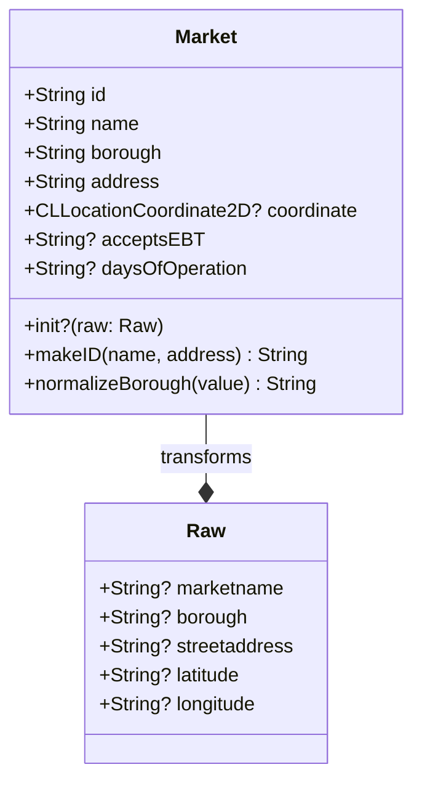
Sources: [NYCFarmerMarkets/Models/Market.swift:10-53](https://github.com/iyepes/NYCFarmerMarkets/blob/123ebba3a0dbcb9994b77ae727c7753a9eea85fc/NYCFarmerMarkets/Models/Market.swift#L10-L53)

The model performs normalization on borough names and coordinates. It identifies unique markets by combining lowercase versions of the name and address to form a stable ID. Sources: [NYCFarmerMarkets/Models/Market.swift:55-83](https://github.com/iyepes/NYCFarmerMarkets/blob/123ebba3a0dbcb9994b77ae727c7753a9eea85fc/NYCFarmerMarkets/Models/Market.swift#L55-L83)

## Initialization & Lifecycle

The application lifecycle begins with the `NYCFarmerMarketsApp` struct, which initializes core stores and applies the visual theme before the first view renders.

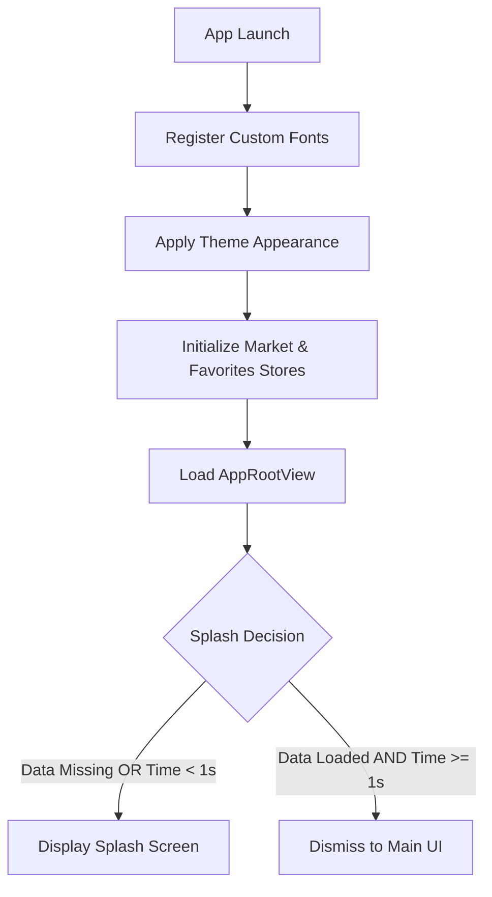
Sources: [NYCFarmerMarkets/NYCFarmerMarketsApp.swift:15-40](https://github.com/iyepes/NYCFarmerMarkets/blob/123ebba3a0dbcb9994b77ae727c7753a9eea85fc/NYCFarmerMarkets/NYCFarmerMarketsApp.swift#L15-L40), [NYCFarmerMarketsTests/SplashDecisionTests.swift:20-30](https://github.com/iyepes/NYCFarmerMarkets/blob/123ebba3a0dbcb9994b77ae727c7753a9eea85fc/NYCFarmerMarketsTests/SplashDecisionTests.swift#L20-L30)

### Splash Logic
The splash screen remains visible until two conditions are met:
1.  Market data is successfully fetched or loaded from cache.
2.  A minimum display time of **1.0 second** has elapsed.
Sources: [NYCFarmerMarketsTests/SplashDecisionTests.swift:20-40](https://github.com/iyepes/NYCFarmerMarkets/blob/123ebba3a0dbcb9994b77ae727c7753a9eea85fc/NYCFarmerMarketsTests/SplashDecisionTests.swift#L20-L40), [NYCFarmerMarketsTests/SplashDecisionTests.swift:63-65](https://github.com/iyepes/NYCFarmerMarkets/blob/123ebba3a0dbcb9994b77ae727c7753a9eea85fc/NYCFarmerMarketsTests/SplashDecisionTests.swift#L63-L65)

## Thematic Design (Spooky Theme)

The application utilizes a custom "Spooky" theme characterized by specific typography and a purple/orange color palette.

### Typography System
The app uses two primary font families. `AppTypography` manages the registration and mapping of these fonts to semantic roles.
- **Display Family**: "Grim Creeper" used for titles and headers.
- **Body Family**: "Breath of the House" used for general content and captions.

Sources: [Design/design-changes.md:12-18](https://github.com/iyepes/NYCFarmerMarkets/blob/123ebba3a0dbcb9994b77ae727c7753a9eea85fc/Design/design-changes.md#L12-L18), [NYCFarmerMarkets/Theme/AppTypography.swift:17-30](https://github.com/iyepes/NYCFarmerMarkets/blob/123ebba3a0dbcb9994b77ae727c7753a9eea85fc/NYCFarmerMarkets/Theme/AppTypography.swift#L17-L30)

### Color Palette
The "Spooky Colors" palette replaced the original green/olive design.
- **Primary**: Lavender (`0xAC84D6`)
- **Secondary/Icon Background**: Pumpkin Orange (`0xC56B23`)
- **Deep**: Deep Purple (`0x31078C`)

Sources: [Design/design-changes.md:38-51](https://github.com/iyepes/NYCFarmerMarkets/blob/123ebba3a0dbcb9994b77ae727c7753a9eea85fc/Design/design-changes.md#L38-L51)

## User Interface Components

### Market Detail View
The `MarketDetailView` provides exhaustive information about a selected market. It includes buttons for "Go to Map" (internal navigation) and "Directions" (external map application). Sources: [NYCFarmerMarkets/Views/MarketDetailView.swift:14-48](https://github.com/iyepes/NYCFarmerMarkets/blob/123ebba3a0dbcb9994b77ae727c7753a9eea85fc/NYCFarmerMarkets/Views/MarketDetailView.swift#L14-L48)

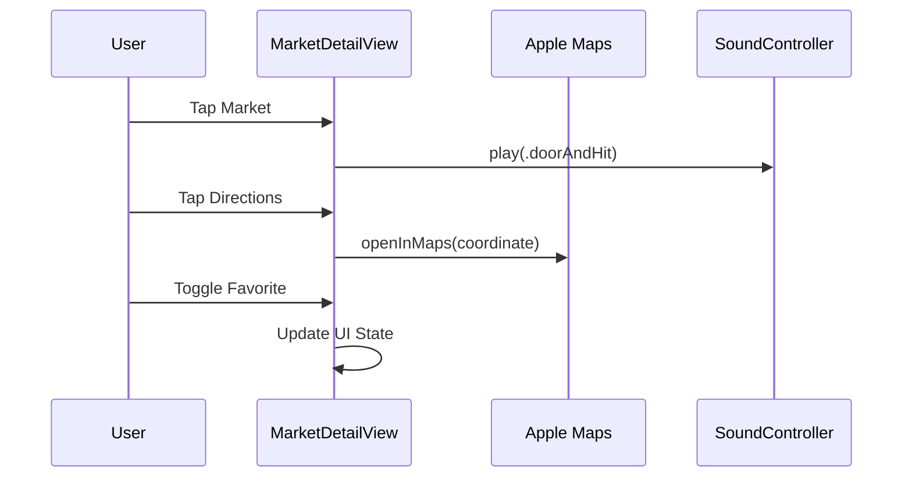
Sources: [NYCFarmerMarkets/Views/MarketDetailView.swift:55-65](https://github.com/iyepes/NYCFarmerMarkets/blob/123ebba3a0dbcb9994b77ae727c7753a9eea85fc/NYCFarmerMarkets/Views/MarketDetailView.swift#L55-L65), [NYCFarmerMarkets/Views/MarketDetailView.swift:101-110](https://github.com/iyepes/NYCFarmerMarkets/blob/123ebba3a0dbcb9994b77ae727c7753a9eea85fc/NYCFarmerMarkets/Views/MarketDetailView.swift#L101-L110)

### Search and Filtering
The search feature is case and diacritic insensitive. It filters markets by matching query strings against the market name, street address, or borough name. When a search is active, borough sections in the list view automatically expand to show results. Sources: [NYCFarmerMarketsTests/MarketSearchTests.swift:20-45](https://github.com/iyepes/NYCFarmerMarkets/blob/123ebba3a0dbcb9994b77ae727c7753a9eea85fc/NYCFarmerMarketsTests/MarketSearchTests.swift#L20-L45), [Design/design-changes.md:21-25](https://github.com/iyepes/NYCFarmerMarkets/blob/123ebba3a0dbcb9994b77ae727c7753a9eea85fc/Design/design-changes.md#L21-L25)

## Summary
NYCFarmerMarkets integrates NYC Open Data into a themed mobile experience. By combining a robust parsing layer (`Market` model), a strict lifecycle manager (`SplashDecision`), and a unified design system (`AppTypography` and `AppPalette`), the application provides a specialized tool for navigating urban agriculture in New York City. Sources: [readme.md:17-21](https://github.com/iyepes/NYCFarmerMarkets/blob/123ebba3a0dbcb9994b77ae727c7753a9eea85fc/readme.md#L17-L21), [NYCFarmerMarkets/NYCFarmerMarketsApp.swift:42-50](https://github.com/iyepes/NYCFarmerMarkets/blob/123ebba3a0dbcb9994b77ae727c7753a9eea85fc/NYCFarmerMarkets/NYCFarmerMarketsApp.swift#L42-L50)

### Setup & Launch Options

<details>
<summary>Relevant source files</summary>

The following files were used as context for generating this wiki page:

- [NYCFarmerMarkets/NYCFarmerMarketsApp.swift](https://github.com/iyepes/NYCFarmerMarkets/blob/123ebba3a0dbcb9994b77ae727c7753a9eea85fc/NYCFarmerMarkets/NYCFarmerMarketsApp.swift)
- [NYCFarmerMarkets/Models/LaunchOptions.swift](https://github.com/iyepes/NYCFarmerMarkets/blob/123ebba3a0dbcb9994b77ae727c7753a9eea85fc/NYCFarmerMarkets/Models/LaunchOptions.swift)
- [NYCFarmerMarkets/Views/AppRootView.swift](https://github.com/iyepes/NYCFarmerMarkets/blob/123ebba3a0dbcb9994b77ae727c7753a9eea85fc/NYCFarmerMarkets/Views/AppRootView.swift)
- [NYCFarmerMarkets/Theme/ThemeStyling.swift](https://github.com/iyepes/NYCFarmerMarkets/blob/123ebba3a0dbcb9994b77ae727c7753a9eea85fc/NYCFarmerMarkets/Theme/ThemeStyling.swift)
- [NYCFarmerMarkets/Theme/AppTypography.swift](https://github.com/iyepes/NYCFarmerMarkets/blob/123ebba3a0dbcb9994b77ae727c7753a9eea85fc/NYCFarmerMarkets/Theme/AppTypography.swift)
- [NYCFarmerMarketsTests/LaunchOptionsTests.swift](https://github.com/iyepes/NYCFarmerMarkets/blob/123ebba3a0dbcb9994b77ae727c7753a9eea85fc/NYCFarmerMarketsTests/LaunchOptionsTests.swift)
</details>

# Setup & Launch Options

Setup & Launch Options encompass the initialization logic and configuration hooks used to prepare the application state at startup. This system handles font registration, theme application, and environment setup for both standard production runs and automated UI testing.

The application uses a specialized configuration structure to parse command-line arguments, allowing developers to reset local storage or simulate network failures during testing.

## Application Initialization

The `NYCFarmerMarketsApp` struct serves as the entry point for the application. It performs several critical setup tasks in its `init()` method before the main view body executes.

### Initialization Sequence
1.  **Typography Registration**: The app registers custom font families (`Grim Creeper` and `Breath of the House`) to make them available to the system.
2.  **Global Appearance**: The `ThemeAppearance.apply()` function configures global UIKit styles for navigation and tab bars.
3.  **Launch Option Parsing**: The system checks `ProcessInfo.processInfo.arguments` to determine if specific testing flags are present.
4.  **State Initialization**: The `MarketStore`, `FavoritesStore`, and `SoundController` are instantiated based on the parsed launch options.

Sources: [NYCFarmerMarkets/NYCFarmerMarketsApp.swift:15-44](https://github.com/iyepes/NYCFarmerMarkets/blob/123ebba3a0dbcb9994b77ae727c7753a9eea85fc/NYCFarmerMarkets/NYCFarmerMarketsApp.swift#L15-L44), [NYCFarmerMarkets/Theme/AppTypography.swift:129-160](https://github.com/iyepes/NYCFarmerMarkets/blob/123ebba3a0dbcb9994b77ae727c7753a9eea85fc/NYCFarmerMarkets/Theme/AppTypography.swift#L129-L160)

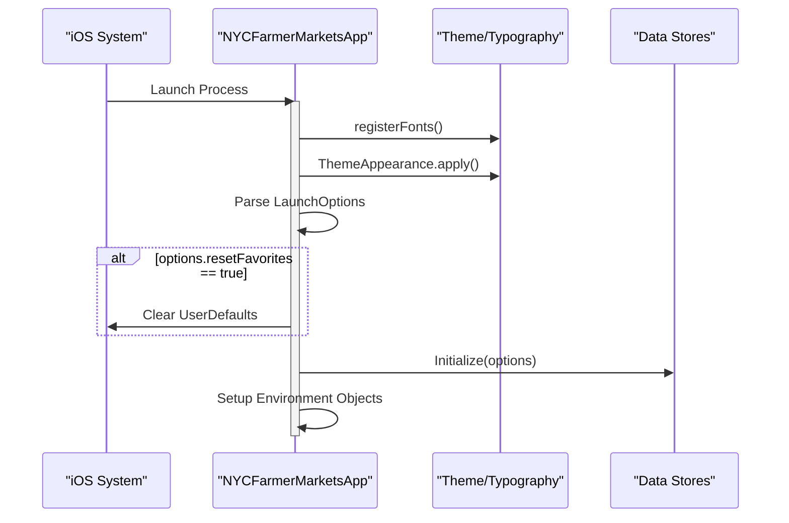
The diagram shows the synchronous startup flow where visual themes are applied before data stores are initialized based on launch arguments. Sources: [NYCFarmerMarkets/NYCFarmerMarketsApp.swift:15-52](https://github.com/iyepes/NYCFarmerMarkets/blob/123ebba3a0dbcb9994b77ae727c7753a9eea85fc/NYCFarmerMarkets/NYCFarmerMarketsApp.swift#L15-L52)

## Launch Options Configuration

The `LaunchOptions` structure provides a centralized way to manage configuration flags passed via process arguments. These flags primarily support UI testing by forcing the app into specific states.

| Argument | Property | Description |
| :--- | :--- | :--- |
| `-uiTestingReset` | `resetFavorites` | Clears stored favorite markets and sound settings from `UserDefaults`, and writes `hasSeenOnboarding = true` unless `-uiTestingResetOnboarding` is also passed. |
| `-uiTestingMuteSounds` | `muteSounds` | Silences interaction sounds and skips audio session setup. |
| `-uiTestingFailDownload` | `failDownload` | Forces the `MarketStore` to simulate a network connection failure. |
| `-uiTestingSplashMinimumSeconds` | `splashMinimumSeconds` | Overrides the default splash screen display duration (expects a following numeric value). |
| `-uiTestingSkipOnboarding` | `skipOnboarding` | Writes `hasSeenOnboarding = true` before the root view exists, so the app goes straight to the tabs. |
| `-uiTestingResetOnboarding` | `resetOnboarding` | Removes `hasSeenOnboarding`, so onboarding shows after the splash. Wins over `-uiTestingSkipOnboarding` and `-uiTestingReset`. |

*Updated in v3:* the onboarding flag is applied by `LaunchOptions.onboardingFlagAction` (`none`, `markSeen` or `reset`) in `NYCFarmerMarketsApp.init`. Sources: [NYCFarmerMarkets/Models/LaunchOptions.swift](https://github.com/iyepes/NYCFarmerMarkets/blob/ad3bdcfd7ae9cd164916a6a36f913d03bc06295c/NYCFarmerMarkets/Models/LaunchOptions.swift), [NYCFarmerMarkets/NYCFarmerMarketsApp.swift](https://github.com/iyepes/NYCFarmerMarkets/blob/ad3bdcfd7ae9cd164916a6a36f913d03bc06295c/NYCFarmerMarkets/NYCFarmerMarketsApp.swift)

Sources: [NYCFarmerMarkets/Models/LaunchOptions.swift:12-38](https://github.com/iyepes/NYCFarmerMarkets/blob/123ebba3a0dbcb9994b77ae727c7753a9eea85fc/NYCFarmerMarkets/Models/LaunchOptions.swift#L12-L38), [NYCFarmerMarketsTests/LaunchOptionsTests.swift:14-72](https://github.com/iyepes/NYCFarmerMarkets/blob/123ebba3a0dbcb9994b77ae727c7753a9eea85fc/NYCFarmerMarketsTests/LaunchOptionsTests.swift#L14-L72)

### Environment Setup Logic
The app initializes its core services differently based on these flags:
- If `failDownload` is active, the `MarketStore` is initialized with an empty temporary cache and a closure that throws a `URLError`.
- If `muteSounds` is active, a `SilentSoundPlayer` is injected instead of the standard `SoundPlayer`.
- The splash screen duration is set using either the provided launch argument or the default `SplashDecision.minimumDisplayTime`.

Sources: [NYCFarmerMarkets/NYCFarmerMarketsApp.swift:25-45](https://github.com/iyepes/NYCFarmerMarkets/blob/123ebba3a0dbcb9994b77ae727c7753a9eea85fc/NYCFarmerMarkets/NYCFarmerMarketsApp.swift#L25-L45), [NYCFarmerMarkets/Models/LaunchOptions.swift:24-38](https://github.com/iyepes/NYCFarmerMarkets/blob/123ebba3a0dbcb9994b77ae727c7753a9eea85fc/NYCFarmerMarkets/Models/LaunchOptions.swift#L24-L38)

## Theme and Typography Setup

Typography setup is a prerequisite for the UI because system-rendered bars (tab bars and navigation bars) require the fonts to be registered before they can be styled.

### Font Registration
The `AppTypography.registerFonts()` method iterates through bundled `.ttf` files and uses `CTFontManagerRegisterFontsForURL` to register them for the process. If registration fails and the error is not "already registered," the failure is logged.

Sources: [NYCFarmerMarkets/Theme/AppTypography.swift:135-160](https://github.com/iyepes/NYCFarmerMarkets/blob/123ebba3a0dbcb9994b77ae727c7753a9eea85fc/NYCFarmerMarkets/Theme/AppTypography.swift#L135-L160)

### Global Appearance Application
The `ThemeAppearance.apply()` function configures the visual style of UIKit components that SwiftUI does not fully manage:
*   **UINavigationBar**: Sets the global `tintColor` to the theme's accent color.
*   **UITabBar**: Configures an opaque background and applies custom colors and fonts to item titles for selected and normal states.
*   **UISearchTextField**: Applies the theme's body font to the search input field.

Sources: [NYCFarmerMarkets/Theme/ThemeStyling.swift:65-98](https://github.com/iyepes/NYCFarmerMarkets/blob/123ebba3a0dbcb9994b77ae727c7753a9eea85fc/NYCFarmerMarkets/Theme/ThemeStyling.swift#L65-L98)

## Root View and State Injection

Once initialization completes, the `AppRootView` manages the transition from the splash screen to the main interface. It injects the initialized stores into the environment.

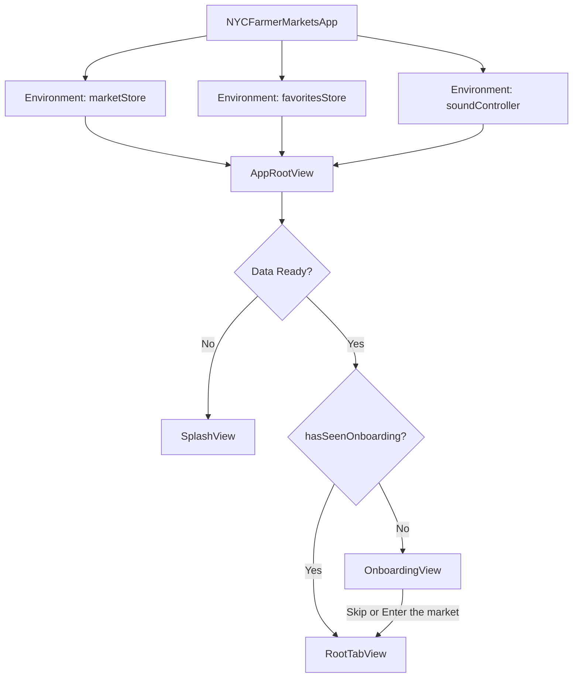
The diagram illustrates how state is injected at the top level and used by `AppRootView` to decide whether to show the loading splash or the main tabs. Sources: [NYCFarmerMarkets/NYCFarmerMarketsApp.swift:51-57](https://github.com/iyepes/NYCFarmerMarkets/blob/123ebba3a0dbcb9994b77ae727c7753a9eea85fc/NYCFarmerMarkets/NYCFarmerMarketsApp.swift#L51-L57), [NYCFarmerMarkets/Views/AppRootView.swift:45-53](https://github.com/iyepes/NYCFarmerMarkets/blob/123ebba3a0dbcb9994b77ae727c7753a9eea85fc/NYCFarmerMarkets/Views/AppRootView.swift#L45-L53)

### Splash Logic
The `AppRootView` tracks the application's readiness using two criteria:
1.  **Data Availability**: `MarketStore` has successfully loaded markets.
2.  **Minimum Time**: A timer (defaulting to 1 second or the `splashMinimumSeconds` override) has elapsed.

The splash screen is dismissed only when both conditions are met. *Updated in v3:* after the splash, `OnboardingDecision` shows onboarding once per install before the tabs (see Core Features > Onboarding Flow). Sources: [NYCFarmerMarkets/Views/AppRootView.swift:42-65](https://github.com/iyepes/NYCFarmerMarkets/blob/123ebba3a0dbcb9994b77ae727c7753a9eea85fc/NYCFarmerMarkets/Views/AppRootView.swift#L42-L65)

## Summary

Setup & Launch Options ensure the application starts with a consistent visual identity and a predictable data state. By utilizing `LaunchOptions`, the project enables robust UI testing by allowing the environment to be manipulated through simple command-line arguments. This architecture decouples production logic from testing requirements while maintaining a centralized initialization flow.

## System Architecture

### Architecture Overview

<details>
<summary>Relevant source files</summary>

The following files were used as context for generating this wiki page:

- [NYCFarmerMarketsApp.swift](https://github.com/iyepes/NYCFarmerMarkets/blob/123ebba3a0dbcb9994b77ae727c7753a9eea85fc/NYCFarmerMarkets/NYCFarmerMarketsApp.swift)
- [Views/AppRootView.swift](https://github.com/iyepes/NYCFarmerMarkets/blob/123ebba3a0dbcb9994b77ae727c7753a9eea85fc/NYCFarmerMarkets/Views/AppRootView.swift)
- [Models/Market.swift](https://github.com/iyepes/NYCFarmerMarkets/blob/123ebba3a0dbcb9994b77ae727c7753a9eea85fc/NYCFarmerMarkets/Models/Market.swift)
- [Theme/AppTypography.swift](https://github.com/iyepes/NYCFarmerMarkets/blob/123ebba3a0dbcb9994b77ae727c7753a9eea85fc/NYCFarmerMarkets/Theme/AppTypography.swift)
- [Theme/AppPalette.swift](https://github.com/iyepes/NYCFarmerMarkets/blob/123ebba3a0dbcb9994b77ae727c7753a9eea85fc/NYCFarmerMarkets/Theme/ThemeStyling.swift)
- [Views/MarketListView.swift](https://github.com/iyepes/NYCFarmerMarkets/blob/123ebba3a0dbcb9994b77ae727c7753a9eea85fc/NYCFarmerMarkets/Views/MarketListView.swift)
- [Views/MarketDetailView.swift](https://github.com/iyepes/NYCFarmerMarkets/blob/123ebba3a0dbcb9994b77ae727c7753a9eea85fc/NYCFarmerMarkets/Views/MarketDetailView.swift)
- [Design/design-changes.md](https://github.com/iyepes/NYCFarmerMarkets/blob/123ebba3a0dbcb9994b77ae727c7753a9eea85fc/Design/design-changes.md)
</details>

# Architecture Overview

This document describes the software architecture of the NYCFarmerMarkets application, now known as **Spooky Markets**. The project follows a modern SwiftUI-based architecture that integrates data persistence, custom theming, and a centralized state management system to provide information about New York City farmers markets.

The application utilizes a multi-layered approach to separate UI concerns from data models and styling logic. It features a splash-screen controlled entry point that ensures data availability before presenting the main interface.

Sources: [NYCFarmerMarketsApp.swift:1-45](https://github.com/iyepes/NYCFarmerMarkets/blob/123ebba3a0dbcb9994b77ae727c7753a9eea85fc/NYCFarmerMarketsApp.swift#L1-L45), [Design/design-changes.md:65-68](https://github.com/iyepes/NYCFarmerMarkets/blob/123ebba3a0dbcb9994b77ae727c7753a9eea85fc/Design/design-changes.md#L65-L68), [Views/AppRootView.swift:12-25](https://github.com/iyepes/NYCFarmerMarkets/blob/123ebba3a0dbcb9994b77ae727c7753a9eea85fc/Views/AppRootView.swift#L12-L25)

## Application Entry Point and Initialization

The application lifecycle starts in `NYCFarmerMarketsApp`, which initializes core stores and controllers. It registers custom fonts and applies global theme appearances during the `init` phase. The app uses SwiftUI's `@State` and `@Environment` to manage and inject dependencies like `MarketStore`, `FavoritesStore`, and `SoundController`.

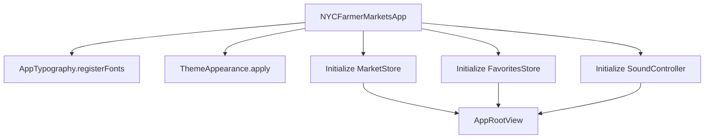
The application supports specific launch arguments for UI testing, allowing it to reset favorites, fail downloads intentionally, or mute sounds.

Sources: [NYCFarmerMarketsApp.swift:13-39](https://github.com/iyepes/NYCFarmerMarkets/blob/123ebba3a0dbcb9994b77ae727c7753a9eea85fc/NYCFarmerMarketsApp.swift#L13-L39), [Theme/ThemeStyling.swift:65-70](https://github.com/iyepes/NYCFarmerMarkets/blob/123ebba3a0dbcb9994b77ae727c7753a9eea85fc/Theme/ThemeStyling.swift#L65-L70)

## State and Data Management

The application's data layer centers around the `Market` model, which represents a single farmers market entry from the NYC Open Data dataset.

### Data Model
The `Market` struct handles the transformation of raw API strings into typed data. It includes logic for normalizing borough names, cleaning whitespace, and parsing coordinates.

| Field | Type | Description |
|---|---|---|
| `id` | `String` | Stable ID formed from name and address |
| `name` | `String` | Market name |
| `borough` | `String` | Normalized borough name |
| `coordinate` | `CLLocationCoordinate2D?` | Derived from latitude and longitude strings |

Sources: [Models/Market.swift:10-40](https://github.com/iyepes/NYCFarmerMarkets/blob/123ebba3a0dbcb9994b77ae727c7753a9eea85fc/Models/Market.swift#L10-L40), [Models/Market.swift:65-80](https://github.com/iyepes/NYCFarmerMarkets/blob/123ebba3a0dbcb9994b77ae727c7753a9eea85fc/Models/Market.swift#L65-L80)

### Launch Logic
`AppRootView` manages the transition from a splash screen to the main content. It monitors the `MarketStore` state to determine when data is available.

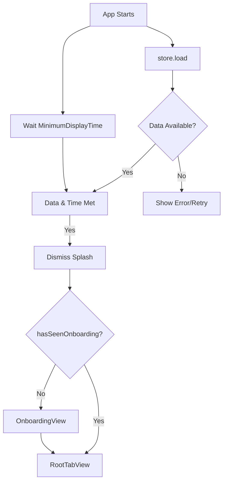
The splash screen remains visible until both the data is loaded and a minimum display time (defaulting to 1 second) has elapsed.

Sources: [Views/AppRootView.swift:42-65](https://github.com/iyepes/NYCFarmerMarkets/blob/123ebba3a0dbcb9994b77ae727c7753a9eea85fc/Views/AppRootView.swift#L42-L65), [NYCFarmerMarketsTests/SplashDecisionTests.swift:85-87](https://github.com/iyepes/NYCFarmerMarkets/blob/123ebba3a0dbcb9994b77ae727c7753a9eea85fc/NYCFarmerMarketsTests/SplashDecisionTests.swift#L85-L87)

## UI and View Architecture

The UI is organized into a tab-based navigation structure, primarily focusing on a searchable list, a map view, and a favorites list.

### Market List View
`MarketListView` provides a searchable list where markets are grouped by borough. It utilizes `SectionExpansionState` to manage collapsible borough headers.

- **Search:** Filters the list by name, address, or borough. Search operations auto-expand matching sections.
- **Collapsible Sections:** Headers start collapsed by default and can be toggled by the user.

Sources: [Views/MarketListView.swift:15-40](https://github.com/iyepes/NYCFarmerMarkets/blob/123ebba3a0dbcb9994b77ae727c7753a9eea85fc/Views/MarketListView.swift#L15-L40), [NYCFarmerMarketsTests/SectionExpansionTests.swift:64-70](https://github.com/iyepes/NYCFarmerMarkets/blob/123ebba3a0dbcb9994b77ae727c7753a9eea85fc/NYCFarmerMarketsTests/SectionExpansionTests.swift#L64-L70)

### Detail View
`MarketDetailView` is a shared component that displays comprehensive information for a selected market. It includes rows for operational hours, EBT acceptance, and external map links.

Sources: [Views/MarketDetailView.swift:15-50](https://github.com/iyepes/NYCFarmerMarkets/blob/123ebba3a0dbcb9994b77ae727c7753a9eea85fc/Views/MarketDetailView.swift#L15-L50)

## Theme and Typography System

The project uses a centralized theme system consisting of an `AppPalette` and `AppTypography`. 

### Typography Roles
Typography is managed through a `Role` enum, mapping semantic uses (e.g., `sectionHeader`, `body`) to specific font families and sizes.

| Family | PostScript Name | Usage |
|---|---|---|
| `display` | `Grim-Creeper-Regular` | Titles, Splash, Section Headers |
| `body` | `Breath-of-the-House` | Body text, Captions, Footnotes |

The `body` family uses a `sizeScale` of 1.15 to improve readability, ensuring the font does not drop below a 14 pt floor.

Sources: [Theme/AppTypography.swift:20-60](https://github.com/iyepes/NYCFarmerMarkets/blob/123ebba3a0dbcb9994b77ae727c7753a9eea85fc/Theme/AppTypography.swift#L20-L60), [Design/design-changes.md:10-35](https://github.com/iyepes/NYCFarmerMarkets/blob/123ebba3a0dbcb9994b77ae727c7753a9eea85fc/Design/design-changes.md#L10-L35)

### Color Palette
The app utilizes a "Spooky" color palette featuring purples and oranges.

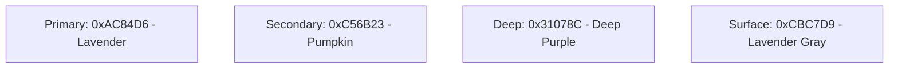
Sources: [Design/design-changes.md:40-55](https://github.com/iyepes/NYCFarmerMarkets/blob/123ebba3a0dbcb9994b77ae727c7753a9eea85fc/Design/design-changes.md#L40-L55), [NYCFarmerMarketsTests/NYCFarmerMarketsTests.swift:348-355](https://github.com/iyepes/NYCFarmerMarkets/blob/123ebba3a0dbcb9994b77ae727c7753a9eea85fc/NYCFarmerMarketsTests/NYCFarmerMarketsTests.swift#L348-L355)

## Conclusion

The architecture of the NYCFarmerMarkets app ensures a robust user experience through strictly defined data parsing, a state-driven splash and loading sequence, and a highly customizable theming engine. By centralizing typography and colors, the application maintains a consistent "Spooky" aesthetic while providing reliable access to public city data.

### State Management & Observation

<details>
<summary>Relevant source files</summary>

The following files were used as context for generating this wiki page:

- [NYCFarmerMarkets/Stores/MarketStore.swift](https://github.com/iyepes/NYCFarmerMarkets/blob/123ebba3a0dbcb9994b77ae727c7753a9eea85fc/NYCFarmerMarkets/Stores/MarketStore.swift)
- [NYCFarmerMarkets/Views/AppRootView.swift](https://github.com/iyepes/NYCFarmerMarkets/blob/123ebba3a0dbcb9994b77ae727c7753a9eea85fc/NYCFarmerMarkets/Views/AppRootView.swift)
- [NYCFarmerMarkets/NYCFarmerMarketsApp.swift](https://github.com/iyepes/NYCFarmerMarkets/blob/123ebba3a0dbcb9994b77ae727c7753a9eea85fc/NYCFarmerMarkets/NYCFarmerMarketsApp.swift)
- [NYCFarmerMarkets/Views/MarketListView.swift](https://github.com/iyepes/NYCFarmerMarkets/blob/123ebba3a0dbcb9994b77ae727c7753a9eea85fc/NYCFarmerMarkets/Views/MarketListView.swift)
- [NYCFarmerMarketsTests/NYCFarmerMarketsTests.swift](https://github.com/iyepes/NYCFarmerMarkets/blob/123ebba3a0dbcb9994b77ae727c7753a9eea85fc/NYCFarmerMarketsTests/NYCFarmerMarketsTests.swift)
- [NYCFarmerMarketsTests/SectionExpansionTests.swift](https://github.com/iyepes/NYCFarmerMarkets/blob/123ebba3a0dbcb9994b77ae727c7753a9eea85fc/NYCFarmerMarketsTests/SectionExpansionTests.swift)
- [NYCFarmerMarketsTests/SplashDecisionTests.swift](https://github.com/iyepes/NYCFarmerMarkets/blob/123ebba3a0dbcb9994b77ae727c7753a9eea85fc/NYCFarmerMarketsTests/SplashDecisionTests.swift)
</details>

# State Management & Observation

State management in the NYC Farmer Markets application coordinates market data lifecycle, user preferences, and view-level UI states. The project uses the SwiftUI `@Observable` macro to facilitate reactive updates across the view hierarchy. This architecture ensures that data remains synchronized between the searchable list, the interactive map, and the favorites gallery.

The system handles asynchronous network operations, local persistence through caching and `UserDefaults`, and manages complex UI states such as the "Spooky" theme's splash sequence.

## Core Data Stores

The application architecture relies on three primary stores injected into the environment at the root level. These stores manage the domain data and global application settings.

### MarketStore
The `MarketStore` manages the collection of `Market` models. It coordinates data fetching from the API and fallback logic using a local JSON cache. It tracks the network status and exposes a shared search query used by multiple navigation tabs.

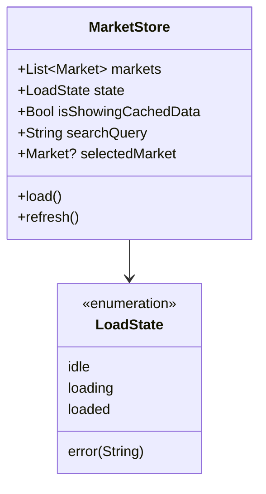
Sources: [NYCFarmerMarkets/Stores/MarketStore.swift:11-30](https://github.com/iyepes/NYCFarmerMarkets/blob/123ebba3a0dbcb9994b77ae727c7753a9eea85fc/NYCFarmerMarkets/Stores/MarketStore.swift#L11-L30), [NYCFarmerMarkets/NYCFarmerMarketsApp.swift:42-43](https://github.com/iyepes/NYCFarmerMarkets/blob/123ebba3a0dbcb9994b77ae727c7753a9eea85fc/NYCFarmerMarkets/NYCFarmerMarketsApp.swift#L42-L43)

### FavoritesStore
The `FavoritesStore` manages the persistent list of market identifiers that the user has marked as favorites. It uses `UserDefaults` for persistence, ensuring selections survive app relaunches.
Sources: [NYCFarmerMarketsTests/NYCFarmerMarketsTests.swift:274-304](https://github.com/iyepes/NYCFarmerMarkets/blob/123ebba3a0dbcb9994b77ae727c7753a9eea85fc/NYCFarmerMarketsTests/NYCFarmerMarketsTests.swift#L274-L304), [NYCFarmerMarkets/NYCFarmerMarketsApp.swift:45](https://github.com/iyepes/NYCFarmerMarkets/blob/123ebba3a0dbcb9994b77ae727c7753a9eea85fc/NYCFarmerMarkets/NYCFarmerMarketsApp.swift#L45)

## Data Flow & Observation

The application uses a "Source of Truth" pattern where stores are initialized in the `App` struct and provided to the view hierarchy via environment modifiers.

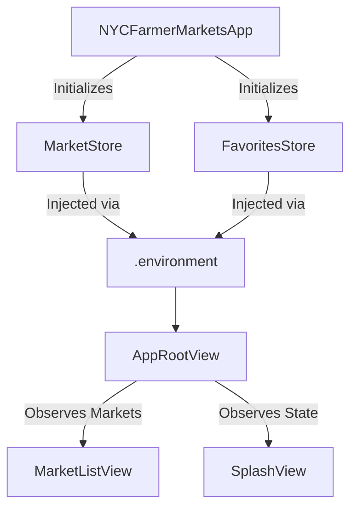
Sources: [NYCFarmerMarkets/NYCFarmerMarketsApp.swift:42-51](https://github.com/iyepes/NYCFarmerMarkets/blob/123ebba3a0dbcb9994b77ae727c7753a9eea85fc/NYCFarmerMarkets/NYCFarmerMarketsApp.swift#L42-L51), [NYCFarmerMarkets/Views/AppRootView.swift:15-16](https://github.com/iyepes/NYCFarmerMarkets/blob/123ebba3a0dbcb9994b77ae727c7753a9eea85fc/NYCFarmerMarkets/Views/AppRootView.swift#L15-L16)

### Loading Sequence
The `AppRootView` manages the transition from the loading splash screen to the main content. It observes the `MarketStore` state to determine when data is available.

1.  **Initial Load**: `AppRootView` triggers `store.load()` on appearance.
2.  **Cached Data**: `MarketStore` immediately populates `markets` if a local cache exists.
3.  **Network Refresh**: The store performs an asynchronous network fetch.
4.  **State Sync**: If the fetch fails but cached data exists, `isShowingCachedData` becomes true, and the UI displays an offline banner.
Sources: [NYCFarmerMarkets/Stores/MarketStore.swift:44-53](https://github.com/iyepes/NYCFarmerMarkets/blob/123ebba3a0dbcb9994b77ae727c7753a9eea85fc/NYCFarmerMarkets/Stores/MarketStore.swift#L44-L53), [NYCFarmerMarkets/Views/AppRootView.swift:54-58](https://github.com/iyepes/NYCFarmerMarkets/blob/123ebba3a0dbcb9994b77ae727c7753a9eea85fc/NYCFarmerMarkets/Views/AppRootView.swift#L54-L58)

## View-Level State

Certain UI states are managed locally within views or dedicated logic structures to keep domain stores clean.

### Section Expansion Management
The `MarketListView` uses a `SectionExpansionState` to track which borough sections are open. This state is dynamic:
*   **Default**: All sections start collapsed.
*   **Manual**: Users can toggle sections.
*   **Auto-Expand**: When a search query is active, sections containing matching markets automatically expand.
*   **Search Exit**: Clearing the search restores the manual expansion state that existed before the search began.
Sources: [NYCFarmerMarketsTests/SectionExpansionTests.swift:65-125](https://github.com/iyepes/NYCFarmerMarkets/blob/123ebba3a0dbcb9994b77ae727c7753a9eea85fc/NYCFarmerMarketsTests/SectionExpansionTests.swift#L65-L125), [NYCFarmerMarkets/Views/MarketListView.swift:16](https://github.com/iyepes/NYCFarmerMarkets/blob/123ebba3a0dbcb9994b77ae727c7753a9eea85fc/NYCFarmerMarkets/Views/MarketListView.swift#L16)

### Splash Sequence Logic
The splash screen dismissal is governed by the `SplashDecision` component. It evaluates three variables to determine if the app should transition to the main interface.

| Condition | Description |
| :--- | :--- |
| `dataAvailable` | True if `MarketStore` has at least one market (cached or fresh). |
| `minimumTimeElapsed` | True if the enforced 1-second delay has passed. |
| `errorMessage` | Holds error text if data is missing and loading failed. |

The splash screen only dismisses when both `dataAvailable` and `minimumTimeElapsed` are true.
Sources: [NYCFarmerMarketsTests/SplashDecisionTests.swift:23-42](https://github.com/iyepes/NYCFarmerMarkets/blob/123ebba3a0dbcb9994b77ae727c7753a9eea85fc/NYCFarmerMarketsTests/SplashDecisionTests.swift#L23-L42), [NYCFarmerMarkets/Views/AppRootView.swift:46-52](https://github.com/iyepes/NYCFarmerMarkets/blob/123ebba3a0dbcb9994b77ae727c7753a9eea85fc/NYCFarmerMarkets/Views/AppRootView.swift#L46-L52)

## Error Handling States

The system differentiates between technical errors (logged) and user-facing messages.

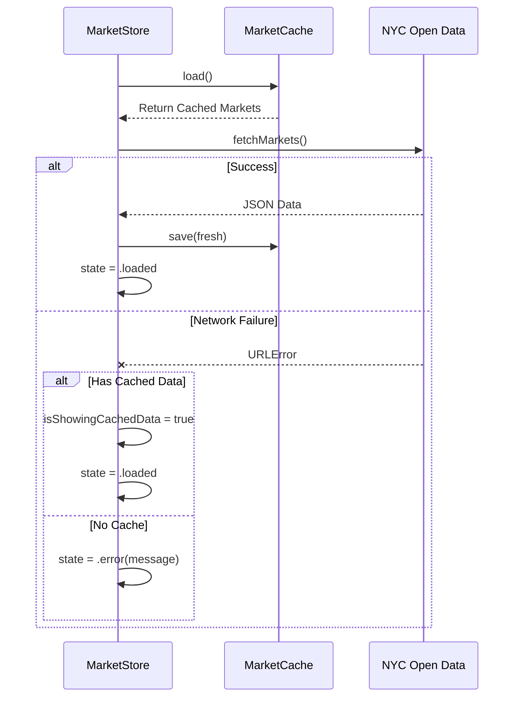
Sources: [NYCFarmerMarkets/Stores/MarketStore.swift:55-80](https://github.com/iyepes/NYCFarmerMarkets/blob/123ebba3a0dbcb9994b77ae727c7753a9eea85fc/NYCFarmerMarkets/Stores/MarketStore.swift#L55-L80), [NYCFarmerMarketsTests/NYCFarmerMarketsTests.swift:110-140](https://github.com/iyepes/NYCFarmerMarkets/blob/123ebba3a0dbcb9994b77ae727c7753a9eea85fc/NYCFarmerMarketsTests/NYCFarmerMarketsTests.swift#L110-L140)

## Summary

State Management & Observation in this project effectively separates persistent domain data from transient UI state. The `MarketStore` provides a centralized point for data synchronization, while local state structures like `SectionExpansionState` handle complex view interactions. This separation allows for features like search-driven UI adjustments and robust offline support via transparent caching.

### Offline & Failure Handling

<details>
<summary>Relevant source files</summary>

The following files were used as context for generating this wiki page:

- [NYCFarmerMarkets/Models/SplashDecision.swift](https://github.com/iyepes/NYCFarmerMarkets/blob/123ebba3a0dbcb9994b77ae727c7753a9eea85fc/NYCFarmerMarkets/Models/SplashDecision.swift)
- [NYCFarmerMarkets/Models/LoadFailureMessage.swift](https://github.com/iyepes/NYCFarmerMarkets/blob/123ebba3a0dbcb9994b77ae727c7753a9eea85fc/NYCFarmerMarkets/Models/LoadFailureMessage.swift)
- [NYCFarmerMarkets/Views/Shared/OfflineBanner.swift](https://github.com/iyepes/NYCFarmerMarkets/blob/123ebba3a0dbcb9994b77ae727c7753a9eea85fc/NYCFarmerMarkets/Views/Shared/OfflineBanner.swift)
- [NYCFarmerMarkets/Stores/MarketStore.swift](https://github.com/iyepes/NYCFarmerMarkets/blob/123ebba3a0dbcb9994b77ae727c7753a9eea85fc/NYCFarmerMarkets/Stores/MarketStore.swift)
- [NYCFarmerMarkets/Views/AppRootView.swift](https://github.com/iyepes/NYCFarmerMarkets/blob/123ebba3a0dbcb9994b77ae727c7753a9eea85fc/NYCFarmerMarkets/Views/AppRootView.swift)
- [NYCFarmerMarkets/Views/SplashView.swift](https://github.com/iyepes/NYCFarmerMarkets/blob/123ebba3a0dbcb9994b77ae727c7753a9eea85fc/NYCFarmerMarkets/Views/SplashView.swift)
- [NYCFarmerMarketsTests/LoadFailureMessageTests.swift](https://github.com/iyepes/NYCFarmerMarkets/blob/123ebba3a0dbcb9994b77ae727c7753a9eea85fc/NYCFarmerMarketsTests/LoadFailureMessageTests.swift)
</details>

# Offline & Failure Handling

The Offline & Failure Handling system manages network disruptions and data retrieval errors to maintain app usability. It prioritizes showing cached data when available and provides friendly, non-technical feedback to the user when the app cannot reach NYC Open Data.

This system monitors the `MarketStore` state to decide whether to show a persistent splash screen, an offline warning banner, or the main application content. It maps technical `URLError` and `MarketServiceError` types to human-readable messages that guide the user to retry or check their connection.

## Architecture and Components

The failure handling logic is distributed across the data store, logic models, and the root view hierarchy.

### MarketStore State Management
The `MarketStore` acts as the primary actor for detecting and storing error states. It distinguishes between a total failure (no data available) and a partial failure (new fetch failed, but cached data exists).

*   **`LoadState`**: An enum trackings if the store is `.idle`, `.loading`, `.loaded`, or in an `.error(String)` state.
*   **`isShowingCachedData`**: A boolean flag set to `true` when a network refresh fails but previous data is available from the cache.
*   **`failure`**: Stores a `LoadFailureMessage` object when a critical error occurs.

Sources: [NYCFarmerMarkets/Stores/MarketStore.swift:13-28](https://github.com/iyepes/NYCFarmerMarkets/blob/123ebba3a0dbcb9994b77ae727c7753a9eea85fc/NYCFarmerMarkets/Stores/MarketStore.swift#L13-L28)

### Error Mapping Logic
Technical errors from `URLSession` or the `MarketService` are transformed into user-friendly messages by the `LoadFailureMessage` struct.

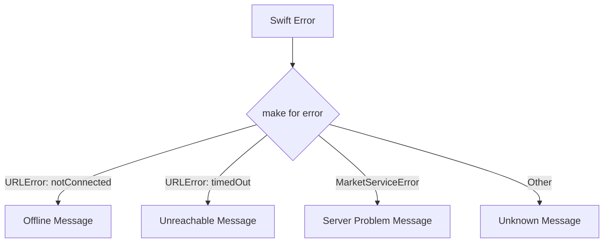
The mapping ensures that technical strings like "NSURLErrorDomain" or "Code=-1009" never reach the UI.

Sources: [NYCFarmerMarkets/Models/LoadFailureMessage.swift:40-54](https://github.com/iyepes/NYCFarmerMarkets/blob/123ebba3a0dbcb9994b77ae727c7753a9eea85fc/NYCFarmerMarkets/Models/LoadFailureMessage.swift#L40-L54), [NYCFarmerMarketsTests/LoadFailureMessageTests.swift:34-44](https://github.com/iyepes/NYCFarmerMarkets/blob/123ebba3a0dbcb9994b77ae727c7753a9eea85fc/NYCFarmerMarketsTests/LoadFailureMessageTests.swift#L34-L44)

## Splash Phase Decision Logic

The app uses a splash screen to manage the initial loading experience. The `SplashDecision` logic determines when to dismiss the splash, show an error, or continue loading.

### Decision Matrix
The system evaluates three inputs: `dataAvailable`, `minimumTimeElapsed`, and `errorMessage`.

| Data Available | Min Time Elapsed | Error Message | Resulting Phase |
| :--- | :--- | :--- | :--- |
| True | True | Irrelevant | `.dismissed` |
| True | False | Irrelevant | `.loading` |
| False | Irrelevant | "Error Text" | `.failed(message)` |
| False | Irrelevant | Nil | `.loading` |

Sources: [NYCFarmerMarkets/Models/SplashDecision.swift:30-41](https://github.com/iyepes/NYCFarmerMarkets/blob/123ebba3a0dbcb9994b77ae727c7753a9eea85fc/NYCFarmerMarkets/Models/SplashDecision.swift#L30-L41), [NYCFarmerMarketsTests/SplashDecisionTests.swift:23-40](https://github.com/iyepes/NYCFarmerMarkets/blob/123ebba3a0dbcb9994b77ae727c7753a9eea85fc/NYCFarmerMarketsTests/SplashDecisionTests.swift#L23-L40)

### Launch Sequence Flow
The following sequence diagram illustrates how `AppRootView` coordinates between the `MarketStore` and the splash screen during a failed fetch that recovers via cache.

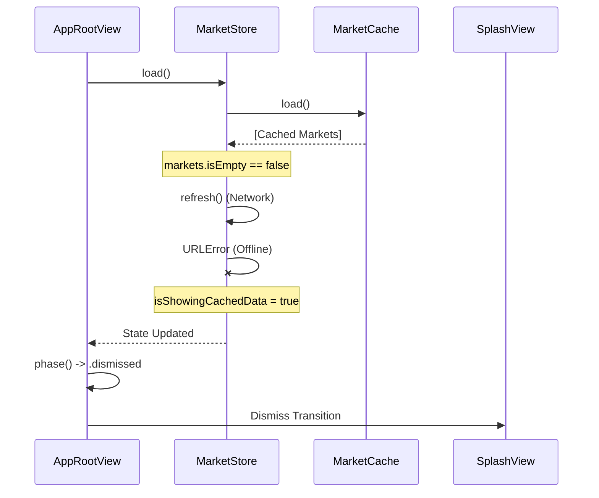
Sources: [NYCFarmerMarkets/Views/AppRootView.swift:54-66](https://github.com/iyepes/NYCFarmerMarkets/blob/123ebba3a0dbcb9994b77ae727c7753a9eea85fc/NYCFarmerMarkets/Views/AppRootView.swift#L54-L66), [NYCFarmerMarkets/Stores/MarketStore.swift:44-55](https://github.com/iyepes/NYCFarmerMarkets/blob/123ebba3a0dbcb9994b77ae727c7753a9eea85fc/NYCFarmerMarkets/Stores/MarketStore.swift#L44-L55)

## User Interface Elements

The system provides different UI feedback depending on the severity of the failure and the availability of cached data.

### Offline Banner
When the app is offline but has cached data, it displays the `OfflineBanner` at the top of the market list.
*   **Visuals**: A horizontal stack with an offline icon and the text "Lost in the fog, showing saved markets".
*   **Accessibility**: Provides a plain label "Offline, showing saved data" for VoiceOver users.

Sources: [NYCFarmerMarkets/Views/Shared/OfflineBanner.swift:10-21](https://github.com/iyepes/NYCFarmerMarkets/blob/123ebba3a0dbcb9994b77ae727c7753a9eea85fc/NYCFarmerMarkets/Views/Shared/OfflineBanner.swift#L10-L21), [NYCFarmerMarkets/Theme/AppCopy.swift:18-19](https://github.com/iyepes/NYCFarmerMarkets/blob/123ebba3a0dbcb9994b77ae727c7753a9eea85fc/NYCFarmerMarkets/Theme/AppCopy.swift#L18-L19)

### Splash Failure View
If no data is available (first launch or empty cache) and a fetch fails, `SplashView` presents a full-screen error state.
1.  Displays the `title` from `LoadFailureMessage` as the primary heading.
2.  Displays the `hint` as secondary text explaining the next step (e.g., "Check your connection").
3.  Provides a **Retry** button that triggers `marketStore.refresh()`.

Sources: [NYCFarmerMarkets/Views/SplashView.swift:31-51](https://github.com/iyepes/NYCFarmerMarkets/blob/123ebba3a0dbcb9994b77ae727c7753a9eea85fc/NYCFarmerMarkets/Views/SplashView.swift#L31-L51), [NYCFarmerMarkets/Models/LoadFailureMessage.swift:14-37](https://github.com/iyepes/NYCFarmerMarkets/blob/123ebba3a0dbcb9994b77ae727c7753a9eea85fc/NYCFarmerMarkets/Models/LoadFailureMessage.swift#L14-L37)

## Failure Message Categories

The following table summarizes the user-facing messages defined in the system.

| Category | Title (Spooky Tone) | Hint (Actionable) | Trigger Condition |
| :--- | :--- | :--- | :--- |
| **Offline** | You're off the grid | Check your connection, then try again. | No internet, roaming off, or connection lost. |
| **Unreachable** | The markets are hiding | We couldn't reach NYC Open Data. Try again in a moment. | Timeout, host not found, or DNS failure. |
| **Server Problem** | NYC Open Data is sleeping | The server had a problem. Try again in a moment. | HTTP 5xx errors or service exceptions. |
| **No Markets** | The market stalls are empty | No markets are available right now. Try again soon. | Successful fetch but 0 markets returned. |
| **Unknown** | Something spooked the data | We couldn't read the markets. Try again. | Decoding errors or unrecognized failures. |

Sources: [NYCFarmerMarkets/Models/LoadFailureMessage.swift:14-37](https://github.com/iyepes/NYCFarmerMarkets/blob/123ebba3a0dbcb9994b77ae727c7753a9eea85fc/NYCFarmerMarkets/Models/LoadFailureMessage.swift#L14-L37)

## Conclusion
The Offline & Failure Handling system ensures that the application remains functional and informative even without an active network connection. By utilizing a local cache and a centralized error-to-message mapping system, the app replaces technical failures with actionable guidance while maintaining its thematic visual style.

## Core Features

### Market Browsing & Search

<details>
<summary>Relevant source files</summary>

The following files were used as context for generating this wiki page:

- [NYCFarmerMarkets/Views/MarketListView.swift](https://github.com/iyepes/NYCFarmerMarkets/blob/123ebba3a0dbcb9994b77ae727c7753a9eea85fc/NYCFarmerMarkets/Views/MarketListView.swift)
- [NYCFarmerMarkets/Stores/MarketStore.swift](https://github.com/iyepes/NYCFarmerMarkets/blob/123ebba3a0dbcb9994b77ae727c7753a9eea85fc/NYCFarmerMarkets/Stores/MarketStore.swift)
- [NYCFarmerMarkets/Models/Market.swift](https://github.com/iyepes/NYCFarmerMarkets/blob/123ebba3a0dbcb9994b77ae727c7753a9eea85fc/NYCFarmerMarkets/Models/Market.swift)
- [NYCFarmerMarkets/Views/MarketMapView.swift](https://github.com/iyepes/NYCFarmerMarkets/blob/123ebba3a0dbcb9994b77ae727c7753a9eea85fc/NYCFarmerMarkets/Views/MarketMapView.swift)
- [NYCFarmerMarketsTests/MarketSearchTests.swift](https://github.com/iyepes/NYCFarmerMarkets/blob/123ebba3a0dbcb9994b77ae727c7753a9eea85fc/NYCFarmerMarketsTests/MarketSearchTests.swift)
- [NYCFarmerMarketsTests/SectionExpansionTests.swift](https://github.com/iyepes/NYCFarmerMarkets/blob/123ebba3a0dbcb9994b77ae727c7753a9eea85fc/NYCFarmerMarketsTests/SectionExpansionTests.swift)
- [NYCFarmerMarketsTests/NYCFarmerMarketsTests.swift](https://github.com/iyepes/NYCFarmerMarkets/blob/123ebba3a0dbcb9994b77ae727c7753a9eea85fc/NYCFarmerMarketsTests/NYCFarmerMarketsTests.swift)

</details>

# Market Browsing & Search

Market Browsing & Search enables users to locate and explore NYC farmer markets through a searchable list grouped by borough and an interactive map. This system coordinates search state between different UI tabs, ensuring that filters applied in the list view immediately reflect in the map view.

The module manages market data normalization, case-insensitive filtering across multiple fields (name, address, and borough), and the expansion state of borough-based list sections. It relies on the `MarketStore` for data persistence and the `MarketSearch` logic for filtering results based on user input.

## Architecture and Data Flow

The search architecture follows a centralized state pattern where the `MarketStore` holds the current `searchQuery`. This shared state allows both `MarketListView` and `MarketMapView` to synchronize their displayed data.

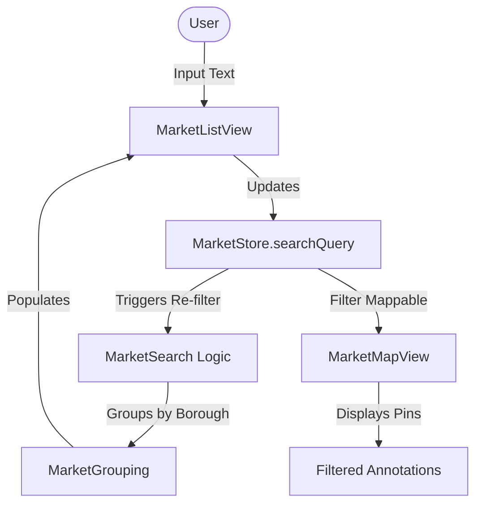
*The diagram shows how user input in the List view updates a shared store, which then propagates filtered data to both the List and Map components.*

Sources: [NYCFarmerMarkets/Views/MarketListView.swift:23-28](https://github.com/iyepes/NYCFarmerMarkets/blob/123ebba3a0dbcb9994b77ae727c7753a9eea85fc/NYCFarmerMarkets/Views/MarketListView.swift#L23-L28), [NYCFarmerMarkets/Stores/MarketStore.swift:28](https://github.com/iyepes/NYCFarmerMarkets/blob/123ebba3a0dbcb9994b77ae727c7753a9eea85fc/NYCFarmerMarkets/Stores/MarketStore.swift#L28), [NYCFarmerMarkets/Views/MarketMapView.swift:23-26](https://github.com/iyepes/NYCFarmerMarkets/blob/123ebba3a0dbcb9994b77ae727c7753a9eea85fc/NYCFarmerMarkets/Views/MarketMapView.swift#L23-L26)

## Market Search Logic

The `MarketSearch` utility provides the core filtering logic. It normalizes queries by trimming whitespace and performing case-insensitive, diacritic-insensitive matches against three primary fields:
1. Market Name
2. Street Address
3. Borough

The system considers a search "active" only if the query contains non-whitespace characters.

### Filtering Rules
| Logic Component | Behavior |
| :--- | :--- |
| **Normalization** | Trims whitespace and newlines from the query. |
| **Case Sensitivity** | Performs case-insensitive comparison. |
| **Diacritics** | Matches characters regardless of accents (e.g., "cafe" matches "Café"). |
| **Fields Targeted** | `market.name`, `market.address`, and `market.borough`. |

Sources: [NYCFarmerMarketsTests/MarketSearchTests.swift:20-45](https://github.com/iyepes/NYCFarmerMarkets/blob/123ebba3a0dbcb9994b77ae727c7753a9eea85fc/NYCFarmerMarketsTests/MarketSearchTests.swift#L20-L45), [NYCFarmerMarketsTests/NYCFarmerMarketsTests.swift:208-212](https://github.com/iyepes/NYCFarmerMarkets/blob/123ebba3a0dbcb9994b77ae727c7753a9eea85fc/NYCFarmerMarketsTests/NYCFarmerMarketsTests.swift#L208-L212)

## List Browsing and Grouping

Markets are organized into sections based on their borough. The `MarketGrouping` class handles the transformation of a flat list of markets into a structured set of `BoroughSection` objects.

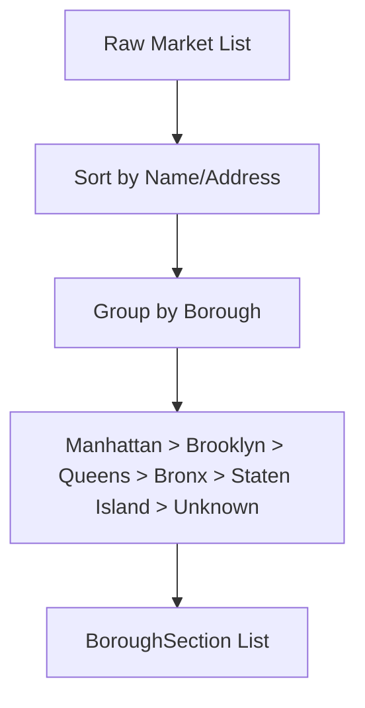
*Markets are grouped into a fixed borough order. Empty sections are hidden when a search is active.*

### Section Expansion State
The UI uses `SectionExpansionState` to track which boroughs are currently visible. 
- **Initial State:** All sections start collapsed.
- **Search Behavior:** When a search becomes active, sections containing matches are automatically expanded to show results.
- **State Restoration:** Clearing a search restores the manual expansion state set by the user before the search began.

Sources: [NYCFarmerMarkets/Views/MarketListView.swift:42-108](https://github.com/iyepes/NYCFarmerMarkets/blob/123ebba3a0dbcb9994b77ae727c7753a9eea85fc/NYCFarmerMarkets/Views/MarketListView.swift#L42-L108), [NYCFarmerMarketsTests/SectionExpansionTests.swift:52-105](https://github.com/iyepes/NYCFarmerMarkets/blob/123ebba3a0dbcb9994b77ae727c7753a9eea85fc/NYCFarmerMarketsTests/SectionExpansionTests.swift#L52-L105)

## Map Integration

The `MarketMapView` utilizes the same `searchQuery` from the `MarketStore`. It filters the market set to only show markers that match the current search criteria and have valid coordinates.

### Map UI Components
- **Filter Indicator:** A top-aligned overlay appears on the map when a search is active, displaying a summary like "5 markets lurking for 'Greenmarket'".
- **Automatic Deselection:** If a selected market no longer matches the search query, the map automatically clears the selection and hides the detail card.

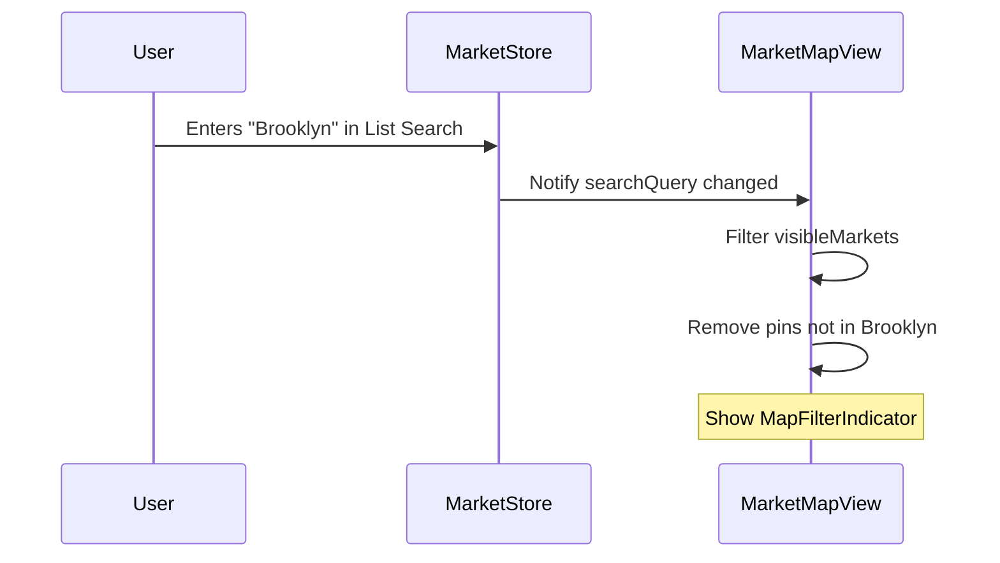
*Sequence of events when a search is initiated and its impact on the Map view.*

Sources: [NYCFarmerMarkets/Views/MarketMapView.swift:23-65](https://github.com/iyepes/NYCFarmerMarkets/blob/123ebba3a0dbcb9994b77ae727c7753a9eea85fc/NYCFarmerMarkets/Views/MarketMapView.swift#L23-L65), [NYCFarmerMarketsTests/NYCFarmerMarketsUITests.swift:302-315](https://github.com/iyepes/NYCFarmerMarkets/blob/123ebba3a0dbcb9994b77ae727c7753a9eea85fc/NYCFarmerMarketsTests/NYCFarmerMarketsUITests.swift#L302-L315)

## Technical Implementation Details

### Market Data Structure
Markets are uniquely identified by a combination of their lowercased name and address.

```swift
// From Market.swift
static func makeID(name: String, address: String) -> String {
    "\(name.lowercased())|\(address.lowercased())"
}
```
Sources: [NYCFarmerMarkets/Models/Market.swift:70-72](https://github.com/iyepes/NYCFarmerMarkets/blob/123ebba3a0dbcb9994b77ae727c7753a9eea85fc/NYCFarmerMarkets/Models/Market.swift#L70-L72)

### Search Activity Detection
The system determines if searching is happening based on the presence of non-whitespace characters in the input string.

```swift
// From MarketSearchTests.swift (via MarketSearch.isActive)
@Test func emptyAndWhitespaceReturnAllInOrder() throws {
    let all = try markets()
    for query in ["", "   ", "\n\t "] {
        #expect(MarketSearch.filter(all, query: query) == all)
        #expect(MarketSearch.isActive(query) == false)
    }
}
```
Sources: [NYCFarmerMarketsTests/MarketSearchTests.swift:20-25](https://github.com/iyepes/NYCFarmerMarkets/blob/123ebba3a0dbcb9994b77ae727c7753a9eea85fc/NYCFarmerMarketsTests/MarketSearchTests.swift#L20-L25)

## Summary

Market Browsing & Search provides a synchronized experience across list and map interfaces. It ensures data consistency by centralizing the search query state in the `MarketStore` and provides a responsive UI through automatic section expansion and filtered map annotations. The implementation prioritizes user convenience with diacritic-insensitive searching and persistent section state management.

### Map Navigation Features

<details>
<summary>Relevant source files</summary>

The following files were used as context for generating this wiki page:

- [NYCFarmerMarkets/Views/MarketMapView.swift](https://github.com/iyepes/NYCFarmerMarkets/blob/123ebba3a0dbcb9994b77ae727c7753a9eea85fc/NYCFarmerMarkets/Views/MarketMapView.swift)
- [NYCFarmerMarkets/Views/MarketLocationMapView.swift](https://github.com/iyepes/NYCFarmerMarkets/blob/123ebba3a0dbcb9994b77ae727c7753a9eea85fc/NYCFarmerMarkets/Views/MarketLocationMapView.swift)
- [NYCFarmerMarkets/Models/SingleMarketMap.swift](https://github.com/iyepes/NYCFarmerMarkets/blob/123ebba3a0dbcb9994b77ae727c7753a9eea85fc/NYCFarmerMarkets/Models/SingleMarketMap.swift)
- [NYCFarmerMarkets/Views/MarketDetailView.swift](https://github.com/iyepes/NYCFarmerMarkets/blob/123ebba3a0dbcb9994b77ae727c7753a9eea85fc/NYCFarmerMarkets/Views/MarketDetailView.swift)
- [NYCFarmerMarkets/Models/Market.swift](https://github.com/iyepes/NYCFarmerMarkets/blob/123ebba3a0dbcb9994b77ae727c7753a9eea85fc/NYCFarmerMarkets/Models/Market.swift)
- [NYCFarmerMarketsUITests/NYCFarmerMarketsUITests.swift](https://github.com/iyepes/NYCFarmerMarkets/blob/123ebba3a0dbcb9994b77ae727c7753a9eea85fc/NYCFarmerMarketsUITests/NYCFarmerMarketsUITests.swift)
- [NYCFarmerMarketsTests/SingleMarketMapTests.swift](https://github.com/iyepes/NYCFarmerMarkets/blob/123ebba3a0dbcb9994b77ae727c7753a9eea85fc/NYCFarmerMarketsTests/SingleMarketMapTests.swift)
</details>

# Map Navigation Features

Map navigation features provide a geospatial interface for users to locate farmer markets across New York City. The system includes a global map view of all markets and a specialized single-location view for individual market details.

The application integrates with system-level mapping tools and internal SwiftUI MapKit components to facilitate market discovery and route planning. Users can interact with map pins, view localized market cards, and transition to external navigation applications.

Sources: [NYCFarmerMarkets/Views/MarketMapView.swift](https://github.com/iyepes/NYCFarmerMarkets/blob/123ebba3a0dbcb9994b77ae727c7753a9eea85fc/NYCFarmerMarkets/Views/MarketMapView.swift), [NYCFarmerMarkets/Views/MarketLocationMapView.swift](https://github.com/iyepes/NYCFarmerMarkets/blob/123ebba3a0dbcb9994b77ae727c7753a9eea85fc/NYCFarmerMarkets/Views/MarketLocationMapView.swift), [readme.md](https://github.com/iyepes/NYCFarmerMarkets/blob/123ebba3a0dbcb9994b77ae727c7753a9eea85fc/readme.md)

## Global Market Map

The `MarketMapView` serves as the primary geospatial discovery tool. It displays all farmer markets that possess valid geographic coordinates. The map synchronizes with the application's global search state, filtering visible pins based on user queries from the list view.

### Map Architecture and Selection Logic

The map uses a `MapCameraPosition` initialized to the New York City region. Selecting a pin updates the `selectedID` state, which triggers the appearance of a `MarketCard` overlay at the bottom of the screen.

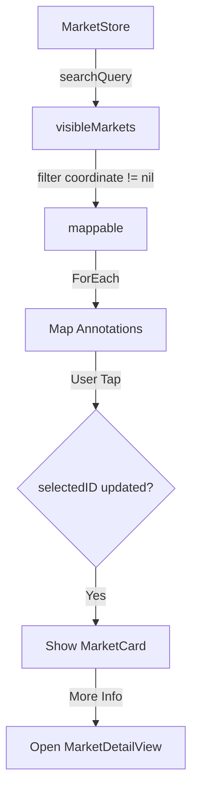

The `visibleMarkets` property dynamically reacts to search changes. If a user searches for a specific borough or name while on the map, the application hides non-matching pins and clears the current selection if it no longer matches the filter.

Sources: [NYCFarmerMarkets/Views/MarketMapView.swift:14-61](https://github.com/iyepes/NYCFarmerMarkets/blob/123ebba3a0dbcb9994b77ae727c7753a9eea85fc/NYCFarmerMarkets/Views/MarketMapView.swift#L14-L61)

### Map Feature Summary

| Component | Description | Logic |
| :--- | :--- | :--- |
| **Annotation** | A custom `MarketPin` | Displays name, favorite status, and selection state. |
| **MarketCard** | Interactive bottom overlay | Shows name, borough, and a "More info" button. |
| **Filter Indicator** | Top-aligned overlay | Displays the active search query and result count. |
| **Offline Banner** | Connectivity warning | Appears if the map is displaying cached data. |

Sources: [NYCFarmerMarkets/Views/MarketMapView.swift:55-88](https://github.com/iyepes/NYCFarmerMarkets/blob/123ebba3a0dbcb9994b77ae727c7753a9eea85fc/NYCFarmerMarkets/Views/MarketMapView.swift#L55-L88), [NYCFarmerMarketsUITests/NYCFarmerMarketsUITests.swift:239-254](https://github.com/iyepes/NYCFarmerMarkets/blob/123ebba3a0dbcb9994b77ae727c7753a9eea85fc/NYCFarmerMarketsUITests/NYCFarmerMarketsUITests.swift#L239-L254)

## Single Market Navigation

When a user views market details, they can access specific navigation features for that single location. The `MarketLocationMapView` provides a focused view centered on one market.

### Coordinate Processing

The `Market` model parses latitude and longitude strings from the NYC Open Data API. If coordinates are missing or zero, the `coordinate` property returns `nil`, and map navigation buttons are hidden in the detail view.

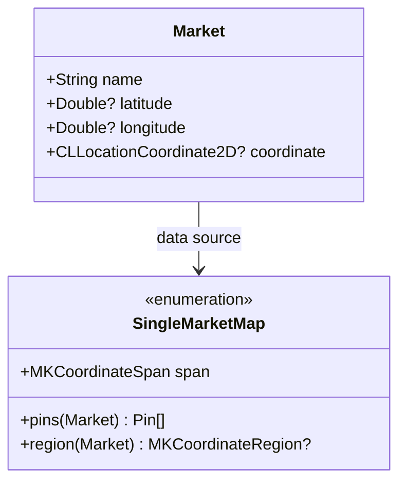

Sources: [NYCFarmerMarkets/Models/Market.swift:26-30](https://github.com/iyepes/NYCFarmerMarkets/blob/123ebba3a0dbcb9994b77ae727c7753a9eea85fc/NYCFarmerMarkets/Models/Market.swift#L26-L30), [NYCFarmerMarkets/Models/SingleMarketMap.swift:10-34](https://github.com/iyepes/NYCFarmerMarkets/blob/123ebba3a0dbcb9994b77ae727c7753a9eea85fc/NYCFarmerMarkets/Models/SingleMarketMap.swift#L10-L34)

### Transition to External Apps

The `MarketDetailView` allows users to hand off navigation to the system Apple Maps application.

1.  **Go to Map**: Pushes the internal `MarketLocationMapView` onto the navigation stack.
2.  **Directions**: Creates an `MKMapItem` and calls `openInMaps()` to launch the external Maps app with the market's coordinates and name.

Sources: [NYCFarmerMarkets/Views/MarketDetailView.swift:34-60](https://github.com/iyepes/NYCFarmerMarkets/blob/123ebba3a0dbcb9994b77ae727c7753a9eea85fc/NYCFarmerMarkets/Views/MarketDetailView.swift#L34-L60), [NYCFarmerMarkets/Views/MarketDetailView.swift:107-115](https://github.com/iyepes/NYCFarmerMarkets/blob/123ebba3a0dbcb9994b77ae727c7753a9eea85fc/NYCFarmerMarkets/Views/MarketDetailView.swift#L107-L115)

## In-App Single Market Map

The `MarketLocationMapView` uses pure logic from the `SingleMarketMap` enum to define its layout. It enforces a fixed zoom level (0.01 degree span) centered on the selected market.

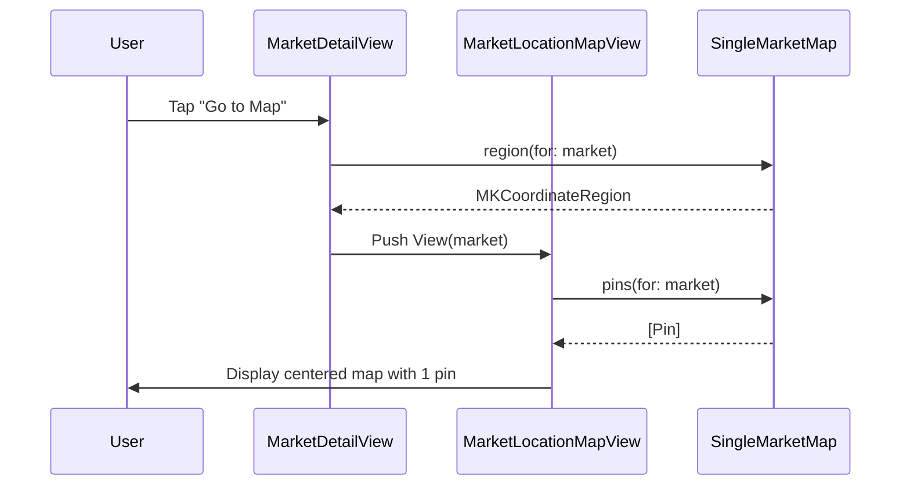

Sources: [NYCFarmerMarkets/Views/MarketLocationMapView.swift:15-30](https://github.com/iyepes/NYCFarmerMarkets/blob/123ebba3a0dbcb9994b77ae727c7753a9eea85fc/NYCFarmerMarkets/Views/MarketLocationMapView.swift#L15-L30), [NYCFarmerMarkets/Models/SingleMarketMap.swift:29-33](https://github.com/iyepes/NYCFarmerMarkets/blob/123ebba3a0dbcb9994b77ae727c7753a9eea85fc/NYCFarmerMarkets/Models/SingleMarketMap.swift#L29-L33), [NYCFarmerMarketsTests/SingleMarketMapTests.swift:30-36](https://github.com/iyepes/NYCFarmerMarkets/blob/123ebba3a0dbcb9994b77ae727c7753a9eea85fc/NYCFarmerMarketsTests/SingleMarketMapTests.swift#L30-L36)

### Navigation Data Configuration

| Property | Value / Source | Description |
| :--- | :--- | :--- |
| **Span** | 0.01 x 0.01 | Fixed zoom level for single market views. |
| **Anchor** | `.bottom` (Global) | Pins point to exact coordinates from the bottom. |
| **Anchor** | `.center` (Single) | Pins are centered on the coordinate in focused view. |
| **Map Style** | `.standard` | Default Apple Maps vector style. |

Sources: [NYCFarmerMarkets/Models/SingleMarketMap.swift:25](https://github.com/iyepes/NYCFarmerMarkets/blob/123ebba3a0dbcb9994b77ae727c7753a9eea85fc/NYCFarmerMarkets/Models/SingleMarketMap.swift#L25), [NYCFarmerMarkets/Views/MarketMapView.instruction:39](https://github.com/iyepes/NYCFarmerMarkets/blob/123ebba3a0dbcb9994b77ae727c7753a9eea85fc/NYCFarmerMarkets/Views/MarketMapView.instruction#L39), [NYCFarmerMarkets/Views/MarketLocationMapView.swift:36](https://github.com/iyepes/NYCFarmerMarkets/blob/123ebba3a0dbcb9994b77ae727c7753a9eea85fc/NYCFarmerMarkets/Views/MarketLocationMapView.swift#L36)

## Conclusion

Map navigation features bridge the gap between tabular market data and real-world discovery. By leveraging `MarketStore` for shared state and `SingleMarketMap` for pure layout logic, the system ensures consistent behavior whether the user is browsing the entire city or seeking directions to a specific vendor location.

### Favorites Management

<details>
<summary>Relevant source files</summary>

The following files were used as context for generating this wiki page:

- [NYCFarmerMarkets/Views/FavoritesView.swift](https://github.com/iyepes/NYCFarmerMarkets/blob/123ebba3a0dbcb9994b77ae727c7753a9eea85fc/NYCFarmerMarkets/Views/FavoritesView.swift)
- [NYCFarmerMarkets/Stores/FavoritesStore.swift](https://github.com/iyepes/NYCFarmerMarkets/blob/123ebba3a0dbcb9994b77ae727c7753a9eea85fc/NYCFarmerMarkets/Stores/FavoritesStore.swift)
- [NYCFarmerMarkets/Views/Shared/MarketDetailToolbar.swift](https://github.com/iyepes/NYCFarmerMarkets/blob/123ebba3a0dbcb9994b77ae727c7753a9eea85fc/NYCFarmerMarkets/Views/Shared/MarketDetailToolbar.swift)
- [NYCFarmerMarkets/NYCFarmerMarketsApp.swift](https://github.com/iyepes/NYCFarmerMarkets/blob/123ebba3a0dbcb9994b77ae727c7753a9eea85fc/NYCFarmerMarkets/NYCFarmerMarketsApp.swift)
- [NYCFarmerMarketsTests/NYCFarmerMarketsTests.swift](https://github.com/iyepes/NYCFarmerMarkets/blob/123ebba3a0dbcb9994b77ae727c7753a9eea85fc/NYCFarmerMarketsTests/NYCFarmerMarketsTests.swift)
- [NYCFarmerMarkets/Views/MarketDetailView.swift](https://github.com/iyepes/NYCFarmerMarkets/blob/123ebba3a0dbcb9994b77ae727c7753a9eea85fc/NYCFarmerMarkets/Views/MarketDetailView.swift)
</details>

# Favorites Management

Favorites Management handles the persistence, retrieval, and UI representation of user-selected farmer markets in the NYC Farmer Markets application. It allows users to "haunt" specific markets, storing their identifiers locally to ensure they remain accessible across app sessions.

The system relies on an `@Observable` store to manage state and `UserDefaults` for persistent storage. Users interact with favorites through the `MarketDetailToolbar` to toggle status and the `FavoritesView` to browse or remove saved markets.

## Architecture and Data Storage

The `FavoritesStore` class acts as the central authority for favorite data. It maintains a `Set<String>` of market identifiers to ensure uniqueness and provide efficient lookups.

### Persistence Logic
The store uses `UserDefaults` to persist the list of market IDs. On initialization, it loads existing IDs from the standard user defaults or a provided suite. Every time the set of IDs changes via a toggle or removal, the store writes the updated list back to disk as a sorted array.

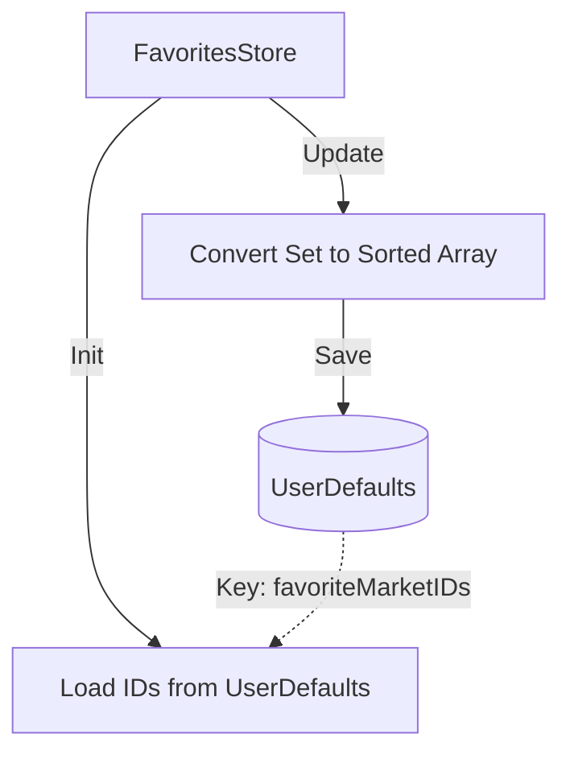
Sources: [NYCFarmerMarkets/Stores/FavoritesStore.swift:10-23](https://github.com/iyepes/NYCFarmerMarkets/blob/123ebba3a0dbcb9994b77ae727c7753a9eea85fc/NYCFarmerMarkets/Stores/FavoritesStore.swift#L10-L23), [NYCFarmerMarkets/Stores/FavoritesStore.swift:41-43](https://github.com/iyepes/NYCFarmerMarkets/blob/123ebba3a0dbcb9994b77ae727c7753a9eea85fc/NYCFarmerMarkets/Stores/FavoritesStore.swift#L41-L43)

### Key Components

| Component | Responsibility |
| :--- | :--- |
| `FavoritesStore` | Manages the `Set` of IDs, provides toggle/remove logic, and handles `UserDefaults` persistence. |
| `FavoritesView` | Displays the list of favorited markets or an empty state if none are saved. |
| `MarketDetailToolbar` | Provides the UI button to add or remove a market from favorites within the detail view. |
| `NYCFarmerMarketsApp` | Initializes the `FavoritesStore` and injects it into the environment. |

Sources: [NYCFarmerMarkets/Stores/FavoritesStore.swift:10-15](https://github.com/iyepes/NYCFarmerMarkets/blob/123ebba3a0dbcb9994b77ae727c7753a9eea85fc/NYCFarmerMarkets/Stores/FavoritesStore.swift#L10-L15), [NYCFarmerMarkets/Views/FavoritesView.swift:11-15](https://github.com/iyepes/NYCFarmerMarkets/blob/123ebba3a0dbcb9994b77ae727c7753a9eea85fc/NYCFarmerMarkets/Views/FavoritesView.swift#L11-L15), [NYCFarmerMarkets/Views/Shared/MarketDetailToolbar.swift:10-15](https://github.com/iyepes/NYCFarmerMarkets/blob/123ebba3a0dbcb9994b77ae727c7753a9eea85fc/NYCFarmerMarkets/Views/Shared/MarketDetailToolbar.swift#L10-L15), [NYCFarmerMarkets/NYCFarmerMarketsApp.swift:37](https://github.com/iyepes/NYCFarmerMarkets/blob/123ebba3a0dbcb9994b77ae727c7753a9eea85fc/NYCFarmerMarkets/NYCFarmerMarketsApp.swift#L37)

## User Interaction Flow

Users manage favorites primarily through the market detail screen and a dedicated favorites tab. The following sequence describes the process of toggling a favorite status and how the UI reacts.

```mermaid
sequenceDiagram
    participant U as User
    participant V as MarketDetailToolbar
    participant S as FavoritesStore
    participant UD as UserDefaults

    U->>V: Tap Favorite Button
    V->>S: toggle(market)
    activate S
    alt is already favorite
        S->>S: remove ID
    else is not favorite
        S->>S: insert ID
    end
    S->>UD: set(Array, forKey: "favoriteMarketIDs")
    S-->>V: State Updated (@Observable)
    deactivate S
    V->>U: Update Icon (Spring Animation)
```
Sources: [NYCFarmerMarkets/Views/Shared/MarketDetailToolbar.swift:28-40](https://github.com/iyepes/NYCFarmerMarkets/blob/123ebba3a0dbcb9994b77ae727c7753a9eea85fc/NYCFarmerMarkets/Views/Shared/MarketDetailToolbar.swift#L28-L40), [NYCFarmerMarkets/Stores/FavoritesStore.swift:27-31](https://github.com/iyepes/NYCFarmerMarkets/blob/123ebba3a0dbcb9994b77ae727c7753a9eea85fc/NYCFarmerMarkets/Stores/FavoritesStore.swift#L27-L31), [NYCFarmerMarkets/Stores/FavoritesStore.swift:41-43](https://github.com/iyepes/NYCFarmerMarkets/blob/123ebba3a0dbcb9994b77ae727c7753a9eea85fc/NYCFarmerMarkets/Stores/FavoritesStore.swift#L41-L43)

### Market Resolution
The `FavoritesStore` does not store full market objects. Instead, it resolves stored IDs against a provided list of markets (typically from the `MarketStore`). This ensures that the favorites list always reflects the most current market data. If a stored ID no longer matches any market in the current dataset, it is skipped during display but retained in storage.
Sources: [NYCFarmerMarkets/Stores/FavoritesStore.swift:37-40](https://github.com/iyepes/NYCFarmerMarkets/blob/123ebba3a0dbcb9994b77ae727c7753a9eea85fc/NYCFarmerMarkets/Stores/FavoritesStore.swift#L37-L40), [NYCFarmerMarketsTests/NYCFarmerMarketsTests.swift:313-322](https://github.com/iyepes/NYCFarmerMarkets/blob/123ebba3a0dbcb9994b77ae727c7753a9eea85fc/NYCFarmerMarketsTests/NYCFarmerMarketsTests.swift#L313-L322)

## UI Implementation

### Favorites Tab (`FavoritesView`)
The `FavoritesView` displays favorited markets in a standard list. If the list is empty, it shows a `ContentUnavailableView` with "No haunts yet".
*   **Navigation:** Tapping a market row plays a sound cue and sets the `selectedMarket` in the `MarketStore`.
*   **Removal:** Users can remove a market via trailing swipe actions or an accessibility action.
Sources: [NYCFarmerMarkets/Views/FavoritesView.swift:23-45](https://github.com/iyepes/NYCFarmerMarkets/blob/123ebba3a0dbcb9994b77ae727c7753a9eea85fc/NYCFarmerMarkets/Views/FavoritesView.swift#L23-L45), [NYCFarmerMarkets/Views/FavoritesView.swift:51-64](https://github.com/iyepes/NYCFarmerMarkets/blob/123ebba3a0dbcb9994b77ae727c7753a9eea85fc/NYCFarmerMarkets/Views/FavoritesView.swift#L51-L64)

### Detail Toolbar
The `MarketDetailToolbar` contains a button that switches between `.favoriteOn` and `.favoriteOff` icons.
*   **Visual Feedback:** The icon uses a spring animation and scale effect when the favorite status is active.
*   **Sound Cues:** The system plays specific audio feedback depending on whether a market was added or removed.
Sources: [NYCFarmerMarkets/Views/Shared/MarketDetailToolbar.swift:32-41](https://github.com/iyepes/NYCFarmerMarkets/blob/123ebba3a0dbcb9994b77ae727c7753a9eea85fc/NYCFarmerMarkets/Views/Shared/MarketDetailToolbar.swift#L32-L41)

## Testing and Validation

The favorites system includes comprehensive unit tests to ensure stability and persistence.

*   **Toggle Logic:** Tests verify that calling `toggle()` twice restores the initial state (off -> on -> off).
*   **Persistence:** Tests confirm that data persists across different instances of `FavoritesStore` using the same `UserDefaults` suite.
*   **Sorting:** The `favorites(in:)` function is tested to ensure it returns markets sorted by name using `localizedStandardCompare`.
Sources: [NYCFarmerMarketsTests/NYCFarmerMarketsTests.swift:293-301](https://github.com/iyepes/NYCFarmerMarkets/blob/123ebba3a0dbcb9994b77ae727c7753a9eea85fc/NYCFarmerMarketsTests/NYCFarmerMarketsTests.swift#L293-L301), [NYCFarmerMarketsTests/NYCFarmerMarketsTests.swift:303-311](https://github.com/iyepes/NYCFarmerMarkets/blob/123ebba3a0dbcb9994b77ae727c7753a9eea85fc/NYCFarmerMarketsTests/NYCFarmerMarketsTests.swift#L303-L311), [NYCFarmerMarkets/Stores/FavoritesStore.swift:39](https://github.com/iyepes/NYCFarmerMarkets/blob/123ebba3a0dbcb9994b77ae727c7753a9eea85fc/NYCFarmerMarkets/Stores/FavoritesStore.swift#L39)

### Summary
Favorites Management provides a lightweight, persistent system for user-selected market tracking. By separating ID storage from market data resolution, the system remains resilient to changes in the underlying market dataset while maintaining a responsive, sound-enhanced user interface.

### Market Details & Actions

<details>
<summary>Relevant source files</summary>

The following files were used as context for generating this wiki page:

- [NYCFarmerMarkets/Views/MarketDetailView.swift](https://github.com/iyepes/NYCFarmerMarkets/blob/123ebba3a0dbcb9994b77ae727c7753a9eea85fc/NYCFarmerMarkets/Views/MarketDetailView.swift)
- [NYCFarmerMarkets/Models/Market.swift](https://github.com/iyepes/NYCFarmerMarkets/blob/123ebba3a0dbcb9994b77ae727c7753a9eea85fc/NYCFarmerMarkets/Models/Market.swift)
- [NYCFarmerMarkets/Stores/MarketStore.swift](https://github.com/iyepes/NYCFarmerMarkets/blob/123ebba3a0dbcb9994b77ae727c7753a9eea85fc/NYCFarmerMarkets/Stores/MarketStore.swift)
- [NYCFarmerMarkets/Views/MarketMapView.swift](https://github.com/iyepes/NYCFarmerMarkets/blob/123ebba3a0dbcb9994b77ae727c7753a9eea85fc/NYCFarmerMarkets/Views/MarketMapView.swift)
- [NYCFarmerMarkets/Theme/AppCopy.swift](https://github.com/iyepes/NYCFarmerMarkets/blob/123ebba3a0dbcb9994b77ae727c7753a9eea85fc/NYCFarmerMarkets/Theme/AppCopy.swift)
- [NYCFarmerMarkets/Views/Shared/MarketRow.swift](https://github.com/iyepes/NYCFarmerMarkets/blob/123ebba3a0dbcb9994b77ae727c7753a9eea85fc/NYCFarmerMarkets/Views/Shared/MarketRow.swift)
- [NYCFarmerMarketsTests/NYCFarmerMarketsTests.swift](https://github.com/iyepes/NYCFarmerMarkets/blob/123ebba3a0dbcb9994b77ae727c7753a9eea85fc/NYCFarmerMarketsTests/NYCFarmerMarketsTests.swift)
</details>

# Market Details & Actions

The Market Details & Actions module provides a comprehensive interface for viewing specific information about a farmers market and performing location-based or preference-based actions. This component serves as a shared detail sheet accessible from the Markets list, the Map tab, and the Favorites view.

This system presents technical data points derived from the NYC Open Data dataset, including operating schedules, EBT acceptance, and geographic coordinates. It enables users to toggle favorite status, view locations on an internal map, or launch external navigation services.

Sources: [MarketDetailView.swift:11-13](https://github.com/iyepes/NYCFarmerMarkets/blob/123ebba3a0dbcb9994b77ae727c7753a9eea85fc/MarketDetailView.swift#L11-L13), [MarketStore.swift:23-24](https://github.com/iyepes/NYCFarmerMarkets/blob/123ebba3a0dbcb9994b77ae727c7753a9eea85fc/MarketStore.swift#L23-L24)

## Detail Representation

The system displays market information through a structured layout consisting of a header and a series of themed cards. Each row represents a specific attribute of the `Market` model.

### Data Model Mapping
The `MarketDetailView` consumes a `Market` object and maps its properties to UI rows. If a value is missing, the system displays a placeholder defined in `AppCopy.missingValue`.

| Detail Item | Source Property | Description |
| :--- | :--- | :--- |
| Address | `market.address` | The street address of the market. |
| Community District | `market.communityDistrict` | The NYC community district number. |
| Days | `market.daysOfOperation` | Specific days the market is open. |
| Hours | `market.hoursOfOperation` | Operating hours for the market. |
| Accepts EBT | `market.acceptsEBT` | Indicates if Electronic Benefits Transfer is accepted. |
| Open Year Round | `market.openYearRound` | Seasonal status of the market. |
| Health Dept. Cooking | `market.healthDeptCooking` | Presence of Health Dept. cooking programs. |
| Data Year | `market.year` | The dataset year for the record. |

Sources: [MarketDetailView.swift:23-32](https://github.com/iyepes/NYCFarmerMarkets/blob/123ebba3a0dbcb9994b77ae727c7753a9eea85fc/MarketDetailView.swift#L23-L32), [Market.swift:10-22](https://github.com/iyepes/NYCFarmerMarkets/blob/123ebba3a0dbcb9994b77ae727c7753a9eea85fc/Market.swift#L10-L22), [AppCopy.swift:39](https://github.com/iyepes/NYCFarmerMarkets/blob/123ebba3a0dbcb9994b77ae727c7753a9eea85fc/AppCopy.swift#L39)

### Technical Implementation of Detail Rows
The `detailRow` function constructs an `HStack` containing an `IconView` and a `VStack` for the title and value. It uses the `themedCard()` modifier to apply standardized styling.

```swift
private func detailRow(_ icon: AppIcon, _ title: String, _ value: String?) -> some View {
    HStack(alignment: .top, spacing: 12) {
        IconView(icon, size: 20)
            .foregroundStyle(AppPalette.accent.color)
            .frame(width: 24)
        VStack(alignment: .leading, spacing: 2) {
            Text(title)
                .appFont(.caption)
            Text(value ?? AppCopy.missingValue)
                .appFont(.body)
        }
    }
    .themedCard()
}
```
Sources: [MarketDetailView.swift:76-92](https://github.com/iyepes/NYCFarmerMarkets/blob/123ebba3a0dbcb9994b77ae727c7753a9eea85fc/MarketDetailView.swift#L76-L92)

## Navigation and External Actions

The module handles two primary geographic actions: internal map navigation and external direction requests. These actions depend on the presence of valid `latitude` and `longitude` data within the `Market` model.

### Action Logic Flow
The following diagram illustrates the decision path when a user interacts with location actions in the detail view.

```mermaid
flowchart TD
    Start[User Views Market Detail] --> CoordCheck{Coordinates Exist?}
    CoordCheck -- No --> HideButtons[Location Buttons Hidden]
    CoordCheck -- Yes --> ShowButtons[Show 'Go to Map' & 'Directions']
    
    ShowButtons --> MapTap[Tap 'Go to Map']
    MapTap --> Sound[Play doorAndHit Sound]
    Sound --> InternalMap[Push MarketLocationMapView]
    
    ShowButtons --> DirectTap[Tap 'Directions']
    DirectTap --> MKItem[Create MKMapItem]
    MKItem --> ExternalMap[Launch Apple Maps App]
```
The system uses `MKMapItem` to interface with the system-level Maps application for directions.
Sources: [MarketDetailView.swift:34-63](https://github.com/iyepes/NYCFarmerMarkets/blob/123ebba3a0dbcb9994b77ae727c7753a9eea85fc/MarketDetailView.swift#L34-L63), [MarketDetailView.swift:94-102](https://github.com/iyepes/NYCFarmerMarkets/blob/123ebba3a0dbcb9994b77ae727c7753a9eea85fc/MarketDetailView.swift#L94-L102)

## Integration and State Management

The `MarketStore` manages the visibility of the detail sheet via the `selectedMarket` property. When this property is non-nil, the application presents the `MarketDetailView`.

### Interaction Sequence
The sequence below shows how a market is selected from the Map view to trigger the detail presentation.

```mermaid
sequenceDiagram
    participant User as User Interface
    participant Map as MarketMapView
    participant Store as MarketStore
    participant Detail as MarketDetailView
    
    User->>Map: Taps Market Pin
    Map->>Store: Sets selectedID
    Store-->>Map: Update Selection
    User->>Map: Taps 'More info'
    Map->>Store: Sets selectedMarket = market
    Store->>Detail: Initialize with Market Object
    Detail-->>User: Display NavigationStack/Sheet
```
Sources: [MarketMapView.swift:51-54](https://github.com/iyepes/NYCFarmerMarkets/blob/123ebba3a0dbcb9994b77ae727c7753a9eea85fc/MarketMapView.swift#L51-L54), [MarketStore.swift:24](https://github.com/iyepes/NYCFarmerMarkets/blob/123ebba3a0dbcb9994b77ae727c7753a9eea85fc/MarketStore.swift#L24), [MarketDetailView.swift:15](https://github.com/iyepes/NYCFarmerMarkets/blob/123ebba3a0dbcb9994b77ae727c7753a9eea85fc/MarketDetailView.swift#L15)

## Accessibility and UI Testing

The detail view incorporates specific identifiers and traits to ensure accessibility and testability.

*   **Header Traits**: The market name is marked with `.isHeader` for screen readers.
*   **Combined Elements**: Detail rows use `.accessibilityElement(children: .combine)` to read the title and value as a single statement.
*   **Identifiers**: Key buttons use `accessibilityIdentifier` such as `open-in-maps` and `look-for-directions` for UI automation.
*   **Labels**: Missing values use a plain-language accessibility label ("Not listed") instead of the themed text ("Shrouded in mist").

Sources: [MarketDetailView.swift:49-60](https://github.com/iyepes/NYCFarmerMarkets/blob/123ebba3a0dbcb9994b77ae727c7753a9eea85fc/MarketDetailView.swift#L49-L60), [MarketDetailView.swift:73](https://github.com/iyepes/NYCFarmerMarkets/blob/123ebba3a0dbcb9994b77ae727c7753a9eea85fc/MarketDetailView.swift#L73), [MarketDetailView.swift:91](https://github.com/iyepes/NYCFarmerMarkets/blob/123ebba3a0dbcb9994b77ae727c7753a9eea85fc/MarketDetailView.swift#L91), [AppCopy.swift:39-40](https://github.com/iyepes/NYCFarmerMarkets/blob/123ebba3a0dbcb9994b77ae727c7753a9eea85fc/AppCopy.swift#L39-L40)

## Summary

The Market Details & Actions module centralizes the presentation of NYC Farmers Market data. It bridges the gap between raw data attributes and actionable user features by integrating with `SoundController` for audio feedback, `MarketStore` for state management, and `MapKit` for geographic services. This unified approach ensures consistent behavior across the list, map, and favorite interfaces of the application.

### Accessibility Integration

<details>
<summary>Relevant source files</summary>

The following files were used as context for generating this wiki page:

- [NYCFarmerMarkets/Models/SectionHeaderAccessibility.swift](https://github.com/iyepes/NYCFarmerMarkets/blob/123ebba3a0dbcb9994b77ae727c7753a9eea85fc/NYCFarmerMarkets/Models/SectionHeaderAccessibility.swift)
- [NYCFarmerMarkets/Theme/AppTypography.swift](https://github.com/iyepes/NYCFarmerMarkets/blob/123ebba3a0dbcb9994b77ae727c7753a9eea85fc/NYCFarmerMarkets/Theme/AppTypography.swift)
- [NYCFarmerMarkets/Theme/AppCopy.swift](https://github.com/iyepes/NYCFarmerMarkets/blob/123ebba3a0dbcb9994b77ae727c7753a9eea85fc/NYCFarmerMarkets/Theme/AppCopy.swift)
- [NYCFarmerMarkets/Theme/AppPalette.swift](https://github.com/iyepes/NYCFarmerMarkets/blob/123ebba3a0dbcb9994b77ae727c7753a9eea85fc/NYCFarmerMarkets/Theme/AppPalette.swift)
- [NYCFarmerMarkets/Views/MarketDetailView.swift](https://github.com/iyepes/NYCFarmerMarkets/blob/123ebba3a0dbcb9994b77ae727c7753a9eea85fc/NYCFarmerMarkets/Views/MarketDetailView.swift)
- [NYCFarmerMarketsTests/SectionHeaderAccessibilityTests.swift](https://github.com/iyepes/NYCFarmerMarkets/blob/123ebba3a0dbcb9994b77ae727c7753a9eea85fc/NYCFarmerMarketsTests/SectionHeaderAccessibilityTests.swift)
- [NYCFarmerMarkets/Theme/AppTypography+UIKit.swift](https://github.com/iyepes/NYCFarmerMarkets/blob/123ebba3a0dbcb9994b77ae727c7753a9eea85fc/NYCFarmerMarkets/Theme/AppTypography+UIKit.swift)
</details>

# Accessibility Integration

Accessibility Integration encompasses the systems and patterns used to ensure the application is usable for all individuals, specifically those utilizing assistive technologies like VoiceOver. The project implements a multi-layered approach involving semantic color tokens, specialized typography scaling, and dedicated accessibility models for UI components.

The integration strategy focuses on providing plain-language descriptions that contrast with the "spooky" thematic branding used for visual users. It ensures that critical information, such as market status and navigation hints, remains clear and functional regardless of visual styling.

## Semantic Labels and Content

The application separates visual thematic text from functional accessibility text. While visual labels may use creative language (e.g., "Summoning markets"), accessibility strings remain descriptive and neutral to ensure clarity for VoiceOver users.

### Content Strategy Mapping

| Feature | Visual Theme Text | Accessibility Equivalent |
| :--- | :--- | :--- |
| Splash Loading | "Summoning markets…" | "Loading farmers markets" |
| Offline State | "Lost in the fog, showing saved markets" | "Offline, showing saved data" |
| No Results | "Nothing lurking here" | "No markets found" |
| Missing Data | "Shrouded in mist" | "Not listed" |

Sources: [NYCFarmerMarkets/Theme/AppCopy.swift:11-41](https://github.com/iyepes/NYCFarmerMarkets/blob/123ebba3a0dbcb9994b77ae727c7753a9eea85fc/NYCFarmerMarkets/Theme/AppCopy.swift#L11-L41)

### Section Header Accessibility Model

The `SectionHeaderAccessibility` module generates pure strings for borough-based list headers. It manages labels, values, and hints to communicate the count of markets and the expansion state of a section.

```mermaid
flowchart TD
    A[Section State] --> B{isExpanded?}
    B -- True --> C[Value: Expanded]
    B -- False --> D[Value: Collapsed]
    B -- True --> E[Hint: Double tap to collapse]
    B -- False --> F[Hint: Double tap to expand]
    G[Borough Name] --> H[Label: Borough, Count markets]
    I[Market Count] --> H
```
The diagram shows how the accessibility model transforms internal state into descriptive strings for screen readers.
Sources: [NYCFarmerMarkets/Models/SectionHeaderAccessibility.swift:4-22](https://github.com/iyepes/NYCFarmerMarkets/blob/123ebba3a0dbcb9994b77ae727c7753a9eea85fc/NYCFarmerMarkets/Models/SectionHeaderAccessibility.swift#L4-L22)

## Typography and Dynamic Type

The system utilizes `AppTypography` to manage font scaling and accessibility. It implements a dual-family system: `Grim Creeper` for display roles and `Breath of the House` for body content. 

### Scaling Logic
- **Body Family Scaling**: The body family uses a `sizeScale` of 1.15 to compensate for thin strokes and a small x-height, ensuring legibility at standard sizes.
- **Minimum Size Floor**: Body roles have a 14pt floor at default Dynamic Type sizes to prevent text from becoming unreadable.
- **Dynamic Type Support**: Every typography role maps to a standard SwiftUI `Font.TextStyle` (e.g., `.body`, `.headline`), allowing the system to scale fonts automatically when the user adjusts system-wide text sizes.

Sources: [NYCFarmerMarkets/Theme/AppTypography.swift:39-55](https://github.com/iyepes/NYCFarmerMarkets/blob/123ebba3a0dbcb9994b77ae727c7753a9eea85fc/NYCFarmerMarkets/Theme/AppTypography.swift#L39-L55), [NYCFarmerMarkets/Theme/AppTypography.swift:101-118](https://github.com/iyepes/NYCFarmerMarkets/blob/123ebba3a0dbcb9994b77ae727c7753a9eea85fc/NYCFarmerMarkets/Theme/AppTypography.swift#L101-L118)

### UIKit Integration and Constraints
For system-rendered components like tab bars, the `uiFont(_:)` method provides `UIFontMetrics` to support Dynamic Type. To maintain layout integrity in fixed-height bars, certain roles have a `maximumPointSize` cap.
Sources: [NYCFarmerMarkets/Theme/AppTypography+UIKit.swift:13-21](https://github.com/iyepes/NYCFarmerMarkets/blob/123ebba3a0dbcb9994b77ae727c7753a9eea85fc/NYCFarmerMarkets/Theme/AppTypography%2BUIKit.swift#L13-L21), [NYCFarmerMarkets/Theme/AppTypography+UIKit.swift:27-33](https://github.com/iyepes/NYCFarmerMarkets/blob/123ebba3a0dbcb9994b77ae727c7753a9eea85fc/NYCFarmerMarkets/Theme/AppTypography%2BUIKit.swift#L27-L33)

## Visual Accessibility and Contrast

The `AppPalette` system enforces WCAG-compliant contrast ratios using semantic color tokens. It includes internal helpers to calculate relative luminance and contrast ratios between 0xRRGGBB values.

### Color Contrast Verification
The system ensures that text and background pairings meet at least AA standards (4.5:1 ratio). Specific exceptions are made for large text/graphics (3.0:1), such as the splash screen elements.

```mermaid
classDiagram
    class AppPalette {
        +mix(a, b, amount) Int
        +luminance(hex) Double
        +contrast(a, b) Double
    }
    class ColorToken {
        +light: Int
        +dark: Int
        +hex(isDark) Int
        +platformColor
    }
    AppPalette --> ColorToken : defines semantic tokens
```
The diagram illustrates the relationship between the palette management and individual color tokens used throughout the UI.
Sources: [NYCFarmerMarkets/Theme/AppPalette.swift:103-125](https://github.com/iyepes/NYCFarmerMarkets/blob/123ebba3a0dbcb9994b77ae727c7753a9eea85fc/NYCFarmerMarkets/Theme/AppPalette.swift#L103-L125), [NYCFarmerMarkets/Theme/AppPalette.swift:65-98](https://github.com/iyepes/NYCFarmerMarkets/blob/123ebba3a0dbcb9994b77ae727c7753a9eea85fc/NYCFarmerMarkets/Theme/AppPalette.swift#L65-L98)

## Implementation in Views

Views apply accessibility features through standard modifiers and custom helpers. The `MarketDetailView` demonstrates the use of accessibility identifiers, traits, and element combining.

- **Accessibility Identifiers**: Components are assigned unique identifiers (e.g., `open-in-maps`, `market-detail`) to support automated UI testing and element discovery.
- **Traits**: Headers are explicitly marked with `.accessibilityAddTraits(.isHeader)` to allow VoiceOver users to navigate by landmarks.
- **Combined Elements**: The `detailRow` uses `.accessibilityElement(children: .combine)` to group a label and its value into a single focusable area, reducing the number of swipes required to consume information.

Sources: [NYCFarmerMarkets/Views/MarketDetailView.swift:76-88](https://github.com/iyepes/NYCFarmerMarkets/blob/123ebba3a0dbcb9994b77ae727c7753a9eea85fc/NYCFarmerMarkets/Views/MarketDetailView.swift#L76-L88), [NYCFarmerMarkets/Views/MarketDetailView.swift:96-103](https://github.com/iyepes/NYCFarmerMarkets/blob/123ebba3a0dbcb9994b77ae727c7753a9eea85fc/NYCFarmerMarkets/Views/MarketDetailView.swift#L96-L103)

## Summary

Accessibility Integration in NYCFarmerMarkets ensures that the application's unique "spooky" visual identity does not compromise usability. By utilizing a robust typography scaling system, WCAG contrast calculations, and a dedicated accessibility model for complex UI states, the project provides a reliable experience for users with diverse needs. All accessibility content is prioritized as plain language to ensure the highest degree of clarity.

### Onboarding Flow

<details>
<summary>Relevant source files</summary>

The following files were used as context for this page (added in v3):

- [NYCFarmerMarkets/Onboarding/OnboardingView.swift](https://github.com/iyepes/NYCFarmerMarkets/blob/ad3bdcfd7ae9cd164916a6a36f913d03bc06295c/NYCFarmerMarkets/Onboarding/OnboardingView.swift)
- [NYCFarmerMarkets/Onboarding/OnboardingPageView.swift](https://github.com/iyepes/NYCFarmerMarkets/blob/ad3bdcfd7ae9cd164916a6a36f913d03bc06295c/NYCFarmerMarkets/Onboarding/OnboardingPageView.swift)
- [NYCFarmerMarkets/Onboarding/OnboardingPage.swift](https://github.com/iyepes/NYCFarmerMarkets/blob/ad3bdcfd7ae9cd164916a6a36f913d03bc06295c/NYCFarmerMarkets/Onboarding/OnboardingPage.swift)
- [NYCFarmerMarkets/Models/OnboardingDecision.swift](https://github.com/iyepes/NYCFarmerMarkets/blob/ad3bdcfd7ae9cd164916a6a36f913d03bc06295c/NYCFarmerMarkets/Models/OnboardingDecision.swift)
- [NYCFarmerMarkets/Models/OnboardingPaging.swift](https://github.com/iyepes/NYCFarmerMarkets/blob/ad3bdcfd7ae9cd164916a6a36f913d03bc06295c/NYCFarmerMarkets/Models/OnboardingPaging.swift)
- [NYCFarmerMarkets/Models/OnboardingHeroLayout.swift](https://github.com/iyepes/NYCFarmerMarkets/blob/ad3bdcfd7ae9cd164916a6a36f913d03bc06295c/NYCFarmerMarkets/Models/OnboardingHeroLayout.swift)
- [NYCFarmerMarkets/Views/AppRootView.swift](https://github.com/iyepes/NYCFarmerMarkets/blob/ad3bdcfd7ae9cd164916a6a36f913d03bc06295c/NYCFarmerMarkets/Views/AppRootView.swift)
- [.kiro/specs/onboarding-flow/requirements.md](https://github.com/iyepes/NYCFarmerMarkets/blob/ad3bdcfd7ae9cd164916a6a36f913d03bc06295c/.kiro/specs/onboarding-flow/requirements.md)
</details>

# Onboarding Flow

Onboarding is a three-page introduction shown once per install, after the first successful data load and before the tabs. It was added in PR #22 and refined in PR #24 (issue #23).

## When onboarding shows

`AppRootView` reads one flag, `hasSeenOnboarding` in `UserDefaults` (key `OnboardingDecision.defaultsKey`), through `@AppStorage`. It passes the flag to `OnboardingView` as a binding, so there is one source of truth. The pure function `OnboardingDecision.screen(phase:hasSeenOnboarding:)` picks the screen:

| Splash phase | `hasSeenOnboarding` | Screen |
| :--- | :--- | :--- |
| `loading` or `failed` | any | Splash |
| `dismissed` | false (or absent) | Onboarding |
| `dismissed` | true | Tabs |

```mermaid
stateDiagram-v2
    [*] --> Splash
    Splash --> Onboarding: data ready, minimum time elapsed, flag false
    Splash --> Tabs: data ready, minimum time elapsed, flag true
    Splash --> Splash: load failed or zero markets (Retry)
    Onboarding --> Tabs: Skip or Enter the market
```

The market load keeps running in the root `.task` while onboarding is shown; onboarding never starts a second load. A failed load with no cache keeps the splash failure and Retry, for both flag values.

## Pages and controls

`OnboardingPage.all` holds three pages (ids 0, 1, 2) with an eyebrow, emoji, hero image, title, message and three bullets. Hero images are the owner's assets `pirate-ship`, `map-image` (framed) and `dairy-products-pallete`. Recent copy edits: page 1 reads "travels an ocean" (PR #24) and page 3 reads "Or willing to know farmers" (owner commit `fb91d62`).

| Control | Identifier | Behavior |
| :--- | :--- | :--- |
| Skip | `onboarding-skip` | `.glass` button. Plays `.hiss`, sets the flag. Hidden, disabled and hidden from VoiceOver on the last page. |
| Page indicator | `onboarding-page-indicator` | 12 pt dots, 12 pt spacing, at least 44 pt. One VoiceOver element labeled "Page indicator" with value "Page N of M". Adjustable: VoiceOver swipe up/down moves one page through `OnboardingPaging.target(from:delta:count:)`; moves past either end do nothing; no sound. |
| Next / Enter the market | `onboarding-next` | Whole capsule is tappable (`.contentShape(.capsule)`). Plays `.hiss`; on the last page sets the flag. |
| Screen | `onboarding-screen` | Container (`.accessibilityElement(children: .contain)`); each page has `onboarding-page-<id>`. |

Skip and Next ignore taps once the flag is true, so the flag is written once. With Reduce Motion on, page changes are not animated. On macOS, where the paged `TabView` style does not exist, one page is shown at a time.

## Hero position

The hero is 190 pt (`OnboardingPageView.heroSize`; symbol fallback 160 pt) with the emoji on the left. `OnboardingHeroLayout.topInset` computes a top inset with a shape-aware check against the measured Skip button. Because the page `ScrollView` adds the top safe area again, the hero lands about 40 pt higher than before PR #24 but below Skip, not beside it. The owner accepted this position; simplifying the rule is listed as a follow-up in `.kiro/steering/known-limits.md`.

Not verified on a device: VoiceOver order and page adjust, Reduce Motion paging, and a possible hero shift at large text sizes when Skip is re-measured after the first frame.

## Audio System (Interaction Sounds)

### Audio Subsystem Architecture

<details>
<summary>Relevant source files</summary>

The following files were used as context for generating this wiki page:

- [NYCFarmerMarkets/Services/SoundPlayer.swift](https://github.com/iyepes/NYCFarmerMarkets/blob/123ebba3a0dbcb9994b77ae727c7753a9eea85fc/NYCFarmerMarkets/Services/SoundPlayer.swift)
- [NYCFarmerMarkets/Stores/SoundController.swift](https://github.com/iyepes/NYCFarmerMarkets/blob/123ebba3a0dbcb9994b77ae727c7753a9eea85fc/NYCFarmerMarkets/Stores/SoundController.swift)
- [NYCFarmerMarkets/Theme/AppSound.swift](https://github.com/iyepes/NYCFarmerMarkets/blob/123ebba3a0dbcb9994b77ae727c7753a9eea85fc/NYCFarmerMarkets/Theme/AppSound.swift)
- [NYCFarmerMarkets/Models/SoundPolicy.swift](https://github.com/iyepes/NYCFarmerMarkets/blob/123ebba3a0dbcb9994b77ae727c7753a9eea85fc/NYCFarmerMarkets/Models/SoundPolicy.swift)
- [NYCFarmerMarkets/NYCFarmerMarketsApp.swift](https://github.com/iyepes/NYCFarmerMarkets/blob/123ebba3a0dbcb9994b77ae727c7753a9eea85fc/NYCFarmerMarkets/NYCFarmerMarketsApp.swift)
- [NYCFarmerMarketsTests/SoundControllerTests.swift](https://github.com/iyepes/NYCFarmerMarkets/blob/123ebba3a0dbcb9994b77ae727c7753a9eea85fc/NYCFarmerMarketsTests/SoundControllerTests.swift)
</details>

# Audio Subsystem Architecture

The Audio Subsystem manages all interaction sounds within the Spooky Markets application. It provides a decoupled architecture where UI views emit cues that are processed by a central controller. This controller applies playback policies based on user preferences and system states before triggering the low-level player.

The subsystem supports "one-shot" sound effects and looping background sounds, specifically for list scrolling activities. It adheres to strict accessibility guidelines by automatically silencing audio when VoiceOver is active or when the user toggles sounds off.

## Core Components

The architecture consists of four primary layers: the sound registry, the playback policy, the stateful controller, and the low-level player.

### AppSound Registry
The `AppSound` enum acts as a central registry for all audio assets. It defines the file names, extensions, and playback characteristics (such as looping) for every sound used in the UI.
Sources: [NYCFarmerMarkets/Theme/AppSound.swift:11-40](https://github.com/iyepes/NYCFarmerMarkets/blob/123ebba3a0dbcb9994b77ae727c7753a9eea85fc/NYCFarmerMarkets/Theme/AppSound.swift#L11-L40)

### SoundPlaying Protocol and Implementation
The `SoundPlaying` protocol defines the interface for audio execution. `SoundPlayer` implements this using `AVAudioPlayer` to manage file loading, audio session initialization, and volume fading. It includes a `SilentSoundPlayer` variant for UI testing to avoid side effects.
Sources: [NYCFarmerMarkets/Services/SoundPlayer.swift:13-30](https://github.com/iyepes/NYCFarmerMarkets/blob/123ebba3a0dbcb9994b77ae727c7753a9eea85fc/NYCFarmerMarkets/Services/SoundPlayer.swift#L13-L30), [NYCFarmerMarkets/Services/SoundPlayer.swift:108-115](https://github.com/iyepes/NYCFarmerMarkets/blob/123ebba3a0dbcb9994b77ae727c7753a9eea85fc/NYCFarmerMarkets/Services/SoundPlayer.swift#L108-L115)

### SoundController
The `SoundController` is an `@Observable` class that serves as the single entry point for UI interactions. It maintains the state of audio (enabled/disabled), VoiceOver status, and the currently active looping sound. It consults the `SoundPolicy` before forwarding requests to the `SoundPlayer`.
Sources: [NYCFarmerMarkets/Stores/SoundController.swift:12-40](https://github.com/iyepes/NYCFarmerMarkets/blob/123ebba3a0dbcb9994b77ae727c7753a9eea85fc/NYCFarmerMarkets/Stores/SoundController.swift#L12-L40)

### SoundPolicy
`SoundPolicy` contains pure logic for determining if a sound should play. It maps `ScrollPhase` states to `ScrollActivity` and determines whether a loop should start, stop, or remain unchanged based on the current activity.
Sources: [NYCFarmerMarkets/Models/SoundPolicy.swift:23-45](https://github.com/iyepes/NYCFarmerMarkets/blob/123ebba3a0dbcb9994b77ae727c7753a9eea85fc/NYCFarmerMarkets/Models/SoundPolicy.swift#L23-L45)

## System Architecture and Data Flow

The following diagram illustrates the relationship between the UI components, the logic layers, and the hardware-level audio player.

```mermaid
graph TD
    UI[SwiftUI Views] -->|play/handle| SC[SoundController]
    SC -->|check| SPOL[SoundPolicy]
    SC -->|exec| SPLAY[SoundPlayer]
    SPLAY -->|AVAudioPlayer| HW[Audio Hardware]
    
    subgraph Logic
        SC
        SPOL
    end
    
    subgraph Services
        SPLAY
    end
```
Sources: [NYCFarmerMarkets/Stores/SoundController.swift:46-75](https://github.com/iyepes/NYCFarmerMarkets/blob/123ebba3a0dbcb9994b77ae727c7753a9eea85fc/NYCFarmerMarkets/Stores/SoundController.swift#L46-L75), [NYCFarmerMarkets/Services/SoundPlayer.swift:65-95](https://github.com/iyepes/NYCFarmerMarkets/blob/123ebba3a0dbcb9994b77ae727c7753a9eea85fc/NYCFarmerMarkets/Services/SoundPlayer.swift#L65-L95)

### Sound Playback Sequence
When a user interacts with the UI (e.g., scrolling a list), the following sequence occurs:

```mermaid
sequenceDiagram
    participant V as View
    participant SC as SoundController
    participant P as SoundPolicy
    participant PL as SoundPlayer
    
    V->>SC: handle(.scrolling, loop: .humanSteps)
    SC->>P: shouldPlay(enabled, voOn, muted)
    P-->>SC: true
    SC->>P: loopAction(isLooping, activity)
    P-->>SC: .start
    SC->>PL: startLoop(.humanSteps)
    PL->>PL: setVolume(1, fade: 0)
    PL->>PL: play()
```
Sources: [NYCFarmerMarkets/Stores/SoundController.swift:63-75](https://github.com/iyepes/NYCFarmerMarkets/blob/123ebba3a0dbcb9994b77ae727c7753a9eea85fc/NYCFarmerMarkets/Stores/SoundController.swift#L63-L75), [NYCFarmerMarkets/Models/SoundPolicy.swift:39-44](https://github.com/iyepes/NYCFarmerMarkets/blob/123ebba3a0dbcb9994b77ae727c7753a9eea85fc/NYCFarmerMarkets/Models/SoundPolicy.swift#L39-L44)

## Audio Assets and Configuration

The application uses specific audio files for different interaction types.

| Sound Case | File Name | Extension | Loop Property |
| :--- | :--- | :--- | :--- |
| `humanSteps` | human-steps | m4a | True |
| `catSteps` | cat-steps | m4a | True |
| `door` | door | m4a | False |
| `doorAndHit` | door-and-hit | m4a | False |
| `hiss` | short-hiss | m4a | False |
| `ay` | ay | m4a | False |
| `ay` | ay | m4a | False |

Sources: [NYCFarmerMarkets/Theme/AppSound.swift:14-38](https://github.com/iyepes/NYCFarmerMarkets/blob/123ebba3a0dbcb9994b77ae727c7753a9eea85fc/NYCFarmerMarkets/Theme/AppSound.swift#L14-L38)

### Initialization and Audio Session
The `SoundPlayer` initializes by setting the `AVAudioSession` category to `.ambient`. This allows the app's audio to mix with other system sounds. The player pre-loads all `AppSound` cases into memory to ensure low-latency playback during user interaction.
Sources: [NYCFarmerMarkets/Services/SoundPlayer.swift:37-63](https://github.com/iyepes/NYCFarmerMarkets/blob/123ebba3a0dbcb9994b77ae727c7753a9eea85fc/NYCFarmerMarkets/Services/SoundPlayer.swift#L37-L63)

## Policy and Governance

Playback is governed by a set of conditions to ensure a non-disruptive user experience.

*   **Accessibility:** Audio is automatically silenced if `voiceOverOn` is true to avoid interfering with screen readers.
*   **User Preference:** The user can toggle audio via `isEnabled`, which persists in `UserDefaults` under the key `soundEnabled`.
*   **State Conflict:** If a second loop is requested while one is already playing, the controller hard-stops the previous loop before starting the new one.
*   **Fading:** When a loop stops (e.g., scrolling ends or the user leaves the view), the `SoundPlayer` performs a 0.3-second volume fade-out before stopping the `AVAudioPlayer`.

Sources: [NYCFarmerMarkets/Stores/SoundController.swift:42-60](https://github.com/iyepes/NYCFarmerMarkets/blob/123ebba3a0dbcb9994b77ae727c7753a9eea85fc/NYCFarmerMarkets/Stores/SoundController.swift#L42-L60), [NYCFarmerMarkets/Services/SoundPlayer.swift:80-92](https://github.com/iyepes/NYCFarmerMarkets/blob/123ebba3a0dbcb9994b77ae727c7753a9eea85fc/NYCFarmerMarkets/Services/SoundPlayer.swift#L80-L92), [NYCFarmerMarketsTests/SoundControllerTests.swift:110-117](https://github.com/iyepes/NYCFarmerMarkets/blob/123ebba3a0dbcb9994b77ae727c7753a9eea85fc/NYCFarmerMarketsTests/SoundControllerTests.swift#L110-L117)

## Integration in Application Lifecycle

The `SoundController` is initialized during the `App` struct's `init` method. Depending on `LaunchOptions`, it chooses either the standard `SoundPlayer` or the `SilentSoundPlayer`. It is then injected into the SwiftUI environment as a shared resource.
Sources: [NYCFarmerMarkets/NYCFarmerMarketsApp.swift:39-44](https://github.com/iyepes/NYCFarmerMarkets/blob/123ebba3a0dbcb9994b77ae727c7753a9eea85fc/NYCFarmerMarkets/NYCFarmerMarketsApp.swift#L39-L44)

```swift
// NYCFarmerMarkets/NYCFarmerMarketsApp.swift:40-42
let player: any SoundPlaying = options.muteSounds ? SilentSoundPlayer() : SoundPlayer()
_soundController = State(initialValue: SoundController(testMuted: options.muteSounds, player: player))
```

## Summary
The Audio Subsystem Architecture provides a robust, testable, and accessible framework for managing application sounds. By separating playback logic (`SoundPolicy`) from state management (`SoundController`) and execution (`SoundPlayer`), the system ensures that audio interactions are consistent and respect user settings and system accessibility states.

### Sound Policy & VoiceOver Rules

<details>
<summary>Relevant source files</summary>

The following files were used as context for generating this wiki page:

- [NYCFarmerMarkets/Models/SoundPolicy.swift](https://github.com/iyepes/NYCFarmerMarkets/blob/123ebba3a0dbcb9994b77ae727c7753a9eea85fc/NYCFarmerMarkets/Models/SoundPolicy.swift)
- [NYCFarmerMarkets/Stores/SoundController.swift](https://github.com/iyepes/NYCFarmerMarkets/blob/123ebba3a0dbcb9994b77ae727c7753a9eea85fc/NYCFarmerMarkets/Stores/SoundController.swift)
- [NYCFarmerMarkets/Services/SoundPlayer.swift](https://github.com/iyepes/NYCFarmerMarkets/blob/123ebba3a0dbcb9994b77ae727c7753a9eea85fc/NYCFarmerMarkets/Services/SoundPlayer.swift)
- [NYCFarmerMarkets/Theme/AppSound.swift](https://github.com/iyepes/NYCFarmerMarkets/blob/123ebba3a0dbcb9994b77ae727c7753a9eea85fc/NYCFarmerMarkets/Theme/AppSound.swift)
- [NYCFarmerMarketsTests/SoundPolicyTests.swift](https://github.com/iyepes/NYCFarmerMarkets/blob/123ebba3a0dbcb9994b77ae727c7753a9eea85fc/NYCFarmerMarketsTests/SoundPolicyTests.swift)
- [NYCFarmerMarketsTests/SoundControllerTests.swift](https://github.com/iyepes/NYCFarmerMarkets/blob/123ebba3a0dbcb9994b77ae727c7753a9eea85fc/NYCFarmerMarketsTests/SoundControllerTests.swift)
</details>

# Sound Policy & VoiceOver Rules

The Sound Policy and VoiceOver rules govern how audio feedback triggers during user interactions. This system ensures that sounds only play when appropriate, specifically preventing audio overlap with system accessibility features like VoiceOver and respecting user preferences.

The architecture separates pure logic from side effects. `SoundPolicy` contains functional rules for playback decisions, while `SoundController` manages the application state and coordinates with `SoundPlayer` to execute audio tasks.

## Core Audio Architecture

The audio system follows a delegated execution pattern. Views send high-level cues to the `SoundController`, which evaluates them against the `SoundPolicy` before commanding the `SoundPlayer`.

```mermaid
flowchart TD
    UI[SwiftUI Views] -->|Cues| SC[SoundController]
    SC -->|Evaluation| SP[SoundPolicy]
    SP -->|Return Action| SC
    SC -->|Command| Player[SoundPlayer]
    Player -->|AVAudioPlayer| Output((Audio Output))
```
The diagram shows the flow from a user interaction in the UI to the final audio output through the system's controller and policy layers.
Sources: [NYCFarmerMarkets/Stores/SoundController.swift](https://github.com/iyepes/NYCFarmerMarkets/blob/123ebba3a0dbcb9994b77ae727c7753a9eea85fc/NYCFarmerMarkets/Stores/SoundController.swift), [NYCFarmerMarkets/Services/SoundPlayer.swift](https://github.com/iyepes/NYCFarmerMarkets/blob/123ebba3a0dbcb9994b77ae727c7753a9eea85fc/NYCFarmerMarkets/Services/SoundPlayer.swift)

## Sound Playback Logic

Playback depends on three primary conditions. The system permits audio only if:
1.  Sound is enabled in the app settings.
2.  VoiceOver is currently inactive.
3.  The app is not in a muted test state.

Sources: [NYCFarmerMarkets/Models/SoundPolicy.swift:14-16](https://github.com/iyepes/NYCFarmerMarkets/blob/123ebba3a0dbcb9994b77ae727c7753a9eea85fc/NYCFarmerMarkets/Models/SoundPolicy.swift#L14-L16), [NYCFarmerMarkets/Stores/SoundController.swift:39-41](https://github.com/iyepes/NYCFarmerMarkets/blob/123ebba3a0dbcb9994b77ae727c7753a9eea85fc/NYCFarmerMarkets/Stores/SoundController.swift#L39-L41)

### Sound Registry (`AppSound`)
The `AppSound` enum acts as a registry for all audio assets. It defines filenames, extensions, and whether a sound should loop.

| Sound Case | File Name | Extension | Looping |
| :--- | :--- | :--- | :--- |
| `humanSteps` | human-steps | m4a | Yes |
| `catSteps` | cat-steps | m4a | Yes |
| `door` | door | m4a | No |
| `doorAndHit` | door-and-hit | m4a | No |
| `hiss` | short-hiss | m4a | No |
| `ay` | ay | m4a | No |

Sources: [NYCFarmerMarkets/Theme/AppSound.swift:13-39](https://github.com/iyepes/NYCFarmerMarkets/blob/123ebba3a0dbcb9994b77ae727c7753a9eea85fc/NYCFarmerMarkets/Theme/AppSound.swift#L13-L39)

## Scroll Activity and Looping

The system manages looping sounds based on list scrolling states. `SoundPolicy` maps SwiftUI `ScrollPhase` values to internal `ScrollActivity` states to determine when to start or stop loops.

### Scroll State Mapping
`SoundPolicy` ignores transient phases like `tracking` or `animating` to prevent erratic audio triggers.

| Scroll Phase | Scroll Activity |
| :--- | :--- |
| `.interacting` | `.scrolling` |
| `.decelerating` | `.scrolling` |
| `.idle` | `.stopped` |
| `.tracking` | `nil` (No change) |
| `.animating` | `nil` (No change) |

Sources: [NYCFarmerMarkets/Models/SoundPolicy.swift:23-31](https://github.com/iyepes/NYCFarmerMarkets/blob/123ebba3a0dbcb9994b77ae727c7753a9eea85fc/NYCFarmerMarkets/Models/SoundPolicy.swift#L23-L31), [NYCFarmerMarketsTests/SoundPolicyTests.swift:23-29](https://github.com/iyepes/NYCFarmerMarkets/blob/123ebba3a0dbcb9994b77ae727c7753a9eea85fc/NYCFarmerMarketsTests/SoundPolicyTests.swift#L23-L29)

### Loop Management Flow
The `SoundController` uses the logic from `SoundPolicy.loopAction` to manage the transition between looping states.

```mermaid
sequenceDiagram
    participant V as MarketListView
    participant SC as SoundController
    participant SP as SoundPolicy
    participant P as SoundPlayer

    V->>SC: handle(.scrolling, loop: .humanSteps)
    SC->>SP: loopAction(isLooping: false, activity: .scrolling)
    SP-->>SC: .start
    SC->>P: startLoop(.humanSteps)
    
    V->>SC: handle(.stopped, loop: .humanSteps)
    SC->>SP: loopAction(isLooping: true, activity: .stopped)
    SP-->>SC: .stop
    SC->>P: stopLoop(.humanSteps)
```
This sequence illustrates how a scrolling event triggers a looping sound and how reaching an idle state terminates it.
Sources: [NYCFarmerMarkets/Stores/SoundController.swift:58-72](https://github.com/iyepes/NYCFarmerMarkets/blob/123ebba3a0dbcb9994b77ae727c7753a9eea85fc/NYCFarmerMarkets/Stores/SoundController.swift#L58-L72), [NYCFarmerMarkets/Models/SoundPolicy.swift:33-38](https://github.com/iyepes/NYCFarmerMarkets/blob/123ebba3a0dbcb9994b77ae727c7753a9eea85fc/NYCFarmerMarkets/Models/SoundPolicy.swift#L33-L38)

## VoiceOver and Accessibility Integration

To ensure a high-quality experience for users with visual impairments, the system automatically silences all application sounds when VoiceOver is detected.

*   **Detection:** `SoundController` maintains a `voiceOverOn` property.
*   **Enforcement:** When `setVoiceOverOn(true)` is called, the controller immediately invokes `silenceEverything()` on the player.
*   **Prevention:** The `canPlay` check returns `false` if `voiceOverOn` is true, blocking subsequent playback requests.

Sources: [NYCFarmerMarkets/Stores/SoundController.swift:51-54](https://github.com/iyepes/NYCFarmerMarkets/blob/123ebba3a0dbcb9994b77ae727c7753a9eea85fc/NYCFarmerMarkets/Stores/SoundController.swift#L51-L54), [NYCFarmerMarkets/Models/SoundPolicy.swift:14-16](https://github.com/iyepes/NYCFarmerMarkets/blob/123ebba3a0dbcb9994b77ae727c7753a9eea85fc/NYCFarmerMarkets/Models/SoundPolicy.swift#L14-L16)

## Sound Player Implementation

The `SoundPlayer` class utilizes `AVAudioPlayer` for technical execution. It includes a 300ms delayed initialization to avoid blocking the main thread during app launch.

### Key Implementation Details:
*   **Audio Session:** Uses `.ambient` category to respect the device's silent switch.
*   **Fading:** Implements a 0.3-second fade-out for looping sounds via `stopLoop` to prevent jarring audio cuts.
*   **Memory Management:** Prepares players for all `AppSound` cases during initialization and stores them in a dictionary.
*   **Testing:** Provides a `SilentSoundPlayer` for UI tests to prevent audio session interference.

Sources: [NYCFarmerMarkets/Services/SoundPlayer.swift:29-58](https://github.com/iyepes/NYCFarmerMarkets/blob/123ebba3a0dbcb9994b77ae727c7753a9eea85fc/NYCFarmerMarkets/Services/SoundPlayer.swift#L29-L58), [NYCFarmerMarkets/Services/SoundPlayer.swift:87-98](https://github.com/iyepes/NYCFarmerMarkets/blob/123ebba3a0dbcb9994b77ae727c7753a9eea85fc/NYCFarmerMarkets/Services/SoundPlayer.swift#L87-L98)

## Summary

The Sound Policy system ensures audio feedback remains an enhancement rather than a distraction. By centralizing rules in `SoundPolicy` and state in `SoundController`, the project maintains a strict separation between interaction logic and accessibility requirements. This architecture guarantees that users of VoiceOver receive a clean audio environment while other users experience a themed audio landscape that reacts naturally to their scrolling and navigation.

### Audio Cues & Triggers

<details>
<summary>Relevant source files</summary>

The following files were used as context for generating this wiki page:

- [NYCFarmerMarkets/Theme/AppSound.swift](https://github.com/iyepes/NYCFarmerMarkets/blob/123ebba3a0dbcb9994b77ae727c7753a9eea85fc/NYCFarmerMarkets/Theme/AppSound.swift)
- [NYCFarmerMarkets/Services/SoundPlayer.swift](https://github.com/iyepes/NYCFarmerMarkets/blob/123ebba3a0dbcb9994b77ae727c7753a9eea85fc/NYCFarmerMarkets/Services/SoundPlayer.swift)
- [NYCFarmerMarkets/Models/SoundPolicy.swift](https://github.com/iyepes/NYCFarmerMarkets/blob/123ebba3a0dbcb9994b77ae727c7753a9eea85fc/NYCFarmerMarkets/Models/SoundPolicy.swift)
- [NYCFarmerMarkets/Theme/ThemeStyling.swift](https://github.com/iyepes/NYCFarmerMarkets/blob/123ebba3a0dbcb9994b77ae727c7753a9eea85fc/NYCFarmerMarkets/Theme/ThemeStyling.swift)
- [NYCFarmerMarkets/Views/MarketListView.swift](https://github.com/iyepes/NYCFarmerMarkets/blob/123ebba3a0dbcb9994b77ae727c7753a9eea85fc/NYCFarmerMarkets/Views/MarketListView.swift)
- [NYCFarmerMarkets/Views/MarketDetailView.swift](https://github.com/iyepes/NYCFarmerMarkets/blob/123ebba3a0dbcb9994b77ae727c7753a9eea85fc/NYCFarmerMarkets/Views/MarketDetailView.swift)
- [NYCFarmerMarketsTests/SoundControllerTests.swift](https://github.com/iyepes/NYCFarmerMarkets/blob/123ebba3a0dbcb9994b77ae727c7753a9eea85fc/NYCFarmerMarketsTests/SoundControllerTests.swift)
</details>

# Audio Cues & Triggers

The Audio Cues & Triggers system manages sound feedback for user interactions within the application. It uses a registry of predefined sounds, a set of playback rules, and a dedicated player to provide a "spooky" atmosphere through human footsteps, cat steps, and door sound effects.

Sources: [NYCFarmerMarkets/Theme/AppSound.swift](https://github.com/iyepes/NYCFarmerMarkets/blob/123ebba3a0dbcb9994b77ae727c7753a9eea85fc/NYCFarmerMarkets/Theme/AppSound.swift), [NYCFarmerMarkets/Theme/AppCopy.swift](https://github.com/iyepes/NYCFarmerMarkets/blob/123ebba3a0dbcb9994b77ae727c7753a9eea85fc/NYCFarmerMarkets/Theme/AppCopy.swift)

## Architecture and Components

The system consists of three primary layers: the registry, the playback engine, and the policy coordinator. Views never access the sound files directly; instead, they emit cues that are processed by a `SoundController` which applies playback policies before invoking the `SoundPlayer`.

### Sound Registry (`AppSound`)
The `AppSound` enum serves as the central registry for all audio assets. It defines the file names, extensions, and whether a sound should loop during playback.

| Sound Case | File Name | Extension | Loops |
| :--- | :--- | :--- | :--- |
| `humanSteps` | human-steps | m4a | Yes |
| `catSteps` | cat-steps | m4a | Yes |
| `door` | door | m4a | No |
| `doorAndHit` | door-and-hit | m4a | No |
| `hiss` | short-hiss | m4a | No |
| `ay` | ay | m4a | No |

Sources: [NYCFarmerMarkets/Theme/AppSound.swift:13-39](https://github.com/iyepes/NYCFarmerMarkets/blob/123ebba3a0dbcb9994b77ae727c7753a9eea85fc/NYCFarmerMarkets/Theme/AppSound.swift#L13-L39)

### Sound Player (`SoundPlayer`)
The `SoundPlayer` implements the `SoundPlaying` protocol. It manages `AVAudioPlayer` instances, configures the `AVAudioSession` to `.ambient` category, and handles volume fades.

*   **Initialization:** It prepares audio players 300ms after launch to avoid blocking the main thread.
*   **Fading:** Loops stop using a 0.3s volume fade-out.
*   **Audio Session:** Sets the session to active and ambient to allow background audio compatibility.

Sources: [NYCFarmerMarkets/Services/SoundPlayer.swift:25-60](https://github.com/iyepes/NYCFarmerMarkets/blob/123ebba3a0dbcb9994b77ae727c7753a9eea85fc/NYCFarmerMarkets/Services/SoundPlayer.swift#L25-L60)

## Playback Logic and Policies

Sound playback depends on the application state, user settings, and accessibility features.

### Playback Restrictions
The `SoundPolicy` validates if a sound should play based on three conditions:
1.  **Enabled:** User has not toggled sounds off in the application settings.
2.  **VoiceOver:** Sounds are automatically muted when VoiceOver is active to avoid interfering with screen reading.
3.  **Test Muted:** Sounds are disabled during UI testing if the `-uiTestingMuteSounds` flag is present.

Sources: [NYCFarmerMarkets/Models/SoundPolicy.swift:23-25](https://github.com/iyepes/NYCFarmerMarkets/blob/123ebba3a0dbcb9994b77ae727c7753a9eea85fc/NYCFarmerMarkets/Models/SoundPolicy.swift#L23-L25), [NYCFarmerMarkets/NYCFarmerMarketsApp.swift:42-43](https://github.com/iyepes/NYCFarmerMarkets/blob/123ebba3a0dbcb9994b77ae727c7753a9eea85fc/NYCFarmerMarkets/NYCFarmerMarketsApp.swift#L42-L43)

### Scroll Interaction Logic
The system triggers looping step sounds based on list scrolling phases.

```mermaid
flowchart TD
    A[onScrollPhaseChange] --> B{Phase?}
    B -- interacting/decelerating --> C[Activity: scrolling]
    B -- idle --> D[Activity: stopped]
    B -- tracking/animating --> E[No Change]
    C --> F{Is Looping?}
    F -- No --> G[Start Loop]
    F -- Yes --> H[None]
    D --> I{Is Looping?}
    I -- Yes --> J[Stop Loop/Fade]
    I -- No --> K[None]
```
The diagram shows how `ScrollPhase` transitions translate to `ScrollActivity` and subsequent `LoopAction`.

Sources: [NYCFarmerMarkets/Models/SoundPolicy.swift:28-44](https://github.com/iyepes/NYCFarmerMarkets/blob/123ebba3a0dbcb9994b77ae727c7753a9eea85fc/NYCFarmerMarkets/Models/SoundPolicy.swift#L28-L44), [NYCFarmerMarkets/Views/MarketListView.swift:94-96](https://github.com/iyepes/NYCFarmerMarkets/blob/123ebba3a0dbcb9994b77ae727c7753a9eea85fc/NYCFarmerMarkets/Views/MarketListView.swift#L94-L96)

## UI Triggers

Various UI components trigger specific audio cues during user interaction.

### Interaction Mapping

| UI Event | Sound Cue | Implementation Detail |
| :--- | :--- | :--- |
| Button Press | `.hiss` | Triggered via `ThemedButtonStyle` using `onChange(of: isPressed)`. |
| List Row Tap | `.hiss` | Explicitly called in `MarketListView` button action. |
| Section Toggle | `.hiss` | Triggered when expanding or collapsing borough headers. |
| Navigation Push | `.doorAndHit` | Triggered in `MarketDetailView` when pushing the map view. |
| List Scrolling | `.humanSteps` | Looping sound based on `onScrollPhaseChange`. |

Sources: [NYCFarmerMarkets/Theme/ThemeStyling.swift:58-60](https://github.com/iyepes/NYCFarmerMarkets/blob/123ebba3a0dbcb9994b77ae727c7753a9eea85fc/NYCFarmerMarkets/Theme/ThemeStyling.swift#L58-L60), [NYCFarmerMarkets/Views/MarketListView.swift:76, 110](https://github.com/iyepes/NYCFarmerMarkets/blob/123ebba3a0dbcb9994b77ae727c7753a9eea85fc/NYCFarmerMarkets/Views/MarketListView.swift#L76), [NYCFarmerMarkets/Views/MarketDetailView.swift:65-68](https://github.com/iyepes/NYCFarmerMarkets/blob/123ebba3a0dbcb9994b77ae727c7753a9eea85fc/NYCFarmerMarkets/Views/MarketDetailView.swift#L65-L68)

### Code Example: Button Trigger
```swift
// NYCFarmerMarkets/Theme/ThemeStyling.swift:58-60
.onChange(of: configuration.isPressed) { _, pressed in
    if pressed { sounds?.play(.hiss) }
}
```

## Sound Controller State Management

The `SoundController` tracks the `currentLoop` to ensure only one looping sound plays at a time. If a new loop starts while another is active, the controller stops the existing loop immediately before starting the new one.

```mermaid
sequenceDiagram
    participant UI as View
    participant SC as SoundController
    participant SP as SoundPlayer
    UI->>SC: handle(.scrolling, loop: .humanSteps)
    SC->>SP: startLoop(.humanSteps)
    UI->>SC: handle(.stopped, loop: .humanSteps)
    SC->>SP: stopLoop(.humanSteps)
    Note right of SP: Fades volume over 0.3s
```
The sequence illustrates the communication between the UI, the controller for policy enforcement, and the player for execution.

Sources: [NYCFarmerMarketsTests/SoundControllerTests.swift:105-115](https://github.com/iyepes/NYCFarmerMarkets/blob/123ebba3a0dbcb9994b77ae727c7753a9eea85fc/NYCFarmerMarketsTests/SoundControllerTests.swift#L105-L115), [NYCFarmerMarkets/Services/SoundPlayer.swift:80-92](https://github.com/iyepes/NYCFarmerMarkets/blob/123ebba3a0dbcb9994b77ae727c7753a9eea85fc/NYCFarmerMarkets/Services/SoundPlayer.swift#L80-L92)

## Summary
The audio system provides immersive feedback by coordinating UI events with a policy-driven playback engine. It prioritizes accessibility by muting during VoiceOver sessions and ensures smooth transitions through volume fading and loop management.

### Favorite Removal Sound (Ay)

<details>
<summary>Relevant source files</summary>

The following files were used as context for this page (added in v3):

- [NYCFarmerMarkets/Models/FavoriteCue.swift](https://github.com/iyepes/NYCFarmerMarkets/blob/ad3bdcfd7ae9cd164916a6a36f913d03bc06295c/NYCFarmerMarkets/Models/FavoriteCue.swift)
- [NYCFarmerMarkets/Theme/AppSound.swift](https://github.com/iyepes/NYCFarmerMarkets/blob/ad3bdcfd7ae9cd164916a6a36f913d03bc06295c/NYCFarmerMarkets/Theme/AppSound.swift)
- [NYCFarmerMarkets/Views/FavoritesView.swift](https://github.com/iyepes/NYCFarmerMarkets/blob/ad3bdcfd7ae9cd164916a6a36f913d03bc06295c/NYCFarmerMarkets/Views/FavoritesView.swift)
- [NYCFarmerMarkets/Views/Shared/MarketDetailToolbar.swift](https://github.com/iyepes/NYCFarmerMarkets/blob/ad3bdcfd7ae9cd164916a6a36f913d03bc06295c/NYCFarmerMarkets/Views/Shared/MarketDetailToolbar.swift)
- [NYCFarmerMarketsTests/FavoriteCueTests.swift](https://github.com/iyepes/NYCFarmerMarkets/blob/ad3bdcfd7ae9cd164916a6a36f913d03bc06295c/NYCFarmerMarketsTests/FavoriteCueTests.swift)
</details>

# Favorite Removal Sound (Ay)

Removing a market from favorites plays the owner's recording `ay.m4a` instead of the hiss (issue #18, PR #19). Adding a favorite keeps the hiss.

`AppSound.ay` (file `ay`, not looping) is chosen by the pure `FavoriteCue` enum, so views never name the sound:

| Removal path | Call |
| :--- | :--- |
| Swipe "Remove" in Favorites | `sounds.play(FavoriteCue.removal)` in `FavoritesView` |
| "Remove from favorites" accessibility action | `sounds.play(FavoriteCue.removal)` in `FavoritesView` |
| Detail toolbar favorite toggle | `sounds.play(FavoriteCue.toggle(wasFavorite:))` in `MarketDetailToolbar` (`.ay` when removing, `.hiss` when adding) |

```mermaid
flowchart LR
    A[User removes favorite] --> B[FavoriteCue.removal]
    C[Detail toggle] --> D{wasFavorite?}
    D -- Yes --> B
    D -- No --> E[.hiss]
    B --> F[.ay]
    F --> G[SoundController.play]
    E --> G
    G --> H{SoundPolicy allows?}
    H -- Yes --> I[SoundPlayer]
    H -- No --> J[Silent]
```

Like every cue, Ay is silent while VoiceOver runs, when sounds are turned off, and in UI tests (`-uiTestingMuteSounds`).

## Data Management and Flow

### Market Service & Open Data

<details>
<summary>Relevant source files</summary>

The following files were used as context for generating this wiki page:

- [NYCFarmerMarkets/Services/MarketService.swift](https://github.com/iyepes/NYCFarmerMarkets/blob/123ebba3a0dbcb9994b77ae727c7753a9eea85fc/NYCFarmerMarkets/Services/MarketService.swift)
- [NYCFarmerMarkets/Models/Market.swift](https://github.com/iyepes/NYCFarmerMarkets/blob/123ebba3a0dbcb9994b77ae727c7753a9eea85fc/NYCFarmerMarkets/Models/Market.swift)
- [NYCFarmerMarkets/Stores/MarketStore.swift](https://github.com/iyepes/NYCFarmerMarkets/blob/123ebba3a0dbcb9994b77ae727c7753a9eea85fc/NYCFarmerMarkets/Stores/MarketStore.swift)
- [NYCFarmerMarkets/Models/SingleMarketMap.swift](https://github.com/iyepes/NYCFarmerMarkets/blob/123ebba3a0dbcb9994b77ae727c7753a9eea85fc/NYCFarmerMarkets/Models/SingleMarketMap.swift)
- [NYCFarmerMarketsTests/NYCFarmerMarketsTests.swift](https://github.com/iyepes/NYCFarmerMarkets/blob/123ebba3a0dbcb9994b77ae727c7753a9eea85fc/NYCFarmerMarketsTests/NYCFarmerMarketsTests.swift)
- [readme.md](https://github.com/iyepes/NYCFarmerMarkets/blob/123ebba3a0dbcb9994b77ae727c7753a9eea85fc/readme.md)
</details>

# Market Service & Open Data

Market Service & Open Data manages the retrieval, parsing, and local persistence of NYC Farmers Market information. This system interacts with the NYC Open Data API to provide up-to-date market listings, including locations, operating hours, and EBT acceptance status.

The service filters raw API responses to ensure only the most recent yearly data is displayed. It works in conjunction with a caching mechanism to allow the application to function when the device is offline.

Sources: [NYCFarmerMarkets/Services/MarketService.swift:20-22](https://github.com/iyepes/NYCFarmerMarkets/blob/123ebba3a0dbcb9994b77ae727c7753a9eea85fc/NYCFarmerMarkets/Services/MarketService.swift#L20-L22), [readme.md:14-18](https://github.com/iyepes/NYCFarmerMarkets/blob/123ebba3a0dbcb9994b77ae727c7753a9eea85fc/readme.md#L14-L18)

## Data Retrieval Architecture

The `MarketService` handles network communication with the NYC Open Data endpoint. It uses an asynchronous fetch pattern to retrieve JSON data from the "NYC Farmers Markets" dataset (8vwk-6iz2).

### API Communication Flow

The following sequence diagram illustrates the process from the initial fetch request to the final parsed market list.

```mermaid
sequenceDiagram
    participant Store as MarketStore
    participant Service as MarketService
    participant API as NYC Open Data
    Store->>Service: fetchMarkets()
    Service->>API: GET /resource/8vwk-6iz2.json
    API-->>Service: JSON Data (Raw Rows)
    Service->>Service: parse(data)
    Note right of Service: Filter latest year & deduplicate
    Service-->>Store: [Market] Array
```
The `MarketService` uses a default limit of 5000 rows to ensure all historical and current records are captured before client-side filtering occurs.

Sources: [NYCFarmerMarkets/Services/MarketService.swift:23-40](https://github.com/iyepes/NYCFarmerMarkets/blob/123ebba3a0dbcb9994b77ae727c7753a9eea85fc/NYCFarmerMarkets/Services/MarketService.swift#L23-L40), [NYCFarmerMarkets/Models/Market.swift:10](https://github.com/iyepes/NYCFarmerMarkets/blob/123ebba3a0dbcb9994b77ae727c7753a9eea85fc/NYCFarmerMarkets/Models/Market.swift#L10)

## Data Models and Transformation

The system utilizes a two-tier model structure: `Market.Raw` for initial decoding and `Market` for application-level logic.

### Market Data Structure

| Field | Type | Description |
| :--- | :--- | :--- |
| `id` | `String` | Case-insensitive composite of name and address |
| `name` | `String` | The official name of the market |
| `borough` | `String` | Normalized NYC borough name |
| `address` | `String` | Street location |
| `latitude` | `Double?` | Geographic latitude (0 values are treated as nil) |
| `longitude` | `Double?` | Geographic longitude (0 values are treated as nil) |
| `acceptsEBT` | `String?` | Indicates if Electronic Benefit Transfer is accepted |

Sources: [NYCFarmerMarkets/Models/Market.swift:11-23](https://github.com/iyepes/NYCFarmerMarkets/blob/123ebba3a0dbcb9994b77ae727c7753a9eea85fc/NYCFarmerMarkets/Models/Market.swift#L11-L23), [NYCFarmerMarkets/Models/Market.swift:51-54](https://github.com/iyepes/NYCFarmerMarkets/blob/123ebba3a0dbcb9994b77ae727c7753a9eea85fc/NYCFarmerMarkets/Models/Market.swift#L51-L54), [NYCFarmerMarketsTests/NYCFarmerMarketsTests.swift:94-103](https://github.com/iyepes/NYCFarmerMarkets/blob/123ebba3a0dbcb9994b77ae727c7753a9eea85fc/NYCFarmerMarketsTests/NYCFarmerMarketsTests.swift#L94-L103)

### Parsing Logic and Normalization

The parsing process involves several validation and cleaning steps:
1.  **Year Filtering:** The service identifies the maximum year present in the dataset and discards all records from previous years.
2.  **Deduplication:** A `Set` of IDs ensures that duplicate records for the same location are removed.
3.  **Borough Normalization:** Borough strings are matched against a known list (Manhattan, Brooklyn, Queens, Bronx, Staten Island) to correct inconsistent casing.
4.  **Coordinate Validation:** String-based coordinates from the API are converted to `Double`. Values that are missing or exactly `0` are set to `nil`.

Sources: [NYCFarmerMarkets/Services/MarketService.swift:45-60](https://github.com/iyepes/NYCFarmerMarkets/blob/123ebba3a0dbcb9994b77ae727c7753a9eea85fc/NYCFarmerMarkets/Services/MarketService.swift#L45-L60), [NYCFarmerMarkets/Models/Market.swift:75-92](https://github.com/iyepes/NYCFarmerMarkets/blob/123ebba3a0dbcb9994b77ae727c7753a9eea85fc/NYCFarmerMarkets/Models/Market.swift#L75-L92)

## State Management and Caching

The `MarketStore` manages the application state, handling the transition between network loading and cached data fallback.

```mermaid
graph TD
    Start[Load Requested] --> CheckCache{Cache Exists?}
    CheckCache -- Yes --> ShowCache[Load Cached Data]
    CheckCache -- No --> SetLoading[State: Loading]
    ShowCache --> SetLoaded[State: Loaded]
    SetLoaded --> Refresh[Network Refresh]
    SetLoading --> Refresh
    Refresh --> Success{Fetch Success?}
    Success -- Yes --> UpdateCache[Save to Cache]
    UpdateCache --> FinalLoaded[State: Loaded / Online]
    Success -- No --> Error{Data Available?}
    Error -- Yes --> SetOffline[State: Loaded / Showing Cached]
    Error -- No --> SetError[State: Error]
```
The store tracks `isShowingCachedData` to notify the UI when a network refresh has failed, even if older data is successfully displayed.

Sources: [NYCFarmerMarkets/Stores/MarketStore.swift:39-60](https://github.com/iyepes/NYCFarmerMarkets/blob/123ebba3a0dbcb9994b77ae727c7753a9eea85fc/NYCFarmerMarkets/Stores/MarketStore.swift#L39-L60), [NYCFarmerMarketsTests/NYCFarmerMarketsTests.swift:150-165](https://github.com/iyepes/NYCFarmerMarkets/blob/123ebba3a0dbcb9994b77ae727c7753a9eea85fc/NYCFarmerMarketsTests/NYCFarmerMarketsTests.swift#L150-L165)

## Error Handling

The system categorizes errors into user-friendly messages rather than technical codes.

| Error Condition | Internal Code | User-Facing Effect |
| :--- | :--- | :--- |
| Bad Server Response | `badStatus(Int)` | Logged technical status, triggers `serverProblem` message |
| Network Loss | `notConnectedToInternet` | Triggers `offline` message or shows cached data |
| Timeout | `timedOut` | Triggers `unreachable` message |

Sources: [NYCFarmerMarkets/Services/MarketService.swift:11-18](https://github.com/iyepes/NYCFarmerMarkets/blob/123ebba3a0dbcb9994b77ae727c7753a9eea85fc/NYCFarmerMarkets/Services/MarketService.swift#L11-L18), [NYCFarmerMarketsTests/LoadFailureMessageTests.swift:14-27](https://github.com/iyepes/NYCFarmerMarkets/blob/123ebba3a0dbcb9994b77ae727c7753a9eea85fc/NYCFarmerMarketsTests/LoadFailureMessageTests.swift#L14-L27)

## Map Integration

The `SingleMarketMap` module converts market data into map-ready pins. It provides pure logic to generate `MKCoordinateRegion` and `Pin` objects, ensuring the UI can frame a market precisely with a fixed span of `0.01` degrees.

Sources: [NYCFarmerMarkets/Models/SingleMarketMap.swift:10-33](https://github.com/iyepes/NYCFarmerMarkets/blob/123ebba3a0dbcb9994b77ae727c7753a9eea85fc/NYCFarmerMarkets/Models/SingleMarketMap.swift#L10-L33)

The Market Service & Open Data module ensures data integrity by handling the complexities of historical datasets and unstable network conditions, providing a reliable foundation for the application's market discovery features.

### Caching Implementation

<details>
<summary>Relevant source files</summary>

The following files were used as context for generating this wiki page:

- [NYCFarmerMarkets/Services/MarketCache.swift](https://github.com/iyepes/NYCFarmerMarkets/blob/123ebba3a0dbcb9994b77ae727c7753a9eea85fc/NYCFarmerMarkets/Services/MarketCache.swift)
- [NYCFarmerMarkets/Stores/MarketStore.swift](https://github.com/iyepes/NYCFarmerMarkets/blob/123ebba3a0dbcb9994b77ae727c7753a9eea85fc/NYCFarmerMarkets/Stores/MarketStore.swift)
- [NYCFarmerMarkets/Models/Market.swift](https://github.com/iyepes/NYCFarmerMarkets/blob/123ebba3a0dbcb9994b77ae727c7753a9eea85fc/NYCFarmerMarkets/Models/Market.swift)
- [NYCFarmerMarketsTests/NYCFarmerMarketsTests.swift](https://github.com/iyepes/NYCFarmerMarkets/blob/123ebba3a0dbcb9994b77ae727c7753a9eea85fc/NYCFarmerMarketsTests/NYCFarmerMarketsTests.swift)
- [NYCFarmerMarkets/NYCFarmerMarketsApp.swift](https://github.com/iyepes/NYCFarmerMarkets/blob/123ebba3a0dbcb9994b77ae727c7753a9eea85fc/NYCFarmerMarkets/NYCFarmerMarketsApp.swift)
- [NYCFarmerMarkets/Theme/AppCopy.swift](https://github.com/iyepes/NYCFarmerMarkets/blob/123ebba3a0dbcb9994b77ae727c7753a9eea85fc/NYCFarmerMarkets/Theme/AppCopy.swift)
</details>

# Caching Implementation

Caching Implementation persists the results of successful network fetches to local storage. This system ensures that the application remains functional in offline scenarios and provides immediate data availability during subsequent launches. The implementation relies on the `MarketCache` struct for file I/O operations and the `MarketStore` class to manage the data lifecycle between the network and the cache.

Sources: [NYCFarmerMarkets/Services/MarketCache.swift:7-10](https://github.com/iyepes/NYCFarmerMarkets/blob/123ebba3a0dbcb9994b77ae727c7753a9eea85fc/NYCFarmerMarkets/Services/MarketCache.swift#L7-L10), [NYCFarmerMarkets/Stores/MarketStore.swift:42-50](https://github.com/iyepes/NYCFarmerMarkets/blob/123ebba3a0dbcb9994b77ae727c7753a9eea85fc/NYCFarmerMarkets/Stores/MarketStore.swift#L42-L50)

## Architecture and Components

The caching architecture consists of three primary layers: the data model, the storage service, and the state manager.

### MarketCache Service
`MarketCache` handles the low-level file operations. It saves an array of `Market` objects as a JSON file in the application's support directory.

*   **File Location**: Uses `markets-cache.json` located in the `.applicationSupportDirectory`. If that directory is unavailable, it defaults to the temporary directory.
*   **Operations**:
    *   `save(_:)`: Encodes markets to JSON and writes the data atomically to disk.
    *   `load()`: Reads the file from disk and decodes it back into `[Market]`.

Sources: [NYCFarmerMarkets/Services/MarketCache.swift:14-25](https://github.com/iyepes/NYCFarmerMarkets/blob/123ebba3a0dbcb9994b77ae727c7753a9eea85fc/NYCFarmerMarkets/Services/MarketCache.swift#L14-L25), [NYCFarmerMarkets/Services/MarketCache.swift:27-36](https://github.com/iyepes/NYCFarmerMarkets/blob/123ebba3a0dbcb9994b77ae727c7753a9eea85fc/NYCFarmerMarkets/Services/MarketCache.swift#L27-L36)

### MarketStore Integration
`MarketStore` coordinates when data is read from or written to the cache. When the application starts, the store attempts to load cached data immediately to populate the UI while a background refresh occurs.

Sources: [NYCFarmerMarkets/Stores/MarketStore.swift:42-50](https://github.com/iyepes/NYCFarmerMarkets/blob/123ebba3a0dbcb9994b77ae727c7753a9eea85fc/NYCFarmerMarkets/Stores/MarketStore.swift#L42-L50)

```mermaid
graph TD
    A[MarketStore.load] --> B{Cache empty?}
    B -- No --> C[Read local JSON]
    C --> D[Update markets UI]
    B -- Yes --> E[Skip local read]
    D --> F[MarketStore.refresh]
    E --> F
    F --> G{Fetch Success?}
    G -- Yes --> H[Overwrite Cache]
    G -- No --> I[Set isShowingCachedData]
```
The diagram shows the logic flow where cached data serves as an immediate placeholder before being superseded by fresh network data.
Sources: [NYCFarmerMarkets/Stores/MarketStore.swift:42-65](https://github.com/iyepes/NYCFarmerMarkets/blob/123ebba3a0dbcb9994b77ae727c7753a9eea85fc/NYCFarmerMarkets/Stores/MarketStore.swift#L42-L65)

## Data Persistence Logic

The system follows a "stale-while-revalidate" pattern. It displays cached data immediately if available but always triggers a network request to fetch updated information.

### Success and Failure States
The interaction between the network and cache determines the application's data state:

| Scenario | Cache Action | UI State |
| :--- | :--- | :--- |
| First Launch (Online) | Save fresh data | `loaded` |
| Subsequent Launch (Online) | Load cache, then overwrite with fresh data | `loaded` |
| Subsequent Launch (Offline) | Load cache, network fail | `loaded`, `isShowingCachedData = true` |
| First Launch (Offline) | No cache found, network fail | `error` |

Sources: [NYCFarmerMarkets/Stores/MarketStore.swift:52-78](https://github.com/iyepes/NYCFarmerMarkets/blob/123ebba3a0dbcb9994b77ae727c7753a9eea85fc/NYCFarmerMarkets/Stores/MarketStore.swift#L52-L78), [NYCFarmerMarketsTests/NYCFarmerMarketsTests.swift:143-160](https://github.com/iyepes/NYCFarmerMarkets/blob/123ebba3a0dbcb9994b77ae727c7753a9eea85fc/NYCFarmerMarketsTests/NYCFarmerMarketsTests.swift#L143-L160)

### Implementation Detail
The `MarketStore.refresh()` method ensures that if a network fetch fails, the existing markets (from cache) are preserved, and a specialized flag is set.

```swift
// NYCFarmerMarkets/Stores/MarketStore.swift:66-78
catch {
    Self.logger.warning("Loading markets failed: \(error.localizedDescription, privacy: .public)")
    if markets.isEmpty {
        let message = LoadFailureMessage.make(for: error)
        failure = message
        state = .error(message.title)
    } else {
        state = .loaded
        isShowingCachedData = true
    }
}
```
Sources: [NYCFarmerMarkets/Stores/MarketStore.swift:66-78](https://github.com/iyepes/NYCFarmerMarkets/blob/123ebba3a0dbcb9994b77ae727c7753a9eea85fc/NYCFarmerMarkets/Stores/MarketStore.swift#L66-L78)

## Data Structure
The cache stores the `Market` model, which implements `Codable` for JSON serialization.

| Field | Type | Description |
| :--- | :--- | :--- |
| `id` | `String` | Stable ID generated from name and address |
| `name` | `String` | Cleaned market name |
| `borough` | `String` | Normalized borough name |
| `latitude`/`longitude` | `Double?` | Geographic coordinates |

Sources: [NYCFarmerMarkets/Models/Market.swift:11-25](https://github.com/iyepes/NYCFarmerMarkets/blob/123ebba3a0dbcb9994b77ae727c7753a9eea85fc/NYCFarmerMarkets/Models/Market.swift#L11-L25), [NYCFarmerMarkets/Models/Market.swift:55-58](https://github.com/iyepes/NYCFarmerMarkets/blob/123ebba3a0dbcb9994b77ae727c7753a9eea85fc/NYCFarmerMarkets/Models/Market.swift#L55-L58)

## User Feedback
When the application relies on cached data due to network failure, the `AppCopy.offlineBanner` provides a "spooky" themed notification to the user.

*   **Visual Text**: "Lost in the fog, showing saved markets"
*   **Accessibility**: "Offline, showing saved data"

Sources: [NYCFarmerMarkets/Theme/AppCopy.swift:18-20](https://github.com/iyepes/NYCFarmerMarkets/blob/123ebba3a0dbcb9994b77ae727c7753a9eea85fc/NYCFarmerMarkets/Theme/AppCopy.swift#L18-L20)

## Lifecycle Sequence
The following sequence diagram illustrates the interaction during a typical application launch:

```mermaid
sequenceDiagram
    participant App as App Launch
    participant Store as MarketStore
    participant Cache as MarketCache
    participant API as Network API

    App->>Store: load()
    Store->>Cache: load()
    Cache-->>Store: [Cached Markets]
    Store->>Store: Update UI with cache
    Store->>API: fetchMarkets()
    alt Success
        API-->>Store: [Fresh Markets]
        Store->>Cache: save(fresh)
        Store->>Store: Update UI (isShowingCachedData = false)
    else Failure
        API--xStore: URLError
        Store->>Store: Keep Cache (isShowingCachedData = true)
    end
```
Sources: [NYCFarmerMarkets/Stores/MarketStore.swift:42-78](https://github.com/iyepes/NYCFarmerMarkets/blob/123ebba3a0dbcb9994b77ae727c7753a9eea85fc/NYCFarmerMarkets/Stores/MarketStore.swift#L42-L78), [NYCFarmerMarkets/Services/MarketCache.swift:27-36](https://github.com/iyepes/NYCFarmerMarkets/blob/123ebba3a0dbcb9994b77ae727c7753a9eea85fc/NYCFarmerMarkets/Services/MarketCache.swift#L27-L36)

## Conclusion
The Caching Implementation provides a resilient data layer by decoupling UI availability from network status. By leveraging atomic disk writes and a dual-loading strategy in the `MarketStore`, the system ensures that New York City farmer market data is always accessible to users, even when "lost in the fog" of network connectivity issues.

### Persistence (UserDefaults)

<details>
<summary>Relevant source files</summary>

The following files were used as context for generating this wiki page:

- [NYCFarmerMarkets/Stores/FavoritesStore.swift](https://github.com/iyepes/NYCFarmerMarkets/blob/123ebba3a0dbcb9994b77ae727c7753a9eea85fc/NYCFarmerMarkets/Stores/FavoritesStore.swift)
- [NYCFarmerMarkets/Stores/SoundController.swift](https://github.com/iyepes/NYCFarmerMarkets/blob/123ebba3a0dbcb9994b77ae727c7753a9eea85fc/NYCFarmerMarkets/Stores/SoundController.swift)
- [NYCFarmerMarkets/NYCFarmerMarketsApp.swift](https://github.com/iyepes/NYCFarmerMarkets/blob/123ebba3a0dbcb9994b77ae727c7753a9eea85fc/NYCFarmerMarkets/NYCFarmerMarketsApp.swift)
- [NYCFarmerMarketsTests/NYCFarmerMarketsTests.swift](https://github.com/iyepes/NYCFarmerMarkets/blob/123ebba3a0dbcb9994b77ae727c7753a9eea85fc/NYCFarmerMarketsTests/NYCFarmerMarketsTests.swift)
- [NYCFarmerMarketsUITests/NYCFarmerMarketsUITests.swift](https://github.com/iyepes/NYCFarmerMarkets/blob/123ebba3a0dbcb9994b77ae727c7753a9eea85fc/NYCFarmerMarketsUITests/NYCFarmerMarketsUITests.swift)
- [NYCFarmerMarkets/Stores/MarketStore.swift](https://github.com/iyepes/NYCFarmerMarkets/blob/123ebba3a0dbcb9994b77ae727c7753a9eea85fc/NYCFarmerMarkets/Stores/MarketStore.swift)
</details>

# Persistence (UserDefaults)

The `NYCFarmerMarkets` application utilizes `UserDefaults` to persist lightweight user preferences and application states across sessions. This system ensures that user interactions, such as bookmarking specific markets or configuring audio settings, remain consistent when the app restarts.

Persistence focuses primarily on two domains: favorite market identifiers and the state of the audio controller. While larger datasets like market lists are handled via a file-based cache in `MarketStore`, `UserDefaults` manages the high-level configuration and user-specific flags.

Sources: [NYCFarmerMarkets/NYCFarmerMarketsApp.swift](https://github.com/iyepes/NYCFarmerMarkets/blob/123ebba3a0dbcb9994b77ae727c7753a9eea85fc/NYCFarmerMarkets/NYCFarmerMarketsApp.swift), [NYCFarmerMarketsTests/NYCFarmerMarketsTests.swift:344-350](https://github.com/iyepes/NYCFarmerMarkets/blob/123ebba3a0dbcb9994b77ae727c7753a9eea85fc/NYCFarmerMarketsTests/NYCFarmerMarketsTests.swift#L344-L350)

## Favorites Management

The `FavoritesStore` class manages the persistence of markets marked as favorites by the user. It stores a collection of unique market identifiers in the standard `UserDefaults` suite.

### Architecture and Logic

The store provides a reactive interface to the UI while ensuring data synchronization with the underlying storage. It uses a specific key, `favoriteMarketIDs`, to store an array of strings representing market IDs.

*   **Toggling State**: When a user favorites or unfavorites a market, the store updates its internal collection and writes the entire updated array back to `UserDefaults`.
*   **Initialization**: On initialization, the store reads the existing array from `UserDefaults`. If no data exists, it defaults to an empty list.
*   **Verification**: The `isFavorite(_:)` method checks the presence of a market ID within the persisted collection to drive UI states, such as the heart icon fill.

Sources: [NYCFarmerMarketsTests/NYCFarmerMarketsTests.swift:352-364](https://github.com/iyepes/NYCFarmerMarkets/blob/123ebba3a0dbcb9994b77ae727c7753a9eea85fc/NYCFarmerMarketsTests/NYCFarmerMarketsTests.swift#L352-L364), [NYCFarmerMarkets/NYCFarmerMarketsApp.swift:24](https://github.com/iyepes/NYCFarmerMarkets/blob/123ebba3a0dbcb9994b77ae727c7753a9eea85fc/NYCFarmerMarkets/NYCFarmerMarketsApp.swift#L24)

### Data Flow for Favorites

The following diagram illustrates the sequence of persisting a favorite market.

```mermaid
sequenceDiagram
    participant User as "User Interface"
    participant Store as "FavoritesStore"
    participant UD as "UserDefaults"
    
    User->>Store: toggle(market)
    Note right of Store: Check if ID exists in list
    alt ID is missing
        Store->>Store: Add market.id
    else ID exists
        Store->>Store: Remove market.id
    end
    Store->>UD: set(array, forKey: "favoriteMarketIDs")
    UD-->>Store: Success
    Store-->>User: Update View State
```
The diagram shows how the `FavoritesStore` acts as a mediator between UI actions and the `UserDefaults` database.
Sources: [NYCFarmerMarketsTests/NYCFarmerMarketsTests.swift:352-360](https://github.com/iyepes/NYCFarmerMarkets/blob/123ebba3a0dbcb9994b77ae727c7753a9eea85fc/NYCFarmerMarketsTests/NYCFarmerMarketsTests.swift#L352-L360)

## Settings and Audio Persistence

The `SoundController` utilizes `UserDefaults` to maintain the user's preference for application sounds. This prevents the app from resetting to the default "On" state every time the user launches the application.

### Implementation Details

The `SoundController` relies on a static property `defaultsKey` to identify its entry in the persistence layer. 

*   **State Persistence**: The controller monitors the mute/unmute state. It writes the current boolean value to `UserDefaults` whenever the user toggles the sound via the settings interface.
*   **UI Test Persistence**: UI tests verify that the sound toggle remains in the "Off" position after an application termination and relaunch.

Sources: [NYCFarmerMarkets/NYCFarmerMarketsApp.swift:25](https://github.com/iyepes/NYCFarmerMarkets/blob/123ebba3a0dbcb9994b77ae727c7753a9eea85fc/NYCFarmerMarkets/NYCFarmerMarketsApp.swift#L25), [NYCFarmerMarketsUITests/NYCFarmerMarketsUITests.swift:68-80](https://github.com/iyepes/NYCFarmerMarkets/blob/123ebba3a0dbcb9994b77ae727c7753a9eea85fc/NYCFarmerMarketsUITests/NYCFarmerMarketsUITests.swift#L68-L80)

## Persistence Configuration Summary

The following table summarizes the keys used within `UserDefaults` and their associated roles.

| Key | Data Type | Component | Description |
| :--- | :--- | :--- | :--- |
| `favoriteMarketIDs` | `[String]` | `FavoritesStore` | Stores the unique IDs of markets bookmarked by the user. |
| `SoundController.defaultsKey` | `Bool` | `SoundController` | Stores whether the application sounds are enabled or muted. |

Sources: [NYCFarmerMarkets/NYCFarmerMarketsApp.swift:24-25](https://github.com/iyepes/NYCFarmerMarkets/blob/123ebba3a0dbcb9994b77ae727c7753a9eea85fc/NYCFarmerMarkets/NYCFarmerMarketsApp.swift#L24-L25), [NYCFarmerMarketsTests/NYCFarmerMarketsTests.swift:364](https://github.com/iyepes/NYCFarmerMarkets/blob/123ebba3a0dbcb9994b77ae727c7753a9eea85fc/NYCFarmerMarketsTests/NYCFarmerMarketsTests.swift#L364)

## Lifecycle and Testing Controls

The application lifecycle manages the initialization and cleanup of persisted data, particularly during development and automated testing.

### Automated Reset Logic

The `NYCFarmerMarketsApp` struct inspects `ProcessInfo` arguments during initialization. If specific launch options are detected, the app performs a cleanup of `UserDefaults` to ensure a "clean slate" for testing.

1.  **Detection**: The app checks `LaunchOptions` for the `resetFavorites` flag.
2.  **Removal**: It calls `removeObject(forKey:)` for both the favorites array and the sound controller key.
3.  **Environment Setup**: This allows UI tests to start without interference from previous test runs or manual usage.

Sources: [NYCFarmerMarkets/NYCFarmerMarketsApp.swift:19-27](https://github.com/iyepes/NYCFarmerMarkets/blob/123ebba3a0dbcb9994b77ae727c7753a9eea85fc/NYCFarmerMarkets/NYCFarmerMarketsApp.swift#L19-L27), [NYCFarmerMarketsUITests/NYCFarmerMarketsUITests.swift:20-22](https://github.com/iyepes/NYCFarmerMarkets/blob/123ebba3a0dbcb9994b77ae727c7753a9eea85fc/NYCFarmerMarketsUITests/NYCFarmerMarketsUITests.swift#L20-L22)

### Persistence Relationship Diagram

This diagram shows the relationship between the main App, the Stores, and the Persistence layers.

```mermaid
classDiagram
    class NYCFarmerMarketsApp {
        +init()
        -marketStore: MarketStore
        -favoritesStore: FavoritesStore
        -soundController: SoundController
    }
    class FavoritesStore {
        +toggle(Market)
        +isFavorite(Market) Bool
        -defaults: UserDefaults
    }
    class SoundController {
        +defaultsKey String
        -player: SoundPlaying
    }
    class MarketCache {
        +save([Market])
        +load() [Market]
    }
    
    NYCFarmerMarketsApp --> FavoritesStore
    NYCFarmerMarketsApp --> SoundController
    NYCFarmerMarketsApp --> MarketStore
    FavoritesStore --> UserDefaults : "persists favoriteMarketIDs"
    SoundController --> UserDefaults : "persists sound state"
    MarketStore --> MarketCache : "persists market list (File System)"
```
The class diagram demonstrates that while `FavoritesStore` and `SoundController` use `UserDefaults`, the `MarketStore` uses a separate `MarketCache` for larger data persistence.
Sources: [NYCFarmerMarkets/NYCFarmerMarketsApp.swift:12-32](https://github.com/iyepes/NYCFarmerMarkets/blob/123ebba3a0dbcb9994b77ae727c7753a9eea85fc/NYCFarmerMarkets/NYCFarmerMarketsApp.swift#L12-L32), [NYCFarmerMarkets/Stores/MarketStore.swift:34-40](https://github.com/iyepes/NYCFarmerMarkets/blob/123ebba3a0dbcb9994b77ae727c7753a9eea85fc/NYCFarmerMarkets/Stores/MarketStore.swift#L34-L40)

## Summary

The persistence architecture in `NYCFarmerMarkets` effectively separates concerns between simple key-value preferences and complex data caching. By leveraging `UserDefaults` for favorites and audio settings, the system provides a robust user experience that respects user choices across app lifecycles. Integration with `LaunchOptions` further ensures that this persistence can be reliably managed during the automated testing phase.

### Onboarding Flag and Settings Keys

<details>
<summary>Relevant source files</summary>

The following files were used as context for this page (added in v3):

- [NYCFarmerMarkets/Models/OnboardingDecision.swift](https://github.com/iyepes/NYCFarmerMarkets/blob/ad3bdcfd7ae9cd164916a6a36f913d03bc06295c/NYCFarmerMarkets/Models/OnboardingDecision.swift)
- [NYCFarmerMarkets/Models/LaunchOptions.swift](https://github.com/iyepes/NYCFarmerMarkets/blob/ad3bdcfd7ae9cd164916a6a36f913d03bc06295c/NYCFarmerMarkets/Models/LaunchOptions.swift)
- [NYCFarmerMarkets/Stores/FavoritesStore.swift](https://github.com/iyepes/NYCFarmerMarkets/blob/ad3bdcfd7ae9cd164916a6a36f913d03bc06295c/NYCFarmerMarkets/Stores/FavoritesStore.swift)
- [NYCFarmerMarkets/Stores/SoundController.swift](https://github.com/iyepes/NYCFarmerMarkets/blob/ad3bdcfd7ae9cd164916a6a36f913d03bc06295c/NYCFarmerMarkets/Stores/SoundController.swift)
</details>

# Onboarding Flag and Settings Keys

| `UserDefaults` key | Owner | Meaning |
| :--- | :--- | :--- |
| `favoriteMarketIDs` | `FavoritesStore` | Favorite market ids; ids with no matching market are kept but not shown. |
| `soundEnabled` | `SoundController` | Sound on/off, default on. |
| `hasSeenOnboarding` | `AppRootView` (`@AppStorage`) | True once the user finishes or skips onboarding; absent reads as false. |

At launch, `LaunchOptions.onboardingFlagAction` decides what UI-test arguments do to `hasSeenOnboarding`, and `OnboardingFlagAction.apply(to:key:)` performs the write before any view exists:

```mermaid
flowchart LR
    A[Launch arguments] --> B{resetOnboarding?}
    B -- Yes --> R[remove flag]
    B -- No --> C{skipOnboarding or uiTestingReset?}
    C -- Yes --> M[set flag true]
    C -- No --> N[leave unchanged]
```

## Frontend Components

### Theme Styling & Typography

<details>
<summary>Relevant source files</summary>

The following files were used as context for generating this wiki page:

- [NYCFarmerMarkets/Theme/AppTypography.swift](https://github.com/iyepes/NYCFarmerMarkets/blob/123ebba3a0dbcb9994b77ae727c7753a9eea85fc/NYCFarmerMarkets/Theme/AppTypography.swift)
- [NYCFarmerMarkets/Theme/AppTypography+UIKit.swift](https://github.com/iyepes/NYCFarmerMarkets/blob/123ebba3a0dbcb9994b77ae727c7753a9eea85fc/NYCFarmerMarkets/Theme/AppTypography%2BUIKit.swift)
- [NYCFarmerMarkets/Theme/ThemeStyling.swift](https://github.com/iyepes/NYCFarmerMarkets/blob/123ebba3a0dbcb9994b77ae727c7753a9eea85fc/NYCFarmerMarkets/Theme/ThemeStyling.swift)
- [NYCFarmerMarkets/Theme/AppPalette.swift](https://github.com/iyepes/NYCFarmerMarkets/blob/123ebba3a0dbcb9994b77ae727c7753a9eea85fc/NYCFarmerMarkets/Theme/AppPalette.swift)
- [Design/design-changes.md](https://github.com/iyepes/NYCFarmerMarkets/blob/123ebba3a0dbcb9994b77ae727c7753a9eea85fc/Design/design-changes.md)
- [NYCFarmerMarkets/NYCFarmerMarketsApp.swift](https://github.com/iyepes/NYCFarmerMarkets/blob/123ebba3a0dbcb9994b77ae727c7753a9eea85fc/NYCFarmerMarkets/NYCFarmerMarketsApp.swift)
</details>

# Theme Styling & Typography

Theme Styling & Typography defines the visual identity and structural design system for the NYCFarmerMarkets application. It provides a centralized mechanism for managing colors through semantic tokens, custom font registration, and reusable SwiftUI view modifiers. This system ensures visual consistency across the app while supporting both light and dark interface styles and Dynamic Type scaling.

Sources: [NYCFarmerMarkets/Theme/AppTypography.swift:1-10](https://github.com/iyepes/NYCFarmerMarkets/blob/123ebba3a0dbcb9994b77ae727c7753a9eea85fc/NYCFarmerMarkets/Theme/AppTypography.swift#L1-L10), [NYCFarmerMarkets/Theme/AppPalette.swift:1-10](https://github.com/iyepes/NYCFarmerMarkets/blob/123ebba3a0dbcb9994b77ae727c7753a9eea85fc/NYCFarmerMarkets/Theme/AppPalette.swift#L1-L10)

## Typography System

The typography system manages two custom font families and maps them to semantic roles. It handles runtime font registration through CoreText and provides a safe fallback to system fonts if custom files are unavailable.

### Font Families
The app utilizes two primary font families bundled as `.ttf` files:
*   **Display (`Grim-Creeper-Regular`)**: Used for titles, splash screens, and headers to provide a "spooky" aesthetic.
*   **Body (`Breath-of-the-House`)**: Used for all standard reading text. It includes a `sizeScale` of 1.15 to compensate for its small x-height and thin strokes.

Sources: [NYCFarmerMarkets/Theme/AppTypography.swift:18-50](https://github.com/iyepes/NYCFarmerMarkets/blob/123ebba3a0dbcb9994b77ae727c7753a9eea85fc/NYCFarmerMarkets/Theme/AppTypography.swift#L18-L50), [Design/design-changes.md:14-25](https://github.com/iyepes/NYCFarmerMarkets/blob/123ebba3a0dbcb9994b77ae727c7753a9eea85fc/Design/design-changes.md#L14-L25)

### Semantic Roles
Text styling is applied via `AppTypography.Role`. Each role defines its associated family, design size, SwiftUI `TextStyle` for scaling, and a fallback weight.

| Role | Family | Design Size | Text Style | Fallback Weight |
| :--- | :--- | :--- | :--- | :--- |
| `splash` | Display | 44 | `.title2` | `.bold` |
| `sectionHeader`| Display | 30 | `.subheadline` | `.bold` |
| `navigationTitle`| Display | 20 | `.headline` | `.semibold` |
| `body` | Body | 17 | `.body` | `.regular` |
| `caption` | Body | 12 | `.caption` | `.regular` |

Sources: [NYCFarmerMarkets/Theme/AppTypography.swift:55-115](https://github.com/iyepes/NYCFarmerMarkets/blob/123ebba3a0dbcb9994b77ae727c7753a9eea85fc/NYCFarmerMarkets/Theme/AppTypography.swift#L55-L115), [Design/design-changes.md:30-40](https://github.com/iyepes/NYCFarmerMarkets/blob/123ebba3a0dbcb9994b77ae727c7753a9eea85fc/Design/design-changes.md#L30-L40)

### Font Resolution Flow
The system determines the final font by checking the availability of the custom PostScript name.

```mermaid
flowchart TD
    Start[View requests .appFont role] --> CheckAvailability{Is Font Family available?}
    CheckAvailability -- Yes --> Scale[Apply Family sizeScale]
    Scale --> Floor[Apply minimumSize floor]
    Floor --> FinalCustom[Return .custom font]
    CheckAvailability -- No --> SystemFallback[Return .system font with fallbackWeight]
    FinalCustom --> Display[Render in View]
    SystemFallback --> Display
```
Sources: [NYCFarmerMarkets/Theme/AppTypography.swift:130-145](https://github.com/iyepes/NYCFarmerMarkets/blob/123ebba3a0dbcb9994b77ae727c7753a9eea85fc/NYCFarmerMarkets/Theme/AppTypography.swift#L130-L145)

## Color Palette and Semantic Tokens

The `AppPalette` serves as the single source of truth for all colors. It uses `ColorToken` structures to store hex values for both light and dark modes, allowing for programmatic contrast calculations.

### Base Values
Hexadecimal literals are restricted to the `AppPalette.Base` enum. Following recent design updates, the palette transitioned from a green/olive theme to a purple/orange "Spooky" theme.

| Name | Hex Value | Description |
| :--- | :--- | :--- |
| `primary` | `0xAC84D6` | Lavender |
| `secondary` | `0xC56B23` | Pumpkin Orange |
| `deep` | `0x31078C` | Deep Purple |
| `surface` | `0xCBC7D9` | Lavender Gray |

Sources: [NYCFarmerMarkets/Theme/AppPalette.swift:65-75](https://github.com/iyepes/NYCFarmerMarkets/blob/123ebba3a0dbcb9994b77ae727c7753a9eea85fc/NYCFarmerMarkets/Theme/AppPalette.swift#L65-L75), [Design/design-changes.md:43-55](https://github.com/iyepes/NYCFarmerMarkets/blob/123ebba3a0dbcb9994b77ae727c7753a9eea85fc/Design/design-changes.md#L43-L55)

### Semantic Tokens
Views do not use base colors directly. Instead, they use semantic tokens that describe the intent of the color.

*   **`background`**: Screen background, mixed with black in dark mode for depth.
*   **`card`**: Background for rows and cards.
*   **`accent`**: Tint for controls, links, and selected tabs.
*   **`onAppIconBackground`**: High-contrast color for the splash logo and text.

Sources: [NYCFarmerMarkets/Theme/AppPalette.swift:80-110](https://github.com/iyepes/NYCFarmerMarkets/blob/123ebba3a0dbcb9994b77ae727c7753a9eea85fc/NYCFarmerMarkets/Theme/AppPalette.swift#L80-L110)

## Global Appearance and Styling

The `ThemeAppearance` class configures global UI components that are not easily styled within standard SwiftUI views, such as `UINavigationBar` and `UITabBar`.

### UIKit Integration
For system-rendered bars, the theme applies specific `UIFont` and `UIColor` configurations during app launch.

```mermaid
sequenceDiagram
    participant App as NYCFarmerMarketsApp
    participant Typography as AppTypography
    participant Appearance as ThemeAppearance
    participant UIKit as UIKit Appearance Proxy

    App->>Typography: registerFonts()
    App->>Appearance: apply()
    activate Appearance
    Appearance->>Typography: uiFont(.tabBarLabel)
    Typography-->>Appearance: Returns Scaled UIFont
    Appearance->>UIKit: Set UINavigationBar.appearance().tintColor
    Appearance->>UIKit: Set UITabBarAppearance fonts and colors
    deactivate Appearance
```
Sources: [NYCFarmerMarkets/Theme/ThemeStyling.swift:67-95](https://github.com/iyepes/NYCFarmerMarkets/blob/123ebba3a0dbcb9994b77ae727c7753a9eea85fc/NYCFarmerMarkets/Theme/ThemeStyling.swift#L67-L95), [NYCFarmerMarkets/NYCFarmerMarketsApp.swift:20-25](https://github.com/iyepes/NYCFarmerMarkets/blob/123ebba3a0dbcb9994b77ae727c7753a9eea85fc/NYCFarmerMarkets/NYCFarmerMarketsApp.swift#L20-L25)

### Reusable Modifiers
The project provides view extensions to apply common styling patterns:
*   **`themedBackground()`**: Applies the semantic background color and ignores safe areas.
*   **`themedCard(selected:)`**: Wraps content in a rounded rectangle with a 14pt corner radius, applying background fills and stroke borders based on selection state.
*   **`ThemedButtonStyle`**: A custom `ButtonStyle` that uses the `accentFill` color, applies a `Capsule` shape, and triggers haptic/audio feedback ("hiss") on press.

Sources: [NYCFarmerMarkets/Theme/ThemeStyling.swift:15-60](https://github.com/iyepes/NYCFarmerMarkets/blob/123ebba3a0dbcb9994b77ae727c7753a9eea85fc/NYCFarmerMarkets/Theme/ThemeStyling.swift#L15-L60)

## Accessibility and Contrast

The system includes built-in helpers to validate WCAG compliance. The `AppPalette.contrast(_:_:)` function calculates the ratio between two colors. While most text-background pairs target a 4.5:1 ratio (AA), specific elements like the splash logo target a 3.0:1 ratio for large graphics.

The `AppTypography+UIKit.swift` extension implements `maximumPointSize` for fixed-height components like the tab bar to prevent labels from overlapping icons at extremely large accessibility sizes.

Sources: [NYCFarmerMarkets/Theme/AppPalette.swift:125-145](https://github.com/iyepes/NYCFarmerMarkets/blob/123ebba3a0dbcb9994b77ae727c7753a9eea85fc/NYCFarmerMarkets/Theme/AppPalette.swift#L125-L145), [NYCFarmerMarkets/Theme/AppTypography+UIKit.swift:25-35](https://github.com/iyepes/NYCFarmerMarkets/blob/123ebba3a0dbcb9994b77ae727c7753a9eea85fc/NYCFarmerMarkets/Theme/AppTypography%2BUIKit.swift#L25-L35)

## Summary

The Theme Styling & Typography module provides a robust, token-based design system. By centralizing font logic in `AppTypography` and color logic in `AppPalette`, the project enables rapid visual iterations (such as the "Spooky Markets" redesign) with minimal changes to the view layer. The integration of UIKit appearance proxies ensures that system components remain consistent with the custom SwiftUI-based UI.

Sources: [Design/design-changes.md:74-85](https://github.com/iyepes/NYCFarmerMarkets/blob/123ebba3a0dbcb9994b77ae727c7753a9eea85fc/Design/design-changes.md#L74-L85), [NYCFarmerMarkets/Theme/ThemeStyling.swift:1-10](https://github.com/iyepes/NYCFarmerMarkets/blob/123ebba3a0dbcb9994b77ae727c7753a9eea85fc/NYCFarmerMarkets/Theme/ThemeStyling.swift#L1-L10)

### Colors, Icons, and Copy

<details>
<summary>Relevant source files</summary>

The following files were used as context for generating this wiki page:

- [NYCFarmerMarkets/Theme/AppPalette.swift](https://github.com/iyepes/NYCFarmerMarkets/blob/123ebba3a0dbcb9994b77ae727c7753a9eea85fc/NYCFarmerMarkets/Theme/AppPalette.swift)
- [NYCFarmerMarkets/Theme/AppTypography.swift](https://github.com/iyepes/NYCFarmerMarkets/blob/123ebba3a0dbcb9994b77ae727c7753a9eea85fc/NYCFarmerMarkets/Theme/AppTypography.swift)
- [NYCFarmerMarkets/Theme/AppCopy.swift](https://github.com/iyepes/NYCFarmerMarkets/blob/123ebba3a0dbcb9994b77ae727c7753a9eea85fc/NYCFarmerMarkets/Theme/AppCopy.swift)
- [NYCFarmerMarkets/Theme/ThemeStyling.swift](https://github.com/iyepes/NYCFarmerMarkets/blob/123ebba3a0dbcb9994b77ae727c7753a9eea85fc/NYCFarmerMarkets/Theme/ThemeStyling.swift)
- [Design/design-changes.md](https://github.com/iyepes/NYCFarmerMarkets/blob/123ebba3a0dbcb9994b77ae727c7753a9eea85fc/Design/design-changes.md)
- [NYCFarmerMarkets/Theme/AppTypography+UIKit.swift](https://github.com/iyepes/NYCFarmerMarkets/blob/123ebba3a0dbcb9994b77ae727c7753a9eea85fc/NYCFarmerMarkets/Theme/AppTypography%2BUIKit.swift)
</details>

# Colors, Icons, and Copy

The Spooky Markets project centralizes its visual identity and user-facing strings through a dedicated theme layer. This system ensures consistent application of colors, typography, and "spooky" themed copy across both SwiftUI and UIKit components.

The theme architecture utilizes semantic tokens, ensuring that views remain decoupled from literal values. This allows for centralized design updates, such as the transition from an olive-green palette to a purple-and-orange "Spooky" theme.

## Color Palette

The color system relies on `AppPalette`, which serves as the single source of truth for all colors in the application. It differentiates between base hex values and semantic tokens used by the UI.

### Base Values
Hexadecimal literals are restricted to the `AppPalette.Base` enumeration.

| Token | Hex Value | Description |
| :--- | :--- | :--- |
| `primary` | `0xAC84D6` | Lavender |
| `secondary` | `0xC56B23` | Pumpkin orange |
| `deep` | `0x31078C` | Deep purple |
| `highlight` | `0xCA881E` | Amber |
| `surface` | `0xCBC7D9` | Lavender gray |
| `appIconOlive`| `0xC56B23` | Orange used for app icon background |

Sources: [NYCFarmerMarkets/Theme/AppPalette.swift:63-71](https://github.com/iyepes/NYCFarmerMarkets/blob/123ebba3a0dbcb9994b77ae727c7753a9eea85fc/NYCFarmerMarkets/Theme/AppPalette.swift#L63-L71), [Design/design-changes.md:38-46](https://github.com/iyepes/NYCFarmerMarkets/blob/123ebba3a0dbcb9994b77ae727c7753a9eea85fc/Design/design-changes.md#L38-L46)

### Semantic Tokens
The application uses `ColorToken` structures to handle light and dark mode appearances. These tokens are calculated using linear blends (mixes) of base colors to provide appropriate contrast and depth.

```mermaid
flowchart TD
    Base[AppPalette.Base] --> Mix[mix function]
    Mix --> Tokens[Semantic Tokens]
    Tokens --> UI[SwiftUI / UIKit Views]
    
    subgraph Tokens_Examples
        T1[background]
        T2[card]
        T3[textPrimary]
        T4[accent]
    end
```
The diagram shows how base colors are processed through mixing logic to generate the semantic tokens consumed by the UI.
Sources: [NYCFarmerMarkets/Theme/AppPalette.swift:15-56](https://github.com/iyepes/NYCFarmerMarkets/blob/123ebba3a0dbcb9994b77ae727c7753a9eea85fc/NYCFarmerMarkets/Theme/AppPalette.swift#L15-L56)

## Typography

The typography system manages two custom font families: **Grim Creeper** (Display) and **Breath of the House** (Body). It includes a registration system that falls back to system fonts if the custom files are unavailable.

### Font Roles and Families
Fonts are assigned based on semantic `Role`. Each role defines its own size, associated `TextStyle` for Dynamic Type scaling, and a fallback weight for system fonts.

| Role | Family | Design Size | Text Style |
| :--- | :--- | :--- | :--- |
| `splash` | Display | 44 pt | .title2 |
| `sectionHeader` | Display | 30 pt | .subheadline |
| `body` | Body | 17 pt | .body |
| `caption` | Body | 12 pt | .caption |

Sources: [NYCFarmerMarkets/Theme/AppTypography.swift:85-115](https://github.com/iyepes/NYCFarmerMarkets/blob/123ebba3a0dbcb9994b77ae727c7753a9eea85fc/NYCFarmerMarkets/Theme/AppTypography.swift#L85-L115), [Design/design-changes.md:16-28](https://github.com/iyepes/NYCFarmerMarkets/blob/123ebba3a0dbcb9994b77ae727c7753a9eea85fc/Design/design-changes.md#L16-L28)

### Scaling Logic
The Body family uses a `sizeScale` of 1.15 and a `minimumSize` of 14 pt to compensate for its thin strokes and small x-height. The Display family uses a scale of 1.0.

```mermaid
graph TD
    Role[Typography Role] --> Size[Base Size]
    Size --> Scale{Family Scale?}
    Scale -- Body --> Res[Base * 1.15]
    Scale -- Display --> Res2[Base * 1.0]
    Res --> Floor[Apply 14pt Floor]
    Floor --> Final[Effective Size]
    Res2 --> Final
```
This flowchart illustrates the logic for determining the final point size based on the assigned font family.
Sources: [NYCFarmerMarkets/Theme/AppTypography.swift:44-58](https://github.com/iyepes/NYCFarmerMarkets/blob/123ebba3a0dbcb9994b77ae727c7753a9eea85fc/NYCFarmerMarkets/Theme/AppTypography.swift#L44-L58)

## User-Facing Copy

The `AppCopy` module manages all user-facing strings, applying a "spooky" tone for standard UI elements while maintaining plain language for accessibility labels.

### Spooky vs. Plain Strings
The system provides distinct strings for visual display and screen readers to ensure clarity for accessibility users.

*   **Splash Loading**: "Summoning markets…" (Visual) vs. "Loading farmers markets" (Accessibility).
*   **Offline State**: "Lost in the fog, showing saved markets" (Visual) vs. "Offline, showing saved data" (Accessibility).
*   **Empty Search**: "Nothing lurking here" (Visual) vs. "No markets found" (Accessibility).

Sources: [NYCFarmerMarkets/Theme/AppCopy.swift:8-37](https://github.com/iyepes/NYCFarmerMarkets/blob/123ebba3a0dbcb9994b77ae727c7753a9eea85fc/NYCFarmerMarkets/Theme/AppCopy.swift#L8-L37)

### Dynamic Summary Logic
The module includes functions to generate localized summaries for search results.

```swift
static func mapFilterSummary(query: String, count: Int) -> String {
    let q = MarketSearch.normalized(query)
    switch count {
    case 0: return "No markets lurking for “\(q)”"
    case 1: return "1 market lurking for “\(q)”"
    default: return "\(count) markets lurking for “\(q)”"
    }
}
```
Sources: [NYCFarmerMarkets/Theme/AppCopy.swift:24-31](https://github.com/iyepes/NYCFarmerMarkets/blob/123ebba3a0dbcb9994b77ae727c7753a9eea85fc/NYCFarmerMarkets/Theme/AppCopy.swift#L24-L31)

## Global Styling Application

The `ThemeAppearance` class applies the theme to system-managed components, such as `UINavigationBar` and `UITabBar`.

1.  **Tab Bar**: Configures opaque backgrounds using `AppPalette.background` and sets icon/text colors for normal and selected states.
2.  **Navigation Bar**: Sets the `tintColor` and applies custom fonts to large and standard titles.
3.  **Search Field**: Sets the font of `UISearchTextField` to the theme's body font.
4.  **Dynamic Updates**: The system observes `UIContentSizeCategory.didChangeNotification` to re-apply fonts when the user changes system text size.

Sources: [NYCFarmerMarkets/Theme/ThemeStyling.swift:55-103](https://github.com/iyepes/NYCFarmerMarkets/blob/123ebba3a0dbcb9994b77ae727c7753a9eea85fc/NYCFarmerMarkets/Theme/ThemeStyling.swift#L55-L103), [NYCFarmerMarkets/Theme/AppTypography+UIKit.swift:14-25](https://github.com/iyepes/NYCFarmerMarkets/blob/123ebba3a0dbcb9994b77ae727c7753a9eea85fc/NYCFarmerMarkets/Theme/AppTypography%2BUIKit.swift#L14-L25)

## Conclusion
The combination of `AppPalette`, `AppTypography`, and `AppCopy` creates a cohesive "Spooky" brand identity. By using semantic tokens and centralized registration, the architecture allows for sweeping design changes with minimal modification to individual view components.

### Splash & App Root

<details>
<summary>Relevant source files</summary>

The following files were used as context for generating this wiki page:

- [NYCFarmerMarkets/Views/SplashView.swift](https://github.com/iyepes/NYCFarmerMarkets/blob/123ebba3a0dbcb9994b77ae727c7753a9eea85fc/NYCFarmerMarkets/Views/SplashView.swift)
- [NYCFarmerMarkets/Views/AppRootView.swift](https://github.com/iyepes/NYCFarmerMarkets/blob/123ebba3a0dbcb9994b77ae727c7753a9eea85fc/NYCFarmerMarkets/Views/AppRootView.swift)
- [NYCFarmerMarkets/Views/SplashLoadingIndicator.swift](https://github.com/iyepes/NYCFarmerMarkets/blob/123ebba3a0dbcb9994b77ae727c7753a9eea85fc/NYCFarmerMarkets/Views/SplashLoadingIndicator.swift)
- [NYCFarmerMarkets/Models/SplashDecision.swift](https://github.com/iyepes/NYCFarmerMarkets/blob/123ebba3a0dbcb9994b77ae727c7753a9eea85fc/NYCFarmerMarkets/Models/SplashDecision.swift)
- [NYCFarmerMarkets/NYCFarmerMarketsApp.swift](https://github.com/iyepes/NYCFarmerMarkets/blob/123ebba3a0dbcb9994b77ae727c7753a9eea85fc/NYCFarmerMarkets/NYCFarmerMarketsApp.swift)
- [NYCFarmerMarketsTests/SplashDecisionTests.swift](https://github.com/iyepes/NYCFarmerMarkets/blob/123ebba3a0dbcb9994b77ae727c7753a9eea85fc/NYCFarmerMarketsTests/SplashDecisionTests.swift)
- [NYCFarmerMarketsUITests/SplashFailureUITests.swift](https://github.com/iyepes/NYCFarmerMarkets/blob/123ebba3a0dbcb9994b77ae727c7753a9eea85fc/NYCFarmerMarketsUITests/SplashFailureUITests.swift)
</details>

# Splash & App Root

The Splash & App Root system manages the initial application lifecycle, data loading states, and the transition from the launch screen to the main user interface. It ensures that the application logo is displayed for a minimum duration while market data is fetched and processed.

This module coordinates between the `MarketStore` state and the UI, handling successful loads, empty data states, and network failures with a retry mechanism. It also integrates accessibility features such as reduced motion for animations and VoiceOver-dependent sound management.

Sources: [NYCFarmerMarkets/Views/AppRootView.swift:1-12](https://github.com/iyepes/NYCFarmerMarkets/blob/123ebba3a0dbcb9994b77ae727c7753a9eea85fc/NYCFarmerMarkets/Views/AppRootView.swift#L1-L12), [NYCFarmerMarkets/Models/SplashDecision.swift:7-14](https://github.com/iyepes/NYCFarmerMarkets/blob/123ebba3a0dbcb9994b77ae727c7753a9eea85fc/NYCFarmerMarkets/Models/SplashDecision.swift#L7-L14)

## Architecture and Lifecycle

The entry point of the application, `NYCFarmerMarketsApp`, initializes the core stores and applies the global theme and typography. It passes a `splashMinimumDisplayTime` to the `AppRootView`, which acts as the primary container for the application's view hierarchy.

The following flowchart illustrates the startup logic and transition phase:

```mermaid
flowchart TD
    Start[App Launch] --> Init[Initialize Store & Theme]
    Init --> RootView[AppRootView Loaded]
    RootView --> TaskLoad[Start store.load]
    RootView --> TaskTimer[Start 1s Timer]
    TaskLoad --> DataCheck{Data Available?}
    TaskTimer --> TimerCheck{Time Elapsed?}
    DataCheck -- Yes --> FinalCheck{Both True?}
    TimerCheck -- Yes --> FinalCheck
    FinalCheck -- Yes --> Dismiss[Dismiss Splash]
    FinalCheck -- No --> Loading[Show Loading]
    DataCheck -- No --> ErrorCheck{Error Exists?}
    ErrorCheck -- Yes --> Failed[Show Failed Phase]
    ErrorCheck -- No --> Loading
    Dismiss --> Seen{hasSeenOnboarding?}
    Seen -- No --> Onb[OnboardingView]
    Seen -- Yes --> MainUI[RootTabView]
    Onb --> MainUI
```
The `AppRootView` uses a `ZStack` with a three-way switch on `RootScreen` (`splash`, `onboarding`, `tabs`) computed by `OnboardingDecision.screen(phase:hasSeenOnboarding:)`. `hasDismissed` still latches to `true` once the loading conditions are met, so the splash never returns. `RootTabView` is created only in the `tabs` case, so its first-appearance door sound plays after onboarding. *Updated in v3.* Sources: [NYCFarmerMarkets/Views/AppRootView.swift](https://github.com/iyepes/NYCFarmerMarkets/blob/ad3bdcfd7ae9cd164916a6a36f913d03bc06295c/NYCFarmerMarkets/Views/AppRootView.swift), [NYCFarmerMarkets/Models/OnboardingDecision.swift](https://github.com/iyepes/NYCFarmerMarkets/blob/ad3bdcfd7ae9cd164916a6a36f913d03bc06295c/NYCFarmerMarkets/Models/OnboardingDecision.swift)

Sources: [NYCFarmerMarkets/NYCFarmerMarketsApp.swift:14-46](https://github.com/iyepes/NYCFarmerMarkets/blob/123ebba3a0dbcb9994b77ae727c7753a9eea85fc/NYCFarmerMarkets/NYCFarmerMarketsApp.swift#L14-L46), [NYCFarmerMarkets/Views/AppRootView.swift:51-70](https://github.com/iyepes/NYCFarmerMarkets/blob/123ebba3a0dbcb9994b77ae727c7753a9eea85fc/NYCFarmerMarkets/Views/AppRootView.swift#L51-L70), [NYCFarmerMarkets/Models/SplashDecision.swift:31-45](https://github.com/iyepes/NYCFarmerMarkets/blob/123ebba3a0dbcb9994b77ae727c7753a9eea85fc/NYCFarmerMarkets/Models/SplashDecision.swift#L31-L45)

## Splash Decision Logic

The transition from the splash screen to the main content is governed by the `SplashDecision` engine. This pure logic component evaluates three primary inputs to determine the current `SplashPhase`.

### Splash Phases
| Phase | Description |
| :--- | :--- |
| `.loading` | The default state where the logo and pulsing dots are visible. |
| `.failed(message)` | Displayed when data is unavailable and an error message is present. |
| `.dismissed` | The final state where the splash is hidden and main tabs are revealed. |

Sources: [NYCFarmerMarkets/Models/SplashDecision.swift:9-19](https://github.com/iyepes/NYCFarmerMarkets/blob/123ebba3a0dbcb9994b77ae727c7753a9eea85fc/NYCFarmerMarkets/Models/SplashDecision.swift#L9-L19)

### Decision Rules
1.  **Data Priority**: If data is available (i.e., `store.markets` is not empty), the splash will eventually dismiss. It remains in the `.loading` phase until the minimum display time (defaulting to 1 second) has passed.
2.  **Failure Handling**: If no data is available and an `errorMessage` is present, the system immediately enters the `.failed` phase, bypassing the minimum display timer.
3.  **Loading Fallback**: If no data is available and no error is reported, the system remains in the `.loading` phase.

Sources: [NYCFarmerMarkets/Models/SplashDecision.swift:31-45](https://github.com/iyepes/NYCFarmerMarkets/blob/123ebba3a0dbcb9994b77ae727c7753a9eea85fc/NYCFarmerMarkets/Models/SplashDecision.swift#L31-L45), [NYCFarmerMarketsTests/SplashDecisionTests.swift:21-39](https://github.com/iyepes/NYCFarmerMarkets/blob/123ebba3a0dbcb9994b77ae727c7753a9eea85fc/NYCFarmerMarketsTests/SplashDecisionTests.swift#L21-L39)

## Components

### SplashView
The `SplashView` provides the visual interface for the launch experience. It uses `AppPalette.appIconBackground` for its background and displays a large version of the application logo. 

*   **Logo**: Displayed using `IconView` with a size of 160.
*   **Footer**: Dynamically switches between the `SplashLoadingIndicator` and a failure block containing the error message, an optional hint, and a "Retry" button. *Updated in v3:* the splash content is inside a `ScrollView` (`.scrollBounceBehavior(.basedOnSize)`), so Retry stays reachable at the largest text size; at default sizes it looks the same as before.

Sources: [NYCFarmerMarkets/Views/SplashView.swift:15-62](https://github.com/iyepes/NYCFarmerMarkets/blob/123ebba3a0dbcb9994b77ae727c7753a9eea85fc/NYCFarmerMarkets/Views/SplashView.swift#L15-L62)

### SplashLoadingIndicator
This component displays three pulsing dots to indicate active loading.
*   **Animation**: Dots pulse in opacity (1.0 to 0.3) and scale (1.0 to 0.7) with a staggered delay of 0.2 seconds between each dot.
*   **Accessibility**: If "Reduce Motion" is enabled in system settings, the animation is disabled and the dots remain static. The entire indicator is treated as a single accessibility element with the label "Loading farmers markets".

Sources: [NYCFarmerMarkets/Views/SplashLoadingIndicator.swift:13-58](https://github.com/iyepes/NYCFarmerMarkets/blob/123ebba3a0dbcb9994b77ae727c7753a9eea85fc/NYCFarmerMarkets/Views/SplashLoadingIndicator.swift#L13-L58)

## Data Flow and Error Handling

The `AppRootView` monitors the `MarketStore` to determine if a failure has occurred. It identifies a failure state only if `store.markets` is empty.

```mermaid
sequenceDiagram
    participant App as AppRootView
    participant Store as MarketStore
    participant Splash as SplashView
    
    App->>Store: load()
    Note over App, Store: Fetching markets...
    Store-->>App: State = .error(message)
    App->>App: Calculate errorMessage
    App->>Splash: Update phase to .failed
    Splash->>App: User taps Retry
    App->>Store: refresh()
    Store-->>App: State = .loaded (with data)
    App->>Splash: Update phase to .dismissed
```

If the loading process succeeds but returns zero markets, the system treats this as a failure and displays the "No Markets" title and hint defined in `LoadFailureMessage`.

Sources: [NYCFarmerMarkets/Views/AppRootView.swift:25-49](https://github.com/iyepes/NYCFarmerMarkets/blob/123ebba3a0dbcb9994b77ae727c7753a9eea85fc/NYCFarmerMarkets/Views/AppRootView.swift#L25-L49), [NYCFarmerMarketsUITests/SplashFailureUITests.swift:36-58](https://github.com/iyepes/NYCFarmerMarkets/blob/123ebba3a0dbcb9994b77ae727c7753a9eea85fc/NYCFarmerMarketsUITests/SplashFailureUITests.swift#L36-L58)

## Accessibility and Environment Integration

The App Root system integrates with system-wide accessibility settings:
*   **VoiceOver**: `AppRootView` monitors `voiceOverEnabled`. When active, it communicates with the `SoundController` to mute application-specific sounds to avoid interfering with the screen reader.
*   **Reduce Motion**: Transitions between the splash screen and the main root view use an opacity fade by default. If `reduceMotion` is true, this transition becomes an immediate `.identity` switch.
*   **Identifiers**: Key components use explicit `accessibilityIdentifier` values (e.g., `"splash-screen"`, `"splash-error"`, `"splash-retry"`) to support automated UI testing.

Sources: [NYCFarmerMarkets/Views/AppRootView.swift:15-18](https://github.com/iyepes/NYCFarmerMarkets/blob/123ebba3a0dbcb9994b77ae727c7753a9eea85fc/NYCFarmerMarkets/Views/AppRootView.swift#L15-L18), [NYCFarmerMarkets/Views/AppRootView.swift:61-64](https://github.com/iyepes/NYCFarmerMarkets/blob/123ebba3a0dbcb9994b77ae727c7753a9eea85fc/NYCFarmerMarkets/Views/AppRootView.swift#L61-L64), [NYCFarmerMarkets/Views/SplashView.swift:29-30](https://github.com/iyepes/NYCFarmerMarkets/blob/123ebba3a0dbcb9994b77ae727c7753a9eea85fc/NYCFarmerMarkets/Views/SplashView.swift#L29-L30)

## Summary

The Splash & App Root module ensures a stable application launch by synchronizing the UI with the underlying data fetch. By enforcing a minimum display time and providing clear error feedback with retry options, it maintains a professional user experience during the critical startup phase. Integrated accessibility hooks further ensure that the launch process respects user preferences for motion and sound.

### Shared UI Components

<details>
<summary>Relevant source files</summary>

The following files were used as context for generating this wiki page:

- [NYCFarmerMarkets/Views/MarketDetailView.swift](https://github.com/iyepes/NYCFarmerMarkets/blob/123ebba3a0dbcb9994b77ae727c7753a9eea85fc/NYCFarmerMarkets/Views/MarketDetailView.swift)
- [NYCFarmerMarkets/Theme/ThemeStyling.swift](https://github.com/iyepes/NYCFarmerMarkets/blob/123ebba3a0dbcb9994b77ae727c7753a9eea85fc/NYCFarmerMarkets/Theme/ThemeStyling.swift)
- [NYCFarmerMarkets/Theme/AppPalette.swift](https://github.com/iyepes/NYCFarmerMarkets/blob/123ebba3a0dbcb9994b77ae727c7753a9eea85fc/NYCFarmerMarkets/Theme/AppPalette.swift)
- [NYCFarmerMarkets/Theme/AppTypography.swift](https://github.com/iyepes/NYCFarmerMarkets/blob/123ebba3a0dbcb9994b77ae727c7753a9eea85fc/NYCFarmerMarkets/Theme/AppTypography.swift)
- [NYCFarmerMarkets/Views/MarketListView.swift](https://github.com/iyepes/NYCFarmerMarkets/blob/123ebba3a0dbcb9994b77ae727c7753a9eea85fc/NYCFarmerMarkets/Views/MarketListView.swift)
- [NYCFarmerMarkets/Views/AppRootView.swift](https://github.com/iyepes/NYCFarmerMarkets/blob/123ebba3a0dbcb9994b77ae727c7753a9eea85fc/NYCFarmerMarkets/Views/AppRootView.swift)
</details>

# Shared UI Components

Shared UI Components provide the visual building blocks and reusable structures for the NYC Farmer Markets application. This system ensures consistent styling, typography, and interaction patterns across the Market List, Map, and Favorites views.

The architecture relies on a centralized theme engine that maps semantic roles to specific color tokens and typographic styles. This decoupling allows the application to support light and dark modes while maintaining a cohesive "spooky" design language.

## Theme and Styling Architecture

The styling system uses a layered approach where views consume semantic tokens rather than literal color or font values. The `AppPalette` defines the color space, while `AppTypography` manages the custom font families and their respective roles.

### Color System
Colors are defined as `ColorToken` objects that store distinct hex values for light and dark appearances. The system calculates contrast ratios to ensure WCAG compliance.

| Semantic Token | Purpose | Light Base | Dark Base |
| :--- | :--- | :--- | :--- |
| `background` | Primary screen surface | `Base.surface` | Mixed `Base.deep` |
| `card` | Background for rows and cards | Mixed `Base.highlight` | `Base.deep` |
| `textPrimary` | Main readable text | `Base.deep` | `Base.surface` |
| `accent` | Tints for controls and icons | `Base.deep` | `Base.primary` |

Sources: [NYCFarmerMarkets/Theme/AppPalette.swift:65-85](https://github.com/iyepes/NYCFarmerMarkets/blob/123ebba3a0dbcb9994b77ae727c7753a9eea85fc/NYCFarmerMarkets/Theme/AppPalette.swift#L65-L85)

### Typography Roles
The application uses two primary font families: **Grim Creeper** (display) for titles and **Breath of the House** (body) for general text. The `AppTypography.Role` enum defines how these fonts scale and fall back to system defaults.

```mermaid
flowchart TD
    Role[Typography Role] --> Family{Font Family}
    Family -- display --> GC[Grim-Creeper-Regular]
    Family -- body --> BH[Breath-of-the-House]
    
    GC --> Size[Design Size]
    BH --> Scale[Size * 1.15 Scale]
    
    Size --> Final[Effective Size]
    Scale --> Floor[Apply 14pt Floor]
    Floor --> Final
```
Sources: [NYCFarmerMarkets/Theme/AppTypography.swift:15-60](https://github.com/iyepes/NYCFarmerMarkets/blob/123ebba3a0dbcb9994b77ae727c7753a9eea85fc/NYCFarmerMarkets/Theme/AppTypography.swift#L15-L60), [Design/design-changes.md:12-35](https://github.com/iyepes/NYCFarmerMarkets/blob/123ebba3a0dbcb9994b77ae727c7753a9eea85fc/Design/design-changes.md#L12-L35)

## Reusable View Modifiers

The `ThemeStyling` module extends SwiftUI views with standard layout and decoration modifiers. These modifiers ensure that components like cards and backgrounds remain consistent throughout the app.

*   **`themedBackground()`**: Applies the themed background color and ignores safe area boundaries.
*   **`themedCard(selected:)`**: Creates a rounded surface with a 14pt corner radius, padding, and a selective stroke border.
*   **`ThemedButtonStyle`**: A custom button style that applies the accent fill, specific horizontal/vertical padding, and triggers a "hiss" sound via the `SoundController`.

Sources: [NYCFarmerMarkets/Theme/ThemeStyling.swift:15-65](https://github.com/iyepes/NYCFarmerMarkets/blob/123ebba3a0dbcb9994b77ae727c7753a9eea85fc/NYCFarmerMarkets/Theme/ThemeStyling.swift#L15-L65)

## Core UI Components

### MarketDetailView
This component serves as the primary information sheet for a specific market. It is utilized by multiple tabs to display attributes such as address, operation days, and EBT acceptance.

*   **Header**: Displays the market name using the `.detailTitle` role and borough using the `.body` role.
*   **Detail Rows**: A structured `HStack` containing an `IconView` and two lines of text (Title and Value).
*   **Action Buttons**: Includes "Go to Map" and "Directions" buttons styled with `ThemedButtonStyle`.

Sources: [NYCFarmerMarkets/Views/MarketDetailView.swift:14-85](https://github.com/iyepes/NYCFarmerMarkets/blob/123ebba3a0dbcb9994b77ae727c7753a9eea85fc/NYCFarmerMarkets/Views/MarketDetailView.swift#L14-L85)

### Section Headers
Used in the `MarketListView`, these headers group markets by borough and provide interactive expansion/collapse functionality.

```mermaid
sequenceDiagram
    participant U as User
    participant H as SectionHeader
    participant S as SectionExpansionState
    participant L as MarketList
    
    U->>H: Taps Header
    H->>S: toggle(borough, query)
    S-->>L: Update Expansion State
    L->>L: Animate Row Visibility
```
Sources: [NYCFarmerMarkets/Views/MarketListView.swift:105-135](https://github.com/iyepes/NYCFarmerMarkets/blob/123ebba3a0dbcb9994b77ae727c7753a9eea85fc/NYCFarmerMarkets/Views/MarketListView.swift#L105-L135), [NYCFarmerMarketsTests/SectionExpansionTests.swift:65-80](https://github.com/iyepes/NYCFarmerMarkets/blob/123ebba3a0dbcb9994b77ae727c7753a9eea85fc/NYCFarmerMarketsTests/SectionExpansionTests.swift#L65-L80)

### Loading and Error States
The `AppRootView` manages the transition from the splash screen to the main content based on data availability.

| State | Component | Logic |
| :--- | :--- | :--- |
| **Loading** | `SplashView` | Visible while `dataAvailable` is false or `minimumTimeElapsed` is false. |
| **Failed** | `SplashView` with Hint | Visible if `errorMessage` is present and markets are empty. |
| **Dismissed** | `OnboardingView` or `RootTabView` | Triggered when data is loaded and minimum display time (1 second) passes. Onboarding shows first if `hasSeenOnboarding` is false (updated in v3). |

Sources: [NYCFarmerMarkets/Views/AppRootView.swift:20-60](https://github.com/iyepes/NYCFarmerMarkets/blob/123ebba3a0dbcb9994b77ae727c7753a9eea85fc/NYCFarmerMarkets/Views/AppRootView.swift#L20-L60), [NYCFarmerMarketsTests/SplashDecisionTests.swift:100-105](https://github.com/iyepes/NYCFarmerMarkets/blob/123ebba3a0dbcb9994b77ae727c7753a9eea85fc/NYCFarmerMarketsTests/SplashDecisionTests.swift#L100-L105)

## Global Appearance Configuration

The `ThemeAppearance` enum provides static methods to configure UIKit-based components that do not natively support SwiftUI styling, such as navigation bars and tab bars.

1.  **Tab Bar**: Sets the background color, selected icon color (`accent`), and unselected icon color (`textSecondary`).
2.  **Navigation Bar**: Applies the `accent` color to the tint and configures large title fonts using `AppTypography`.
3.  **Search Field**: Sets the font for `UISearchTextField` to the themed body font.
4.  **Dynamic Type**: Observes `UIContentSizeCategory.didChangeNotification` to refresh bar fonts when the user changes system text size.

Sources: [NYCFarmerMarkets/Theme/ThemeStyling.swift:75-125](https://github.com/iyepes/NYCFarmerMarkets/blob/123ebba3a0dbcb9994b77ae727c7753a9eea85fc/NYCFarmerMarkets/Theme/ThemeStyling.swift#L75-L125)

## Summary

Shared UI Components in the NYCFarmerMarkets project leverage a semantic theme system to provide a unified "Spooky Markets" aesthetic. By centralizing palette and typography definitions, the architecture supports complex behaviors like accessibility-aware font scaling and automatic dark mode switching while minimizing code duplication in individual view implementations.

### Onboarding Components and Theme Additions

<details>
<summary>Relevant source files</summary>

The following files were used as context for this page (added in v3):

- [NYCFarmerMarkets/Onboarding/OnboardingView.swift](https://github.com/iyepes/NYCFarmerMarkets/blob/ad3bdcfd7ae9cd164916a6a36f913d03bc06295c/NYCFarmerMarkets/Onboarding/OnboardingView.swift)
- [NYCFarmerMarkets/Onboarding/OnboardingPageView.swift](https://github.com/iyepes/NYCFarmerMarkets/blob/ad3bdcfd7ae9cd164916a6a36f913d03bc06295c/NYCFarmerMarkets/Onboarding/OnboardingPageView.swift)
- [NYCFarmerMarkets/Views/SplashView.swift](https://github.com/iyepes/NYCFarmerMarkets/blob/ad3bdcfd7ae9cd164916a6a36f913d03bc06295c/NYCFarmerMarkets/Views/SplashView.swift)
- [NYCFarmerMarkets/Theme/AppIcon.swift](https://github.com/iyepes/NYCFarmerMarkets/blob/ad3bdcfd7ae9cd164916a6a36f913d03bc06295c/NYCFarmerMarkets/Theme/AppIcon.swift)
- [NYCFarmerMarkets/Theme/AppCopy.swift](https://github.com/iyepes/NYCFarmerMarkets/blob/ad3bdcfd7ae9cd164916a6a36f913d03bc06295c/NYCFarmerMarkets/Theme/AppCopy.swift)
- [NYCFarmerMarkets/Theme/AppTypography.swift](https://github.com/iyepes/NYCFarmerMarkets/blob/ad3bdcfd7ae9cd164916a6a36f913d03bc06295c/NYCFarmerMarkets/Theme/AppTypography.swift)
</details>

# Onboarding Components and Theme Additions

| Component | Role |
| :--- | :--- |
| `OnboardingView` | Pager, Skip, page indicator and Next; owns `selection` and the measured Skip size; writes the onboarding flag through its binding. |
| `OnboardingPageView` | One scrolling page: hero (hidden from VoiceOver), eyebrow, title (header trait), message and bullets. |
| `AppRootView` | Three-way switch between `SplashView`, `OnboardingView` and `RootTabView`. |
| `SplashView` | Content in a `ScrollView`, so the failure message and Retry are reachable at any text size. |

Theme additions follow `.kiro/steering/theme-conventions.md`:

- **Icons:** `AppIcon.onboardingBullet`, `.onboardingShipping`, `.onboardingMap`, `.onboardingPeople`. The hero symbol is drawn by `IconView` at its size, so the onboarding files contain no `.font(` call.
- **Copy:** `AppCopy.onboardingSkip`, `.onboardingNext`, `.onboardingEnter`, `.onboardingPrimaryLabel(isLast:)`, `.onboardingPageIndicator(page:count:)` and `.onboardingPageIndicatorLabel`.
- **Typography:** the `splash` role is 44 pt (was 40). The onboarding emoji uses it, and the splash failure message grows with it.

## Backend Systems

### On-Device Services and the Open Data API

<details>
<summary>Relevant source files</summary>

The following files were used as context for this section (added in v3):

- [NYCFarmerMarkets/Services/MarketService.swift](https://github.com/iyepes/NYCFarmerMarkets/blob/ad3bdcfd7ae9cd164916a6a36f913d03bc06295c/NYCFarmerMarkets/Services/MarketService.swift)
- [NYCFarmerMarkets/Services/MarketCache.swift](https://github.com/iyepes/NYCFarmerMarkets/blob/ad3bdcfd7ae9cd164916a6a36f913d03bc06295c/NYCFarmerMarkets/Services/MarketCache.swift)
- [NYCFarmerMarkets/Services/SoundPlayer.swift](https://github.com/iyepes/NYCFarmerMarkets/blob/ad3bdcfd7ae9cd164916a6a36f913d03bc06295c/NYCFarmerMarkets/Services/SoundPlayer.swift)
- [.kiro/steering/product.md](https://github.com/iyepes/NYCFarmerMarkets/blob/ad3bdcfd7ae9cd164916a6a36f913d03bc06295c/.kiro/steering/product.md)
</details>

# On-Device Services and the Open Data API

The project has no server of its own. Its "backend" is the public NYC Open Data API plus on-device services.

| Part | What it is |
| :--- | :--- |
| NYC Open Data (dataset `8vwk-6iz2`) | Public Socrata JSON endpoint, read with one GET (`$limit=5000`) by `MarketService`. No API key or login. The city controls availability and update frequency. |
| `MarketService` | Fetches and parses rows; keeps only the most recent year and removes duplicate ids. |
| `MarketCache` | Saves the last successful fetch as JSON in Application Support (`markets-cache.json`) for offline use. |
| `SoundPlayer` / `SilentSoundPlayer` | On-device audio behind `SoundPlaying`; the silent player is used in muted UI tests. |

```mermaid
flowchart LR
    App[MarketStore] -->|fetch| Svc[MarketService]
    Svc -->|HTTPS GET| API[(NYC Open Data)]
    Svc -->|latest year, deduped| App
    App <-->|load/save| Cache[(MarketCache JSON)]
```

Data loading, caching and failure handling are described in detail under Data Management and Flow. Not verifiable from the code: the API's uptime, rate limits and schema changes.

## Model Integration

### Domain Models (No Machine-Learning Model)

<details>
<summary>Relevant source files</summary>

The following files were used as context for this section (added in v3):

- [NYCFarmerMarkets/Models/Market.swift](https://github.com/iyepes/NYCFarmerMarkets/blob/ad3bdcfd7ae9cd164916a6a36f913d03bc06295c/NYCFarmerMarkets/Models/Market.swift)
- [NYCFarmerMarkets/Models/OnboardingDecision.swift](https://github.com/iyepes/NYCFarmerMarkets/blob/ad3bdcfd7ae9cd164916a6a36f913d03bc06295c/NYCFarmerMarkets/Models/OnboardingDecision.swift)
- [NYCFarmerMarkets/Models/FavoriteCue.swift](https://github.com/iyepes/NYCFarmerMarkets/blob/ad3bdcfd7ae9cd164916a6a36f913d03bc06295c/NYCFarmerMarkets/Models/FavoriteCue.swift)
- [.kiro/steering/tech.md](https://github.com/iyepes/NYCFarmerMarkets/blob/ad3bdcfd7ae9cd164916a6a36f913d03bc06295c/.kiro/steering/tech.md)
</details>

# Domain Models (No Machine-Learning Model)

The app ships no machine-learning or AI model, and it calls no AI service at runtime. AI agents are used only during development (see Extensibility and Customization).

What it has instead is a set of pure, `nonisolated` model types in `NYCFarmerMarkets/Models/`, kept free of SwiftUI so they can be unit tested:

| Type | Purpose |
| :--- | :--- |
| `Market` | One farmers market, decoded from an API row. |
| `MarketGrouping`, `MarketSearch` | Borough grouping and search filtering shared by the list and the map. |
| `SectionExpansion`, `SectionHeaderAccessibility` | Collapsible borough sections and their VoiceOver text. |
| `SplashDecision`, `LoadFailureMessage` | Splash phase and friendly failure text. |
| `OnboardingDecision` (with `RootScreen`) | Splash, onboarding or tabs. |
| `OnboardingPaging`, `OnboardingHeroLayout` | Onboarding page steps and hero inset. |
| `SingleMarketMap` | Region and pin for the in-app single-market map. |
| `SoundPolicy`, `FavoriteCue` | Whether a sound may play, and which cue a favorite change uses. |
| `LaunchOptions` | UI-test launch arguments. |

## Testing Strategies

### Unit Testing Strategy

<details>
<summary>Relevant source files</summary>

The following files were used as context for generating this wiki page:

- [NYCFarmerMarketsTests/NYCFarmerMarketsTests.swift](https://github.com/iyepes/NYCFarmerMarkets/blob/123ebba3a0dbcb9994b77ae727c7753a9eea85fc/NYCFarmerMarketsTests/NYCFarmerMarketsTests.swift)
- [NYCFarmerMarketsTests/SoundControllerTests.swift](https://github.com/iyepes/NYCFarmerMarkets/blob/123ebba3a0dbcb9994b77ae727c7753a9eea85fc/NYCFarmerMarketsTests/SoundControllerTests.swift)
- [NYCFarmerMarketsTests/AppSoundTests.swift](https://github.com/iyepes/NYCFarmerMarkets/blob/123ebba3a0dbcb9994b77ae727c7753a9eea85fc/NYCFarmerMarketsTests/AppSoundTests.swift)
- [NYCFarmerMarketsTests/SectionExpansionTests.swift](https://github.com/iyepes/NYCFarmerMarkets/blob/123ebba3a0dbcb9994b77ae727c7753a9eea85fc/NYCFarmerMarketsTests/SectionExpansionTests.swift)
- [NYCFarmerMarketsTests/SplashDecisionTests.swift](https://github.com/iyepes/NYCFarmerMarkets/blob/123ebba3a0dbcb9994b77ae727c7753a9eea85fc/NYCFarmerMarketsTests/SplashDecisionTests.swift)
- [NYCFarmerMarketsTests/AppTypographyTests.swift](https://github.com/iyepes/NYCFarmerMarkets/blob/123ebba3a0dbcb9994b77ae727c7753a9eea85fc/NYCFarmerMarketsTests/AppTypographyTests.swift)
- [NYCFarmerMarketsTests/LaunchOptionsTests.swift](https://github.com/iyepes/NYCFarmerMarkets/blob/123ebba3a0dbcb9994b77ae727c7753a9eea85fc/NYCFarmerMarketsTests/LaunchOptionsTests.swift)
- [NYCFarmerMarketsTests/LoadFailureMessageTests.swift](https://github.com/iyepes/NYCFarmerMarkets/blob/123ebba3a0dbcb9994b77ae727c7753a9eea85fc/NYCFarmerMarketsTests/LoadFailureMessageTests.swift)
</details>

# Unit Testing Strategy

The Unit Testing Strategy for NYCFarmerMarkets focuses on validating core business logic, data persistence, and UI state transitions using the Swift `Testing` framework. The strategy ensures reliability across data parsing, network service behavior, state management for collapsible sections, and thematic consistency.

This project employs a combination of deterministic property-based testing using seeded random number generators and traditional state-based assertions. Tests cover critical modules including the market data services, favorite management, typography resolution, and sound policy execution.

Sources: [NYCFarmerMarketsTests/NYCFarmerMarketsTests.swift](https://github.com/iyepes/NYCFarmerMarkets/blob/123ebba3a0dbcb9994b77ae727c7753a9eea85fc/NYCFarmerMarketsTests/NYCFarmerMarketsTests.swift), [NYCFarmerMarketsTests/SectionExpansionTests.swift](https://github.com/iyepes/NYCFarmerMarkets/blob/123ebba3a0dbcb9994b77ae727c7753a9eea85fc/NYCFarmerMarketsTests/SectionExpansionTests.swift), [NYCFarmerMarketsTests/SplashDecisionTests.swift](https://github.com/iyepes/NYCFarmerMarkets/blob/123ebba3a0dbcb9994b77ae727c7753a9eea85fc/NYCFarmerMarketsTests/SplashDecisionTests.swift)

## Data Service and Model Testing

The strategy validates the `MarketService` and `Market` models to ensure data integrity during parsing and network interactions. Testing verifies that the system correctly normalizes borough names, handles missing coordinates, and deduplicates market entries.

### Mocking Network Responses
The suite uses a `MockURLProtocol` to intercept network requests. This allows the simulation of various server conditions, such as successful JSON delivery, 500-series status codes, and connectivity timeouts.

```mermaid
flowchart TD
    A[MarketService] --> B[URLSession]
    B --> C{MockURLProtocol}
    C -->|Success| D[Return Fixture Data]
    C -->|Failure| E[Return HTTP 500/Timeout]
    D --> F[MarketService.parse]
    F --> G[Validation: Normalized Boroughs]
    F --> H[Validation: Stable IDs]
```
The diagram shows how network requests are intercepted to validate parsing logic and error handling.
Sources: [NYCFarmerMarketsTests/NYCFarmerMarketsTests.swift:52-120](https://github.com/iyepes/NYCFarmerMarkets/blob/123ebba3a0dbcb9994b77ae727c7753a9eea85fc/NYCFarmerMarketsTests/NYCFarmerMarketsTests.swift#L52-L120)

## State Management and Property Testing

The application uses property testing to validate complex UI states, specifically for the splash screen transition and borough section expansion.

### Splash Screen Logic
The `SplashDecision` logic determines when to dismiss the loading screen. Tests verify three conditions: data availability, minimum time elapsed, and error message presence. The splash screen remains active until both data is available and the 1-second minimum duration has passed.

| Condition | Data Available | Min Time Elapsed | Error Message | Resulting Phase |
| :--- | :--- | :--- | :--- | :--- |
| Initial | False | False | Nil | `.loading` |
| Failure | False | Any | "Offline" | `.failed` |
| Fast Success | True | False | Nil | `.loading` |
| Ready | True | True | Nil | `.dismissed` |

Sources: [NYCFarmerMarketsTests/SplashDecisionTests.swift:15-58](https://github.com/iyepes/NYCFarmerMarkets/blob/123ebba3a0dbcb9994b77ae727c7753a9eea85fc/NYCFarmerMarketsTests/SplashDecisionTests.swift#L15-L58)

### Collapsible Borough Sections
`SectionExpansionState` tests use a custom `SplitMix64` seeded random number generator to ensure deterministic and reproducible test runs. These tests validate that:
*   Sections start in a collapsed state.
*   Toggling a section twice restores its original state.
*   Active search queries automatically expand relevant sections.
*   Clearing a search restores the manual expansion state set previously.

Sources: [NYCFarmerMarketsTests/SectionExpansionTests.swift:7-80](https://github.com/iyepes/NYCFarmerMarkets/blob/123ebba3a0dbcb9994b77ae727c7753a9eea85fc/NYCFarmerMarketsTests/SectionExpansionTests.swift#L7-L80)

## Sound and Audio Logic

Testing for `SoundController` and `SoundPolicy` ensures audio feedback respects user settings and accessibility states.

### Audio Interaction Flow
Tests verify that audio only plays when sounds are enabled in `UserDefaults`, VoiceOver is inactive, and the app is not in a muted UI testing mode.

```mermaid
sequenceDiagram
    participant App as App Interaction
    participant SC as SoundController
    participant SP as SoundPolicy
    participant Player as SoundPlaying (Mock)

    App->>SC: handle(activity, loop)
    SC->>SP: shouldPlay(enabled, voiceOver, muted)
    SP-->>SC: Boolean Result
    alt is allowed
        SC->>Player: startLoop(sound)
    else is restricted
        SC-xPlayer: No Action
    end
```
The sequence illustrates the validation gate for audio playback within the controller.
Sources: [NYCFarmerMarketsTests/SoundControllerTests.swift:42-120](https://github.com/iyepes/NYCFarmerMarkets/blob/123ebba3a0dbcb9994b77ae727c7753a9eea85fc/NYCFarmerMarketsTests/SoundControllerTests.swift#L42-L120), [NYCFarmerMarketsTests/SoundPolicyTests.swift:9-15](https://github.com/iyepes/NYCFarmerMarkets/blob/123ebba3a0dbcb9994b77ae727c7753a9eea85fc/NYCFarmerMarketsTests/SoundPolicyTests.swift#L9-L15)

## Thematic and Typography Validation

The testing strategy includes checks for visual and structural design requirements.

*   **Typography:** Tests verify that font files (`Grim Creeper.ttf`, `Breath of the House.ttf`) are correctly bundled and that PostScript names resolve to the expected font families.
*   **Accessibility Scaling:** Tests ensure that body roles (e.g., `.caption`) never fall below a 14pt floor and apply a 1.15x scale factor.
*   **Color Contrast:** A suite of contrast tests validates that foreground/background pairs meet WCAG AA standards (4.5:1 ratio), while splash graphics meet the 3.0:1 threshold.

Sources: [NYCFarmerMarketsTests/AppTypographyTests.swift:15-80](https://github.com/iyepes/NYCFarmerMarkets/blob/123ebba3a0dbcb9994b77ae727c7753a9eea85fc/NYCFarmerMarketsTests/AppTypographyTests.swift#L15-L80), [NYCFarmerMarketsTests/NYCFarmerMarketsTests.swift:250-290](https://github.com/iyepes/NYCFarmerMarkets/blob/123ebba3a0dbcb9994b77ae727c7753a9eea85fc/NYCFarmerMarketsTests/NYCFarmerMarketsTests.swift#L250-L290)

## Infrastructure and Launch Options

`LaunchOptions` tests validate the parsing of process arguments, which is critical for UI testing environments. The strategy confirms that flags like `-uiTestingReset`, `-uiTestingMuteSounds`, and `-uiTestingSplashMinimumSeconds` are correctly interpreted to configure the app state at startup.

Sources: [NYCFarmerMarketsTests/LaunchOptionsTests.swift:10-70](https://github.com/iyepes/NYCFarmerMarkets/blob/123ebba3a0dbcb9994b77ae727c7753a9eea85fc/NYCFarmerMarketsTests/LaunchOptionsTests.swift#L10-L70), [NYCFarmerMarkets/NYCFarmerMarketsApp.swift:21-45](https://github.com/iyepes/NYCFarmerMarkets/blob/123ebba3a0dbcb9994b77ae727c7753a9eea85fc/NYCFarmerMarkets/NYCFarmerMarketsApp.swift#L21-L45)

### UI Testing & Mocking

<details>
<summary>Relevant source files</summary>

The following files were used as context for generating this wiki page:

- [NYCFarmerMarketsUITests/NYCFarmerMarketsUITests.swift](https://github.com/iyepes/NYCFarmerMarkets/blob/123ebba3a0dbcb9994b77ae727c7753a9eea85fc/NYCFarmerMarketsUITests/NYCFarmerMarketsUITests.swift)
- [NYCFarmerMarketsUITests/SplashFailureUITests.swift](https://github.com/iyepes/NYCFarmerMarkets/blob/123ebba3a0dbcb9994b77ae727c7753a9eea85fc/NYCFarmerMarketsUITests/SplashFailureUITests.swift)
- [NYCFarmerMarketsTests/NYCFarmerMarketsTests.swift](https://github.com/iyepes/NYCFarmerMarkets/blob/123ebba3a0dbcb9994b77ae727c7753a9eea85fc/NYCFarmerMarketsTests/NYCFarmerMarketsTests.swift)
- [NYCFarmerMarketsTests/LaunchOptionsTests.swift](https://github.com/iyepes/NYCFarmerMarkets/blob/123ebba3a0dbcb9994b77ae727c7753a9eea85fc/NYCFarmerMarketsTests/LaunchOptionsTests.swift)
- [NYCFarmerMarkets/NYCFarmerMarketsApp.swift](https://github.com/iyepes/NYCFarmerMarkets/blob/123ebba3a0dbcb9994b77ae727c7753a9eea85fc/NYCFarmerMarkets/NYCFarmerMarketsApp.swift)
- [NYCFarmerMarketsUITests/NYCFarmerMarketsUITestsLaunchTests.swift](https://github.com/iyepes/NYCFarmerMarkets/blob/123ebba3a0dbcb9994b77ae727c7753a9eea85fc/NYCFarmerMarketsUITests/NYCFarmerMarketsUITestsLaunchTests.swift)
</details>

# UI Testing & Mocking

UI Testing and Mocking in the NYCFarmerMarkets project ensure the reliability of user interface components and data-driven states. The system validates complex interactions such as market searching, favorite management, and map navigation while providing a controlled environment through launch arguments and network protocol mocking.

The project utilizes `XCTest` for UI automation and custom mocking logic within unit tests to simulate various network conditions, including successful fetches, server errors, and offline states. Sources: [NYCFarmerMarketsUITests/NYCFarmerMarketsUITests.swift](https://github.com/iyepes/NYCFarmerMarkets/blob/123ebba3a0dbcb9994b77ae727c7753a9eea85fc/NYCFarmerMarketsUITests/NYCFarmerMarketsUITests.swift), [NYCFarmerMarketsTests/NYCFarmerMarketsTests.swift](https://github.com/iyepes/NYCFarmerMarkets/blob/123ebba3a0dbcb9994b77ae727c7753a9eea85fc/NYCFarmerMarketsTests/NYCFarmerMarketsTests.swift)

## Test Infrastructure and Configuration

The application uses `XCUIApplication` launch arguments to inject specific behaviors for testing. These arguments allow tests to reset local storage, mute audio, or force specific failure states to verify error handling in the UI.

### Launch Arguments
| Argument | Description |
| :--- | :--- |
| `-uiTestingReset` | Clears `UserDefaults` for favorites and sound settings. |
| `-uiTestingMuteSounds` | Disables the audio session and prevents sound file loading. |
| `-uiTestingFailDownload` | Forces the `MarketStore` to throw a network error and use an empty cache. |
| `-uiTestingSplashMinimumSeconds` | Overrides the default splash screen duration for observation. |
| `-uiTestingSkipOnboarding` | Marks onboarding as seen so the app lands on the tabs. |
| `-uiTestingResetOnboarding` | Removes the onboarding flag so onboarding shows; wins over the other two. |

Sources: [NYCFarmerMarkets/NYCFarmerMarketsApp.swift:23-45](https://github.com/iyepes/NYCFarmerMarkets/blob/123ebba3a0dbcb9994b77ae727c7753a9eea85fc/NYCFarmerMarkets/NYCFarmerMarketsApp.swift#L23-L45), [NYCFarmerMarketsTests/LaunchOptionsTests.swift](https://github.com/iyepes/NYCFarmerMarkets/blob/123ebba3a0dbcb9994b77ae727c7753a9eea85fc/NYCFarmerMarketsTests/LaunchOptionsTests.swift)

### UI Test Lifecycle
```mermaid
sequenceDiagram
    participant T as Test Runner
    participant A as App Instance
    participant S as MarketStore
    T->>A: launch(arguments: ["-uiTestingReset", ...])
    A->>A: init() checks ProcessInfo.arguments
    opt if -uiTestingReset
        A->>A: Clear UserDefaults
    end
    alt if -uiTestingFailDownload
        A->>S: Initialize with empty cache & failing fetcher
    else Normal
        A->>S: Initialize with default MarketStore
    end
    A-->>T: App Idle (Ready for Interaction)
```
The application initialization logic reads `ProcessInfo.processInfo.arguments` to configure the `MarketStore` and `SoundController` before the UI is rendered. Sources: [NYCFarmerMarkets/NYCFarmerMarketsApp.swift:20-43](https://github.com/iyepes/NYCFarmerMarkets/blob/123ebba3a0dbcb9994b77ae727c7753a9eea85fc/NYCFarmerMarkets/NYCFarmerMarketsApp.swift#L20-L43)

## Network Mocking with URLProtocol

Unit tests verify the `MarketService` and `MarketStore` by intercepting network requests using a custom `MockURLProtocol`. This approach avoids real network calls and allows for deterministic testing of JSON parsing and HTTP status codes.

### Mock Implementation
The `MockURLProtocol` overrides `startLoading` to execute a static `handler` closure. This closure returns a predefined `HTTPURLResponse` and `Data` payload.
Sources: [NYCFarmerMarketsTests/NYCFarmerMarketsTests.swift:52-73](https://github.com/iyepes/NYCFarmerMarkets/blob/123ebba3a0dbcb9994b77ae727c7753a9eea85fc/NYCFarmerMarketsTests/NYCFarmerMarketsTests.swift#L52-L73)

```swift
final class MockURLProtocol: URLProtocol {
    nonisolated(unsafe) static var handler: ((URLRequest) throws -> (HTTPURLResponse, Data))?

    override func startLoading() {
        do {
            guard let handler = Self.handler else { throw URLError(.badServerResponse) }
            let (response, data) = try handler(request)
            client?.urlProtocol(self, didReceive: response, cacheStoragePolicy: .notAllowed)
            client?.urlProtocol(self, didLoad: data)
            client?.urlProtocolDidFinishLoading(self)
        } catch {
            client?.urlProtocol(self, didFailWithError: error)
        }
    }
}
```
Sources: [NYCFarmerMarketsTests/NYCFarmerMarketsTests.swift:52-69](https://github.com/iyepes/NYCFarmerMarkets/blob/123ebba3a0dbcb9994b77ae727c7753a9eea85fc/NYCFarmerMarketsTests/NYCFarmerMarketsTests.swift#L52-L69)

## UI State Validation

UI tests specifically target critical user journeys, including the splash screen transition, borough section expansion, and search filtering.

### Splash Screen and Failure Handling
Tests verify that the splash screen remains visible if a download fails and no cached data is available. In this state, the UI must present a "Retry" button and a friendly error message instead of technical error codes.
Sources: [NYCFarmerMarketsUITests/SplashFailureUITests.swift:30-45](https://github.com/iyepes/NYCFarmerMarkets/blob/123ebba3a0dbcb9994b77ae727c7753a9eea85fc/NYCFarmerMarketsUITests/SplashFailureUITests.swift#L30-L45)

```mermaid
flowchart TD
    Start[App Launch] --> Fetch{Data Fetch}
    Fetch -- Success --> Dismiss[Dismiss Splash]
    Fetch -- Failure + Cache --> Dismiss
    Fetch -- Failure + No Cache --> Error[Show Splash Error]
    Error --> Retry[User Taps Retry]
    Retry --> Fetch
```
Sources: [NYCFarmerMarketsUITests/SplashFailureUITests.swift](https://github.com/iyepes/NYCFarmerMarkets/blob/123ebba3a0dbcb9994b77ae727c7753a9eea85fc/NYCFarmerMarketsUITests/SplashFailureUITests.swift), [NYCFarmerMarketsTests/NYCFarmerMarketsTests.swift:132-142](https://github.com/iyepes/NYCFarmerMarkets/blob/123ebba3a0dbcb9994b77ae727c7753a9eea85fc/NYCFarmerMarketsTests/NYCFarmerMarketsTests.swift#L132-L142)

### Functional UI Coverage
*   **Collapsible Sections:** Verifies that borough headers start collapsed and expand upon tapping or searching. Sources: [NYCFarmerMarketsUITests/NYCFarmerMarketsUITests.swift:175-195](https://github.com/iyepes/NYCFarmerMarkets/blob/123ebba3a0dbcb9994b77ae727c7753a9eea85fc/NYCFarmerMarketsUITests/NYCFarmerMarketsUITests.swift#L175-L195)
*   **Favorites Flow:** Validates adding a favorite in the detail view, confirming its appearance in the Favorites tab, and removing it via swipe. Sources: [NYCFarmerMarketsUITests/NYCFarmerMarketsUITests.swift:79-108](https://github.com/iyepes/NYCFarmerMarkets/blob/123ebba3a0dbcb9994b77ae727c7753a9eea85fc/NYCFarmerMarketsUITests/NYCFarmerMarketsUITests.swift#L79-L108)
*   **Map Interactions:** Tests pin selection, "More Info" navigation, and the single-market map view pushed from details. Sources: [NYCFarmerMarketsUITests/NYCFarmerMarketsUITests.swift:125-145](https://github.com/iyepes/NYCFarmerMarkets/blob/123ebba3a0dbcb9994b77ae727c7753a9eea85fc/NYCFarmerMarketsUITests/NYCFarmerMarketsUITests.swift#L125-L145)

## Conclusion

The UI Testing & Mocking framework provides a robust layer of defense against regressions. By combining `URLProtocol` interception for data logic with launch-argument-driven UI automation, the project ensures that both the underlying services and the user-facing interface behave correctly under various conditions, including network instability and state transitions. Sources: [NYCFarmerMarketsUITests/NYCFarmerMarketsUITests.swift](https://github.com/iyepes/NYCFarmerMarkets/blob/123ebba3a0dbcb9994b77ae727c7753a9eea85fc/NYCFarmerMarketsUITests/NYCFarmerMarketsUITests.swift), [NYCFarmerMarketsTests/NYCFarmerMarketsTests.swift](https://github.com/iyepes/NYCFarmerMarkets/blob/123ebba3a0dbcb9994b77ae727c7753a9eea85fc/NYCFarmerMarketsTests/NYCFarmerMarketsTests.swift)

### Onboarding and Recent Tests

<details>
<summary>Relevant source files</summary>

The following files were used as context for this page (added in v3):

- [NYCFarmerMarketsTests/OnboardingDecisionTests.swift](https://github.com/iyepes/NYCFarmerMarkets/blob/ad3bdcfd7ae9cd164916a6a36f913d03bc06295c/NYCFarmerMarketsTests/OnboardingDecisionTests.swift)
- [NYCFarmerMarketsTests/OnboardingFlagActionTests.swift](https://github.com/iyepes/NYCFarmerMarkets/blob/ad3bdcfd7ae9cd164916a6a36f913d03bc06295c/NYCFarmerMarketsTests/OnboardingFlagActionTests.swift)
- [NYCFarmerMarketsTests/OnboardingPageTests.swift](https://github.com/iyepes/NYCFarmerMarkets/blob/ad3bdcfd7ae9cd164916a6a36f913d03bc06295c/NYCFarmerMarketsTests/OnboardingPageTests.swift)
- [NYCFarmerMarketsTests/OnboardingPagingTests.swift](https://github.com/iyepes/NYCFarmerMarkets/blob/ad3bdcfd7ae9cd164916a6a36f913d03bc06295c/NYCFarmerMarketsTests/OnboardingPagingTests.swift)
- [NYCFarmerMarketsTests/OnboardingHeroLayoutTests.swift](https://github.com/iyepes/NYCFarmerMarkets/blob/ad3bdcfd7ae9cd164916a6a36f913d03bc06295c/NYCFarmerMarketsTests/OnboardingHeroLayoutTests.swift)
- [NYCFarmerMarketsTests/FavoriteCueTests.swift](https://github.com/iyepes/NYCFarmerMarkets/blob/ad3bdcfd7ae9cd164916a6a36f913d03bc06295c/NYCFarmerMarketsTests/FavoriteCueTests.swift)
- [NYCFarmerMarketsUITests/OnboardingUITests.swift](https://github.com/iyepes/NYCFarmerMarkets/blob/ad3bdcfd7ae9cd164916a6a36f913d03bc06295c/NYCFarmerMarketsUITests/OnboardingUITests.swift)
</details>

# Onboarding and Recent Tests

Tests added since version 2 of this wiki:

| File | Covers |
| :--- | :--- |
| `OnboardingDecisionTests` | Screen table for every phase and flag value; failure messages never change the result; no memory between calls. |
| `LaunchOptionsTests` (extended) | Exact parsing of the two onboarding arguments and the precedence of `-uiTestingResetOnboarding`. |
| `OnboardingFlagActionTests` | `none`, `markSeen` and `reset` written to a throwaway `UserDefaults` suite. |
| `OnboardingPageTests` | Three pages with unique ids and non-blank copy; every hero image exists in the app bundle. |
| `OnboardingPagingTests` | Page steps within bounds; moves past either end return nil. |
| `OnboardingHeroLayoutTests` | Hero inset for 375, 390 and 393 pt widths, circle and framed styles, and large Skip sizes. |
| `FavoriteCueTests` | `.ay` for removal, `.hiss` for adding. |
| `AppCopyTests`, `AppTypographyTests` (extended) | Onboarding labels; `splash` role at 44 pt. |

`OnboardingUITests` (XCTest) launches with `-uiTestingReset -uiTestingResetOnboarding -uiTestingMuteSounds` and covers: onboarding shows after the splash without the tabs, Next twice then "Enter the market", Skip, onboarding shows only once after relaunch, swipe to page 2, Next tapped outside its text, a page indicator of at least 44 pt, and screenshots at the default and largest text sizes.

XCUITest cannot trigger the page indicator's VoiceOver adjust action, so that behavior is covered by `OnboardingPagingTests` and the owner's device check. The PR #24 run reported 165 tests passing; this wiki update did not re-run the tests.

## Deployment and Infrastructure

### Build, Signing and Release

<details>
<summary>Relevant source files</summary>

The following files were used as context for this section (added in v3):

- [NYCFarmerMarkets.xcodeproj/project.pbxproj](https://github.com/iyepes/NYCFarmerMarkets/blob/ad3bdcfd7ae9cd164916a6a36f913d03bc06295c/NYCFarmerMarkets.xcodeproj/project.pbxproj)
- [NYCFarmerMarkets/Info.plist](https://github.com/iyepes/NYCFarmerMarkets/blob/ad3bdcfd7ae9cd164916a6a36f913d03bc06295c/NYCFarmerMarkets/Info.plist)
- [.kiro/steering/tech.md](https://github.com/iyepes/NYCFarmerMarkets/blob/ad3bdcfd7ae9cd164916a6a36f913d03bc06295c/.kiro/steering/tech.md)
- [readme.md](https://github.com/iyepes/NYCFarmerMarkets/blob/ad3bdcfd7ae9cd164916a6a36f913d03bc06295c/readme.md)
</details>

# Build, Signing and Release

| Setting | Value (app target) |
| :--- | :--- |
| Display name | Spooky Markets |
| Bundle id | `com.hacemoscontactos.NYCFarmerMarkets` |
| Version / build | `MARKETING_VERSION` 1.0, `CURRENT_PROJECT_VERSION` 3 |
| Platforms | iOS 26.5, macOS 26.4, visionOS 26.5 (device families iPhone, iPad, Vision) |
| Signing | Automatic; macOS uses the App Sandbox |
| Category | Food and drink |

Build commands for the simulator and macOS are in `.kiro/steering/tech.md`. Fonts, sounds and images are bundled automatically from the synchronized `NYCFarmerMarkets/` folder; fonts are also listed in `Info.plist` `UIAppFonts`.

Release is manual. The owner raised the build number for App Store uploads in commits `123ebba` and `eab5ca6`; archiving and uploading happen in Xcode. The repository has no CI configuration and no scripted release.

Pull requests run a SonarQube Cloud quality gate, which comments on each PR; its configuration is not in this repository. Feature work usually runs through the Kiro `feature-to-pr` workflow (see Extensibility and Customization).

Not verified: the App Store Connect setup, TestFlight distribution and visionOS runtime behavior.

## Extensibility and Customization

### Steering System & AI Agents

<details>
<summary>Relevant source files</summary>

The following files were used as context for generating this wiki page:

- [Design/design-changes.md](https://github.com/iyepes/NYCFarmerMarkets/blob/123ebba3a0dbcb9994b77ae727c7753a9eea85fc/Design/design-changes.md)
- [NYCFarmerMarketsTests/SplashDecisionTests.swift](https://github.com/iyepes/NYCFarmerMarkets/blob/123ebba3a0dbcb9994b77ae727c7753a9eea85fc/NYCFarmerMarketsTests/SplashDecisionTests.swift)
- [NYCFarmerMarketsTests/SectionExpansionTests.swift](https://github.com/iyepes/NYCFarmerMarkets/blob/123ebba3a0dbcb9994b77ae727c7753a9eea85fc/NYCFarmerMarketsTests/SectionExpansionTests.swift)
- [NYCFarmerMarkets/Theme/AppTypography.swift](https://github.com/iyepes/NYCFarmerMarkets/blob/123ebba3a0dbcb9994b77ae727c7753a9eea85fc/NYCFarmerMarkets/Theme/AppTypography.swift)
- [NYCFarmerMarkets/NYCFarmerMarketsApp.swift](https://github.com/iyepes/NYCFarmerMarkets/blob/123ebba3a0dbcb9994b77ae727c7753a9eea85fc/NYCFarmerMarkets/NYCFarmerMarketsApp.swift)
- [NYCFarmerMarketsTests/NYCFarmerMarketsTests.swift](https://github.com/iyepes/NYCFarmerMarkets/blob/123ebba3a0dbcb9994b77ae727c7753a9eea85fc/NYCFarmerMarketsTests/NYCFarmerMarketsTests.swift)
</details>

# Steering System & AI Agents

The Steering System in Spooky Markets governs application lifecycle transitions, automated state management for UI components, and the logic driving the initial user experience. It encompasses the decision-making logic for the splash screen phase transitions and the automated expansion of borough-based market sections during search operations. 

This system ensures that data availability, timing constraints, and user input drive the interface state predictably. It manages the transition from a "summoning" (loading) state to a functional market list or map view while maintaining visual and structural consistency.

Sources: [NYCFarmerMarkets/Theme/AppCopy.swift:10](https://github.com/iyepes/NYCFarmerMarkets/blob/123ebba3a0dbcb9994b77ae727c7753a9eea85fc/NYCFarmerMarkets/Theme/AppCopy.swift#L10), [NYCFarmerMarketsTests/SplashDecisionTests.swift:20-25](https://github.com/iyepes/NYCFarmerMarkets/blob/123ebba3a0dbcb9994b77ae727c7753a9eea85fc/NYCFarmerMarketsTests/SplashDecisionTests.swift#L20-L25), [NYCFarmerMarketsTests/SectionExpansionTests.swift:51-60](https://github.com/iyepes/NYCFarmerMarkets/blob/123ebba3a0dbcb9994b77ae727c7753a9eea85fc/NYCFarmerMarketsTests/SectionExpansionTests.swift#L51-L60)

## Splash Steering & Phase Control

The application uses a specific decision logic to manage the transition from launch to the main interface. This logic, encapsulated in `SplashDecision`, determines the current lifecycle phase based on three variables: data availability, minimum display time, and error states.

### Splash Lifecycle States
The system transitions through three primary phases:
*   **Loading:** The initial state where the app waits for data or for the minimum display time to pass.
*   **Failed:** An terminal state triggered if data fails to load and no cached data is available.
*   **Dismissed:** The final state that triggers the transition to the main application view.

```mermaid
flowchart TD
    Start[App Launch] --> CheckData{Data Available?}
    CheckData -- No --> CheckError{Error Exist?}
    CheckError -- Yes --> StateFailed[Phase: Failed]
    CheckError -- No --> StateLoading[Phase: Loading]
    CheckData -- Yes --> CheckTime{Time > 1s?}
    CheckTime -- No --> StateLoading
    CheckTime -- Yes --> StateDismissed[Phase: Dismissed]
    StateFailed --> Retry[User Retries]
    Retry --> CheckData
```
*The diagram shows the logic flow used by `SplashDecision` to determine the visibility of the splash screen.*

Sources: [NYCFarmerMarketsTests/SplashDecisionTests.swift:20-45](https://github.com/iyepes/NYCFarmerMarkets/blob/123ebba3a0dbcb9994b77ae727c7753a9eea85fc/NYCFarmerMarketsTests/SplashDecisionTests.swift#L20-L45), [NYCFarmerMarketsTests/SplashDecisionTests.swift:65-67](https://github.com/iyepes/NYCFarmerMarkets/blob/123ebba3a0dbcb9994b77ae727c7753a9eea85fc/NYCFarmerMarketsTests/SplashDecisionTests.swift#L65-L67)

## Section Expansion Logic

The Steering System manages the `SectionExpansionState` to control how market boroughs are presented to the user. It employs a "Smart Expansion" strategy where sections automatically adapt their visibility based on the presence of a search query.

### Expansion Rules
| Condition | Behavior |
| :--- | :--- |
| **Initial Launch** | All borough sections start in a **Collapsed** state. |
| **Active Search** | Sections containing matching markets **Auto-Expand** if the user hasn't manually overridden them. |
| **Search Cleared** | Sections revert to the expansion state they held before the search began. |
| **Manual Toggle** | User interaction inverts the current state (Expanded vs. Collapsed) and persists through the search session. |

Sources: [NYCFarmerMarketsTests/SectionExpansionTests.swift:53-56](https://github.com/iyepes/NYCFarmerMarkets/blob/123ebba3a0dbcb9994b77ae727c7753a9eea85fc/NYCFarmerMarketsTests/SectionExpansionTests.swift#L53-L56), [NYCFarmerMarketsTests/SectionExpansionTests.swift:85-90](https://github.com/iyepes/NYCFarmerMarkets/blob/123ebba3a0dbcb9994b77ae727c7753a9eea85fc/NYCFarmerMarketsTests/SectionExpansionTests.swift#L85-L90), [NYCFarmerMarketsTests/SectionExpansionTests.swift:103-107](https://github.com/iyepes/NYCFarmerMarkets/blob/123ebba3a0dbcb9994b77ae727c7753a9eea85fc/NYCFarmerMarketsTests/SectionExpansionTests.swift#L103-L107)

## Thematic & Visual Steering

The system directs the visual identity through a centralized `AppTypography` and `AppPalette` configuration. After a design overhaul, the system steers the UI toward a "Spooky" theme, replacing traditional green/olive colors with a purple/orange palette.

### Typography Role Mapping
The Steering System assigns specific font families to UI roles to balance aesthetics with readability.

```mermaid
classDiagram
    class AppTypography {
        +Family display
        +Family body
        +registerFonts()
    }
    class Role {
        <<enumeration>>
        splash
        sectionHeader
        navigationTitle
        body
        caption
    }
    AppTypography --> Role : assigns
    Role ..> FamilyDisplay : uses Grim Creeper
    Role ..> FamilyBody : uses Breath of the House
```
*The class diagram illustrates how semantic roles are mapped to specific font families.*

| Family | Roles | Scaling Strategy |
| :--- | :--- | :--- |
| **Display** (Grim Creeper) | Splash, SectionHeader, Titles | Fixed design size (e.g., SectionHeader at 30pt). |
| **Body** (Breath of the House) | Body, Subheadline, Caption | 1.15x scale with 14pt minimum floor. |

Sources: [Design/design-changes.md:12-25](https://github.com/iyepes/NYCFarmerMarkets/blob/123ebba3a0dbcb9994b77ae727c7753a9eea85fc/Design/design-changes.md#L12-L25), [NYCFarmerMarkets/Theme/AppTypography.swift:55-80](https://github.com/iyepes/NYCFarmerMarkets/blob/123ebba3a0dbcb9994b77ae727c7753a9eea85fc/NYCFarmerMarkets/Theme/AppTypography.swift#L55-L80), [NYCFarmerMarkets/Theme/AppTypography.swift:90-100](https://github.com/iyepes/NYCFarmerMarkets/blob/123ebba3a0dbcb9994b77ae727c7753a9eea85fc/NYCFarmerMarkets/Theme/AppTypography.swift#L90-L100)

## Data Consistency & Search Agents

The `MarketSearch` and `MarketGrouping` agents process raw market data to ensure the UI steering remains accurate. The search agent normalizes queries (trimming whitespace and ignoring case) before the grouping agent organizes results by borough.

*   **Normalization:** The system strips whitespace and newlines from queries to prevent empty search results from accidental formatting.
*   **Stability:** Market IDs remain stable and case-insensitive to ensure favorite selections and UI states persist correctly.
*   **Availability:** Cached data is treated as available data. If a network fetch fails but cache exists, the Steering System allows the splash screen to dismiss into a "Lost in the fog" (offline) state.

Sources: [NYCFarmerMarketsTests/NYCFarmerMarketsTests.swift:115-120](https://github.com/iyepes/NYCFarmerMarkets/blob/123ebba3a0dbcb9994b77ae727c7753a9eea85fc/NYCFarmerMarketsTests/NYCFarmerMarketsTests.swift#L115-L120), [NYCFarmerMarketsTests/NYCFarmerMarketsTests.swift:155-165](https://github.com/iyepes/NYCFarmerMarkets/blob/123ebba3a0dbcb9994b77ae727c7753a9eea85fc/NYCFarmerMarketsTests/NYCFarmerMarketsTests.swift#L155-L165), [NYCFarmerMarkets/Theme/AppCopy.swift:27-30](https://github.com/iyepes/NYCFarmerMarkets/blob/123ebba3a0dbcb9994b77ae727c7753a9eea85fc/NYCFarmerMarkets/Theme/AppCopy.swift#L27-L30)

The Steering System successfully integrates lifecycle management with thematic consistency, ensuring the user experience remains responsive to both data availability and active search intent.

### Kiro Steering, Specs, Workflows and Agents

<details>
<summary>Relevant source files</summary>

The following files were used as context for this page (added in v3):

- [.kiro/steering/tech.md](https://github.com/iyepes/NYCFarmerMarkets/blob/ad3bdcfd7ae9cd164916a6a36f913d03bc06295c/.kiro/steering/tech.md)
- [.kiro/steering/theme-conventions.md](https://github.com/iyepes/NYCFarmerMarkets/blob/ad3bdcfd7ae9cd164916a6a36f913d03bc06295c/.kiro/steering/theme-conventions.md)
- [.kiro/steering/known-limits.md](https://github.com/iyepes/NYCFarmerMarkets/blob/ad3bdcfd7ae9cd164916a6a36f913d03bc06295c/.kiro/steering/known-limits.md)
- [.kiro/workflows/feature-to-pr.workflow.json](https://github.com/iyepes/NYCFarmerMarkets/blob/ad3bdcfd7ae9cd164916a6a36f913d03bc06295c/.kiro/workflows/feature-to-pr.workflow.json)
- [.kiro/hooks/security-review-before-commit.json](https://github.com/iyepes/NYCFarmerMarkets/blob/ad3bdcfd7ae9cd164916a6a36f913d03bc06295c/.kiro/hooks/security-review-before-commit.json)
- [.kiro/agents/wiki-documenter.md](https://github.com/iyepes/NYCFarmerMarkets/blob/ad3bdcfd7ae9cd164916a6a36f913d03bc06295c/.kiro/agents/wiki-documenter.md)
</details>

# Kiro Steering, Specs, Workflows and Agents

Note: the page "Steering System & AI Agents" above (from v2) describes runtime decision logic in the app (`SplashDecision`, `SectionExpansionState`), not the Kiro development setup. This page describes the development setup.

| Folder | Content |
| :--- | :--- |
| `.kiro/steering/` | Rules every Kiro session follows: `product.md`, `tech.md`, `theme-conventions.md` (Swift files only), `git-and-workflow.md`, `known-limits.md` (manual). |
| `.kiro/specs/` | One folder per feature with `requirements.md`, `design.md`, `tasks.md`: `nyc-farmer-markets`, `splash-screen-collapsible-boroughs`, `spooky-copy`, `map-shows-list-search-results`, `internal-map-and-directions-button`, `custom-fonts-integration`, `interaction-sounds`, `onboarding-flow`. Later changes are dated amendments. |
| `.kiro/hooks/` | `security-review-before-commit.json`: before each `git commit`, reviews staged Swift files for security issues. |
| `.kiro/workflows/` | `feature-to-pr.workflow.json`, the feature workflow below. |
| `.kiro/agents/` | `wiki-documenter.md`, the custom agent that maintains this wiki. |
| `.agents/runs/` | Archived traces of each workflow run (requirements, design, reviews, test report, PR status). |

```mermaid
flowchart LR
    I[Issue draft, owner approves] --> B[Branch]
    B --> R[Requirements]
    R --> D[Design loop]
    D --> P[Plan and spec]
    P --> C[Code and review loop]
    C --> T[Test loop]
    T --> A[Archive traces]
    A --> U[Push, owner approves]
    U --> PR[PR and PR loop]
    PR --> AP[Archive PR traces, owner approves]
```

## How to extend the app

| To add | Follow |
| :--- | :--- |
| A color, icon, font role or spooky string | `Theme/` only (`AppPalette`, `AppIcon`, `AppTypography`, `AppCopy`); see `theme-conventions.md`. |
| A sound cue | A case in `AppSound`, played through `SoundController`; never name files in views. |
| A UI-test hook | A launch argument parsed by `LaunchOptions`, never a build-time switch. |
| Pure logic | A `nonisolated` type in `Models/` with Swift Testing tests. |


## Changelog

### Version 3 (2026-11-17)

Compared version 2 (generated at `123ebba`) with commit `ad3bdcf`. Changes in that range: the Ay favorite-removal sound (PR #19, not covered by v2), onboarding (PR #22), onboarding accessibility fixes (PR #24), owner copy and README edits (`fb91d62`, `c97e76d`), build number bumps (`123ebba`, `eab5ca6`), steering and agent additions (PR #26, #27).

- Added required sections that were missing: Backend Systems, Model Integration, Deployment and Infrastructure.
- Renamed "Data Management & Flow" to "Data Management and Flow" and "Testing Strategy" to "Testing Strategies", and reordered the top-level sections to the standard order. The Audio System section stays, after Core Features.
- New pages: Onboarding Flow, Favorite Removal Sound (Ay), Onboarding Components and Theme Additions, Onboarding Flag and Settings Keys, Onboarding and Recent Tests, Kiro Steering, Specs, Workflows and Agents.
- Updated in place: launch argument tables (two new onboarding arguments, `-uiTestingReset` now marks onboarding seen), root view and launch diagrams (onboarding between splash and tabs), the splash Dismissed state, the splash failure layout (scrolls), the `splash` typography role (44 pt), and the sound tables (`ay`).
- Fixed the UI Test Lifecycle sequence diagram (carried over from v2): the `-uiTestingFailDownload` branch used `opt ... else`, which Mermaid rejects; it is now `alt ... else`.
- Version 2 is kept in `iyepes-NYCFarmerMarkets-wiki-v2.md`. Its content is unchanged except for the same one-word diagram fix.
