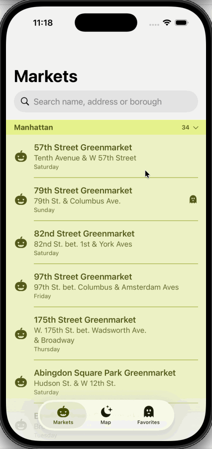

Do you want to eat find fresh from farmers available in your community while walking by New York City? This app allows you to find registered markets.

Locate the markets by name or just tap the Map View. Easy and simple for your convenience.

- Navigate through the city and find Farmer Markets near you using the Map View.
- Use the List view to see all markets per boruogh, search according with your preferences. Map View is updated with your search results.
- Click the desired Farmer Market in the list or pin map to see its details.
- Allow app to use your current location in order to show it in the map view.

***

The information displayed by NY Farmers Markets App comes from New York City Open Data, update frequency is determined by them. It is available for the general public [HERE](https://data.cityofnewyork.us/Health/NYC-Farmers-Markets/8vwk-6iz2/about_data).  NY Farmers Markets App has no direct affiliation with New York City.

By Downloading or Using NY Farmers Markets App you agree with the Terms of Use. You can read the Terms [HERE](https://blog.hacemoscontactos.com/ny-farmers-markets-terms-of-use/)